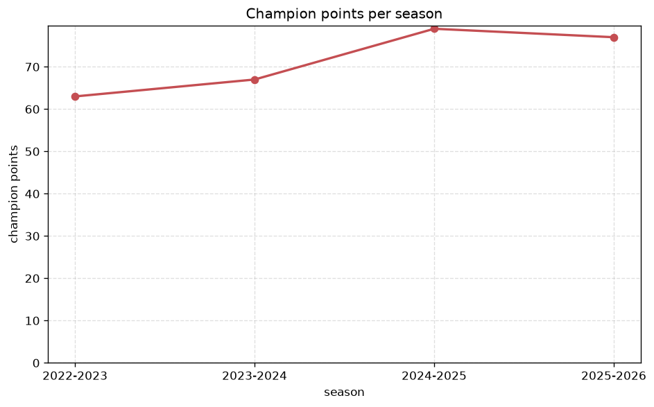
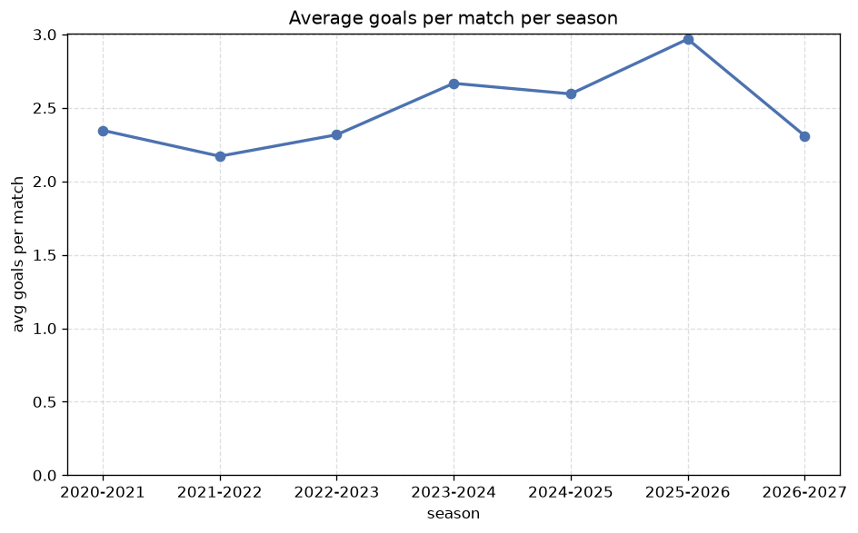

# Season Trends Analysis
- Report: `season_trends`
- Generated: 2026-10-29T02:12:36+00:00
- Script: `backend/scripts/analyze_seasons.py` v1.0.0
- League: Division 1 (Saudi Arabia)
- Scope: league `saudi2`

## 1. Champions per season
| season | champion | pts | runner-up | margin |
|---|---|---|---|---|
| 2020-2021 | - | - | - | - |
| 2021-2022 | - | - | - | - |
| 2022-2023 | Al Hazem | 63 | Al Okhdood | 2 pts |
| 2023-2024 | Al Qadisiya | 67 | Al Kholood | 8 pts |
| 2024-2025 | Neom SC | 79 | Al Najma | 15 pts |
| 2025-2026 | Abha | 77 | Al Diriyah | 2 pts |
| 2026-2027 | - | - | - | - |

## 2. Title-race tightness
- Tight races (margin <= 3 pts): **2** of 4 seasons
- Tightest race: **2022-2023** - Al Hazem beat Al Okhdood by **2** pts

| season | margin | tight |
|---|---|---|
| 2022-2023 | 2 pts | yes |
| 2023-2024 | 8 pts |  |
| 2024-2025 | 15 pts |  |
| 2025-2026 | 2 pts | yes |

## 3. Points thresholds
_Position-specific points per season. Key: 1 = champion, 2 = runner-up, 4 = CL line, 6 = Europa, 15 = last safe, 18 = bottom._

| season | pos 1 | pos 2 | pos 4 | pos 6 | pos 15 | pos 18 |
|---|---|---|---|---|---|---|
| 2020-2021 | - | 81 | 69 | 50 | 34 | 25 |
| 2021-2022 | - | 65 | 55 | 54 | 40 | 23 |
| 2022-2023 | 63 | 61 | - | 42 | 31 | 21 |
| 2023-2024 | 67 | 59 | 58 | 47 | 34 | 21 |
| 2024-2025 | 79 | 64 | 57 | 55 | 29 | 19 |
| 2025-2026 | 77 | 75 | 71 | 59 | 32 | 14 |
| 2026-2027 | - | 15 | 15 | 13 | 7 | 6 |

## 4. Relegation battle
| season | safe pos | safe pts | drop pos | drop pts | gap |
|---|---|---|---|---|---|
| 2020-2021 | 15 | 34 | 16 | 29 | 5 pts |
| 2021-2022 | 15 | 40 | 16 | 40 | 0 pts |
| 2022-2023 | 15 | 31 | 16 | 31 | 0 pts |
| 2023-2024 | 15 | 34 | 16 | 26 | 8 pts |
| 2024-2025 | 15 | 29 | 16 | 21 | 8 pts |
| 2025-2026 | 15 | 32 | 16 | 22 | 10 pts |
| 2026-2027 | 15 | 7 | 16 | 6 | 1 pts |

## 5. League-level trends
| season | matches | total goals | avg goals | home win | draw | away win | goalless | avg pts/team |
|---|---|---|---|---|---|---|---|---|
| 2020-2021 | 380 | 892 | 2.347 | 37.9% | 28.4% | 33.7% | 11.1% | 43.15 |
| 2021-2022 | 380 | 825 | 2.171 | 37.9% | 33.7% | 28.4% | 13.4% | 42.0 |
| 2022-2023 | 306 | 709 | 2.317 | 40.8% | 27.1% | 32.0% | 8.5% | 37.72 |
| 2023-2024 | 306 | 816 | 2.667 | 43.1% | 27.1% | 29.7% | 7.5% | 41.28 |
| 2024-2025 | 306 | 794 | 2.595 | 40.5% | 26.8% | 32.7% | 7.5% | 43.94 |
| 2025-2026 | 309 | 917 | 2.968 | 41.4% | 23.3% | 35.3% | 5.2% | 47.17 |
| 2026-2027 | 71 | 164 | 2.31 | 32.4% | 39.4% | 28.2% | 15.5% | 10.33 |

## 6. View divergence
- Largest divergence: **2021-2022** (luck view, avg abs position diff = 44.100)

_Avg absolute position difference between classic view and alternative view per season._

| season | classic vs luck | classic vs goals |
|---|---|---|
| 2020-2021 | 34.100 | 21.700 |
| 2021-2022 | 44.100 | 30.000 |
| 2022-2023 | 32.111 | 35.444 |
| 2023-2024 | 17.722 | 19.333 |
| 2024-2025 | 9.778 | 8.778 |
| 2025-2026 | 3.333 | 5.444 |
| 2026-2027 | 2.667 | 5.389 |

---
*All statistics are computed from PostgreSQL tables (read-only). Run with `python backend/scripts/analyze_seasons.py` to regenerate.*

## Charts

