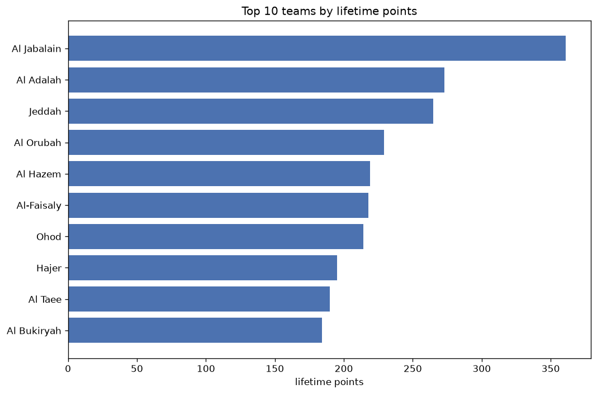
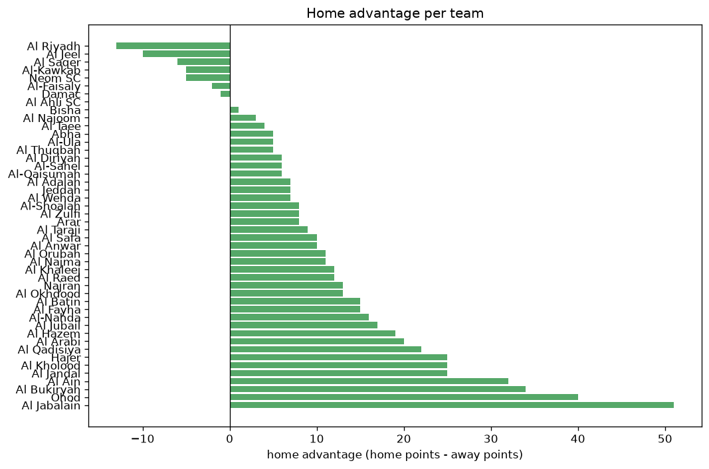

# Team Analysis
- Report: `teams_analysis`
- Generated: 2026-10-30T04:08:55+00:00
- Script: `backend/scripts/analyze_teams.py` v1.0.0
- League: Division 1 (Saudi Arabia)
- Scope: league `saudi2`

- Teams: **46** | Seasons: **7** | Matches: **2061**

## 1. Team standings (lifetime)
| team | seasons | played | W | D | L | pts | GF | GA | GD | avg pts/season | best pos | worst pos | titles |
|---|---|---|---|---|---|---|---|---|---|---|---|---|---|
| Al Jabalain | 7 | 222 | 98 | 67 | 57 | 361 | 298 | 232 | 66 | 51.57 | 2 | 8 | 0 |
| Al Adalah | 6 | 187 | 70 | 63 | 54 | 273 | 253 | 239 | 14 | 45.5 | 3 | 14 | 0 |
| Jeddah | 7 | 221 | 67 | 64 | 90 | 265 | 236 | 289 | -53 | 37.86 | 9 | 14 | 0 |
| Al Orubah | 5 | 148 | 65 | 34 | 49 | 229 | 190 | 163 | 27 | 45.8 | 5 | 16 | 0 |
| Al Hazem | 3 | 106 | 66 | 21 | 19 | 219 | 189 | 99 | 90 | 73.0 | 1 | 4 | 1 |
| Al-Faisaly | 4 | 136 | 61 | 35 | 40 | 218 | 208 | 160 | 48 | 54.5 | 3 | 18 | 0 |
| Ohod | 5 | 178 | 51 | 61 | 66 | 214 | 197 | 228 | -31 | 42.8 | 7 | 16 | 0 |
| Hajer | 5 | 152 | 50 | 45 | 57 | 195 | 167 | 176 | -9 | 39.0 | 5 | 17 | 0 |
| Al Taee | 4 | 115 | 55 | 25 | 35 | 190 | 169 | 141 | 28 | 47.5 | 5 | 9 | 0 |
| Al Bukiryah | 5 | 149 | 50 | 34 | 65 | 184 | 152 | 179 | -27 | 36.8 | 6 | 18 | 0 |
| Al Qadisiya | 3 | 106 | 46 | 30 | 30 | 168 | 133 | 95 | 38 | 56.0 | 1 | 15 | 1 |
| Al Diriyah | 3 | 112 | 47 | 27 | 38 | 168 | 156 | 135 | 21 | 56.0 | 2 | 15 | 0 |
| Al Arabi | 4 | 136 | 45 | 33 | 58 | 168 | 183 | 206 | -23 | 42.0 | 3 | 17 | 0 |
| Al Ain | 4 | 140 | 38 | 48 | 54 | 162 | 142 | 180 | -38 | 40.5 | 11 | 15 | 0 |
| Al Kholood | 3 | 106 | 44 | 27 | 35 | 159 | 128 | 97 | 31 | 53.0 | 2 | 12 | 0 |
| Najran | 3 | 110 | 32 | 35 | 43 | 131 | 117 | 134 | -17 | 43.67 | 10 | 14 | 0 |
| Al Najma | 3 | 77 | 36 | 19 | 22 | 127 | 123 | 93 | 30 | 42.33 | 2 | 11 | 0 |
| Al-Sahel | 3 | 110 | 30 | 36 | 44 | 126 | 120 | 142 | -22 | 42.0 | 17 | 18 | 0 |
| Abha | 2 | 68 | 36 | 17 | 15 | 125 | 110 | 83 | 27 | 62.5 | 1 | 8 | 1 |
| Al Okhdood | 3 | 79 | 34 | 21 | 24 | 123 | 116 | 90 | 26 | 41.0 | 2 | 15 | 0 |
| Al Wehda | 3 | 81 | 32 | 27 | 22 | 123 | 121 | 97 | 24 | 41.0 | 4 | 10 | 0 |
| Al-Shoalah | 3 | 110 | 28 | 38 | 44 | 122 | 100 | 113 | -13 | 40.67 | 16 | 19 | 0 |
| Al Khaleej | 2 | 76 | 31 | 25 | 20 | 118 | 93 | 83 | 10 | 59.0 | 2 | 8 | 0 |
| Al Batin | 3 | 102 | 30 | 25 | 47 | 115 | 124 | 166 | -42 | 38.33 | 6 | 16 | 0 |
| Al Jandal | 4 | 110 | 30 | 25 | 55 | 115 | 113 | 165 | -52 | 28.75 | 9 | 16 | 0 |
| Al Zulfi | 3 | 76 | 24 | 30 | 22 | 102 | 91 | 84 | 7 | 34.0 | 7 | 10 | 0 |
| Al Jeel | 3 | 83 | 23 | 27 | 33 | 96 | 75 | 110 | -35 | 32.0 | 12 | 19 | 0 |
| Al-Ula | 2 | 41 | 27 | 8 | 6 | 89 | 85 | 37 | 48 | 44.5 | 4 | 4 | 0 |
| Al Fayha | 1 | 38 | 24 | 9 | 5 | 81 | 72 | 27 | 45 | 81.0 | 3 | 3 | 0 |
| Al-Nahda | 2 | 76 | 17 | 29 | 30 | 80 | 74 | 97 | -23 | 40.0 | 20 | 21 | 0 |
| Neom SC | 1 | 34 | 24 | 7 | 3 | 79 | 80 | 27 | 53 | 79.0 | 1 | 1 | 1 |
| Al-Kawkab | 2 | 76 | 17 | 28 | 31 | 79 | 77 | 102 | -25 | 39.5 | 17 | 19 | 0 |
| Al Ahli SC | 1 | 34 | 21 | 9 | 4 | 72 | 48 | 24 | 24 | 72.0 | 3 | 3 | 0 |
| Al-Qaisumah | 2 | 68 | 15 | 23 | 30 | 68 | 78 | 105 | -27 | 34.0 | 17 | 19 | 0 |
| Al Safa | 2 | 68 | 18 | 14 | 36 | 68 | 82 | 122 | -40 | 34.0 | 10 | 17 | 0 |
| Al Riyadh | 1 | 34 | 19 | 6 | 9 | 63 | 52 | 37 | 15 | 63.0 | 5 | 5 | 0 |
| Al Raed | 2 | 43 | 17 | 11 | 15 | 62 | 72 | 59 | 13 | 31.0 | 7 | 12 | 0 |
| Al Jubail | 2 | 68 | 12 | 17 | 39 | 53 | 62 | 117 | -55 | 26.5 | 11 | 18 | 0 |
| Al Anwar | 2 | 42 | 12 | 16 | 14 | 52 | 60 | 59 | 1 | 26.0 | 10 | 12 | 0 |
| Al Thuqbah | 1 | 38 | 10 | 7 | 21 | 37 | 45 | 60 | -15 | 37.0 | 15 | 15 | 0 |
| Arar | 1 | 38 | 4 | 14 | 20 | 26 | 28 | 62 | -34 | 26.0 | 21 | 21 | 0 |
| Bisha | 1 | 38 | 5 | 10 | 23 | 25 | 27 | 57 | -30 | 25.0 | 20 | 20 | 0 |
| Al Najoom | 1 | 38 | 6 | 5 | 27 | 23 | 27 | 67 | -40 | 23.0 | 19 | 19 | 0 |
| Al Taraji | 1 | 34 | 4 | 9 | 21 | 21 | 28 | 66 | -38 | 21.0 | 18 | 18 | 0 |
| Damac | 1 | 9 | 4 | 3 | 2 | 15 | 13 | 10 | 3 | 15.0 | 6 | 6 | 0 |
| Al Saqer | 1 | 9 | 2 | 4 | 3 | 10 | 8 | 8 | 0 | 10.0 | 11 | 11 | 0 |

## 2. Home vs away split
| team | home P | H-W | H-D | H-L | H-pts | away P | A-W | A-D | A-L | A-pts | adv |
|---|---|---|---|---|---|---|---|---|---|---|---|
| Al Jabalain | 110 | 59 | 29 | 22 | 206 | 112 | 39 | 38 | 35 | 155 | 51 |
| Ohod | 89 | 32 | 31 | 26 | 127 | 89 | 19 | 30 | 40 | 87 | 40 |
| Al Bukiryah | 76 | 30 | 19 | 27 | 109 | 73 | 20 | 15 | 38 | 75 | 34 |
| Al Ain | 70 | 24 | 25 | 21 | 97 | 70 | 14 | 23 | 33 | 65 | 32 |
| Hajer | 76 | 29 | 23 | 24 | 110 | 76 | 21 | 22 | 33 | 85 | 25 |
| Al Kholood | 53 | 25 | 17 | 11 | 92 | 53 | 19 | 10 | 24 | 67 | 25 |
| Al Jandal | 56 | 19 | 13 | 24 | 70 | 54 | 11 | 12 | 31 | 45 | 25 |
| Al Qadisiya | 53 | 26 | 17 | 10 | 95 | 53 | 20 | 13 | 20 | 73 | 22 |
| Al Arabi | 68 | 27 | 13 | 28 | 94 | 68 | 18 | 20 | 30 | 74 | 20 |
| Al Hazem | 53 | 36 | 11 | 6 | 119 | 53 | 30 | 10 | 13 | 100 | 19 |
| Al Jubail | 34 | 8 | 11 | 15 | 35 | 34 | 4 | 6 | 24 | 18 | 17 |
| Al-Nahda | 38 | 11 | 15 | 12 | 48 | 38 | 6 | 14 | 18 | 32 | 16 |
| Al Batin | 51 | 18 | 11 | 22 | 65 | 51 | 12 | 14 | 25 | 50 | 15 |
| Al Fayha | 19 | 15 | 3 | 1 | 48 | 19 | 9 | 6 | 4 | 33 | 15 |
| Najran | 55 | 19 | 15 | 21 | 72 | 55 | 13 | 20 | 22 | 59 | 13 |
| Al Okhdood | 38 | 20 | 8 | 10 | 68 | 41 | 14 | 13 | 14 | 55 | 13 |
| Al Khaleej | 38 | 18 | 11 | 9 | 65 | 38 | 13 | 14 | 11 | 53 | 12 |
| Al Raed | 21 | 11 | 4 | 6 | 37 | 22 | 6 | 7 | 9 | 25 | 12 |
| Al Orubah | 74 | 33 | 21 | 20 | 120 | 74 | 32 | 13 | 29 | 109 | 11 |
| Al Najma | 39 | 20 | 9 | 10 | 69 | 38 | 16 | 10 | 12 | 58 | 11 |
| Al Safa | 34 | 11 | 6 | 17 | 39 | 34 | 7 | 8 | 19 | 29 | 10 |
| Al Anwar | 21 | 9 | 4 | 8 | 31 | 21 | 3 | 12 | 6 | 21 | 10 |
| Al Taraji | 17 | 3 | 6 | 8 | 15 | 17 | 1 | 3 | 13 | 6 | 9 |
| Al-Shoalah | 55 | 16 | 17 | 22 | 65 | 55 | 12 | 21 | 22 | 57 | 8 |
| Al Zulfi | 37 | 14 | 13 | 10 | 55 | 39 | 10 | 17 | 12 | 47 | 8 |
| Arar | 19 | 3 | 8 | 8 | 17 | 19 | 1 | 6 | 12 | 9 | 8 |
| Al Adalah | 94 | 36 | 32 | 26 | 140 | 93 | 34 | 31 | 28 | 133 | 7 |
| Jeddah | 110 | 32 | 40 | 38 | 136 | 111 | 35 | 24 | 52 | 129 | 7 |
| Al Wehda | 41 | 17 | 14 | 10 | 65 | 40 | 15 | 13 | 12 | 58 | 7 |
| Al Diriyah | 57 | 25 | 12 | 20 | 87 | 55 | 22 | 15 | 18 | 81 | 6 |
| Al-Sahel | 55 | 16 | 18 | 21 | 66 | 55 | 14 | 18 | 23 | 60 | 6 |
| Al-Qaisumah | 34 | 8 | 13 | 13 | 37 | 34 | 7 | 10 | 17 | 31 | 6 |
| Abha | 34 | 18 | 11 | 5 | 65 | 34 | 18 | 6 | 10 | 60 | 5 |
| Al-Ula | 21 | 14 | 5 | 2 | 47 | 20 | 13 | 3 | 4 | 42 | 5 |
| Al Thuqbah | 19 | 6 | 3 | 10 | 21 | 19 | 4 | 4 | 11 | 16 | 5 |
| Al Taee | 58 | 28 | 13 | 17 | 97 | 57 | 27 | 12 | 18 | 93 | 4 |
| Al Najoom | 19 | 3 | 4 | 12 | 13 | 19 | 3 | 1 | 15 | 10 | 3 |
| Bisha | 19 | 2 | 7 | 10 | 13 | 19 | 3 | 3 | 13 | 12 | 1 |
| Al Ahli SC | 17 | 11 | 3 | 3 | 36 | 17 | 10 | 6 | 1 | 36 | 0 |
| Damac | 4 | 2 | 1 | 1 | 7 | 5 | 2 | 2 | 1 | 8 | -1 |
| Al-Faisaly | 68 | 31 | 15 | 22 | 108 | 68 | 30 | 20 | 18 | 110 | -2 |
| Al-Kawkab | 38 | 9 | 10 | 19 | 37 | 38 | 8 | 18 | 12 | 42 | -5 |
| Neom SC | 17 | 10 | 7 | 0 | 37 | 17 | 14 | 0 | 3 | 42 | -5 |
| Al Saqer | 4 | 0 | 2 | 2 | 2 | 5 | 2 | 2 | 1 | 8 | -6 |
| Al Jeel | 41 | 11 | 10 | 20 | 43 | 42 | 12 | 17 | 13 | 53 | -10 |
| Al Riyadh | 17 | 7 | 4 | 6 | 25 | 17 | 12 | 2 | 3 | 38 | -13 |

## 3. Top performers
### Best points per game (PPG)
| rank | team | PPG |
|---|---|---|
| 1 | Neom SC | 2.32 |
| 2 | Al-Ula | 2.17 |
| 3 | Al Fayha | 2.13 |
| 4 | Al Ahli SC | 2.12 |
| 5 | Al Hazem | 2.07 |

### Most goals scored
| rank | team | goals |
|---|---|---|
| 1 | Al Jabalain | 298 |
| 2 | Al Adalah | 253 |
| 3 | Jeddah | 236 |
| 4 | Al-Faisaly | 208 |
| 5 | Ohod | 197 |

### Best goal difference
| rank | team | GD |
|---|---|---|
| 1 | Al Hazem | 90 |
| 2 | Al Jabalain | 66 |
| 3 | Neom SC | 53 |
| 4 | Al-Faisaly | 48 |
| 5 | Al-Ula | 48 |

### Best defence (goals against per match, standings)
| rank | team | GA/match |
|---|---|---|
| 1 | Al Fayha | 0.647 |
| 2 | Neom SC | 0.727 |
| 3 | Al Ahli SC | 0.733 |
| 4 | Al-Ula | 0.872 |
| 5 | Al Kholood | 0.885 |

## 4. Team consistency
- Teams present in all **7** seasons: **2**

Al Jabalain, Jeddah

## 5. Head-to-head dominance
- Distinct fixtures: **636** (showing the 15 most frequent)

| fixture | meetings | home wins | draws | away wins | home pct | draw pct | away pct |
|---|---|---|---|---|---|---|---|
| Al Jabalain vs Jeddah | 13 | 6 | 3 | 4 | 46.2% | 23.1% | 30.8% |
| Al Jabalain vs Ohod | 10 | 4 | 5 | 1 | 40.0% | 50.0% | 10.0% |
| Al Adalah vs Al Jabalain | 10 | 3 | 1 | 6 | 30.0% | 10.0% | 60.0% |
| Al Adalah vs Jeddah | 10 | 3 | 4 | 3 | 30.0% | 40.0% | 30.0% |
| Ohod vs Jeddah | 10 | 3 | 4 | 3 | 30.0% | 40.0% | 30.0% |
| Al Jabalain vs Hajer | 9 | 4 | 1 | 4 | 44.4% | 11.1% | 44.4% |
| Al Orubah vs Al Jabalain | 9 | 4 | 2 | 3 | 44.4% | 22.2% | 33.3% |
| Al Orubah vs Jeddah | 9 | 4 | 1 | 4 | 44.4% | 11.1% | 44.4% |
| Hajer vs Jeddah | 9 | 4 | 2 | 3 | 44.4% | 22.2% | 33.3% |
| Al Adalah vs Al Bukiryah | 9 | 3 | 3 | 3 | 33.3% | 33.3% | 33.3% |
| Al Ain vs Jeddah | 8 | 5 | 3 | 0 | 62.5% | 37.5% | 0.0% |
| Al Jabalain vs Al Bukiryah | 8 | 5 | 0 | 3 | 62.5% | 0.0% | 37.5% |
| Al Ain vs Al Jabalain | 8 | 4 | 2 | 2 | 50.0% | 25.0% | 25.0% |
| Al-Faisaly vs Al Jabalain | 8 | 4 | 1 | 3 | 50.0% | 12.5% | 37.5% |
| Hajer vs Ohod | 8 | 4 | 2 | 2 | 50.0% | 25.0% | 25.0% |

## 6. Position per season (classic view)
_Cells show final position; '-' when the team was absent from that season._

| team | 2020-2021 | 2021-2022 | 2022-2023 | 2023-2024 | 2024-2025 | 2025-2026 | 2026-2027 |
|---|---|---|---|---|---|---|---|
| Al Jabalain | 4 | 6 | 8 | 7 | 5 | 6 | 2 |
| Al Adalah | 11 | 3 | - | 4 | 3 | 14 | 9 |
| Jeddah | 10 | 13 | 13 | 14 | 9 | 13 | 14 |
| Al Orubah | - | 11 | 16 | 5 | - | 5 | 13 |
| Al Hazem | 2 | - | 1 | - | 4 | - | - |
| Al-Faisaly | - | - | 10 | 16 | 18 | 3 | - |
| Ohod | 7 | 7 | 7 | 15 | 16 | - | - |
| Hajer | 6 | 5 | 9 | 17 | - | - | 17 |
| Al Taee | 5 | - | - | - | 7 | 9 | 8 |
| Al Bukiryah | 13 | - | - | 13 | 6 | 11 | 18 |
| Al Qadisiya | - | 9 | 15 | 1 | - | - | - |
| Al Diriyah | 9 | 15 | - | - | - | 2 | - |
| Al Arabi | - | - | 6 | 3 | 13 | 17 | - |
| Al Ain | - | 12 | 11 | 12 | 15 | - | - |
| Al Kholood | - | 8 | 12 | 2 | - | - | - |
| Najran | 14 | 10 | 14 | - | - | - | - |
| Al Najma | - | - | - | 11 | 2 | - | 3 |
| Al-Sahel | 18 | 17 | 18 | - | - | - | - |
| Abha | - | - | - | - | 8 | 1 | - |
| Al Okhdood | - | 14 | 2 | - | - | - | 15 |
| Al Wehda | - | 4 | - | - | - | 10 | 5 |
| Al-Shoalah | 16 | 18 | 19 | - | - | - | - |
| Al Khaleej | 8 | 2 | - | - | - | - | - |
| Al Batin | - | - | - | 6 | 12 | 16 | - |
| Al Jandal | - | - | - | 9 | 14 | 15 | 16 |
| Al Zulfi | - | - | - | - | 10 | 8 | 7 |
| Al Jeel | 12 | 16 | - | - | - | - | 19 |
| Al-Ula | - | - | - | - | - | 4 | 4 |
| Al Fayha | 3 | - | - | - | - | - | - |
| Al-Nahda | 20 | 21 | - | - | - | - | - |
| Neom SC | - | - | - | - | 1 | - | - |
| Al-Kawkab | 17 | 19 | - | - | - | - | - |
| Al Ahli SC | - | - | 3 | - | - | - | - |
| Al-Qaisumah | - | - | 17 | 19 | - | - | - |
| Al Safa | - | - | - | 10 | 17 | - | - |
| Al Riyadh | - | - | 5 | - | - | - | - |
| Al Raed | - | - | - | - | - | 7 | 12 |
| Al Jubail | - | - | - | - | 11 | 18 | - |
| Al Anwar | - | - | - | - | - | 12 | 10 |
| Al Thuqbah | 15 | - | - | - | - | - | - |
| Arar | 21 | - | - | - | - | - | - |
| Bisha | - | 20 | - | - | - | - | - |
| Al Najoom | 19 | - | - | - | - | - | - |
| Al Taraji | - | - | - | 18 | - | - | - |
| Damac | - | - | - | - | - | - | 6 |
| Al Saqer | - | - | - | - | - | - | 11 |

---
*All statistics are computed from PostgreSQL tables (read-only). Run with `python backend/scripts/analyze_teams.py` to regenerate.*

## Charts

