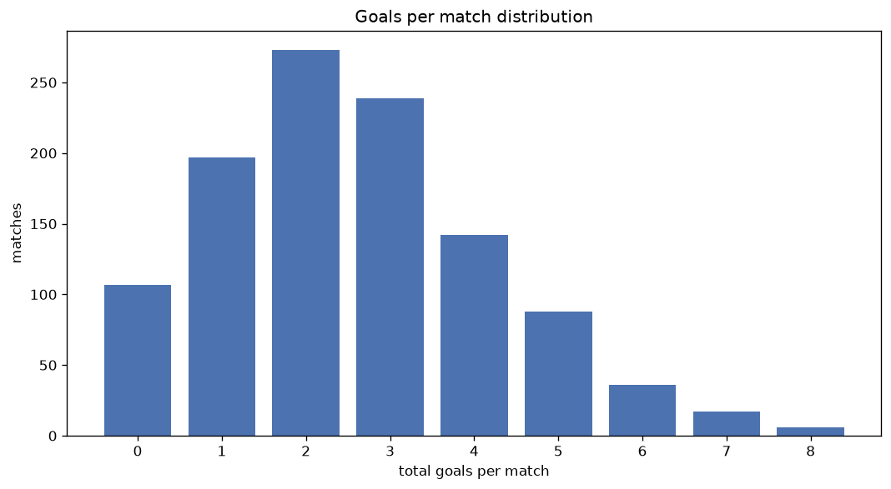
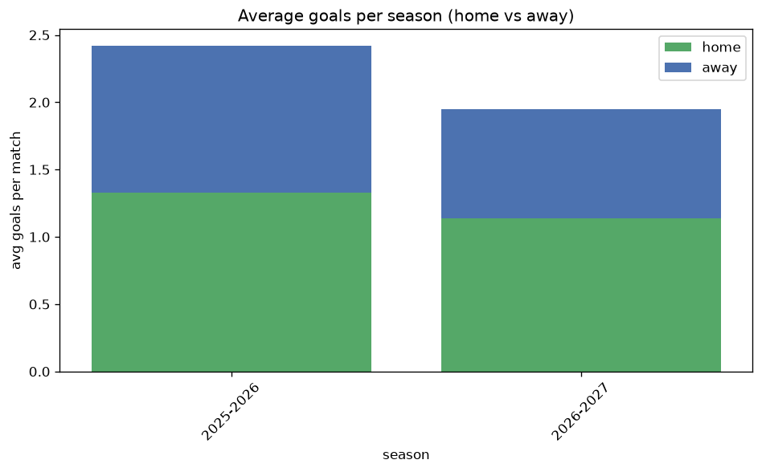

# Goal Analysis
- Report: `goals_analysis`
- Generated: 2026-10-27T02:28:01+00:00
- Script: `backend/scripts/analyze_goals.py` v1.0.0
- League: Championship (Scotland)
- Scope: league `scot-champ`

## 1. Goals per match distribution
| goals | matches | pct |
|---|---|---|
| 0 | 107 | 9.7% |
| 1 | 197 | 17.8% |
| 2 | 273 | 24.7% |
| 3 | 239 | 21.6% |
| 4 | 142 | 12.9% |
| 5 | 88 | 8.0% |
| 6 | 36 | 3.3% |
| 7 | 17 | 1.5% |
| 8 | 6 | 0.5% |

## 2. Goals per match per season
| season | matches | total goals | avg home | avg away | avg total |
|---|---|---|---|---|---|
| 2020-2021 | 135 | 380 | 1.548 | 1.267 | 2.815 |
| 2021-2022 | 180 | 432 | 1.25 | 1.15 | 2.4 |
| 2022-2023 | 180 | 504 | 1.55 | 1.25 | 2.8 |
| 2023-2024 | 180 | 503 | 1.433 | 1.361 | 2.794 |
| 2024-2025 | 180 | 452 | 1.428 | 1.083 | 2.511 |
| 2025-2026 | 190 | 460 | 1.326 | 1.095 | 2.421 |
| 2026-2027 | 60 | 120 | 1.167 | 0.833 | 2.0 |

## 3. Home vs away goal share
- Home goals: **1550** (54.4%)
- Away goals: **1301** (45.6%)
- Home/away ratio: **1.191**

| season | home goals | away goals | total | home pct | away pct |
|---|---|---|---|---|---|
| 2020-2021 | 209 | 171 | 380 | 55.0% | 45.0% |
| 2021-2022 | 225 | 207 | 432 | 52.1% | 47.9% |
| 2022-2023 | 279 | 225 | 504 | 55.4% | 44.6% |
| 2023-2024 | 258 | 245 | 503 | 51.3% | 48.7% |
| 2024-2025 | 257 | 195 | 452 | 56.9% | 43.1% |
| 2025-2026 | 252 | 208 | 460 | 54.8% | 45.2% |
| 2026-2027 | 70 | 50 | 120 | 58.3% | 41.7% |

## 4. BTTS (Both Teams To Score)
- Overall: **545** of `1105` (49.3%)

| season | matches | BTTS | pct |
|---|---|---|---|
| 2020-2021 | 135 | 76 | 56.3% |
| 2021-2022 | 180 | 82 | 45.6% |
| 2022-2023 | 180 | 96 | 53.3% |
| 2023-2024 | 180 | 99 | 55.0% |
| 2024-2025 | 180 | 77 | 42.8% |
| 2025-2026 | 190 | 93 | 48.9% |
| 2026-2027 | 60 | 22 | 36.7% |

## 5. Clean sheets
- Home clean sheets: **363** (32.9%)
- Away clean sheets: **304** (27.5%)
- Total clean sheets recorded: **667**
- Matches with at least one clean sheet: **560** (50.7%)
- Both teams kept clean sheets (0-0): **107**

| season | matches | home CS | away CS | total CS | matches w/ CS |
|---|---|---|---|---|---|
| 2020-2021 | 135 | 37 | 35 | 72 | 59 (43.7%) |
| 2021-2022 | 180 | 59 | 57 | 116 | 98 (54.4%) |
| 2022-2023 | 180 | 57 | 41 | 98 | 84 (46.7%) |
| 2023-2024 | 180 | 50 | 48 | 98 | 81 (45.0%) |
| 2024-2025 | 180 | 70 | 48 | 118 | 103 (57.2%) |
| 2025-2026 | 190 | 63 | 59 | 122 | 97 (51.1%) |
| 2026-2027 | 60 | 27 | 16 | 43 | 38 (63.3%) |

## 6. Scoring intensity
- First-half goals: **1290** (45.2%)
- Second-half goals: **1561** (54.8%)
- Avg first-half goals per match: **1.167**
- Avg second-half goals per match: **1.413**
- Second-half-only scoring (HT 0-0, FT goals >= 1): **235** (21.3%)

| season | matches | 1st half | 2nd half | 1st half pct | 2nd half pct |
|---|---|---|---|---|---|
| 2020-2021 | 135 | 161 | 219 | 42.4% | 57.6% |
| 2021-2022 | 180 | 190 | 242 | 44.0% | 56.0% |
| 2022-2023 | 180 | 215 | 289 | 42.7% | 57.3% |
| 2023-2024 | 180 | 221 | 282 | 43.9% | 56.1% |
| 2024-2025 | 180 | 220 | 232 | 48.7% | 51.3% |
| 2025-2026 | 190 | 215 | 245 | 46.7% | 53.3% |
| 2026-2027 | 60 | 68 | 52 | 56.7% | 43.3% |

## 7. First-goal timing
- Matches with first-goal time recorded: `998` of `1105` (90.3%)
- Goalless matches: `107`
- Min `1` | Max `96` | Mean `30.47` | Median (p50) `25.0`

| bucket | count | % of matches | % of scoring matches |
|---|---|---|---|
| 1-15 | 328 | 29.7% | 32.9% |
| 16-30 | 245 | 22.2% | 24.5% |
| 31-45 | 177 | 16.0% | 17.7% |
| 46-60 | 130 | 11.8% | 13.0% |
| 61-75 | 65 | 5.9% | 6.5% |
| 76-90 | 46 | 4.2% | 4.6% |
| 91-120 | 7 | 0.6% | 0.7% |

---
*All statistics are computed from PostgreSQL tables (read-only). Run with `python backend/scripts/analyze_goals.py` to regenerate.*

## Charts

