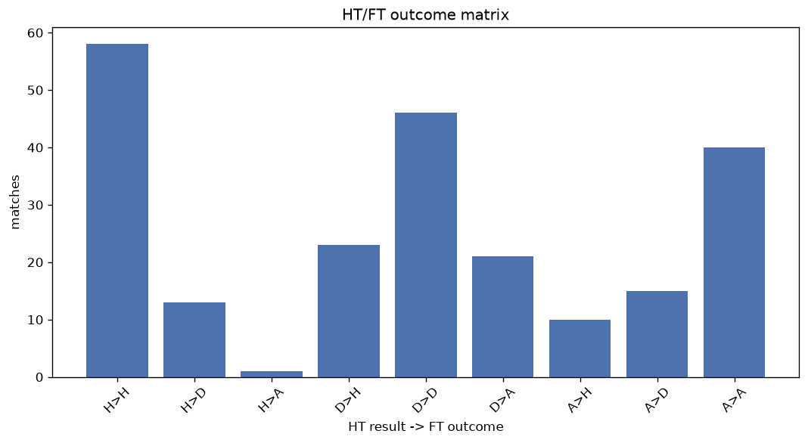
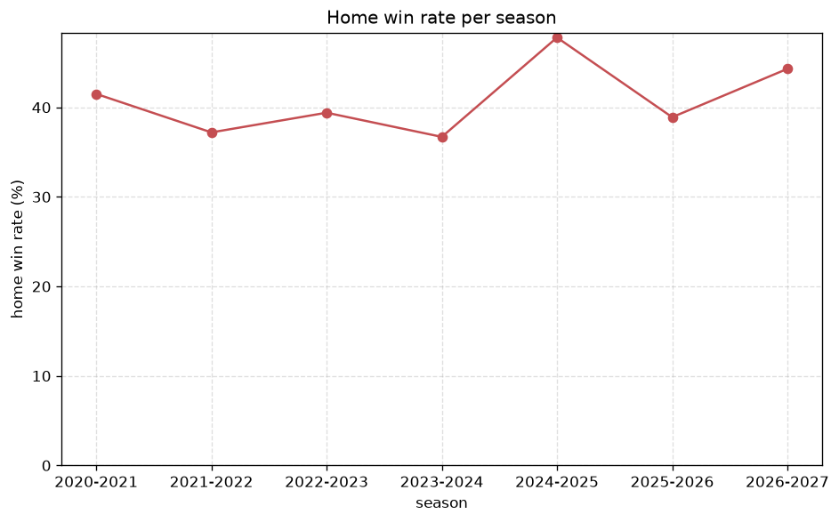

# Match Analysis
- Report: `matches_analysis`
- Generated: 2026-10-30T04:09:19+00:00
- Script: `backend/scripts/analyze_matches.py` v1.0.0
- League: Championship (Scotland)
- Scope: league `scot-champ`

## 1. Overall summary
| metric | value |
|---|---|
| Matches | 1106 |
| Home wins | 447 (40.4%) |
| Draws | 322 (29.1%) |
| Away wins | 337 (30.5%) |
| Total goals | 2852 |
| Average goals per match | 2.579 |
| Goalless matches | 107 (9.7%) |

## 2. Per-season breakdown
| season | matches | home wins | draws | away wins | total goals | avg goals | goalless |
|---|---|---|---|---|---|---|---|
| 2020-2021 | 135 | 56 (41.5%) | 43 (31.9%) | 36 (26.7%) | 380 | 2.815 | 13 (9.6%) |
| 2021-2022 | 180 | 67 (37.2%) | 58 (32.2%) | 55 (30.6%) | 432 | 2.4 | 18 (10.0%) |
| 2022-2023 | 180 | 71 (39.4%) | 53 (29.4%) | 56 (31.1%) | 504 | 2.8 | 14 (7.8%) |
| 2023-2024 | 180 | 66 (36.7%) | 47 (26.1%) | 67 (37.2%) | 503 | 2.794 | 17 (9.4%) |
| 2024-2025 | 180 | 86 (47.8%) | 43 (23.9%) | 51 (28.3%) | 452 | 2.511 | 15 (8.3%) |
| 2025-2026 | 190 | 74 (38.9%) | 64 (33.7%) | 52 (27.4%) | 460 | 2.421 | 25 (13.2%) |
| 2026-2027 | 61 | 27 (44.3%) | 14 (23.0%) | 20 (32.8%) | 121 | 1.984 | 5 (8.2%) |

## 3. HT/FT outcome matrix
| HT result \ FT result | Home | Draw | Away | total |
|---|---|---|---|---|
| HT home lead | 268 (75.3%) | 74 (20.8%) | 14 (3.9%) | 356 |
| HT draw | 148 (33.0%) | 191 (42.5%) | 110 (24.5%) | 449 |
| HT away lead | 31 (10.3%) | 57 (18.9%) | 213 (70.8%) | 301 |

## 4. Comeback matches
- Home comebacks (trailing at HT, won at FT): **31** (2.8%)
- Away comebacks (trailing at HT, won at FT): **14** (1.3%)

### Home comebacks
| season | home | away | HT | FT |
|---|---|---|---|---|
| 2020-2021 | Morton | Ayr | 0-1 | 3-2 |
| 2020-2021 | Inverness | Arbroath | 0-1 | 3-1 |
| 2020-2021 | Alloa | Inverness | 0-1 | 2-1 |
| 2020-2021 | Dundee FC | Alloa | 0-1 | 3-1 |
| 2020-2021 | Raith | Alloa | 0-1 | 3-1 |
| 2020-2021 | Dundee FC | Dunfermline | 1-2 | 3-2 |
| 2021-2022 | Inverness | Partick Thistle | 0-1 | 3-1 |
| 2021-2022 | Morton | Partick Thistle | 0-1 | 2-1 |
| 2021-2022 | Dunfermline | Ayr | 0-1 | 2-1 |
| 2021-2022 | Kilmarnock | Arbroath | 0-1 | 2-1 |
| 2022-2023 | Queen's Park | Inverness | 0-1 | 2-1 |
| 2022-2023 | Morton | Cove Rangers | 0-1 | 2-1 |
| 2022-2023 | Queen's Park | Inverness | 0-1 | 2-1 |
| 2023-2024 | Airdrieonians | Partick Thistle | 0-1 | 2-1 |
| 2023-2024 | Arbroath | Raith | 0-1 | 3-2 |
| 2023-2024 | Ayr | Airdrieonians | 0-1 | 2-1 |
| 2024-2025 | Ayr | Hamilton | 1-2 | 3-2 |
| 2024-2025 | Livingston | Raith | 0-1 | 2-1 |
| 2024-2025 | Dunfermline | Raith | 0-1 | 3-1 |
| 2024-2025 | Dunfermline | Morton | 0-1 | 2-1 |
| 2024-2025 | Morton | Ayr | 0-1 | 2-1 |
| 2025-2026 | Partick Thistle | Airdrieonians | 0-1 | 2-1 |
| 2025-2026 | St Johnstone | Dunfermline | 0-1 | 2-1 |
| 2025-2026 | Arbroath | St Johnstone | 0-1 | 3-1 |
| 2025-2026 | Partick Thistle | Ayr | 0-1 | 2-1 |
| 2025-2026 | Partick Thistle | Morton | 0-2 | 3-2 |
| 2025-2026 | Dunfermline | Morton | 0-1 | 3-1 |
| 2025-2026 | Raith | Morton | 0-1 | 3-2 |
| 2025-2026 | Airdrieonians | Ayr | 0-1 | 2-1 |
| 2025-2026 | Raith | Ross County | 0-1 | 3-2 |
| 2025-2026 | Partick Thistle | Dunfermline | 0-1 | 2-1 |

### Away comebacks
| season | home | away | HT | FT |
|---|---|---|---|---|
| 2020-2021 | Alloa | Raith | 1-0 | 1-2 |
| 2021-2022 | Inverness | Dunfermline | 1-0 | 1-2 |
| 2021-2022 | Raith | Arbroath | 1-0 | 1-2 |
| 2021-2022 | Raith | Inverness | 2-1 | 2-3 |
| 2021-2022 | Dunfermline | Queen of South | 1-0 | 1-2 |
| 2022-2023 | Queen's Park | Ayr | 2-0 | 2-3 |
| 2022-2023 | Partick Thistle | Dundee FC | 2-0 | 2-3 |
| 2022-2023 | Morton | Arbroath | 1-0 | 1-2 |
| 2022-2023 | Arbroath | Raith | 1-0 | 1-2 |
| 2023-2024 | Queen's Park | Airdrieonians | 1-0 | 1-2 |
| 2023-2024 | Ayr | Dundee Utd | 1-0 | 1-2 |
| 2024-2025 | Queen's Park | Morton | 1-0 | 1-2 |
| 2024-2025 | Falkirk | Raith | 1-0 | 1-3 |
| 2025-2026 | Ayr | St Johnstone | 2-0 | 2-4 |

## 5. HT lead conversion
| HT state | matches | converted to win | held as draw | collapsed to loss |
|---|---|---|---|---|
| Home lead | 356 | 268 (75.3%) | 74 (20.8%) | 14 (3.9%) |
| Away lead | 301 | 213 (70.8%) | 57 (18.9%) | 31 (10.3%) |

### Matches level at half-time
| FT result | count | pct |
|---|---|---|
| Home win | 148 | 33.0% |
| Draw | 191 | 42.5% |
| Away win | 110 | 24.5% |

## 6. First-goal timing
- Matches with a first-goal time recorded: `999` of `1106` (90.3%)

Outcome distribution by first-goal timing bucket:
| bucket | matches | % of matches | home | draw | away |
|---|---|---|---|---|---|
| 1-15 | 328 | 29.7% | 164 (50.0%) | 62 (18.9%) | 102 (31.1%) |
| 16-30 | 245 | 22.2% | 101 (41.2%) | 64 (26.1%) | 80 (32.7%) |
| 31-45 | 177 | 16.0% | 69 (39.0%) | 42 (23.7%) | 66 (37.3%) |
| 46-60 | 130 | 11.8% | 60 (46.2%) | 32 (24.6%) | 38 (29.2%) |
| 61-75 | 65 | 5.9% | 27 (41.5%) | 11 (16.9%) | 27 (41.5%) |
| 76-90 | 47 | 4.2% | 21 (44.7%) | 4 (8.5%) | 22 (46.8%) |
| 91-120 | 7 | 0.6% | 5 (71.4%) | 0 (0.0%) | 2 (28.6%) |

## 7. Goalless matches
- Overall: **107** of `1106` (9.7%)

| season | matches | goalless | pct |
|---|---|---|---|
| 2020-2021 | 135 | 13 | 9.6% |
| 2021-2022 | 180 | 18 | 10.0% |
| 2022-2023 | 180 | 14 | 7.8% |
| 2023-2024 | 180 | 17 | 9.4% |
| 2024-2025 | 180 | 15 | 8.3% |
| 2025-2026 | 190 | 25 | 13.2% |
| 2026-2027 | 61 | 5 | 8.2% |

---
*All statistics are computed from PostgreSQL tables (read-only). Run with `python backend/scripts/analyze_matches.py` to regenerate.*

## Charts

