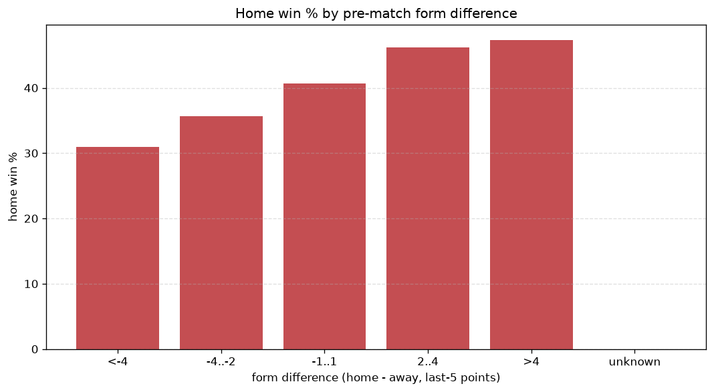
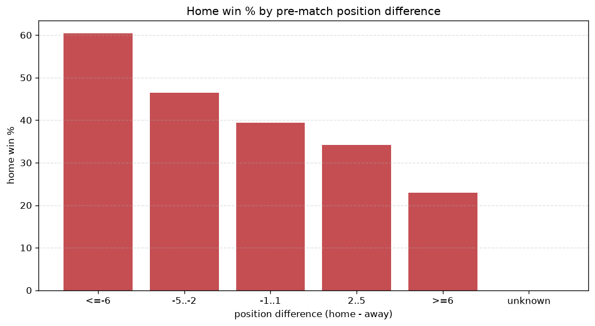

# Relationships Analysis
- Report: `relationships`
- Generated: 2026-10-27T02:28:08+00:00
- Script: `backend/scripts/analyze_relationships.py` v1.0.0
- League: Championship (Scotland)
- Scope: league `scot-champ`

- Matches analysed: **1045** (23 leakage-safe pre-match features).

## 1. Correlation matrix
_Pearson correlation of each pre-match feature with observed goals; sorted by |corr(total goals)|._

| feature | corr(home) | corr(away) | corr(total) |
|---|---|---|---|
| home_position_before_match | -0.197 | 0.109 | -0.075 |
| position_difference | -0.227 | 0.143 | -0.075 |
| points_difference | 0.226 | -0.158 | 0.064 |
| away_points_before_match | -0.091 | 0.016 | -0.059 |
| home_team_home_goals_avg | 0.127 | -0.065 | 0.052 |
| away_team_wins_last_5 | -0.097 | 0.032 | -0.052 |
| away_team_away_conceded_avg | 0.066 | 0.000 | 0.050 |
| away_team_points_last_5 | -0.108 | 0.048 | -0.050 |
| rest_days_difference | -0.030 | -0.034 | -0.046 |
| away_team_away_win_rate | -0.101 | 0.049 | -0.044 |
| away_team_goals_conceded_last_5 | 0.078 | -0.037 | 0.034 |
| home_team_home_win_rate | 0.092 | -0.055 | 0.032 |
| away_position_before_match | 0.124 | -0.093 | 0.031 |
| away_team_goals_scored_last_5 | -0.089 | 0.060 | -0.027 |
| away_rest_days | 0.009 | 0.023 | 0.022 |
| home_rest_days | -0.021 | -0.009 | -0.022 |
| home_team_goals_conceded_last_5 | -0.087 | 0.070 | -0.018 |
| home_team_wins_last_5 | 0.065 | -0.053 | 0.013 |
| home_points_before_match | 0.073 | -0.099 | -0.012 |
| home_team_goals_scored_last_5 | 0.043 | -0.037 | 0.008 |
| home_team_home_conceded_avg | -0.044 | 0.059 | 0.007 |
| away_team_away_goals_avg | -0.071 | 0.077 | -0.001 |
| home_team_points_last_5 | 0.058 | -0.065 | -0.000 |

## 2. Form vs outcome
_Home win/draw/away % per bucket of `home_team_points_last_5 - away_team_points_last_5`._

| bucket | matches | home | draw | away | home % | draw % | away % |
|---|---|---|---|---|---|---|---|
| <-4 | 155 | 48 | 50 | 57 | 31.0% | 32.3% | 36.8% |
| -4..-2 | 227 | 81 | 66 | 80 | 35.7% | 29.1% | 35.2% |
| -1..1 | 307 | 125 | 93 | 89 | 40.7% | 30.3% | 29.0% |
| 2..4 | 225 | 104 | 63 | 58 | 46.2% | 28.0% | 25.8% |
| >4 | 131 | 62 | 36 | 33 | 47.3% | 27.5% | 25.2% |
| unknown | 0 | 0 | 0 | 0 | - | - | - |

## 3. Position vs outcome
_Home win/draw/away % per bucket of `position_difference` (home position - away position; negative favours the home team)._

| bucket | matches | home | draw | away | home % | draw % | away % |
|---|---|---|---|---|---|---|---|
| <=-6 | 111 | 67 | 28 | 16 | 60.4% | 25.2% | 14.4% |
| -5..-2 | 269 | 125 | 71 | 73 | 46.5% | 26.4% | 27.1% |
| -1..1 | 254 | 100 | 79 | 75 | 39.4% | 31.1% | 29.5% |
| 2..5 | 298 | 102 | 93 | 103 | 34.2% | 31.2% | 34.6% |
| >=6 | 113 | 26 | 37 | 50 | 23.0% | 32.7% | 44.2% |
| unknown | 0 | 0 | 0 | 0 | - | - | - |

## 4. Rest advantage
_Home win/draw/away % per bucket of `rest_days_difference` (home rest - away rest). Matches with unknown rest are bucketed separately._

| bucket | matches | home | draw | away | home % | draw % | away % |
|---|---|---|---|---|---|---|---|
| <-1 | 146 | 56 | 48 | 42 | 38.4% | 32.9% | 28.8% |
| -1..0 | 94 | 34 | 22 | 38 | 36.2% | 23.4% | 40.4% |
| 0 | 559 | 220 | 167 | 172 | 39.4% | 29.9% | 30.8% |
| 1..2 | 90 | 36 | 33 | 21 | 40.0% | 36.7% | 23.3% |
| >2 | 124 | 59 | 26 | 39 | 47.6% | 21.0% | 31.5% |
| unknown | 32 | 15 | 12 | 5 | 46.9% | 37.5% | 15.6% |
- *32 match(es) had unknown rest difference (missing rest data on at least one side).*

## 5. Home team quality
_Home win rate by `home_team_home_win_rate` tier (split at 0.5)._

- `< 0.5` tier: **36.5%** home win (239/655)
- `>= 0.5` tier: **46.4%** home win (181/390)
- Home-win gap (>= split minus < split): **+9.9 pp**

| tier | label | matches | home | draw | away | home % |
|---|---|---|---|---|---|---|
| low | < 0.5 | 655 | 239 | 203 | 213 | 36.5% |
| high | >= 0.5 | 390 | 181 | 105 | 104 | 46.4% |

## 6. Feature averages by result
_Mean feature value per outcome; `range` is home-minus-away spread of the group means._

| feature | home mean | draw mean | away mean | range |
|---|---|---|---|---|
| points_difference | 2.674 | -1.341 | -2.968 | 5.642 |
| home_points_before_match | 24.245 | 23.286 | 20.748 | 3.498 |
| away_points_before_match | 21.571 | 24.627 | 23.716 | 3.055 |
| position_difference | -0.952 | 0.552 | 1.117 | 2.069 |
| home_position_before_match | 4.883 | 5.711 | 6.170 | 1.287 |
| away_position_before_match | 5.836 | 5.159 | 5.054 | 0.782 |
| home_team_goals_conceded_last_5 | 5.712 | 6.208 | 6.442 | 0.730 |
| away_team_goals_scored_last_5 | 5.688 | 6.127 | 6.328 | 0.640 |
| away_team_points_last_5 | 5.933 | 6.468 | 6.558 | 0.625 |
| rest_days_difference | 0.119 | -0.470 | -0.109 | 0.588 |
| home_team_points_last_5 | 6.281 | 6.036 | 5.814 | 0.467 |
| home_rest_days | 7.830 | 7.385 | 7.772 | 0.444 |
| away_team_goals_conceded_last_5 | 6.071 | 5.630 | 5.779 | 0.442 |
| home_team_goals_scored_last_5 | 6.100 | 5.847 | 5.792 | 0.308 |
| home_team_home_goals_avg | 1.460 | 1.284 | 1.252 | 0.208 |
| away_rest_days | 7.702 | 7.855 | 7.881 | 0.179 |
| away_team_wins_last_5 | 1.564 | 1.708 | 1.732 | 0.168 |
| away_team_away_goals_avg | 1.059 | 1.201 | 1.226 | 0.166 |
| home_team_wins_last_5 | 1.638 | 1.591 | 1.473 | 0.165 |
| home_team_home_conceded_avg | 1.105 | 1.146 | 1.197 | 0.092 |
| away_team_away_conceded_avg | 1.383 | 1.323 | 1.319 | 0.064 |
| away_team_away_win_rate | 0.263 | 0.301 | 0.321 | 0.058 |
| home_team_home_win_rate | 0.414 | 0.369 | 0.363 | 0.050 |

---
*All features are leakage-safe pre-match values built by `ml.features.build_features.build_rows` from strictly prior matches. Run with `python backend/scripts/analyze_relationships.py` to regenerate.*

## Charts

