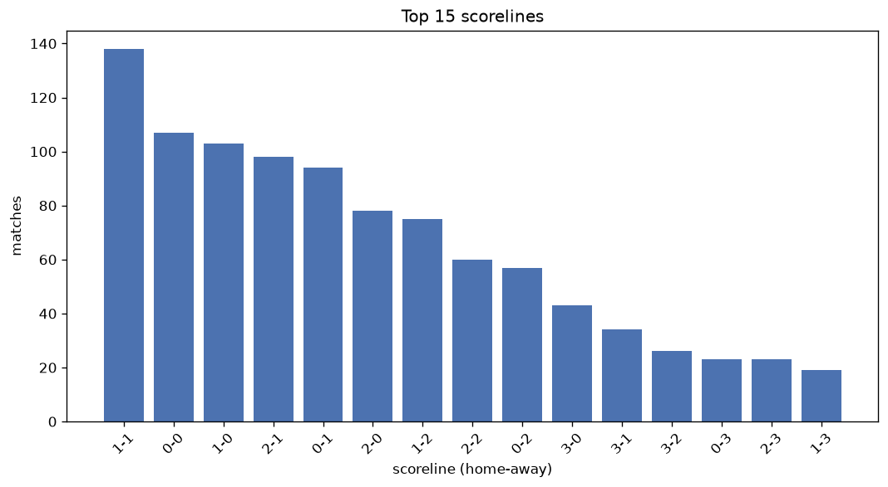
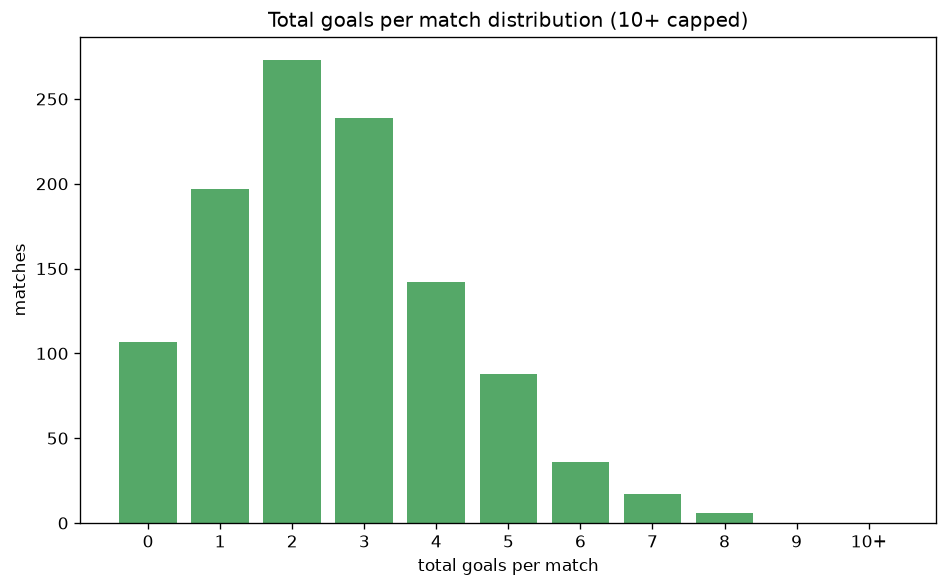

# Scoreline Analysis
- Report: `scoreline_analysis`
- Generated: 2026-10-26T01:46:02+00:00
- Script: `backend/scripts/analyze_scorelines.py` v1.0.0
- League: Championship (Scotland)
- Scope: league `scot-champ`

## 1. Scoreline frequency
- Matches analysed: **1105** across **7** seasons.
- Distinct scorelines seen: **38**.

| scoreline | count | pct |
|---|---|---|
| 1-1 | 138 | 12.5% |
| 0-0 | 107 | 9.7% |
| 1-0 | 103 | 9.3% |
| 2-1 | 98 | 8.9% |
| 0-1 | 94 | 8.5% |
| 2-0 | 78 | 7.1% |
| 1-2 | 75 | 6.8% |
| 2-2 | 60 | 5.4% |
| 0-2 | 57 | 5.2% |
| 3-0 | 43 | 3.9% |
| 3-1 | 34 | 3.1% |
| 3-2 | 26 | 2.4% |
| 0-3 | 23 | 2.1% |
| 2-3 | 23 | 2.1% |
| 1-3 | 19 | 1.7% |
| 4-0 | 15 | 1.4% |
| 3-3 | 14 | 1.3% |
| 0-4 | 14 | 1.3% |
| 5-0 | 11 | 1.0% |
| 1-4 | 10 | 0.9% |

## 2. Scoreline frequency per season

### 2020-2021
| scoreline | count | pct |
|---|---|---|
| 1-1 | 19 | 14.1% |
| 2-1 | 13 | 9.6% |
| 0-0 | 13 | 9.6% |
| 1-0 | 11 | 8.1% |
| 0-1 | 11 | 8.1% |

### 2021-2022
| scoreline | count | pct |
|---|---|---|
| 1-1 | 23 | 12.8% |
| 1-0 | 22 | 12.2% |
| 0-1 | 20 | 11.1% |
| 0-0 | 18 | 10.0% |
| 2-1 | 17 | 9.4% |

### 2022-2023
| scoreline | count | pct |
|---|---|---|
| 1-1 | 23 | 12.8% |
| 1-2 | 16 | 8.9% |
| 1-0 | 15 | 8.3% |
| 2-0 | 14 | 7.8% |
| 0-0 | 14 | 7.8% |

### 2023-2024
| scoreline | count | pct |
|---|---|---|
| 1-2 | 22 | 12.2% |
| 1-1 | 20 | 11.1% |
| 0-0 | 17 | 9.4% |
| 2-1 | 16 | 8.9% |
| 0-1 | 15 | 8.3% |

### 2024-2025
| scoreline | count | pct |
|---|---|---|
| 1-0 | 21 | 11.7% |
| 2-1 | 20 | 11.1% |
| 2-0 | 19 | 10.6% |
| 1-1 | 17 | 9.4% |
| 0-0 | 15 | 8.3% |

### 2025-2026
| scoreline | count | pct |
|---|---|---|
| 1-1 | 28 | 14.7% |
| 0-0 | 25 | 13.2% |
| 2-1 | 17 | 8.9% |
| 0-1 | 16 | 8.4% |
| 1-0 | 16 | 8.4% |

### 2026-2027
| scoreline | count | pct |
|---|---|---|
| 2-0 | 12 | 20.0% |
| 1-1 | 8 | 13.3% |
| 1-0 | 7 | 11.7% |
| 0-1 | 6 | 10.0% |
| 1-2 | 6 | 10.0% |

## 3. Total-goal histogram
_10+ groups all matches with 10 or more total goals._

| total goals | matches | pct |
|---|---|---|
| 0 | 107 | 9.7% |
| 1 | 197 | 17.8% |
| 2 | 273 | 24.7% |
| 3 | 239 | 21.6% |
| 4 | 142 | 12.9% |
| 5 | 88 | 8.0% |
| 6 | 36 | 3.3% |
| 7 | 17 | 1.5% |
| 8 | 6 | 0.5% |
| 9 | 0 | 0.0% |
| 10+ | 0 | 0.0% |

## 4. Extreme scorelines
- Matches with 7+ total goals: **23**

| season | date | scoreline | total goals |
|---|---|---|---|
| 2020-2021 | 2020-10-16 | 6-2 | 8 |
| 2020-2021 | 2020-12-26 | 5-3 | 8 |
| 2021-2022 | 2021-07-31 | 4-4 | 8 |
| 2022-2023 | 2022-10-29 | 4-4 | 8 |
| 2022-2023 | 2023-05-05 | 3-5 | 8 |
| 2023-2024 | 2023-12-22 | 4-4 | 8 |
| 2020-2021 | 2020-10-24 | 2-5 | 7 |
| 2020-2021 | 2020-12-12 | 6-1 | 7 |
| 2020-2021 | 2020-12-26 | 2-5 | 7 |
| 2020-2021 | 2021-04-24 | 4-3 | 7 |
| 2021-2022 | 2021-10-15 | 1-6 | 7 |
| 2021-2022 | 2021-12-11 | 1-6 | 7 |
| 2022-2023 | 2022-11-19 | 2-5 | 7 |
| 2022-2023 | 2023-01-02 | 6-1 | 7 |
| 2022-2023 | 2023-03-18 | 6-1 | 7 |
| 2022-2023 | 2023-04-01 | 7-0 | 7 |
| 2023-2024 | 2023-09-22 | 2-5 | 7 |
| 2023-2024 | 2023-12-08 | 4-3 | 7 |
| 2023-2024 | 2024-02-27 | 4-3 | 7 |
| 2023-2024 | 2024-03-16 | 5-2 | 7 |
| 2024-2025 | 2024-12-14 | 5-2 | 7 |
| 2024-2025 | 2025-02-08 | 5-2 | 7 |
| 2025-2026 | 2025-11-15 | 4-3 | 7 |

## 5. Margin-of-victory distribution (decided matches)
- Decided matches: **783** (draws: **322**)
- Average winning margin: **1.8**

| margin | matches | pct |
|---|---|---|
| 1 | 423 | 54.0% |
| 2 | 199 | 25.4% |
| 3+ | 161 | 20.6% |

## 6. Margin by outcome

### Home wins
- Matches: **447** | avg margin: **1.86** | max margin: **7**
| margin | matches | pct |
|---|---|---|
| 1 | 231 | 51.7% |
| 2 | 118 | 26.4% |
| 3+ | 98 | 21.9% |
- *Full match-by-match list available in `scoreline_analysis.json`.*

### Away wins
- Matches: **336** | avg margin: **1.73** | max margin: **6**
| margin | matches | pct |
|---|---|---|
| 1 | 192 | 57.1% |
| 2 | 81 | 24.1% |
| 3+ | 63 | 18.8% |
- *Full match-by-match list available in `scoreline_analysis.json`.*

## 7. Most common exact score by outcome type
| outcome | matches | most common score | count | pct |
|---|---|---|---|---|
| home | 447 | 1-0 | 103 | 23.0% |
| draw | 322 | 1-1 | 138 | 42.9% |
| away | 336 | 0-1 | 94 | 28.0% |

---
*All statistics are computed from PostgreSQL tables (read-only). Run with `python backend/scripts/analyze_scorelines.py` to regenerate.*

## Charts

