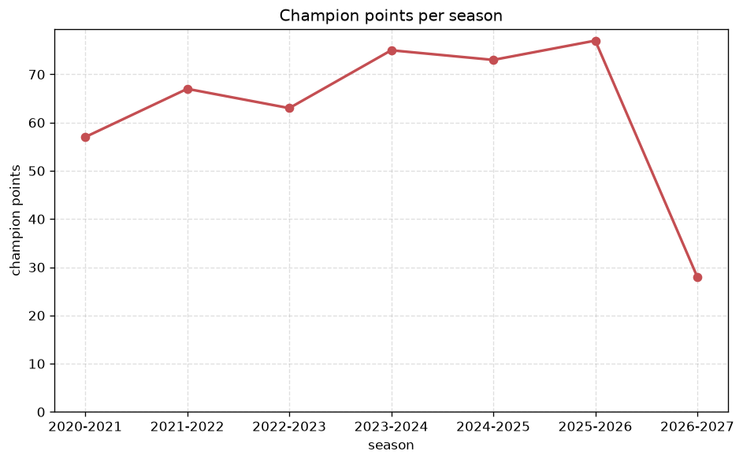
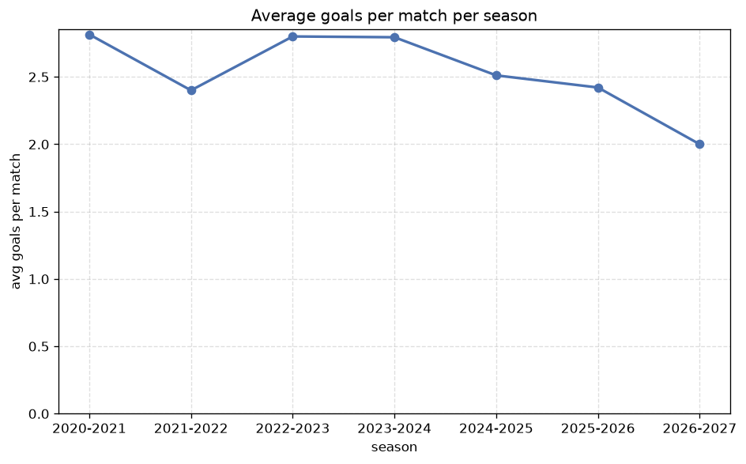

# Season Trends Analysis
- Report: `season_trends`
- Generated: 2026-10-26T01:46:00+00:00
- Script: `backend/scripts/analyze_seasons.py` v1.0.0
- League: Championship (Scotland)
- Scope: league `scot-champ`

## 1. Champions per season
| season | champion | pts | runner-up | margin |
|---|---|---|---|---|
| 2020-2021 | Hearts | 57 | Dundee FC | 12 pts |
| 2021-2022 | Kilmarnock | 67 | Arbroath | 2 pts |
| 2022-2023 | Dundee FC | 63 | Ayr | 5 pts |
| 2023-2024 | Dundee Utd | 75 | Raith | 6 pts |
| 2024-2025 | Falkirk | 73 | Livingston | 3 pts |
| 2025-2026 | St Johnstone | 77 | Partick Thistle | 7 pts |
| 2026-2027 | Partick Thistle | 28 | Stenhousemuir | 5 pts |

## 2. Title-race tightness
- Tight races (margin <= 3 pts): **2** of 7 seasons
- Tightest race: **2021-2022** - Kilmarnock beat Arbroath by **2** pts

| season | margin | tight |
|---|---|---|
| 2020-2021 | 12 pts |  |
| 2021-2022 | 2 pts | yes |
| 2022-2023 | 5 pts |  |
| 2023-2024 | 6 pts |  |
| 2024-2025 | 3 pts | yes |
| 2025-2026 | 7 pts |  |
| 2026-2027 | 5 pts |  |

## 3. Points thresholds
_Position-specific points per season. Key: 1 = champion, 2 = runner-up, 4 = CL line, 6 = Europa, 7 = last safe, 10 = bottom._

| season | pos 1 | pos 2 | pos 4 | pos 6 | pos 7 | pos 10 |
|---|---|---|---|---|---|---|
| 2020-2021 | 57 | 45 | 39 | 32 | 30 | 22 |
| 2021-2022 | 67 | 65 | 52 | 42 | 40 | 33 |
| 2022-2023 | 63 | 58 | 57 | 55 | 43 | 31 |
| 2023-2024 | 75 | 69 | 52 | 45 | 44 | 23 |
| 2024-2025 | 73 | 70 | 55 | 48 | 36 | 29 |
| 2025-2026 | 77 | 70 | 53 | 41 | 39 | 34 |
| 2026-2027 | 28 | 23 | 19 | 17 | 12 | 7 |

## 4. Relegation battle
| season | safe pos | safe pts | drop pos | drop pts | gap |
|---|---|---|---|---|---|
| 2020-2021 | 7 | 30 | 8 | 29 | 1 pts |
| 2021-2022 | 7 | 40 | 8 | 39 | 1 pts |
| 2022-2023 | 7 | 43 | 8 | 34 | 9 pts |
| 2023-2024 | 7 | 44 | 8 | 43 | 1 pts |
| 2024-2025 | 7 | 36 | 8 | 35 | 1 pts |
| 2025-2026 | 7 | 39 | 8 | 38 | 1 pts |
| 2026-2027 | 7 | 12 | 8 | 11 | 1 pts |

## 5. League-level trends
| season | matches | total goals | avg goals | home win | draw | away win | goalless | avg pts/team |
|---|---|---|---|---|---|---|---|---|
| 2020-2021 | 135 | 380 | 2.815 | 41.5% | 31.9% | 26.7% | 9.6% | 36.2 |
| 2021-2022 | 180 | 432 | 2.4 | 37.2% | 32.2% | 30.6% | 10.0% | 48.2 |
| 2022-2023 | 180 | 504 | 2.8 | 39.4% | 29.4% | 31.1% | 7.8% | 48.7 |
| 2023-2024 | 180 | 503 | 2.794 | 36.7% | 26.1% | 37.2% | 9.4% | 49.3 |
| 2024-2025 | 180 | 452 | 2.511 | 47.8% | 23.9% | 28.3% | 8.3% | 49.7 |
| 2025-2026 | 190 | 460 | 2.421 | 38.9% | 33.7% | 27.4% | 13.2% | 38.69 |
| 2026-2027 | 60 | 120 | 2.0 | 45.0% | 23.3% | 31.7% | 8.3% | 16.6 |

## 6. View divergence
- Largest divergence: **2021-2022** (goals view, avg abs position diff = 4.600)

_Avg absolute position difference between classic view and alternative view per season._

| season | classic vs luck | classic vs goals |
|---|---|---|
| 2020-2021 | 2.800 | 2.600 |
| 2021-2022 | 1.000 | 4.600 |
| 2022-2023 | 2.000 | 2.200 |
| 2023-2024 | 1.400 | 3.600 |
| 2024-2025 | 1.400 | 3.000 |
| 2025-2026 | 3.385 | 2.462 |
| 2026-2027 | 1.000 | 4.200 |

---
*All statistics are computed from PostgreSQL tables (read-only). Run with `python backend/scripts/analyze_seasons.py` to regenerate.*

## Charts

