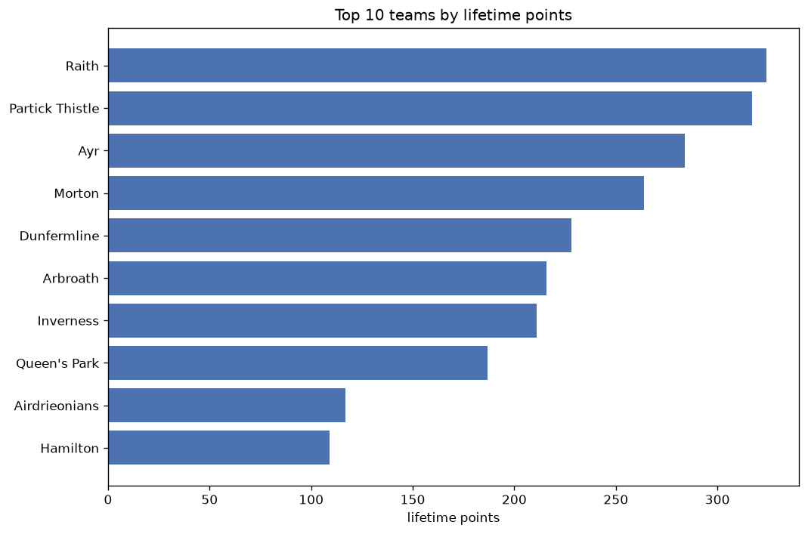
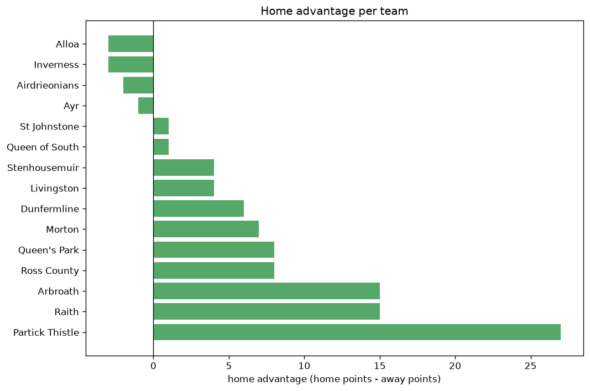

# Team Analysis
- Report: `teams_analysis`
- Generated: 2026-10-30T04:09:25+00:00
- Script: `backend/scripts/analyze_teams.py` v1.0.0
- League: Championship (Scotland)
- Scope: league `scot-champ`

- Teams: **22** | Seasons: **7** | Matches: **1106**

## 1. Team standings (lifetime)
| team | seasons | played | W | D | L | pts | GF | GA | GD | avg pts/season | best pos | worst pos | titles |
|---|---|---|---|---|---|---|---|---|---|---|---|---|---|
| Raith | 7 | 219 | 88 | 60 | 71 | 324 | 299 | 265 | 34 | 46.29 | 2 | 7 | 0 |
| Partick Thistle | 6 | 195 | 85 | 62 | 48 | 317 | 289 | 219 | 70 | 52.83 | 1 | 4 | 1 |
| Ayr | 7 | 219 | 72 | 68 | 79 | 284 | 289 | 292 | -3 | 40.57 | 2 | 8 | 0 |
| Morton | 7 | 219 | 64 | 72 | 83 | 264 | 242 | 289 | -47 | 37.71 | 5 | 10 | 0 |
| Dunfermline | 6 | 187 | 57 | 60 | 70 | 231 | 210 | 228 | -18 | 38.5 | 3 | 9 | 0 |
| Arbroath | 6 | 185 | 52 | 60 | 73 | 216 | 196 | 258 | -62 | 36.0 | 2 | 10 | 0 |
| Inverness | 5 | 147 | 54 | 49 | 44 | 211 | 198 | 163 | 35 | 42.2 | 3 | 9 | 0 |
| Queen's Park | 5 | 157 | 49 | 40 | 68 | 187 | 192 | 231 | -39 | 37.4 | 3 | 9 | 0 |
| Airdrieonians | 3 | 110 | 30 | 27 | 53 | 117 | 114 | 158 | -44 | 39.0 | 4 | 10 | 0 |
| Hamilton | 3 | 108 | 27 | 28 | 53 | 109 | 107 | 180 | -73 | 36.33 | 6 | 9 | 0 |
| Dundee FC | 2 | 63 | 29 | 21 | 13 | 108 | 115 | 80 | 35 | 54.0 | 1 | 2 | 1 |
| Livingston | 2 | 48 | 25 | 12 | 11 | 87 | 70 | 38 | 32 | 43.5 | 2 | 6 | 0 |
| St Johnstone | 1 | 36 | 22 | 11 | 3 | 77 | 67 | 25 | 42 | 77.0 | 1 | 1 | 1 |
| Dundee Utd | 1 | 36 | 22 | 9 | 5 | 75 | 73 | 23 | 50 | 75.0 | 1 | 1 | 1 |
| Falkirk | 1 | 36 | 22 | 7 | 7 | 73 | 72 | 33 | 39 | 73.0 | 1 | 1 | 1 |
| Kilmarnock | 1 | 36 | 20 | 7 | 9 | 67 | 50 | 27 | 23 | 67.0 | 1 | 1 | 1 |
| Queen of South | 3 | 65 | 17 | 15 | 33 | 66 | 77 | 109 | -32 | 22.0 | 6 | 13 | 0 |
| Hearts | 1 | 27 | 17 | 6 | 4 | 57 | 63 | 24 | 39 | 57.0 | 1 | 1 | 1 |
| Ross County | 1 | 36 | 8 | 10 | 18 | 34 | 36 | 57 | -21 | 34.0 | 10 | 10 | 0 |
| Alloa | 2 | 31 | 8 | 7 | 16 | 31 | 35 | 64 | -29 | 15.5 | 10 | 11 | 0 |
| Cove Rangers | 1 | 36 | 7 | 10 | 19 | 31 | 38 | 75 | -37 | 31.0 | 10 | 10 | 0 |
| Stenhousemuir | 2 | 16 | 9 | 3 | 4 | 30 | 20 | 14 | 6 | 15.0 | 2 | 12 | 0 |

## 2. Home vs away split
| team | home P | H-W | H-D | H-L | H-pts | away P | A-W | A-D | A-L | A-pts | adv |
|---|---|---|---|---|---|---|---|---|---|---|---|
| Partick Thistle | 98 | 54 | 29 | 15 | 191 | 97 | 31 | 33 | 33 | 126 | 65 |
| Dunfermline | 93 | 36 | 31 | 26 | 139 | 94 | 21 | 29 | 44 | 92 | 47 |
| Raith | 109 | 49 | 32 | 28 | 179 | 110 | 39 | 28 | 43 | 145 | 34 |
| Morton | 110 | 39 | 31 | 40 | 148 | 109 | 25 | 41 | 43 | 116 | 32 |
| Arbroath | 92 | 29 | 36 | 27 | 123 | 93 | 23 | 24 | 46 | 93 | 30 |
| Airdrieonians | 55 | 18 | 16 | 21 | 70 | 55 | 12 | 11 | 32 | 47 | 23 |
| Ayr | 109 | 37 | 38 | 34 | 149 | 110 | 35 | 30 | 45 | 135 | 14 |
| Dundee FC | 31 | 18 | 7 | 6 | 61 | 32 | 11 | 14 | 7 | 47 | 14 |
| Queen's Park | 79 | 27 | 19 | 33 | 100 | 78 | 22 | 21 | 35 | 87 | 13 |
| Livingston | 25 | 15 | 5 | 5 | 50 | 23 | 10 | 7 | 6 | 37 | 13 |
| Falkirk | 18 | 13 | 3 | 2 | 42 | 18 | 9 | 4 | 5 | 31 | 11 |
| Hearts | 14 | 11 | 1 | 2 | 34 | 13 | 6 | 5 | 2 | 23 | 11 |
| Ross County | 18 | 6 | 3 | 9 | 21 | 18 | 2 | 7 | 9 | 13 | 8 |
| Kilmarnock | 18 | 12 | 1 | 5 | 37 | 18 | 8 | 6 | 4 | 30 | 7 |
| Cove Rangers | 18 | 5 | 4 | 9 | 19 | 18 | 2 | 6 | 10 | 12 | 7 |
| Hamilton | 54 | 14 | 14 | 26 | 56 | 54 | 13 | 14 | 27 | 53 | 3 |
| Alloa | 16 | 4 | 5 | 7 | 17 | 15 | 4 | 2 | 9 | 14 | 3 |
| Stenhousemuir | 8 | 5 | 1 | 2 | 16 | 8 | 4 | 2 | 2 | 14 | 2 |
| St Johnstone | 18 | 11 | 6 | 1 | 39 | 18 | 11 | 5 | 2 | 38 | 1 |
| Queen of South | 32 | 8 | 9 | 15 | 33 | 33 | 9 | 6 | 18 | 33 | 0 |
| Inverness | 73 | 26 | 26 | 21 | 104 | 74 | 28 | 23 | 23 | 107 | -3 |
| Dundee Utd | 18 | 10 | 5 | 3 | 35 | 18 | 12 | 4 | 2 | 40 | -5 |

## 3. Top performers
### Best points per game (PPG)
| rank | team | PPG |
|---|---|---|
| 1 | St Johnstone | 2.14 |
| 2 | Hearts | 2.11 |
| 3 | Dundee Utd | 2.08 |
| 4 | Falkirk | 2.03 |
| 5 | Stenhousemuir | 1.88 |

### Most goals scored
| rank | team | goals |
|---|---|---|
| 1 | Raith | 299 |
| 2 | Partick Thistle | 289 |
| 3 | Ayr | 289 |
| 4 | Morton | 242 |
| 5 | Dunfermline | 210 |

### Best goal difference
| rank | team | GD |
|---|---|---|
| 1 | Partick Thistle | 70 |
| 2 | Dundee Utd | 50 |
| 3 | St Johnstone | 42 |
| 4 | Falkirk | 39 |
| 5 | Hearts | 39 |

### Best defence (goals against per match, standings)
| rank | team | GA/match |
|---|---|---|
| 1 | Dundee Utd | 0.639 |
| 2 | St Johnstone | 0.694 |
| 3 | Kilmarnock | 0.750 |
| 4 | Livingston | 0.792 |
| 5 | Stenhousemuir | 0.800 |

## 4. Team consistency
- Teams present in all **7** seasons: **3**

Ayr, Morton, Raith

## 5. Head-to-head dominance
- Distinct fixtures: **155** (showing the 15 most frequent)

| fixture | meetings | home wins | draws | away wins | home pct | draw pct | away pct |
|---|---|---|---|---|---|---|---|
| Raith vs Ayr | 24 | 13 | 5 | 6 | 54.2% | 20.8% | 25.0% |
| Raith vs Morton | 24 | 9 | 8 | 7 | 37.5% | 33.3% | 29.2% |
| Ayr vs Morton | 24 | 6 | 12 | 6 | 25.0% | 50.0% | 25.0% |
| Ayr vs Partick Thistle | 23 | 13 | 6 | 4 | 56.5% | 26.1% | 17.4% |
| Raith vs Partick Thistle | 21 | 10 | 8 | 3 | 47.6% | 38.1% | 14.3% |
| Morton vs Partick Thistle | 21 | 9 | 7 | 5 | 42.9% | 33.3% | 23.8% |
| Dunfermline vs Ayr | 21 | 6 | 9 | 6 | 28.6% | 42.9% | 28.6% |
| Arbroath vs Morton | 21 | 5 | 8 | 8 | 23.8% | 38.1% | 38.1% |
| Raith vs Dunfermline | 20 | 13 | 4 | 3 | 65.0% | 20.0% | 15.0% |
| Arbroath vs Ayr | 20 | 10 | 8 | 2 | 50.0% | 40.0% | 10.0% |
| Dunfermline vs Morton | 20 | 9 | 5 | 6 | 45.0% | 25.0% | 30.0% |
| Raith vs Arbroath | 20 | 8 | 7 | 5 | 40.0% | 35.0% | 25.0% |
| Morton vs Queen's Park | 19 | 11 | 5 | 3 | 57.9% | 26.3% | 15.8% |
| Dunfermline vs Partick Thistle | 19 | 7 | 6 | 6 | 36.8% | 31.6% | 31.6% |
| Dunfermline vs Arbroath | 18 | 8 | 5 | 5 | 44.4% | 27.8% | 27.8% |

## 6. Position per season (classic view)
_Cells show final position; '-' when the team was absent from that season._

| team | 2020-2021 | 2021-2022 | 2022-2023 | 2023-2024 | 2024-2025 | 2025-2026 | 2026-2027 |
|---|---|---|---|---|---|---|---|
| Raith | 3 | 5 | 7 | 2 | 5 | 5 | 3 |
| Partick Thistle | - | 4 | 4 | 3 | 4 | 2 | 1 |
| Ayr | 8 | 8 | 2 | 7 | 3 | 7 | 7 |
| Morton | 9 | 7 | 5 | 5 | 6 | 8 | 10 |
| Dunfermline | 4 | 9 | - | 6 | 8 | 3 | 4 |
| Arbroath | 7 | 2 | 8 | 10 | - | 4 | 8 |
| Inverness | 5 | 3 | 6 | 9 | - | - | 5 |
| Queen's Park | - | - | 3 | 8 | 9 | 6 | 9 |
| Airdrieonians | - | - | - | 4 | 10 | 9 | - |
| Hamilton | - | 6 | 9 | - | 7 | - | - |
| Dundee FC | 2 | - | 1 | - | - | - | - |
| Livingston | - | - | - | - | 2 | - | 6 |
| St Johnstone | - | - | - | - | - | 1 | - |
| Dundee Utd | - | - | - | 1 | - | - | - |
| Falkirk | - | - | - | - | 1 | - | - |
| Kilmarnock | - | 1 | - | - | - | - | - |
| Queen of South | 6 | 10 | - | - | - | 13 | - |
| Hearts | 1 | - | - | - | - | - | - |
| Ross County | - | - | - | - | - | 10 | - |
| Alloa | 10 | - | - | - | - | 11 | - |
| Cove Rangers | - | - | 10 | - | - | - | - |
| Stenhousemuir | - | - | - | - | - | 12 | 2 |

---
*All statistics are computed from PostgreSQL tables (read-only). Run with `python backend/scripts/analyze_teams.py` to regenerate.*

## Charts

