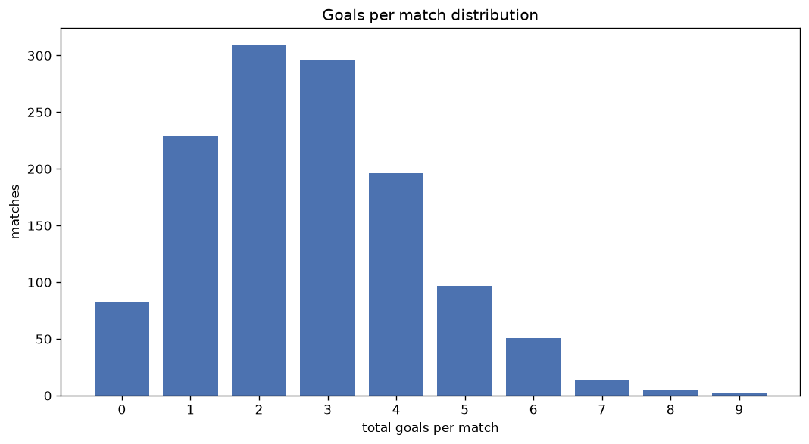
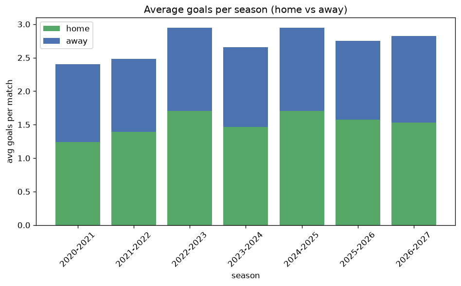

# Goal Analysis
- Report: `goals_analysis`
- Generated: 2026-10-26T01:46:18+00:00
- Script: `backend/scripts/analyze_goals.py` v1.0.0
- League: Premiership (Scotland)
- Scope: league `scot-premier`

## 1. Goals per match distribution
| goals | matches | pct |
|---|---|---|
| 0 | 83 | 6.5% |
| 1 | 229 | 17.9% |
| 2 | 309 | 24.1% |
| 3 | 296 | 23.1% |
| 4 | 196 | 15.3% |
| 5 | 97 | 7.6% |
| 6 | 51 | 4.0% |
| 7 | 14 | 1.1% |
| 8 | 5 | 0.4% |
| 9 | 2 | 0.2% |

## 2. Goals per match per season
| season | matches | total goals | avg home | avg away | avg total |
|---|---|---|---|---|---|
| 2020-2021 | 198 | 475 | 1.242 | 1.157 | 2.399 |
| 2021-2022 | 198 | 491 | 1.394 | 1.086 | 2.48 |
| 2022-2023 | 198 | 583 | 1.702 | 1.242 | 2.944 |
| 2023-2024 | 198 | 526 | 1.465 | 1.192 | 2.657 |
| 2024-2025 | 198 | 584 | 1.707 | 1.242 | 2.949 |
| 2025-2026 | 234 | 643 | 1.573 | 1.175 | 2.748 |
| 2026-2027 | 58 | 164 | 1.534 | 1.293 | 2.828 |

## 3. Home vs away goal share
- Home goals: **1944** (56.1%)
- Away goals: **1522** (43.9%)
- Home/away ratio: **1.277**

| season | home goals | away goals | total | home pct | away pct |
|---|---|---|---|---|---|
| 2020-2021 | 246 | 229 | 475 | 51.8% | 48.2% |
| 2021-2022 | 276 | 215 | 491 | 56.2% | 43.8% |
| 2022-2023 | 337 | 246 | 583 | 57.8% | 42.2% |
| 2023-2024 | 290 | 236 | 526 | 55.1% | 44.9% |
| 2024-2025 | 338 | 246 | 584 | 57.9% | 42.1% |
| 2025-2026 | 368 | 275 | 643 | 57.2% | 42.8% |
| 2026-2027 | 89 | 75 | 164 | 54.3% | 45.7% |

## 4. BTTS (Both Teams To Score)
- Overall: **627** of `1282` (48.9%)

| season | matches | BTTS | pct |
|---|---|---|---|
| 2020-2021 | 198 | 80 | 40.4% |
| 2021-2022 | 198 | 96 | 48.5% |
| 2022-2023 | 198 | 99 | 50.0% |
| 2023-2024 | 198 | 95 | 48.0% |
| 2024-2025 | 198 | 104 | 52.5% |
| 2025-2026 | 234 | 121 | 51.7% |
| 2026-2027 | 58 | 32 | 55.2% |

## 5. Clean sheets
- Home clean sheets: **438** (34.2%)
- Away clean sheets: **300** (23.4%)
- Total clean sheets recorded: **738**
- Matches with at least one clean sheet: **655** (51.1%)
- Both teams kept clean sheets (0-0): **83**

| season | matches | home CS | away CS | total CS | matches w/ CS |
|---|---|---|---|---|---|
| 2020-2021 | 198 | 71 | 64 | 135 | 118 (59.6%) |
| 2021-2022 | 198 | 74 | 45 | 119 | 102 (51.5%) |
| 2022-2023 | 198 | 66 | 39 | 105 | 99 (50.0%) |
| 2023-2024 | 198 | 65 | 52 | 117 | 103 (52.0%) |
| 2024-2025 | 198 | 65 | 39 | 104 | 94 (47.5%) |
| 2025-2026 | 234 | 83 | 47 | 130 | 113 (48.3%) |
| 2026-2027 | 58 | 14 | 14 | 28 | 26 (44.8%) |

## 6. Scoring intensity
- First-half goals: **1588** (45.8%)
- Second-half goals: **1878** (54.2%)
- Avg first-half goals per match: **1.239**
- Avg second-half goals per match: **1.465**
- Second-half-only scoring (HT 0-0, FT goals >= 1): **260** (20.3%)

| season | matches | 1st half | 2nd half | 1st half pct | 2nd half pct |
|---|---|---|---|---|---|
| 2020-2021 | 198 | 225 | 250 | 47.4% | 52.6% |
| 2021-2022 | 198 | 240 | 251 | 48.9% | 51.1% |
| 2022-2023 | 198 | 264 | 319 | 45.3% | 54.7% |
| 2023-2024 | 198 | 216 | 310 | 41.1% | 58.9% |
| 2024-2025 | 198 | 264 | 320 | 45.2% | 54.8% |
| 2025-2026 | 234 | 291 | 352 | 45.3% | 54.7% |
| 2026-2027 | 58 | 88 | 76 | 53.7% | 46.3% |

## 7. First-goal timing
- Matches with first-goal time recorded: `1199` of `1282` (93.5%)
- Goalless matches: `83`
- Min `1` | Max `98` | Mean `29.9` | Median (p50) `24`

| bucket | count | % of matches | % of scoring matches |
|---|---|---|---|
| 1-15 | 399 | 31.1% | 33.3% |
| 16-30 | 322 | 25.1% | 26.9% |
| 31-45 | 196 | 15.3% | 16.3% |
| 46-60 | 138 | 10.8% | 11.5% |
| 61-75 | 79 | 6.2% | 6.6% |
| 76-90 | 50 | 3.9% | 4.2% |
| 91-120 | 15 | 1.2% | 1.3% |

---
*All statistics are computed from PostgreSQL tables (read-only). Run with `python backend/scripts/analyze_goals.py` to regenerate.*

## Charts

