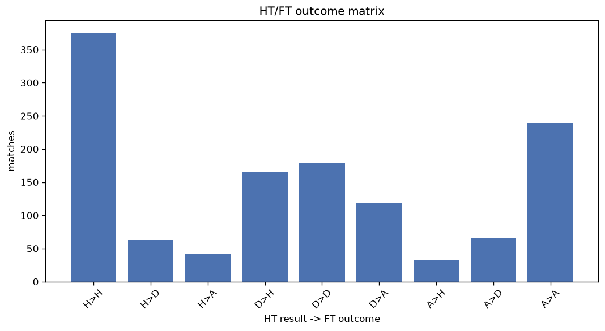
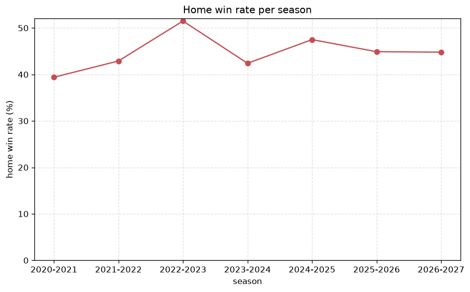

# Match Analysis
- Report: `matches_analysis`
- Generated: 2026-10-26T01:46:15+00:00
- Script: `backend/scripts/analyze_matches.py` v1.0.0
- League: Premiership (Scotland)
- Scope: league `scot-premier`

## 1. Overall summary
| metric | value |
|---|---|
| Matches | 1282 |
| Home wins | 574 (44.8%) |
| Draws | 307 (23.9%) |
| Away wins | 401 (31.3%) |
| Total goals | 3466 |
| Average goals per match | 2.704 |
| Goalless matches | 83 (6.5%) |

## 2. Per-season breakdown
| season | matches | home wins | draws | away wins | total goals | avg goals | goalless |
|---|---|---|---|---|---|---|---|
| 2020-2021 | 198 | 78 (39.4%) | 49 (24.7%) | 71 (35.9%) | 475 | 2.399 | 17 (8.6%) |
| 2021-2022 | 198 | 85 (42.9%) | 55 (27.8%) | 58 (29.3%) | 491 | 2.48 | 17 (8.6%) |
| 2022-2023 | 198 | 102 (51.5%) | 33 (16.7%) | 63 (31.8%) | 583 | 2.944 | 6 (3.0%) |
| 2023-2024 | 198 | 84 (42.4%) | 54 (27.3%) | 60 (30.3%) | 526 | 2.657 | 14 (7.1%) |
| 2024-2025 | 198 | 94 (47.5%) | 41 (20.7%) | 63 (31.8%) | 584 | 2.949 | 10 (5.1%) |
| 2025-2026 | 234 | 105 (44.9%) | 64 (27.4%) | 65 (27.8%) | 643 | 2.748 | 17 (7.3%) |
| 2026-2027 | 58 | 26 (44.8%) | 11 (19.0%) | 21 (36.2%) | 164 | 2.828 | 2 (3.4%) |

## 3. HT/FT outcome matrix
| HT result \ FT result | Home | Draw | Away | total |
|---|---|---|---|---|
| HT home lead | 375 (78.1%) | 63 (13.1%) | 42 (8.8%) | 480 |
| HT draw | 166 (35.8%) | 179 (38.6%) | 119 (25.6%) | 464 |
| HT away lead | 33 (9.8%) | 65 (19.2%) | 240 (71.0%) | 338 |

## 4. Comeback matches
- Home comebacks (trailing at HT, won at FT): **33** (2.6%)
- Away comebacks (trailing at HT, won at FT): **42** (3.3%)

### Home comebacks
| season | home | away | HT | FT |
|---|---|---|---|---|
| 2020-2021 | Rangers | Motherwell | 0-1 | 3-1 |
| 2020-2021 | St. Mirren | St Johnstone | 1-2 | 3-2 |
| 2021-2022 | St. Mirren | Aberdeen | 1-2 | 3-2 |
| 2021-2022 | Rangers | Hibernian | 0-1 | 2-1 |
| 2021-2022 | Aberdeen | Hearts | 0-1 | 2-1 |
| 2021-2022 | Ross County | Dundee FC | 1-2 | 3-2 |
| 2022-2023 | Kilmarnock | Motherwell | 0-1 | 2-1 |
| 2022-2023 | Ross County | St. Mirren | 1-2 | 3-2 |
| 2022-2023 | Rangers | Hibernian | 1-2 | 3-2 |
| 2022-2023 | Hearts | Dundee Utd | 0-1 | 3-1 |
| 2022-2023 | Celtic | Hibernian | 0-1 | 3-1 |
| 2023-2024 | Motherwell | Kilmarnock | 0-1 | 2-1 |
| 2023-2024 | Rangers | Hearts | 0-1 | 2-1 |
| 2023-2024 | Aberdeen | Hearts | 0-1 | 2-1 |
| 2023-2024 | Kilmarnock | Celtic | 0-1 | 2-1 |
| 2023-2024 | Hearts | Dundee FC | 0-2 | 3-2 |
| 2023-2024 | Dundee FC | St Johnstone | 0-1 | 2-1 |
| 2023-2024 | St. Mirren | Aberdeen | 0-1 | 2-1 |
| 2023-2024 | Kilmarnock | St. Mirren | 0-2 | 5-2 |
| 2023-2024 | Ross County | Rangers | 0-1 | 3-2 |
| 2024-2025 | Ross County | Kilmarnock | 0-1 | 2-1 |
| 2024-2025 | Dundee FC | Kilmarnock | 1-2 | 3-2 |
| 2024-2025 | St Johnstone | Motherwell | 0-1 | 2-1 |
| 2024-2025 | Hearts | St. Mirren | 0-1 | 3-1 |
| 2025-2026 | Falkirk | Dundee FC | 0-1 | 2-1 |
| 2025-2026 | Aberdeen | Kilmarnock | 0-1 | 2-1 |
| 2025-2026 | Dundee Utd | Celtic | 0-1 | 2-1 |
| 2025-2026 | Dundee FC | Kilmarnock | 0-1 | 2-1 |
| 2025-2026 | Hearts | Rangers | 0-1 | 2-1 |
| 2025-2026 | Partick Thistle | Dunfermline | 0-1 | 2-1 |
| 2025-2026 | Dundee FC | Aberdeen | 1-2 | 3-2 |
| 2026-2027 | Aberdeen | Hearts | 0-1 | 2-1 |
| 2026-2027 | Hearts | Dundee FC | 0-1 | 2-1 |

### Away comebacks
| season | home | away | HT | FT |
|---|---|---|---|---|
| 2020-2021 | Livingston | Hamilton | 1-0 | 1-2 |
| 2020-2021 | Dundee Utd | Livingston | 1-0 | 1-2 |
| 2020-2021 | Ross County | Motherwell | 1-0 | 1-2 |
| 2020-2021 | Kilmarnock | St Johnstone | 2-0 | 2-3 |
| 2020-2021 | Hamilton | Ross County | 1-0 | 1-2 |
| 2021-2022 | Motherwell | Hibernian | 2-1 | 2-3 |
| 2021-2022 | Livingston | Aberdeen | 1-0 | 1-2 |
| 2021-2022 | Livingston | Motherwell | 1-0 | 1-2 |
| 2021-2022 | St Johnstone | Hibernian | 1-0 | 1-2 |
| 2021-2022 | Hibernian | Livingston | 2-1 | 2-3 |
| 2021-2022 | Hearts | Dundee FC | 1-0 | 1-2 |
| 2021-2022 | St. Mirren | Dundee Utd | 1-0 | 1-2 |
| 2021-2022 | Dundee FC | Rangers | 1-0 | 1-2 |
| 2022-2023 | Livingston | Rangers | 1-0 | 1-2 |
| 2022-2023 | Hibernian | St Johnstone | 1-0 | 1-2 |
| 2022-2023 | Kilmarnock | Livingston | 2-1 | 2-3 |
| 2022-2023 | Ross County | St Johnstone | 1-0 | 1-2 |
| 2022-2023 | St. Mirren | Celtic | 1-0 | 1-5 |
| 2022-2023 | Motherwell | Dundee Utd | 1-0 | 1-2 |
| 2023-2024 | St Johnstone | Celtic | 1-0 | 1-3 |
| 2023-2024 | Dundee FC | Hearts | 1-0 | 2-3 |
| 2023-2024 | Motherwell | Celtic | 1-0 | 1-3 |
| 2023-2024 | Kilmarnock | Rangers | 1-0 | 1-2 |
| 2023-2024 | Livingston | Motherwell | 1-0 | 1-3 |
| 2023-2024 | Dundee FC | Motherwell | 1-0 | 2-3 |
| 2024-2025 | Dundee FC | Kilmarnock | 1-0 | 2-3 |
| 2024-2025 | Ross County | Celtic | 1-0 | 1-2 |
| 2024-2025 | Dundee FC | St Johnstone | 1-0 | 1-2 |
| 2024-2025 | Hearts | Kilmarnock | 1-0 | 1-2 |
| 2024-2025 | St Johnstone | Dundee Utd | 1-0 | 1-2 |
| 2024-2025 | Kilmarnock | Rangers | 2-1 | 2-4 |
| 2024-2025 | Dundee FC | Rangers | 2-1 | 3-4 |
| 2025-2026 | Dundee Utd | Hearts | 2-1 | 2-3 |
| 2025-2026 | Livingston | Hearts | 1-0 | 1-2 |
| 2025-2026 | Motherwell | Falkirk | 1-0 | 1-2 |
| 2025-2026 | Livingston | Motherwell | 1-0 | 1-2 |
| 2025-2026 | Celtic | Rangers | 1-0 | 1-3 |
| 2025-2026 | Kilmarnock | Celtic | 2-0 | 2-3 |
| 2025-2026 | Falkirk | Rangers | 2-1 | 3-6 |
| 2025-2026 | Hibernian | Hearts | 1-0 | 1-2 |
| 2026-2027 | St. Mirren | Celtic | 1-0 | 1-2 |
| 2026-2027 | Falkirk | Dundee FC | 1-0 | 1-2 |

## 5. HT lead conversion
| HT state | matches | converted to win | held as draw | collapsed to loss |
|---|---|---|---|---|
| Home lead | 480 | 375 (78.1%) | 63 (13.1%) | 42 (8.8%) |
| Away lead | 338 | 240 (71.0%) | 65 (19.2%) | 33 (9.8%) |

### Matches level at half-time
| FT result | count | pct |
|---|---|---|
| Home win | 166 | 35.8% |
| Draw | 179 | 38.6% |
| Away win | 119 | 25.6% |

## 6. First-goal timing
- Matches with a first-goal time recorded: `1199` of `1282` (93.5%)

Outcome distribution by first-goal timing bucket:
| bucket | matches | % of matches | home | draw | away |
|---|---|---|---|---|---|
| 1-15 | 399 | 31.1% | 196 (49.1%) | 65 (16.3%) | 138 (34.6%) |
| 16-30 | 322 | 25.1% | 154 (47.8%) | 59 (18.3%) | 109 (33.9%) |
| 31-45 | 196 | 15.3% | 95 (48.5%) | 50 (25.5%) | 51 (26.0%) |
| 46-60 | 138 | 10.8% | 62 (44.9%) | 29 (21.0%) | 47 (34.1%) |
| 61-75 | 79 | 6.2% | 42 (53.2%) | 12 (15.2%) | 25 (31.6%) |
| 76-90 | 50 | 3.9% | 19 (38.0%) | 9 (18.0%) | 22 (44.0%) |
| 91-120 | 15 | 1.2% | 6 (40.0%) | 0 (0.0%) | 9 (60.0%) |

## 7. Goalless matches
- Overall: **83** of `1282` (6.5%)

| season | matches | goalless | pct |
|---|---|---|---|
| 2020-2021 | 198 | 17 | 8.6% |
| 2021-2022 | 198 | 17 | 8.6% |
| 2022-2023 | 198 | 6 | 3.0% |
| 2023-2024 | 198 | 14 | 7.1% |
| 2024-2025 | 198 | 10 | 5.1% |
| 2025-2026 | 234 | 17 | 7.3% |
| 2026-2027 | 58 | 2 | 3.4% |

---
*All statistics are computed from PostgreSQL tables (read-only). Run with `python backend/scripts/analyze_matches.py` to regenerate.*

## Charts

