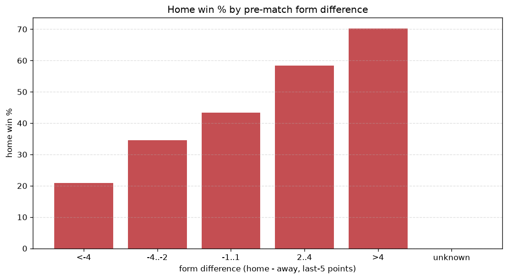
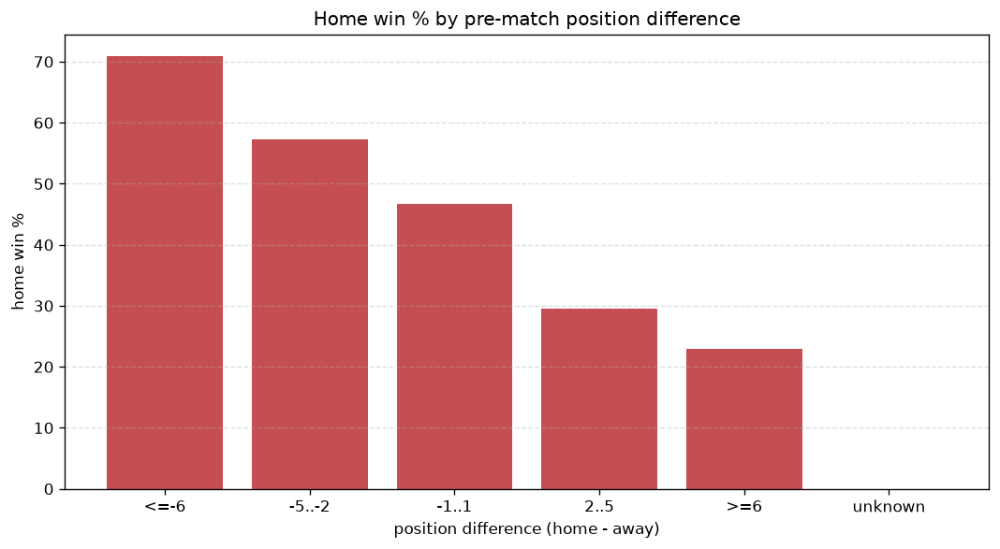

# Relationships Analysis
- Report: `relationships`
- Generated: 2026-10-26T01:46:27+00:00
- Script: `backend/scripts/analyze_relationships.py` v1.0.0
- League: Premiership (Scotland)
- Scope: league `scot-premier`

- Matches analysed: **1224** (23 leakage-safe pre-match features).

## 1. Correlation matrix
_Pearson correlation of each pre-match feature with observed goals; sorted by |corr(total goals)|._

| feature | corr(home) | corr(away) | corr(total) |
|---|---|---|---|
| home_team_goals_scored_last_5 | 0.251 | -0.108 | 0.121 |
| home_team_home_goals_avg | 0.265 | -0.137 | 0.111 |
| home_points_before_match | 0.216 | -0.091 | 0.106 |
| home_team_home_win_rate | 0.245 | -0.130 | 0.100 |
| away_team_away_goals_avg | -0.100 | 0.234 | 0.092 |
| away_team_goals_scored_last_5 | -0.090 | 0.216 | 0.087 |
| away_points_before_match | -0.048 | 0.170 | 0.087 |
| home_team_points_last_5 | 0.226 | -0.135 | 0.081 |
| home_team_wins_last_5 | 0.219 | -0.134 | 0.077 |
| away_team_away_win_rate | -0.131 | 0.232 | 0.066 |
| home_position_before_match | -0.248 | 0.183 | -0.064 |
| away_team_points_last_5 | -0.126 | 0.222 | 0.063 |
| away_team_wins_last_5 | -0.139 | 0.229 | 0.058 |
| away_rest_days | 0.052 | 0.014 | 0.051 |
| home_rest_days | 0.033 | 0.017 | 0.040 |
| away_position_before_match | 0.155 | -0.217 | -0.036 |
| home_team_home_conceded_avg | -0.131 | 0.101 | -0.030 |
| points_difference | 0.308 | -0.304 | 0.023 |
| away_team_away_conceded_avg | 0.087 | -0.125 | -0.022 |
| position_difference | -0.291 | 0.288 | -0.021 |
| away_team_goals_conceded_last_5 | 0.107 | -0.140 | -0.018 |
| rest_days_difference | -0.020 | 0.006 | -0.012 |
| home_team_goals_conceded_last_5 | -0.112 | 0.112 | -0.007 |

## 2. Form vs outcome
_Home win/draw/away % per bucket of `home_team_points_last_5 - away_team_points_last_5`._

| bucket | matches | home | draw | away | home % | draw % | away % |
|---|---|---|---|---|---|---|---|
| <-4 | 234 | 49 | 66 | 119 | 20.9% | 28.2% | 50.9% |
| -4..-2 | 237 | 82 | 65 | 90 | 34.6% | 27.4% | 38.0% |
| -1..1 | 319 | 138 | 90 | 91 | 43.3% | 28.2% | 28.5% |
| 2..4 | 219 | 128 | 41 | 50 | 58.4% | 18.7% | 22.8% |
| >4 | 215 | 151 | 34 | 30 | 70.2% | 15.8% | 14.0% |
| unknown | 0 | 0 | 0 | 0 | - | - | - |

## 3. Position vs outcome
_Home win/draw/away % per bucket of `position_difference` (home position - away position; negative favours the home team)._

| bucket | matches | home | draw | away | home % | draw % | away % |
|---|---|---|---|---|---|---|---|
| <=-6 | 165 | 117 | 28 | 20 | 70.9% | 17.0% | 12.1% |
| -5..-2 | 307 | 176 | 61 | 70 | 57.3% | 19.9% | 22.8% |
| -1..1 | 261 | 122 | 70 | 69 | 46.7% | 26.8% | 26.4% |
| 2..5 | 312 | 92 | 91 | 129 | 29.5% | 29.2% | 41.3% |
| >=6 | 179 | 41 | 46 | 92 | 22.9% | 25.7% | 51.4% |
| unknown | 0 | 0 | 0 | 0 | - | - | - |

## 4. Rest advantage
_Home win/draw/away % per bucket of `rest_days_difference` (home rest - away rest). Matches with unknown rest are bucketed separately._

| bucket | matches | home | draw | away | home % | draw % | away % |
|---|---|---|---|---|---|---|---|
| <-1 | 104 | 49 | 20 | 35 | 47.1% | 19.2% | 33.7% |
| -1..0 | 180 | 99 | 34 | 47 | 55.0% | 18.9% | 26.1% |
| 0 | 609 | 270 | 144 | 195 | 44.3% | 23.6% | 32.0% |
| 1..2 | 173 | 57 | 54 | 62 | 32.9% | 31.2% | 35.8% |
| >2 | 120 | 57 | 31 | 32 | 47.5% | 25.8% | 26.7% |
| unknown | 38 | 16 | 13 | 9 | 42.1% | 34.2% | 23.7% |
- *38 match(es) had unknown rest difference (missing rest data on at least one side).*

## 5. Home team quality
_Home win rate by `home_team_home_win_rate` tier (split at 0.5)._

- `< 0.5` tier: **36.9%** home win (287/778)
- `>= 0.5` tier: **58.5%** home win (261/446)
- Home-win gap (>= split minus < split): **+21.6 pp**

| tier | label | matches | home | draw | away | home % |
|---|---|---|---|---|---|---|
| low | < 0.5 | 778 | 287 | 208 | 283 | 36.9% |
| high | >= 0.5 | 446 | 261 | 88 | 97 | 58.5% |

## 6. Feature averages by result
_Mean feature value per outcome; `range` is home-minus-away spread of the group means._

| feature | home mean | draw mean | away mean | range |
|---|---|---|---|---|
| points_difference | 5.659 | -2.615 | -6.405 | 12.064 |
| home_points_before_match | 26.365 | 19.432 | 19.484 | 6.933 |
| away_points_before_match | 20.706 | 22.047 | 25.889 | 5.183 |
| position_difference | -1.675 | 0.872 | 2.176 | 3.851 |
| home_team_points_last_5 | 7.279 | 5.264 | 5.334 | 2.016 |
| home_position_before_match | 5.644 | 7.253 | 7.579 | 1.935 |
| away_position_before_match | 7.319 | 6.382 | 5.403 | 1.917 |
| home_team_goals_scored_last_5 | 6.993 | 5.149 | 5.255 | 1.844 |
| away_team_points_last_5 | 5.626 | 6.291 | 7.421 | 1.795 |
| away_team_goals_scored_last_5 | 5.589 | 6.037 | 7.189 | 1.600 |
| away_team_goals_conceded_last_5 | 6.580 | 5.919 | 5.361 | 1.220 |
| home_team_goals_conceded_last_5 | 5.704 | 6.510 | 6.584 | 0.880 |
| away_team_wins_last_5 | 1.473 | 1.743 | 2.158 | 0.685 |
| home_team_wins_last_5 | 2.060 | 1.392 | 1.416 | 0.668 |
| rest_days_difference | 0.060 | 0.625 | 0.102 | 0.565 |
| away_rest_days | 7.850 | 7.435 | 7.671 | 0.415 |
| home_team_home_goals_avg | 1.602 | 1.224 | 1.198 | 0.404 |
| away_team_away_goals_avg | 0.967 | 1.080 | 1.284 | 0.316 |
| home_rest_days | 7.910 | 8.046 | 7.774 | 0.272 |
| away_team_away_conceded_avg | 1.476 | 1.371 | 1.253 | 0.223 |
| home_team_home_conceded_avg | 1.002 | 1.167 | 1.165 | 0.165 |
| home_team_home_win_rate | 0.469 | 0.356 | 0.337 | 0.133 |
| away_team_away_win_rate | 0.248 | 0.296 | 0.375 | 0.128 |

---
*All features are leakage-safe pre-match values built by `ml.features.build_features.build_rows` from strictly prior matches. Run with `python backend/scripts/analyze_relationships.py` to regenerate.*

## Charts

