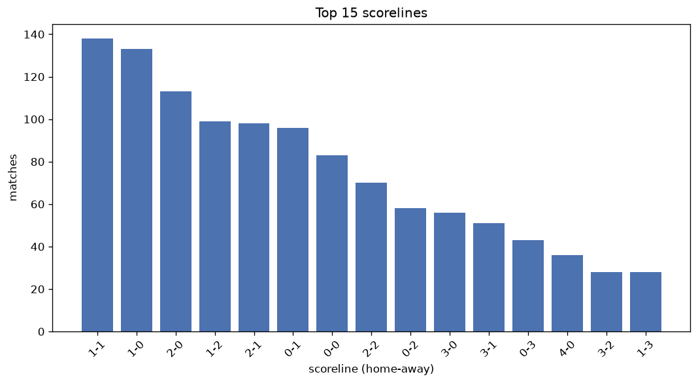
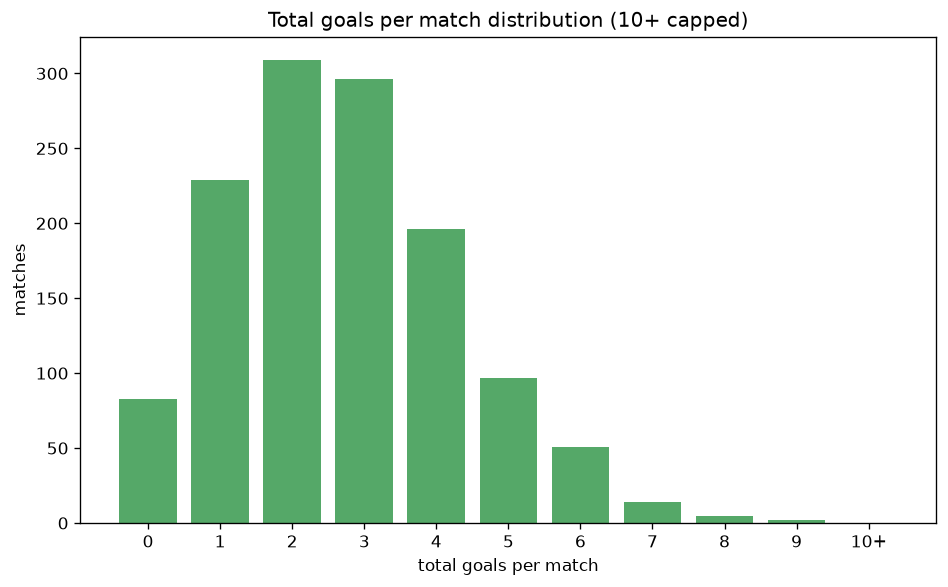

# Scoreline Analysis
- Report: `scoreline_analysis`
- Generated: 2026-10-26T01:46:25+00:00
- Script: `backend/scripts/analyze_scorelines.py` v1.0.0
- League: Premiership (Scotland)
- Scope: league `scot-premier`

## 1. Scoreline frequency
- Matches analysed: **1282** across **7** seasons.
- Distinct scorelines seen: **41**.

| scoreline | count | pct |
|---|---|---|
| 1-1 | 138 | 10.8% |
| 1-0 | 133 | 10.4% |
| 2-0 | 113 | 8.8% |
| 1-2 | 99 | 7.7% |
| 2-1 | 98 | 7.6% |
| 0-1 | 96 | 7.5% |
| 0-0 | 83 | 6.5% |
| 2-2 | 70 | 5.5% |
| 0-2 | 58 | 4.5% |
| 3-0 | 56 | 4.4% |
| 3-1 | 51 | 4.0% |
| 0-3 | 43 | 3.4% |
| 4-0 | 36 | 2.8% |
| 3-2 | 28 | 2.2% |
| 1-3 | 28 | 2.2% |
| 2-3 | 26 | 2.0% |
| 4-1 | 17 | 1.3% |
| 3-3 | 16 | 1.2% |
| 1-4 | 12 | 0.9% |
| 0-4 | 11 | 0.9% |

## 2. Scoreline frequency per season

### 2020-2021
| scoreline | count | pct |
|---|---|---|
| 1-1 | 24 | 12.1% |
| 1-0 | 22 | 11.1% |
| 0-1 | 19 | 9.6% |
| 2-0 | 18 | 9.1% |
| 0-0 | 17 | 8.6% |

### 2021-2022
| scoreline | count | pct |
|---|---|---|
| 1-1 | 26 | 13.1% |
| 1-0 | 24 | 12.1% |
| 2-0 | 21 | 10.6% |
| 0-0 | 17 | 8.6% |
| 1-2 | 17 | 8.6% |

### 2022-2023
| scoreline | count | pct |
|---|---|---|
| 1-0 | 21 | 10.6% |
| 1-1 | 20 | 10.1% |
| 2-1 | 18 | 9.1% |
| 2-0 | 15 | 7.6% |
| 1-2 | 12 | 6.1% |

### 2023-2024
| scoreline | count | pct |
|---|---|---|
| 1-1 | 20 | 10.1% |
| 1-0 | 19 | 9.6% |
| 2-0 | 19 | 9.6% |
| 2-1 | 17 | 8.6% |
| 2-2 | 16 | 8.1% |

### 2024-2025
| scoreline | count | pct |
|---|---|---|
| 1-2 | 19 | 9.6% |
| 1-0 | 17 | 8.6% |
| 2-1 | 16 | 8.1% |
| 1-1 | 16 | 8.1% |
| 2-0 | 16 | 8.1% |

### 2025-2026
| scoreline | count | pct |
|---|---|---|
| 1-1 | 25 | 10.7% |
| 1-0 | 25 | 10.7% |
| 2-0 | 23 | 9.8% |
| 2-2 | 18 | 7.7% |
| 1-2 | 18 | 7.7% |

### 2026-2027
| scoreline | count | pct |
|---|---|---|
| 2-1 | 8 | 13.8% |
| 1-1 | 7 | 12.1% |
| 1-2 | 7 | 12.1% |
| 0-1 | 6 | 10.3% |
| 1-0 | 5 | 8.6% |

## 3. Total-goal histogram
_10+ groups all matches with 10 or more total goals._

| total goals | matches | pct |
|---|---|---|
| 0 | 83 | 6.5% |
| 1 | 229 | 17.9% |
| 2 | 309 | 24.1% |
| 3 | 296 | 23.1% |
| 4 | 196 | 15.3% |
| 5 | 97 | 7.6% |
| 6 | 51 | 4.0% |
| 7 | 14 | 1.1% |
| 8 | 5 | 0.4% |
| 9 | 2 | 0.2% |
| 10+ | 0 | 0.0% |

## 4. Extreme scorelines
- Matches with 7+ total goals: **21**

| season | date | scoreline | total goals |
|---|---|---|---|
| 2022-2023 | 2022-08-28 | 0-9 | 9 |
| 2025-2026 | 2026-04-12 | 3-6 | 9 |
| 2020-2021 | 2020-10-17 | 3-5 | 8 |
| 2020-2021 | 2020-11-08 | 8-0 | 8 |
| 2023-2024 | 2024-02-28 | 7-1 | 8 |
| 2025-2026 | 2026-01-24 | 6-2 | 8 |
| 2026-2027 | 2026-10-18 | 7-1 | 8 |
| 2021-2022 | 2021-10-31 | 1-6 | 7 |
| 2021-2022 | 2021-11-06 | 5-2 | 7 |
| 2021-2022 | 2022-04-09 | 7-0 | 7 |
| 2022-2023 | 2022-10-15 | 6-1 | 7 |
| 2022-2023 | 2022-10-22 | 3-4 | 7 |
| 2022-2023 | 2023-04-15 | 5-2 | 7 |
| 2022-2023 | 2023-04-22 | 6-1 | 7 |
| 2023-2024 | 2024-03-16 | 5-2 | 7 |
| 2024-2025 | 2024-12-14 | 4-3 | 7 |
| 2024-2025 | 2025-03-01 | 2-5 | 7 |
| 2024-2025 | 2025-03-29 | 3-4 | 7 |
| 2025-2026 | 2026-02-11 | 4-3 | 7 |
| 2025-2026 | 2026-05-16 | 2-5 | 7 |
| 2026-2027 | 2026-08-02 | 4-3 | 7 |

## 5. Margin-of-victory distribution (decided matches)
- Decided matches: **975** (draws: **307**)
- Average winning margin: **1.87**

| margin | matches | pct |
|---|---|---|
| 1 | 485 | 49.7% |
| 2 | 267 | 27.4% |
| 3+ | 223 | 22.9% |

## 6. Margin by outcome

### Home wins
- Matches: **574** | avg margin: **1.96** | max margin: **8**
| margin | matches | pct |
|---|---|---|
| 1 | 262 | 45.6% |
| 2 | 172 | 30.0% |
| 3+ | 140 | 24.4% |
- *Full match-by-match list available in `scoreline_analysis.json`.*

### Away wins
- Matches: **401** | avg margin: **1.75** | max margin: **9**
| margin | matches | pct |
|---|---|---|
| 1 | 223 | 55.6% |
| 2 | 95 | 23.7% |
| 3+ | 83 | 20.7% |
- *Full match-by-match list available in `scoreline_analysis.json`.*

## 7. Most common exact score by outcome type
| outcome | matches | most common score | count | pct |
|---|---|---|---|---|
| home | 574 | 1-0 | 133 | 23.2% |
| draw | 307 | 1-1 | 138 | 45.0% |
| away | 401 | 1-2 | 99 | 24.7% |

---
*All statistics are computed from PostgreSQL tables (read-only). Run with `python backend/scripts/analyze_scorelines.py` to regenerate.*

## Charts

