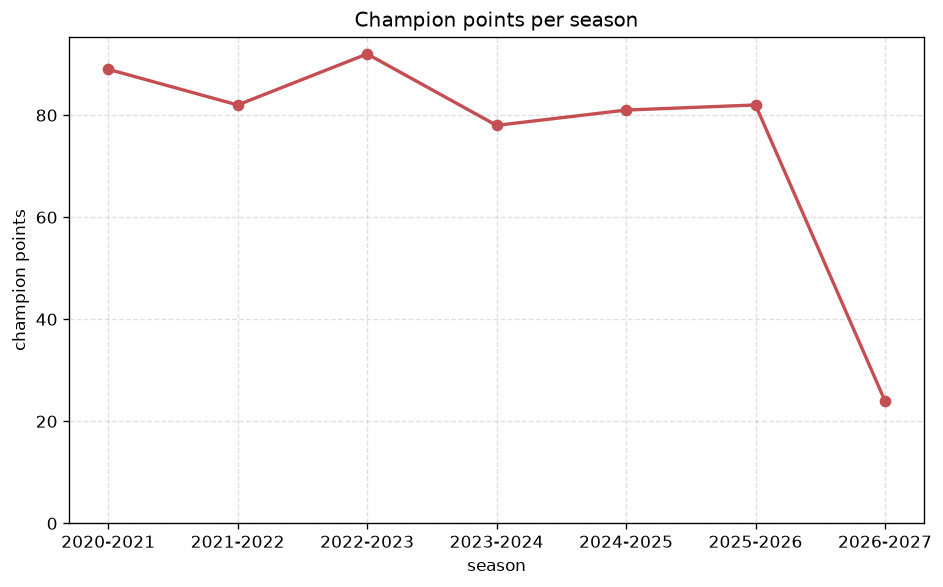
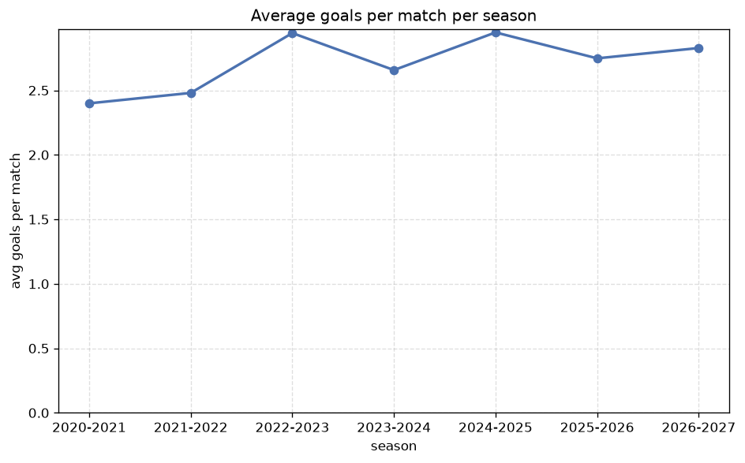

# Season Trends Analysis
- Report: `season_trends`
- Generated: 2026-10-29T02:13:12+00:00
- Script: `backend/scripts/analyze_seasons.py` v1.0.0
- League: Premiership (Scotland)
- Scope: league `scot-premier`

## 1. Champions per season
| season | champion | pts | runner-up | margin |
|---|---|---|---|---|
| 2020-2021 | Rangers | 89 | Celtic | 20 pts |
| 2021-2022 | Celtic | 82 | Rangers | 6 pts |
| 2022-2023 | Celtic | 92 | Rangers | 13 pts |
| 2023-2024 | Celtic | 78 | Rangers | 3 pts |
| 2024-2025 | Celtic | 81 | Rangers | 15 pts |
| 2025-2026 | Celtic | 82 | Hearts | 2 pts |
| 2026-2027 | Celtic | 27 | Rangers | 4 pts |

## 2. Title-race tightness
- Tight races (margin <= 3 pts): **2** of 7 seasons
- Tightest race: **2025-2026** - Celtic beat Hearts by **2** pts

| season | margin | tight |
|---|---|---|
| 2020-2021 | 20 pts |  |
| 2021-2022 | 6 pts |  |
| 2022-2023 | 13 pts |  |
| 2023-2024 | 3 pts | yes |
| 2024-2025 | 15 pts |  |
| 2025-2026 | 2 pts | yes |
| 2026-2027 | 4 pts |  |

## 3. Points thresholds
_Position-specific points per season. Key: 1 = champion, 2 = runner-up, 4 = CL line, 6 = Europa, 9 = last safe, 12 = bottom._

| season | pos 1 | pos 2 | pos 4 | pos 6 | pos 9 | pos 12 |
|---|---|---|---|---|---|---|
| 2020-2021 | 89 | 69 | 49 | 40 | 35 | 27 |
| 2021-2022 | 82 | 76 | 41 | 40 | 36 | 25 |
| 2022-2023 | 92 | 79 | 48 | 44 | 33 | 27 |
| 2023-2024 | 78 | 75 | 51 | 41 | 35 | 18 |
| 2024-2025 | 81 | 66 | 50 | 41 | 35 | 29 |
| 2025-2026 | 82 | 80 | 61 | 49 | 40 | 21 |
| 2026-2027 | 27 | 23 | 15 | 13 | 11 | 7 |

## 4. Relegation battle
| season | safe pos | safe pts | drop pos | drop pts | gap |
|---|---|---|---|---|---|
| 2020-2021 | 9 | 35 | 10 | 29 | 6 pts |
| 2021-2022 | 9 | 36 | 10 | 36 | 0 pts |
| 2022-2023 | 9 | 33 | 10 | 31 | 2 pts |
| 2023-2024 | 9 | 35 | 10 | 31 | 4 pts |
| 2024-2025 | 9 | 35 | 10 | 35 | 0 pts |
| 2025-2026 | 9 | 40 | 10 | 40 | 0 pts |
| 2026-2027 | 9 | 11 | 10 | 8 | 3 pts |

## 5. League-level trends
| season | matches | total goals | avg goals | home win | draw | away win | goalless | avg pts/team |
|---|---|---|---|---|---|---|---|---|
| 2020-2021 | 198 | 475 | 2.399 | 39.4% | 24.7% | 35.9% | 8.6% | 45.42 |
| 2021-2022 | 198 | 491 | 2.48 | 42.9% | 27.8% | 29.3% | 8.6% | 44.92 |
| 2022-2023 | 198 | 583 | 2.944 | 51.5% | 16.7% | 31.8% | 3.0% | 46.75 |
| 2023-2024 | 198 | 526 | 2.657 | 42.4% | 27.3% | 30.3% | 7.1% | 45.0 |
| 2024-2025 | 198 | 584 | 2.949 | 47.5% | 20.7% | 31.8% | 5.1% | 46.08 |
| 2025-2026 | 234 | 643 | 2.748 | 44.9% | 27.4% | 27.8% | 7.3% | 42.53 |
| 2026-2027 | 60 | 169 | 2.817 | 43.3% | 18.3% | 38.3% | 3.3% | 14.08 |

## 6. View divergence
- Largest divergence: **2020-2021** (goals view, avg abs position diff = 4.167)

_Avg absolute position difference between classic view and alternative view per season._

| season | classic vs luck | classic vs goals |
|---|---|---|
| 2020-2021 | 3.000 | 4.167 |
| 2021-2022 | 2.333 | 2.667 |
| 2022-2023 | 1.500 | 1.333 |
| 2023-2024 | 2.500 | 3.500 |
| 2024-2025 | 3.500 | 3.167 |
| 2025-2026 | 2.800 | 2.933 |
| 2026-2027 | 1.167 | 3.500 |

---
*All statistics are computed from PostgreSQL tables (read-only). Run with `python backend/scripts/analyze_seasons.py` to regenerate.*

## Charts

