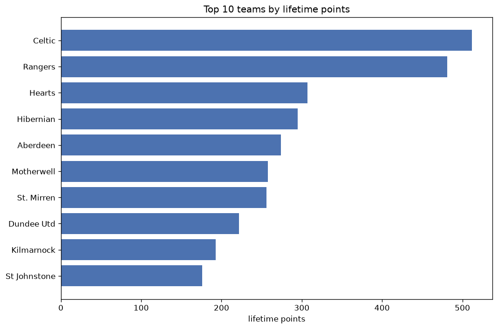
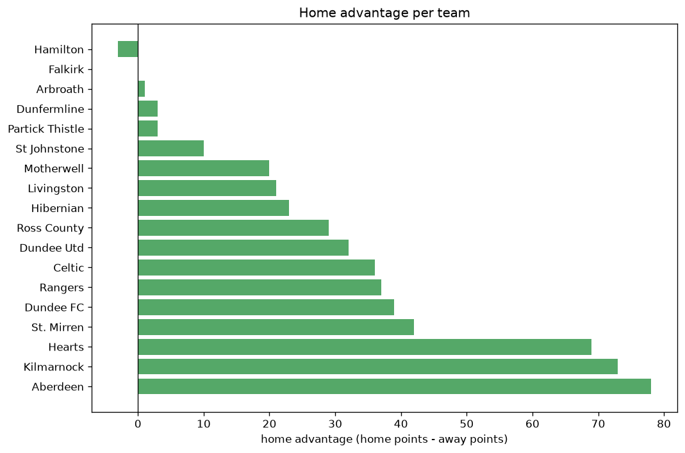

# Team Analysis
- Report: `teams_analysis`
- Generated: 2026-10-30T04:09:53+00:00
- Script: `backend/scripts/analyze_teams.py` v1.0.0
- League: Premiership (Scotland)
- Scope: league `scot-premier`

- Teams: **18** | Seasons: **7** | Matches: **1290**

## 1. Team standings (lifetime)
| team | seasons | played | W | D | L | pts | GF | GA | GD | avg pts/season | best pos | worst pos | titles |
|---|---|---|---|---|---|---|---|---|---|---|---|---|---|
| Celtic | 7 | 214 | 161 | 29 | 24 | 512 | 524 | 165 | 359 | 73.14 | 1 | 2 | 6 |
| Rangers | 7 | 214 | 147 | 40 | 27 | 481 | 461 | 181 | 280 | 68.71 | 1 | 3 | 1 |
| Hearts | 6 | 181 | 90 | 37 | 54 | 307 | 284 | 211 | 73 | 51.17 | 2 | 7 | 0 |
| Hibernian | 7 | 214 | 78 | 61 | 75 | 295 | 291 | 273 | 18 | 42.14 | 3 | 11 | 0 |
| Aberdeen | 7 | 214 | 75 | 49 | 90 | 274 | 254 | 292 | -38 | 39.14 | 3 | 9 | 0 |
| Motherwell | 7 | 214 | 66 | 60 | 88 | 258 | 269 | 312 | -43 | 36.86 | 4 | 10 | 0 |
| St. Mirren | 7 | 216 | 67 | 55 | 94 | 256 | 225 | 309 | -84 | 36.57 | 5 | 11 | 0 |
| Dundee Utd | 6 | 181 | 55 | 57 | 69 | 222 | 202 | 254 | -52 | 37.0 | 4 | 10 | 0 |
| Kilmarnock | 6 | 181 | 50 | 43 | 88 | 193 | 204 | 291 | -87 | 32.17 | 4 | 12 | 0 |
| St Johnstone | 6 | 176 | 44 | 44 | 88 | 176 | 159 | 259 | -100 | 29.33 | 6 | 12 | 0 |
| Livingston | 5 | 170 | 39 | 46 | 85 | 163 | 170 | 270 | -100 | 32.6 | 5 | 12 | 0 |
| Ross County | 5 | 165 | 41 | 38 | 86 | 161 | 164 | 275 | -111 | 32.2 | 5 | 12 | 0 |
| Dundee FC | 5 | 148 | 40 | 39 | 69 | 159 | 182 | 256 | -74 | 31.8 | 4 | 12 | 0 |
| Falkirk | 2 | 49 | 18 | 10 | 21 | 64 | 63 | 74 | -11 | 32.0 | 6 | 6 | 0 |
| Hamilton | 1 | 33 | 6 | 9 | 18 | 27 | 31 | 60 | -29 | 27.0 | 12 | 12 | 0 |
| Dunfermline | 1 | 4 | 1 | 2 | 1 | 5 | 3 | 3 | 0 | 5.0 | 14 | 14 | 0 |
| Partick Thistle | 1 | 4 | 1 | 2 | 1 | 5 | 4 | 4 | 0 | 5.0 | 13 | 13 | 0 |
| Arbroath | 1 | 2 | 0 | 1 | 1 | 1 | 0 | 1 | -1 | 1.0 | 15 | 15 | 0 |

## 2. Home vs away split
| team | home P | H-W | H-D | H-L | H-pts | away P | A-W | A-D | A-L | A-pts | adv |
|---|---|---|---|---|---|---|---|---|---|---|---|
| Aberdeen | 108 | 50 | 26 | 32 | 176 | 106 | 25 | 23 | 58 | 98 | 78 |
| Kilmarnock | 89 | 37 | 22 | 30 | 133 | 92 | 13 | 21 | 58 | 60 | 73 |
| Hearts | 90 | 57 | 17 | 16 | 188 | 91 | 33 | 20 | 38 | 119 | 69 |
| St. Mirren | 109 | 39 | 32 | 38 | 149 | 107 | 28 | 23 | 56 | 107 | 42 |
| Dundee FC | 75 | 26 | 21 | 28 | 99 | 73 | 14 | 18 | 41 | 60 | 39 |
| Rangers | 106 | 82 | 13 | 11 | 259 | 108 | 65 | 27 | 16 | 222 | 37 |
| Celtic | 108 | 87 | 13 | 8 | 274 | 106 | 74 | 16 | 16 | 238 | 36 |
| Dundee Utd | 90 | 35 | 22 | 33 | 127 | 91 | 20 | 35 | 36 | 95 | 32 |
| Ross County | 83 | 24 | 23 | 36 | 95 | 82 | 17 | 15 | 50 | 66 | 29 |
| Hibernian | 108 | 43 | 30 | 35 | 159 | 106 | 35 | 31 | 40 | 136 | 23 |
| Livingston | 84 | 22 | 26 | 36 | 92 | 86 | 17 | 20 | 49 | 71 | 21 |
| Motherwell | 106 | 37 | 28 | 41 | 139 | 108 | 29 | 32 | 47 | 119 | 20 |
| St Johnstone | 88 | 23 | 24 | 41 | 93 | 88 | 21 | 20 | 47 | 83 | 10 |
| Dunfermline | 2 | 1 | 1 | 0 | 4 | 2 | 0 | 1 | 1 | 1 | 3 |
| Partick Thistle | 2 | 1 | 1 | 0 | 4 | 2 | 0 | 1 | 1 | 1 | 3 |
| Arbroath | 1 | 0 | 1 | 0 | 1 | 1 | 0 | 0 | 1 | 0 | 1 |
| Falkirk | 25 | 9 | 5 | 11 | 32 | 24 | 9 | 5 | 10 | 32 | 0 |
| Hamilton | 16 | 2 | 6 | 8 | 12 | 17 | 4 | 3 | 10 | 15 | -3 |

## 3. Top performers
### Best points per game (PPG)
| rank | team | PPG |
|---|---|---|
| 1 | Celtic | 2.39 |
| 2 | Rangers | 2.25 |
| 3 | Hearts | 1.70 |
| 4 | Hibernian | 1.38 |
| 5 | Falkirk | 1.31 |

### Most goals scored
| rank | team | goals |
|---|---|---|
| 1 | Celtic | 524 |
| 2 | Rangers | 461 |
| 3 | Hibernian | 291 |
| 4 | Hearts | 284 |
| 5 | Motherwell | 269 |

### Best goal difference
| rank | team | GD |
|---|---|---|
| 1 | Celtic | 359 |
| 2 | Rangers | 280 |
| 3 | Hearts | 73 |
| 4 | Hibernian | 18 |
| 5 | Dunfermline | 0 |

### Best defence (goals against per match, standings)
| rank | team | GA/match |
|---|---|---|
| 1 | Arbroath | 0.500 |
| 2 | Dunfermline | 0.750 |
| 3 | Celtic | 0.771 |
| 4 | Rangers | 0.846 |
| 5 | Partick Thistle | 1.000 |

## 4. Team consistency
- Teams present in all **7** seasons: **6**

Aberdeen, Celtic, Hibernian, Motherwell, Rangers, St. Mirren

## 5. Head-to-head dominance
- Distinct fixtures: **104** (showing the 15 most frequent)

| fixture | meetings | home wins | draws | away wins | home pct | draw pct | away pct |
|---|---|---|---|---|---|---|---|
| Aberdeen vs St. Mirren | 20 | 11 | 4 | 5 | 55.0% | 20.0% | 25.0% |
| Rangers vs Celtic | 20 | 9 | 5 | 6 | 45.0% | 25.0% | 30.0% |
| Celtic vs Motherwell | 20 | 8 | 2 | 10 | 40.0% | 10.0% | 50.0% |
| Rangers vs Hibernian | 20 | 8 | 4 | 8 | 40.0% | 20.0% | 40.0% |
| Celtic vs Hibernian | 20 | 7 | 5 | 8 | 35.0% | 25.0% | 40.0% |
| Rangers vs Motherwell | 20 | 6 | 6 | 8 | 30.0% | 30.0% | 40.0% |
| Hibernian vs Motherwell | 20 | 4 | 7 | 9 | 20.0% | 35.0% | 45.0% |
| Hibernian vs Aberdeen | 19 | 12 | 3 | 4 | 63.2% | 15.8% | 21.1% |
| Rangers vs St. Mirren | 19 | 10 | 2 | 7 | 52.6% | 10.5% | 36.8% |
| Celtic vs Aberdeen | 19 | 9 | 3 | 7 | 47.4% | 15.8% | 36.8% |
| Celtic vs St. Mirren | 19 | 9 | 1 | 9 | 47.4% | 5.3% | 47.4% |
| Rangers vs Aberdeen | 19 | 9 | 4 | 6 | 47.4% | 21.1% | 31.6% |
| Aberdeen vs Motherwell | 19 | 8 | 4 | 7 | 42.1% | 21.1% | 36.8% |
| Hibernian vs St. Mirren | 19 | 5 | 6 | 8 | 26.3% | 31.6% | 42.1% |
| St. Mirren vs Motherwell | 19 | 5 | 9 | 5 | 26.3% | 47.4% | 26.3% |

## 6. Position per season (classic view)
_Cells show final position; '-' when the team was absent from that season._

| team | 2020-2021 | 2021-2022 | 2022-2023 | 2023-2024 | 2024-2025 | 2025-2026 | 2026-2027 |
|---|---|---|---|---|---|---|---|
| Celtic | 2 | 1 | 1 | 1 | 1 | 1 | 1 |
| Rangers | 1 | 2 | 2 | 2 | 2 | 3 | 2 |
| Hearts | - | 3 | 4 | 3 | 7 | 2 | 3 |
| Hibernian | 3 | 7 | 5 | 7 | 3 | 5 | 11 |
| Aberdeen | 4 | 9 | 3 | 9 | 5 | 9 | 9 |
| Motherwell | 9 | 6 | 8 | 8 | 8 | 4 | 10 |
| St. Mirren | 7 | 10 | 6 | 5 | 6 | 11 | 7 |
| Dundee Utd | 8 | 4 | 10 | - | 4 | 7 | 5 |
| Kilmarnock | 11 | - | 11 | 4 | 9 | 10 | 12 |
| St Johnstone | 6 | 11 | 9 | 10 | 12 | - | 8 |
| Livingston | 5 | 8 | 7 | 12 | - | 12 | - |
| Ross County | 10 | 5 | 12 | 11 | 10 | - | - |
| Dundee FC | - | 12 | - | 6 | 11 | 8 | 4 |
| Falkirk | - | - | - | - | - | 6 | 6 |
| Hamilton | 12 | - | - | - | - | - | - |
| Dunfermline | - | - | - | - | - | 14 | - |
| Partick Thistle | - | - | - | - | - | 13 | - |
| Arbroath | - | - | - | - | - | 15 | - |

---
*All statistics are computed from PostgreSQL tables (read-only). Run with `python backend/scripts/analyze_teams.py` to regenerate.*

## Charts

