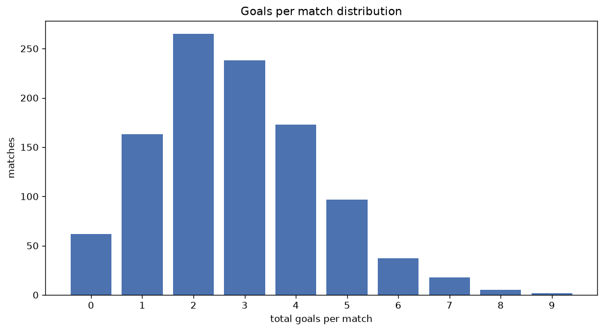
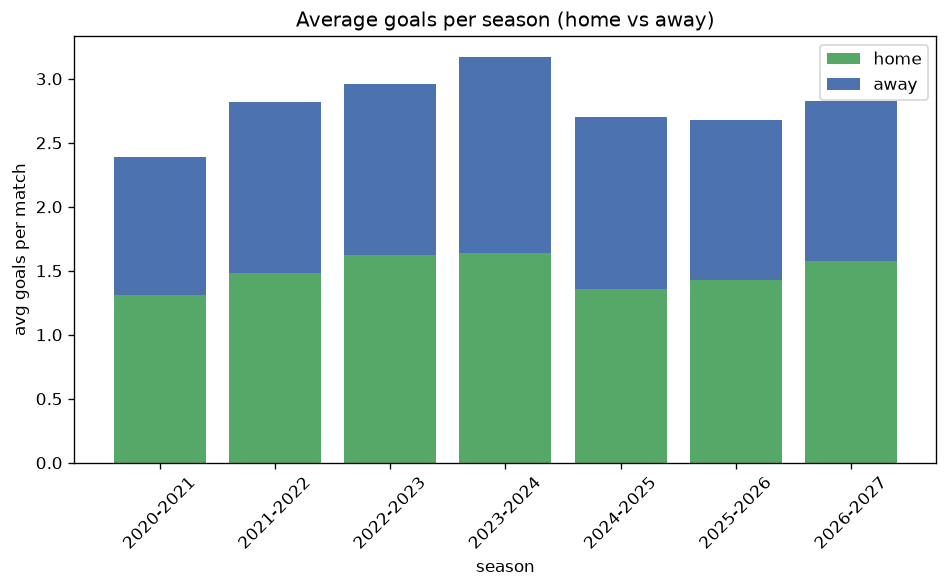

# Goal Analysis
- Report: `goals_analysis`
- Generated: 2026-10-26T01:46:38+00:00
- Script: `backend/scripts/analyze_goals.py` v1.0.0
- League: League One (Scotland)
- Scope: league `scot1`

## 1. Goals per match distribution
| goals | matches | pct |
|---|---|---|
| 0 | 62 | 5.8% |
| 1 | 163 | 15.4% |
| 2 | 265 | 25.0% |
| 3 | 238 | 22.5% |
| 4 | 173 | 16.3% |
| 5 | 97 | 9.2% |
| 6 | 37 | 3.5% |
| 7 | 18 | 1.7% |
| 8 | 5 | 0.5% |
| 9 | 2 | 0.2% |

## 2. Goals per match per season
| season | matches | total goals | avg home | avg away | avg total |
|---|---|---|---|---|---|
| 2020-2021 | 90 | 215 | 1.311 | 1.078 | 2.389 |
| 2021-2022 | 180 | 507 | 1.483 | 1.333 | 2.817 |
| 2022-2023 | 180 | 533 | 1.622 | 1.339 | 2.961 |
| 2023-2024 | 180 | 571 | 1.639 | 1.533 | 3.172 |
| 2024-2025 | 180 | 486 | 1.361 | 1.339 | 2.7 |
| 2025-2026 | 191 | 511 | 1.429 | 1.246 | 2.675 |
| 2026-2027 | 59 | 167 | 1.576 | 1.254 | 2.831 |

## 3. Home vs away goal share
- Home goals: **1583** (52.9%)
- Away goals: **1407** (47.1%)
- Home/away ratio: **1.125**

| season | home goals | away goals | total | home pct | away pct |
|---|---|---|---|---|---|
| 2020-2021 | 118 | 97 | 215 | 54.9% | 45.1% |
| 2021-2022 | 267 | 240 | 507 | 52.7% | 47.3% |
| 2022-2023 | 292 | 241 | 533 | 54.8% | 45.2% |
| 2023-2024 | 295 | 276 | 571 | 51.7% | 48.3% |
| 2024-2025 | 245 | 241 | 486 | 50.4% | 49.6% |
| 2025-2026 | 273 | 238 | 511 | 53.4% | 46.6% |
| 2026-2027 | 93 | 74 | 167 | 55.7% | 44.3% |

## 4. BTTS (Both Teams To Score)
- Overall: **561** of `1060` (52.9%)

| season | matches | BTTS | pct |
|---|---|---|---|
| 2020-2021 | 90 | 36 | 40.0% |
| 2021-2022 | 180 | 102 | 56.7% |
| 2022-2023 | 180 | 93 | 51.7% |
| 2023-2024 | 180 | 106 | 58.9% |
| 2024-2025 | 180 | 95 | 52.8% |
| 2025-2026 | 191 | 103 | 53.9% |
| 2026-2027 | 59 | 26 | 44.1% |

## 5. Clean sheets
- Home clean sheets: **306** (28.9%)
- Away clean sheets: **255** (24.1%)
- Total clean sheets recorded: **561**
- Matches with at least one clean sheet: **499** (47.1%)
- Both teams kept clean sheets (0-0): **62**

| season | matches | home CS | away CS | total CS | matches w/ CS |
|---|---|---|---|---|---|
| 2020-2021 | 90 | 34 | 26 | 60 | 54 (60.0%) |
| 2021-2022 | 180 | 43 | 45 | 88 | 78 (43.3%) |
| 2022-2023 | 180 | 61 | 37 | 98 | 87 (48.3%) |
| 2023-2024 | 180 | 45 | 37 | 82 | 74 (41.1%) |
| 2024-2025 | 180 | 53 | 45 | 98 | 85 (47.2%) |
| 2025-2026 | 191 | 51 | 47 | 98 | 88 (46.1%) |
| 2026-2027 | 59 | 19 | 18 | 37 | 33 (55.9%) |

## 6. Scoring intensity
- First-half goals: **1283** (42.9%)
- Second-half goals: **1706** (57.1%)
- Avg first-half goals per match: **1.212**
- Avg second-half goals per match: **1.611**
- Second-half-only scoring (HT 0-0, FT goals >= 1): **250** (23.6%)
- *1 match(es) excluded (no HT score recorded).*

| season | matches | 1st half | 2nd half | 1st half pct | 2nd half pct |
|---|---|---|---|---|---|
| 2020-2021 | 90 | 95 | 120 | 44.2% | 55.8% |
| 2021-2022 | 180 | 197 | 310 | 38.9% | 61.1% |
| 2022-2023 | 180 | 218 | 315 | 40.9% | 59.1% |
| 2023-2024 | 180 | 268 | 303 | 46.9% | 53.1% |
| 2024-2025 | 180 | 213 | 273 | 43.8% | 56.2% |
| 2025-2026 | 191 | 225 | 286 | 44.0% | 56.0% |
| 2026-2027 | 59 | 67 | 99 | 40.4% | 59.6% |

## 7. First-goal timing
- Matches with first-goal time recorded: `997` of `1060` (94.1%)
- Goalless matches: `63`
- Min `1` | Max `94` | Mean `30.75` | Median (p50) `25`

| bucket | count | % of matches | % of scoring matches |
|---|---|---|---|
| 1-15 | 344 | 32.5% | 34.5% |
| 16-30 | 233 | 22.0% | 23.4% |
| 31-45 | 156 | 14.7% | 15.6% |
| 46-60 | 134 | 12.6% | 13.4% |
| 61-75 | 80 | 7.5% | 8.0% |
| 76-90 | 44 | 4.2% | 4.4% |
| 91-120 | 6 | 0.6% | 0.6% |

---
*All statistics are computed from PostgreSQL tables (read-only). Run with `python backend/scripts/analyze_goals.py` to regenerate.*

## Charts

