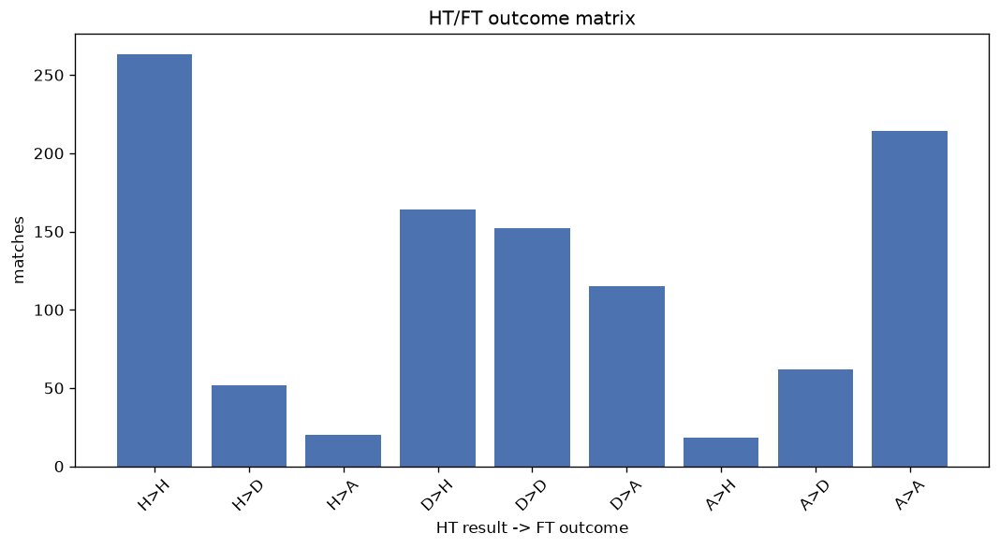
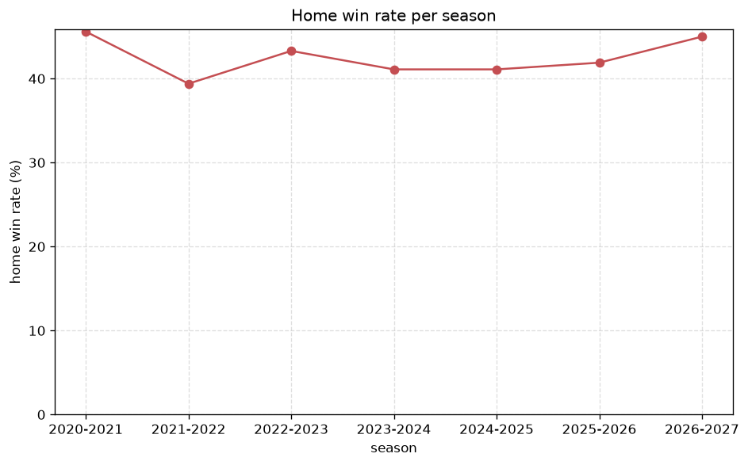

# Match Analysis
- Report: `matches_analysis`
- Generated: 2026-10-29T02:13:24+00:00
- Script: `backend/scripts/analyze_matches.py` v1.0.0
- League: League One (Scotland)
- Scope: league `scot1`

## 1. Overall summary
| metric | value |
|---|---|
| Matches | 1061 |
| Home wins | 445 (41.9%) |
| Draws | 266 (25.1%) |
| Away wins | 350 (33.0%) |
| Total goals | 2992 |
| Average goals per match | 2.820 |
| Goalless matches | 62 (5.8%) |

## 2. Per-season breakdown
| season | matches | home wins | draws | away wins | total goals | avg goals | goalless |
|---|---|---|---|---|---|---|---|
| 2020-2021 | 90 | 41 (45.6%) | 19 (21.1%) | 30 (33.3%) | 215 | 2.389 | 6 (6.7%) |
| 2021-2022 | 180 | 71 (39.4%) | 52 (28.9%) | 57 (31.7%) | 507 | 2.817 | 10 (5.6%) |
| 2022-2023 | 180 | 78 (43.3%) | 42 (23.3%) | 60 (33.3%) | 533 | 2.961 | 11 (6.1%) |
| 2023-2024 | 180 | 74 (41.1%) | 41 (22.8%) | 65 (36.1%) | 571 | 3.172 | 8 (4.4%) |
| 2024-2025 | 180 | 74 (41.1%) | 47 (26.1%) | 59 (32.8%) | 486 | 2.7 | 13 (7.2%) |
| 2025-2026 | 191 | 80 (41.9%) | 52 (27.2%) | 59 (30.9%) | 511 | 2.675 | 10 (5.2%) |
| 2026-2027 | 60 | 27 (45.0%) | 13 (21.7%) | 20 (33.3%) | 169 | 2.817 | 4 (6.7%) |

## 3. HT/FT outcome matrix
| HT result \ FT result | Home | Draw | Away | total |
|---|---|---|---|---|
| HT home lead | 263 (78.5%) | 52 (15.5%) | 20 (6.0%) | 335 |
| HT draw | 164 (38.1%) | 152 (35.3%) | 115 (26.7%) | 431 |
| HT away lead | 18 (6.1%) | 62 (21.1%) | 214 (72.8%) | 294 |
- *1 match(es) excluded (no HT score recorded).*

## 4. Comeback matches
- Home comebacks (trailing at HT, won at FT): **18** (1.7%)
- Away comebacks (trailing at HT, won at FT): **20** (1.9%)

### Home comebacks
| season | home | away | HT | FT |
|---|---|---|---|---|
| 2020-2021 | East Fife | Peterhead | 0-1 | 2-1 |
| 2021-2022 | Falkirk | East Fife | 0-1 | 2-1 |
| 2021-2022 | Peterhead | Queen's Park | 0-1 | 2-1 |
| 2021-2022 | Montrose | Queen's Park | 0-1 | 2-1 |
| 2022-2023 | Edinburgh City | Alloa | 1-3 | 4-3 |
| 2023-2024 | Queen of South | Annan | 0-1 | 3-1 |
| 2023-2024 | Annan | Edinburgh City | 1-2 | 3-2 |
| 2023-2024 | Montrose | Queen of South | 0-2 | 3-2 |
| 2024-2025 | Cove Rangers | Arbroath | 0-1 | 2-1 |
| 2024-2025 | Alloa | Cove Rangers | 0-1 | 2-1 |
| 2024-2025 | Annan | Kelty Hearts | 0-1 | 2-1 |
| 2024-2025 | Alloa | Montrose | 0-1 | 2-1 |
| 2025-2026 | Montrose | Inverness | 0-1 | 2-1 |
| 2025-2026 | Queen of South | Kelty Hearts | 0-1 | 3-1 |
| 2025-2026 | Inverness | Alloa | 0-1 | 3-1 |
| 2025-2026 | East Fife | Cove Rangers | 0-1 | 2-1 |
| 2025-2026 | Alloa | Kelty Hearts | 0-1 | 2-1 |
| 2026-2027 | Queen of South | Airdrieonians | 0-1 | 2-1 |

### Away comebacks
| season | home | away | HT | FT |
|---|---|---|---|---|
| 2020-2021 | Cove Rangers | Montrose | 1-0 | 1-2 |
| 2020-2021 | Cove Rangers | Clyde | 2-1 | 2-3 |
| 2021-2022 | East Fife | Cove Rangers | 2-1 | 2-3 |
| 2022-2023 | Queen of South | Kelty Hearts | 1-0 | 1-2 |
| 2022-2023 | Queen of South | Alloa | 1-0 | 1-2 |
| 2022-2023 | Peterhead | Queen of South | 1-0 | 1-3 |
| 2022-2023 | Kelty Hearts | Falkirk | 1-0 | 1-2 |
| 2022-2023 | Airdrieonians | Dunfermline | 2-0 | 3-4 |
| 2022-2023 | Kelty Hearts | Montrose | 1-0 | 1-2 |
| 2023-2024 | Edinburgh City | Queen of South | 1-0 | 1-2 |
| 2023-2024 | Cove Rangers | Alloa | 1-0 | 1-2 |
| 2023-2024 | Queen of South | Montrose | 1-0 | 2-3 |
| 2023-2024 | Edinburgh City | Alloa | 2-1 | 2-5 |
| 2024-2025 | Montrose | Inverness | 2-0 | 2-3 |
| 2024-2025 | Kelty Hearts | Annan | 1-0 | 1-3 |
| 2024-2025 | Annan | Alloa | 1-0 | 3-4 |
| 2024-2025 | Alloa | Dumbarton | 1-0 | 2-3 |
| 2025-2026 | Hamilton | East Fife | 1-0 | 1-2 |
| 2025-2026 | Kelty Hearts | Cove Rangers | 2-1 | 2-5 |
| 2025-2026 | Alloa | Peterhead | 1-0 | 1-2 |

## 5. HT lead conversion
| HT state | matches | converted to win | held as draw | collapsed to loss |
|---|---|---|---|---|
| Home lead | 335 | 263 (78.5%) | 52 (15.5%) | 20 (6.0%) |
| Away lead | 294 | 214 (72.8%) | 62 (21.1%) | 18 (6.1%) |

### Matches level at half-time
| FT result | count | pct |
|---|---|---|
| Home win | 164 | 38.1% |
| Draw | 152 | 35.3% |
| Away win | 115 | 26.7% |
- *1 match(es) excluded (no HT score recorded).*

## 6. First-goal timing
- Matches with a first-goal time recorded: `998` of `1061` (94.1%)

Outcome distribution by first-goal timing bucket:
| bucket | matches | % of matches | home | draw | away |
|---|---|---|---|---|---|
| 1-15 | 344 | 32.4% | 168 (48.8%) | 60 (17.4%) | 116 (33.7%) |
| 16-30 | 233 | 22.0% | 95 (40.8%) | 55 (23.6%) | 83 (35.6%) |
| 31-45 | 157 | 14.8% | 60 (38.2%) | 35 (22.3%) | 62 (39.5%) |
| 46-60 | 134 | 12.6% | 62 (46.3%) | 29 (21.6%) | 43 (32.1%) |
| 61-75 | 80 | 7.5% | 40 (50.0%) | 18 (22.5%) | 22 (27.5%) |
| 76-90 | 44 | 4.1% | 16 (36.4%) | 7 (15.9%) | 21 (47.7%) |
| 91-120 | 6 | 0.6% | 4 (66.7%) | 0 (0.0%) | 2 (33.3%) |

## 7. Goalless matches
- Overall: **62** of `1061` (5.8%)

| season | matches | goalless | pct |
|---|---|---|---|
| 2020-2021 | 90 | 6 | 6.7% |
| 2021-2022 | 180 | 10 | 5.6% |
| 2022-2023 | 180 | 11 | 6.1% |
| 2023-2024 | 180 | 8 | 4.4% |
| 2024-2025 | 180 | 13 | 7.2% |
| 2025-2026 | 191 | 10 | 5.2% |
| 2026-2027 | 60 | 4 | 6.7% |

---
*All statistics are computed from PostgreSQL tables (read-only). Run with `python backend/scripts/analyze_matches.py` to regenerate.*

## Charts

