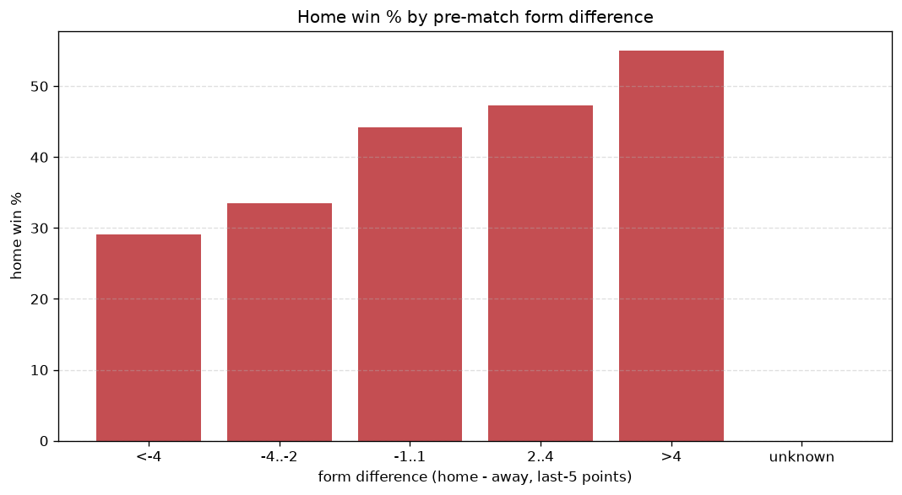
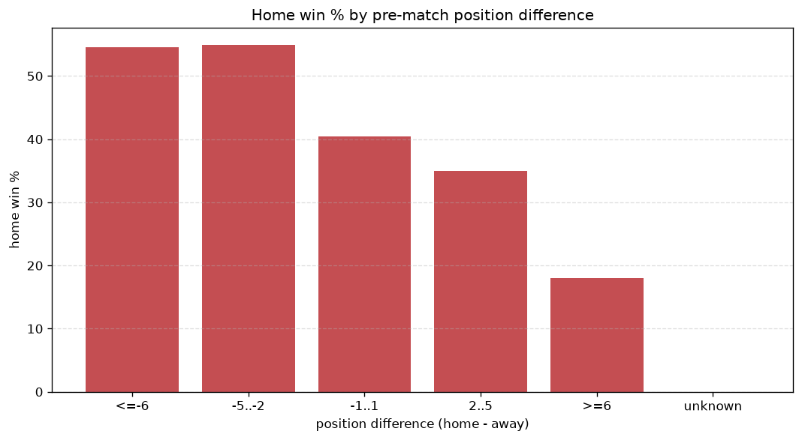

# Relationships Analysis
- Report: `relationships`
- Generated: 2026-10-26T01:46:46+00:00
- Script: `backend/scripts/analyze_relationships.py` v1.0.0
- League: League One (Scotland)
- Scope: league `scot1`

- Matches analysed: **1001** (23 leakage-safe pre-match features).

## 1. Correlation matrix
_Pearson correlation of each pre-match feature with observed goals; sorted by |corr(total goals)|._

| feature | corr(home) | corr(away) | corr(total) |
|---|---|---|---|
| away_team_away_conceded_avg | 0.212 | -0.077 | 0.108 |
| away_position_before_match | 0.228 | -0.101 | 0.103 |
| home_team_home_conceded_avg | -0.028 | 0.119 | 0.068 |
| home_team_home_goals_avg | 0.138 | -0.057 | 0.066 |
| home_points_before_match | 0.116 | -0.033 | 0.065 |
| position_difference | -0.266 | 0.192 | -0.064 |
| away_team_goals_conceded_last_5 | 0.137 | -0.069 | 0.056 |
| away_team_away_win_rate | -0.128 | 0.071 | -0.046 |
| points_difference | 0.270 | -0.229 | 0.039 |
| home_team_goals_scored_last_5 | 0.116 | -0.074 | 0.035 |
| home_team_goals_conceded_last_5 | -0.067 | 0.115 | 0.034 |
| away_points_before_match | -0.100 | 0.149 | 0.034 |
| home_team_points_last_5 | 0.137 | -0.110 | 0.025 |
| away_team_goals_scored_last_5 | -0.070 | 0.102 | 0.022 |
| away_team_away_goals_avg | -0.064 | 0.094 | 0.021 |
| home_team_home_win_rate | 0.127 | -0.105 | 0.021 |
| away_rest_days | -0.013 | -0.012 | -0.019 |
| home_team_wins_last_5 | 0.120 | -0.103 | 0.017 |
| home_rest_days | -0.026 | 0.006 | -0.016 |
| home_position_before_match | -0.146 | 0.169 | 0.012 |
| away_team_points_last_5 | -0.110 | 0.103 | -0.009 |
| away_team_wins_last_5 | -0.094 | 0.093 | -0.004 |
| rest_days_difference | -0.028 | 0.032 | 0.001 |

## 2. Form vs outcome
_Home win/draw/away % per bucket of `home_team_points_last_5 - away_team_points_last_5`._

| bucket | matches | home | draw | away | home % | draw % | away % |
|---|---|---|---|---|---|---|---|
| <-4 | 165 | 48 | 43 | 74 | 29.1% | 26.1% | 44.8% |
| -4..-2 | 203 | 68 | 53 | 82 | 33.5% | 26.1% | 40.4% |
| -1..1 | 283 | 125 | 69 | 89 | 44.2% | 24.4% | 31.4% |
| 2..4 | 201 | 95 | 54 | 52 | 47.3% | 26.9% | 25.9% |
| >4 | 149 | 82 | 34 | 33 | 55.0% | 22.8% | 22.1% |
| unknown | 0 | 0 | 0 | 0 | - | - | - |

## 3. Position vs outcome
_Home win/draw/away % per bucket of `position_difference` (home position - away position; negative favours the home team)._

| bucket | matches | home | draw | away | home % | draw % | away % |
|---|---|---|---|---|---|---|---|
| <=-6 | 99 | 54 | 32 | 13 | 54.5% | 32.3% | 13.1% |
| -5..-2 | 273 | 150 | 58 | 65 | 54.9% | 21.2% | 23.8% |
| -1..1 | 235 | 95 | 65 | 75 | 40.4% | 27.7% | 31.9% |
| 2..5 | 283 | 99 | 65 | 119 | 35.0% | 23.0% | 42.0% |
| >=6 | 111 | 20 | 33 | 58 | 18.0% | 29.7% | 52.3% |
| unknown | 0 | 0 | 0 | 0 | - | - | - |

## 4. Rest advantage
_Home win/draw/away % per bucket of `rest_days_difference` (home rest - away rest). Matches with unknown rest are bucketed separately._

| bucket | matches | home | draw | away | home % | draw % | away % |
|---|---|---|---|---|---|---|---|
| <-1 | 97 | 40 | 26 | 31 | 41.2% | 26.8% | 32.0% |
| -1..0 | 10 | 3 | 6 | 1 | 30.0% | 60.0% | 10.0% |
| 0 | 763 | 325 | 193 | 245 | 42.6% | 25.3% | 32.1% |
| 1..2 | 14 | 4 | 4 | 6 | 28.6% | 28.6% | 42.9% |
| >2 | 84 | 33 | 17 | 34 | 39.3% | 20.2% | 40.5% |
| unknown | 33 | 13 | 7 | 13 | 39.4% | 21.2% | 39.4% |
- *33 match(es) had unknown rest difference (missing rest data on at least one side).*

## 5. Home team quality
_Home win rate by `home_team_home_win_rate` tier (split at 0.5)._

- `< 0.5` tier: **37.5%** home win (221/590)
- `>= 0.5` tier: **47.9%** home win (197/411)
- Home-win gap (>= split minus < split): **+10.4 pp**

| tier | label | matches | home | draw | away | home % |
|---|---|---|---|---|---|---|
| low | < 0.5 | 590 | 221 | 144 | 225 | 37.5% |
| high | >= 0.5 | 411 | 197 | 109 | 105 | 47.9% |

## 6. Feature averages by result
_Mean feature value per outcome; `range` is home-minus-away spread of the group means._

| feature | home mean | draw mean | away mean | range |
|---|---|---|---|---|
| points_difference | 4.144 | -0.601 | -5.558 | 9.701 |
| away_points_before_match | 19.766 | 24.743 | 26.391 | 6.625 |
| home_points_before_match | 23.909 | 24.142 | 20.833 | 3.309 |
| position_difference | -1.041 | 0.126 | 1.521 | 2.562 |
| away_position_before_match | 6.017 | 5.202 | 4.661 | 1.356 |
| home_position_before_match | 4.976 | 5.328 | 6.182 | 1.206 |
| home_team_points_last_5 | 6.581 | 6.308 | 5.500 | 1.081 |
| away_team_points_last_5 | 5.730 | 6.569 | 6.791 | 1.061 |
| home_team_goals_conceded_last_5 | 6.010 | 6.162 | 6.979 | 0.969 |
| away_team_goals_conceded_last_5 | 6.746 | 6.134 | 5.848 | 0.898 |
| away_team_goals_scored_last_5 | 5.923 | 6.783 | 6.809 | 0.886 |
| home_team_goals_scored_last_5 | 6.498 | 6.364 | 5.864 | 0.634 |
| home_rest_days | 7.808 | 8.049 | 8.306 | 0.498 |
| away_rest_days | 7.914 | 8.232 | 8.242 | 0.329 |
| home_team_wins_last_5 | 1.782 | 1.723 | 1.470 | 0.313 |
| away_team_wins_last_5 | 1.543 | 1.798 | 1.855 | 0.311 |
| away_team_away_conceded_avg | 1.524 | 1.297 | 1.254 | 0.269 |
| rest_days_difference | -0.094 | -0.183 | 0.047 | 0.230 |
| home_team_home_conceded_avg | 1.157 | 1.171 | 1.314 | 0.157 |
| away_team_away_goals_avg | 1.150 | 1.242 | 1.299 | 0.149 |
| home_team_home_goals_avg | 1.423 | 1.391 | 1.296 | 0.127 |
| home_team_home_win_rate | 0.431 | 0.418 | 0.360 | 0.071 |
| away_team_away_win_rate | 0.274 | 0.327 | 0.335 | 0.062 |

---
*All features are leakage-safe pre-match values built by `ml.features.build_features.build_rows` from strictly prior matches. Run with `python backend/scripts/analyze_relationships.py` to regenerate.*

## Charts

