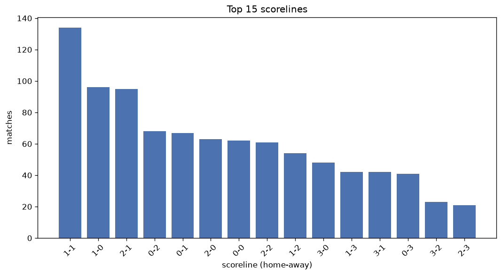
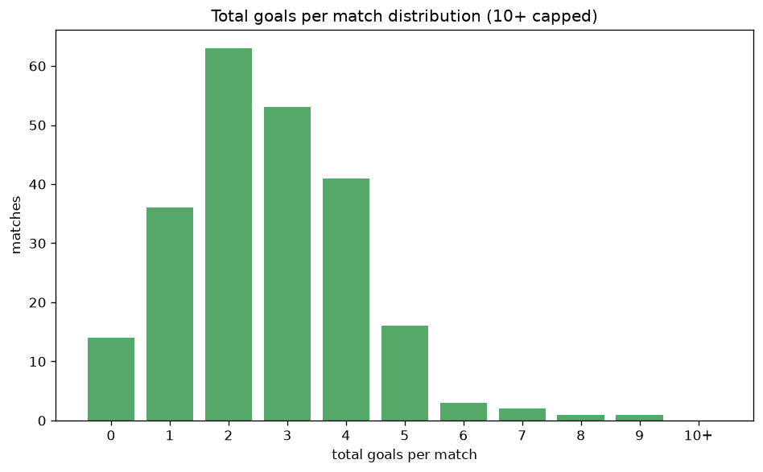

# Scoreline Analysis
- Report: `scoreline_analysis`
- Generated: 2026-10-27T02:28:42+00:00
- Script: `backend/scripts/analyze_scorelines.py` v1.0.0
- League: League One (Scotland)
- Scope: league `scot1`

## 1. Scoreline frequency
- Matches analysed: **1060** across **7** seasons.
- Distinct scorelines seen: **40**.

| scoreline | count | pct |
|---|---|---|
| 1-1 | 134 | 12.6% |
| 1-0 | 96 | 9.1% |
| 2-1 | 95 | 9.0% |
| 0-2 | 68 | 6.4% |
| 0-1 | 67 | 6.3% |
| 2-0 | 63 | 5.9% |
| 0-0 | 62 | 5.8% |
| 2-2 | 61 | 5.8% |
| 1-2 | 54 | 5.1% |
| 3-0 | 48 | 4.5% |
| 1-3 | 42 | 4.0% |
| 3-1 | 42 | 4.0% |
| 0-3 | 41 | 3.9% |
| 3-2 | 23 | 2.2% |
| 2-3 | 21 | 2.0% |
| 4-0 | 19 | 1.8% |
| 4-1 | 17 | 1.6% |
| 5-0 | 15 | 1.4% |
| 1-4 | 15 | 1.4% |
| 0-4 | 9 | 0.8% |

## 2. Scoreline frequency per season

### 2020-2021
| scoreline | count | pct |
|---|---|---|
| 1-0 | 12 | 13.3% |
| 2-0 | 10 | 11.1% |
| 0-1 | 10 | 11.1% |
| 2-1 | 9 | 10.0% |
| 1-1 | 7 | 7.8% |

### 2021-2022
| scoreline | count | pct |
|---|---|---|
| 1-1 | 31 | 17.2% |
| 2-1 | 18 | 10.0% |
| 0-1 | 12 | 6.7% |
| 0-3 | 11 | 6.1% |
| 1-0 | 11 | 6.1% |

### 2022-2023
| scoreline | count | pct |
|---|---|---|
| 1-1 | 19 | 10.6% |
| 1-0 | 17 | 9.4% |
| 2-1 | 14 | 7.8% |
| 2-0 | 14 | 7.8% |
| 0-2 | 13 | 7.2% |

### 2023-2024
| scoreline | count | pct |
|---|---|---|
| 1-1 | 18 | 10.0% |
| 1-0 | 17 | 9.4% |
| 2-2 | 14 | 7.8% |
| 0-2 | 11 | 6.1% |
| 1-2 | 11 | 6.1% |

### 2024-2025
| scoreline | count | pct |
|---|---|---|
| 1-1 | 23 | 12.8% |
| 2-1 | 20 | 11.1% |
| 1-0 | 18 | 10.0% |
| 0-0 | 13 | 7.2% |
| 2-0 | 13 | 7.2% |

### 2025-2026
| scoreline | count | pct |
|---|---|---|
| 1-1 | 30 | 15.7% |
| 1-0 | 17 | 8.9% |
| 2-1 | 16 | 8.4% |
| 0-2 | 15 | 7.9% |
| 3-1 | 14 | 7.3% |

### 2026-2027
| scoreline | count | pct |
|---|---|---|
| 2-1 | 7 | 11.9% |
| 0-1 | 6 | 10.2% |
| 1-1 | 6 | 10.2% |
| 3-0 | 5 | 8.5% |
| 0-0 | 4 | 6.8% |

## 3. Total-goal histogram
_10+ groups all matches with 10 or more total goals._

| total goals | matches | pct |
|---|---|---|
| 0 | 62 | 5.8% |
| 1 | 163 | 15.4% |
| 2 | 265 | 25.0% |
| 3 | 238 | 22.5% |
| 4 | 173 | 16.3% |
| 5 | 97 | 9.2% |
| 6 | 37 | 3.5% |
| 7 | 18 | 1.7% |
| 8 | 5 | 0.5% |
| 9 | 2 | 0.2% |
| 10+ | 0 | 0.0% |

## 4. Extreme scorelines
- Matches with 7+ total goals: **25**

| season | date | scoreline | total goals |
|---|---|---|---|
| 2023-2024 | 2023-12-23 | 7-2 | 9 |
| 2025-2026 | 2026-03-14 | 5-4 | 9 |
| 2021-2022 | 2022-01-08 | 6-2 | 8 |
| 2022-2023 | 2023-01-02 | 3-5 | 8 |
| 2023-2024 | 2024-03-30 | 1-7 | 8 |
| 2026-2027 | 2026-09-15 | 8-0 | 8 |
| 2026-2027 | 2026-10-17 | 1-7 | 8 |
| 2021-2022 | 2021-08-14 | 5-2 | 7 |
| 2021-2022 | 2021-10-24 | 3-4 | 7 |
| 2021-2022 | 2022-02-26 | 4-3 | 7 |
| 2021-2022 | 2022-03-05 | 5-2 | 7 |
| 2022-2023 | 2022-11-19 | 4-3 | 7 |
| 2022-2023 | 2022-12-23 | 5-2 | 7 |
| 2022-2023 | 2023-02-11 | 3-4 | 7 |
| 2022-2023 | 2023-03-11 | 6-1 | 7 |
| 2022-2023 | 2023-03-18 | 7-0 | 7 |
| 2023-2024 | 2023-08-05 | 3-4 | 7 |
| 2023-2024 | 2023-09-16 | 5-2 | 7 |
| 2023-2024 | 2023-12-30 | 2-5 | 7 |
| 2023-2024 | 2024-03-02 | 4-3 | 7 |
| 2023-2024 | 2024-03-16 | 2-5 | 7 |
| 2024-2025 | 2025-02-22 | 3-4 | 7 |
| 2025-2026 | 2025-12-20 | 2-5 | 7 |
| 2025-2026 | 2026-05-15 | 4-3 | 7 |
| 2026-2027 | 2026-10-03 | 4-3 | 7 |

## 5. Margin-of-victory distribution (decided matches)
- Decided matches: **795** (draws: **265**)
- Average winning margin: **1.93**

| margin | matches | pct |
|---|---|---|
| 1 | 366 | 46.0% |
| 2 | 230 | 28.9% |
| 3+ | 199 | 25.0% |

## 6. Margin by outcome

### Home wins
- Matches: **445** | avg margin: **1.92** | max margin: **8**
| margin | matches | pct |
|---|---|---|
| 1 | 220 | 49.4% |
| 2 | 111 | 24.9% |
| 3+ | 114 | 25.6% |
- *Full match-by-match list available in `scoreline_analysis.json`.*

### Away wins
- Matches: **350** | avg margin: **1.94** | max margin: **6**
| margin | matches | pct |
|---|---|---|
| 1 | 146 | 41.7% |
| 2 | 119 | 34.0% |
| 3+ | 85 | 24.3% |
- *Full match-by-match list available in `scoreline_analysis.json`.*

## 7. Most common exact score by outcome type
| outcome | matches | most common score | count | pct |
|---|---|---|---|---|
| home | 445 | 1-0 | 96 | 21.6% |
| draw | 265 | 1-1 | 134 | 50.6% |
| away | 350 | 0-2 | 68 | 19.4% |

---
*All statistics are computed from PostgreSQL tables (read-only). Run with `python backend/scripts/analyze_scorelines.py` to regenerate.*

## Charts

