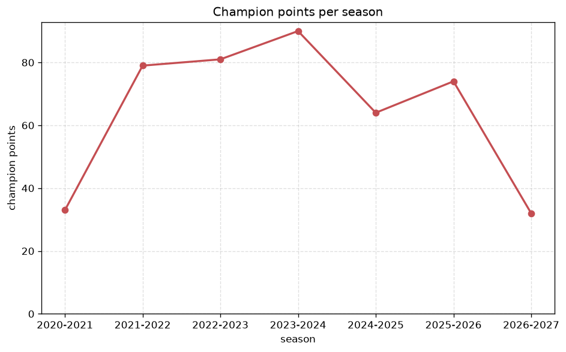
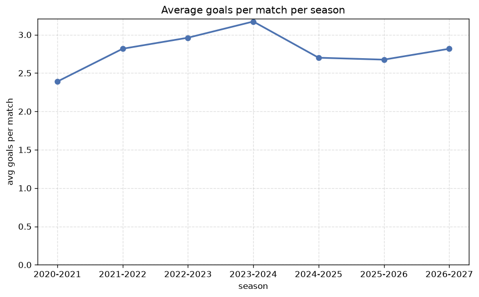

# Season Trends Analysis
- Report: `season_trends`
- Generated: 2026-10-29T02:13:30+00:00
- Script: `backend/scripts/analyze_seasons.py` v1.0.0
- League: League One (Scotland)
- Scope: league `scot1`

## 1. Champions per season
| season | champion | pts | runner-up | margin |
|---|---|---|---|---|
| 2020-2021 | Partick Thistle | 33 | Falkirk | 2 pts |
| 2021-2022 | Cove Rangers | 79 | Airdrieonians | 7 pts |
| 2022-2023 | Dunfermline | 81 | Falkirk | 14 pts |
| 2023-2024 | Falkirk | 90 | Hamilton | 16 pts |
| 2024-2025 | Arbroath | 64 | Inverness | 6 pts |
| 2025-2026 | Inverness | 74 | Stenhousemuir | 3 pts |
| 2026-2027 | Ross County | 32 | Hamilton | 0 pts |

## 2. Title-race tightness
- Tight races (margin <= 3 pts): **3** of 7 seasons
- Tightest race: **2026-2027** - Ross County beat Hamilton by **0** pts

| season | margin | tight |
|---|---|---|
| 2020-2021 | 2 pts | yes |
| 2021-2022 | 7 pts |  |
| 2022-2023 | 14 pts |  |
| 2023-2024 | 16 pts |  |
| 2024-2025 | 6 pts |  |
| 2025-2026 | 3 pts | yes |
| 2026-2027 | 0 pts | yes |

## 3. Points thresholds
_Position-specific points per season. Key: 1 = champion, 2 = runner-up, 4 = CL line, 6 = Europa, 7 = last safe, 10 = bottom._

| season | pos 1 | pos 2 | pos 4 | pos 6 | pos 7 | pos 10 |
|---|---|---|---|---|---|---|
| 2020-2021 | 33 | 31 | 29 | 27 | 23 | 11 |
| 2021-2022 | 79 | 72 | 51 | 44 | 42 | 23 |
| 2022-2023 | 81 | 67 | 57 | 51 | 48 | 16 |
| 2023-2024 | 90 | 74 | 53 | 44 | 41 | 14 |
| 2024-2025 | 64 | 58 | 55 | 51 | 44 | 35 |
| 2025-2026 | 74 | 71 | 59 | 43 | 42 | 29 |
| 2026-2027 | 32 | 32 | 19 | 13 | 12 | 6 |

## 4. Relegation battle
| season | safe pos | safe pts | drop pos | drop pts | gap |
|---|---|---|---|---|---|
| 2020-2021 | 7 | 23 | 8 | 20 | 3 pts |
| 2021-2022 | 7 | 42 | 8 | 39 | 3 pts |
| 2022-2023 | 7 | 48 | 8 | 40 | 8 pts |
| 2023-2024 | 7 | 41 | 8 | 39 | 2 pts |
| 2024-2025 | 7 | 44 | 8 | 40 | 4 pts |
| 2025-2026 | 7 | 42 | 8 | 38 | 4 pts |
| 2026-2027 | 7 | 12 | 8 | 10 | 2 pts |

## 5. League-level trends
| season | matches | total goals | avg goals | home win | draw | away win | goalless | avg pts/team |
|---|---|---|---|---|---|---|---|---|
| 2020-2021 | 90 | 215 | 2.389 | 45.6% | 21.1% | 33.3% | 6.7% | 25.1 |
| 2021-2022 | 180 | 507 | 2.817 | 39.4% | 28.9% | 31.7% | 5.6% | 48.8 |
| 2022-2023 | 180 | 533 | 2.961 | 43.3% | 23.3% | 33.3% | 6.1% | 49.8 |
| 2023-2024 | 180 | 571 | 3.172 | 41.1% | 22.8% | 36.1% | 4.4% | 49.9 |
| 2024-2025 | 180 | 486 | 2.7 | 41.1% | 26.1% | 32.8% | 7.2% | 49.3 |
| 2025-2026 | 191 | 511 | 2.675 | 41.9% | 27.2% | 30.9% | 5.2% | 37.0 |
| 2026-2027 | 60 | 169 | 2.817 | 45.0% | 21.7% | 33.3% | 6.7% | 16.7 |

## 6. View divergence
- Largest divergence: **2025-2026** (goals view, avg abs position diff = 4.571)

_Avg absolute position difference between classic view and alternative view per season._

| season | classic vs luck | classic vs goals |
|---|---|---|
| 2020-2021 | 3.000 | 3.400 |
| 2021-2022 | 1.800 | 3.400 |
| 2022-2023 | 1.200 | 2.800 |
| 2023-2024 | 1.400 | 3.000 |
| 2024-2025 | 0.800 | 3.800 |
| 2025-2026 | 3.286 | 4.571 |
| 2026-2027 | 0.800 | 1.600 |

---
*All statistics are computed from PostgreSQL tables (read-only). Run with `python backend/scripts/analyze_seasons.py` to regenerate.*

## Charts

