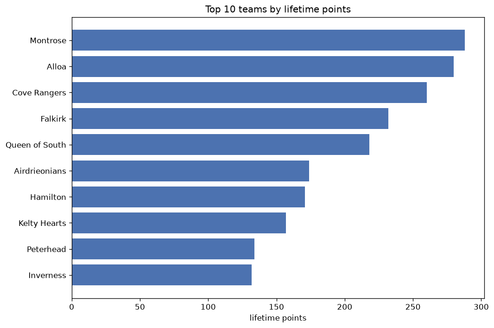
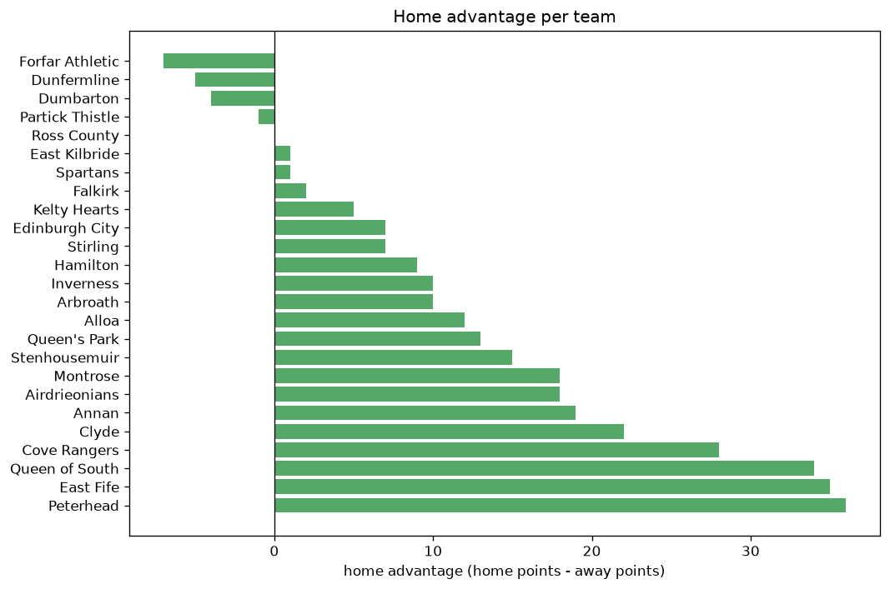

# Team Analysis
- Report: `teams_analysis`
- Generated: 2026-10-29T02:13:28+00:00
- Script: `backend/scripts/analyze_teams.py` v1.0.0
- League: League One (Scotland)
- Scope: league `scot1`

- Teams: **25** | Seasons: **7** | Matches: **1061**

## 1. Team standings (lifetime)
| team | seasons | played | W | D | L | pts | GF | GA | GD | avg pts/season | best pos | worst pos | titles |
|---|---|---|---|---|---|---|---|---|---|---|---|---|---|
| Montrose | 7 | 210 | 76 | 60 | 74 | 288 | 293 | 310 | -17 | 41.14 | 3 | 8 | 0 |
| Alloa | 6 | 195 | 78 | 46 | 71 | 280 | 286 | 262 | 24 | 46.67 | 3 | 7 | 0 |
| Cove Rangers | 6 | 174 | 72 | 44 | 58 | 260 | 265 | 214 | 51 | 43.33 | 1 | 10 | 1 |
| Falkirk | 4 | 126 | 67 | 31 | 28 | 232 | 241 | 137 | 104 | 58.0 | 1 | 6 | 1 |
| Queen of South | 5 | 158 | 61 | 35 | 62 | 218 | 225 | 238 | -13 | 43.6 | 4 | 7 | 0 |
| Airdrieonians | 5 | 104 | 50 | 24 | 30 | 174 | 190 | 132 | 58 | 34.8 | 2 | 13 | 0 |
| Hamilton | 3 | 88 | 51 | 18 | 19 | 171 | 163 | 81 | 82 | 57.0 | 2 | 3 | 0 |
| Kelty Hearts | 4 | 144 | 39 | 40 | 65 | 157 | 160 | 225 | -65 | 39.25 | 6 | 10 | 0 |
| Peterhead | 5 | 138 | 36 | 26 | 76 | 134 | 137 | 240 | -103 | 26.8 | 6 | 10 | 0 |
| Inverness | 2 | 72 | 37 | 21 | 14 | 132 | 105 | 62 | 43 | 66.0 | 1 | 2 | 1 |
| Stenhousemuir | 2 | 75 | 35 | 22 | 18 | 127 | 105 | 76 | 29 | 63.5 | 2 | 5 | 0 |
| East Fife | 4 | 102 | 23 | 26 | 53 | 95 | 97 | 172 | -75 | 23.75 | 6 | 10 | 0 |
| Dumbarton | 3 | 90 | 22 | 22 | 46 | 88 | 108 | 155 | -47 | 29.33 | 9 | 10 | 0 |
| Clyde | 4 | 94 | 21 | 25 | 48 | 88 | 103 | 168 | -65 | 22.0 | 8 | 11 | 0 |
| Dunfermline | 1 | 36 | 23 | 12 | 1 | 81 | 63 | 21 | 42 | 81.0 | 1 | 1 | 1 |
| Annan | 2 | 72 | 19 | 18 | 35 | 75 | 96 | 136 | -40 | 37.5 | 8 | 9 | 0 |
| Edinburgh City | 2 | 72 | 18 | 11 | 43 | 65 | 98 | 153 | -55 | 32.5 | 6 | 10 | 0 |
| Arbroath | 1 | 36 | 19 | 7 | 10 | 64 | 58 | 42 | 16 | 64.0 | 1 | 1 | 1 |
| Queen's Park | 1 | 36 | 11 | 18 | 7 | 51 | 51 | 36 | 15 | 51.0 | 4 | 4 | 0 |
| Stirling | 1 | 36 | 10 | 9 | 17 | 39 | 39 | 58 | -19 | 39.0 | 9 | 9 | 0 |
| Partick Thistle | 1 | 18 | 9 | 6 | 3 | 33 | 30 | 13 | 17 | 33.0 | 1 | 1 | 1 |
| Ross County | 1 | 12 | 10 | 2 | 0 | 32 | 43 | 7 | 36 | 32.0 | 1 | 1 | 1 |
| East Kilbride | 1 | 12 | 6 | 3 | 3 | 21 | 21 | 15 | 6 | 21.0 | 3 | 3 | 0 |
| Forfar Athletic | 2 | 20 | 2 | 5 | 13 | 11 | 14 | 36 | -22 | 5.5 | 10 | 14 | 0 |
| Spartans | 1 | 2 | 0 | 1 | 1 | 1 | 1 | 3 | -2 | 1.0 | 12 | 12 | 0 |

## 2. Home vs away split
| team | home P | H-W | H-D | H-L | H-pts | away P | A-W | A-D | A-L | A-pts | adv |
|---|---|---|---|---|---|---|---|---|---|---|---|
| Peterhead | 69 | 24 | 13 | 32 | 85 | 69 | 12 | 13 | 44 | 49 | 36 |
| East Fife | 51 | 17 | 14 | 20 | 65 | 51 | 6 | 12 | 33 | 30 | 35 |
| Queen of South | 79 | 37 | 15 | 27 | 126 | 79 | 24 | 20 | 35 | 92 | 34 |
| Cove Rangers | 87 | 40 | 24 | 23 | 144 | 87 | 32 | 20 | 35 | 116 | 28 |
| Clyde | 47 | 14 | 13 | 20 | 55 | 47 | 7 | 12 | 28 | 33 | 22 |
| Annan | 36 | 13 | 8 | 15 | 47 | 36 | 6 | 10 | 20 | 28 | 19 |
| Montrose | 105 | 41 | 30 | 34 | 153 | 105 | 35 | 30 | 40 | 135 | 18 |
| Airdrieonians | 52 | 29 | 9 | 14 | 96 | 52 | 21 | 15 | 16 | 78 | 18 |
| Stenhousemuir | 37 | 20 | 11 | 6 | 71 | 38 | 15 | 11 | 12 | 56 | 15 |
| Queen's Park | 18 | 8 | 8 | 2 | 32 | 18 | 3 | 10 | 5 | 19 | 13 |
| Alloa | 98 | 41 | 23 | 34 | 146 | 97 | 37 | 23 | 37 | 134 | 12 |
| Inverness | 36 | 20 | 11 | 5 | 71 | 36 | 17 | 10 | 9 | 61 | 10 |
| Arbroath | 18 | 11 | 4 | 3 | 37 | 18 | 8 | 3 | 7 | 27 | 10 |
| Hamilton | 44 | 28 | 6 | 10 | 90 | 44 | 23 | 12 | 9 | 81 | 9 |
| Edinburgh City | 36 | 10 | 6 | 20 | 36 | 36 | 8 | 5 | 23 | 29 | 7 |
| Stirling | 18 | 5 | 8 | 5 | 23 | 18 | 5 | 1 | 12 | 16 | 7 |
| Kelty Hearts | 72 | 21 | 18 | 33 | 81 | 72 | 18 | 22 | 32 | 76 | 5 |
| Falkirk | 63 | 34 | 15 | 14 | 117 | 63 | 33 | 16 | 14 | 115 | 2 |
| East Kilbride | 6 | 3 | 2 | 1 | 11 | 6 | 3 | 1 | 2 | 10 | 1 |
| Spartans | 1 | 0 | 1 | 0 | 1 | 1 | 0 | 0 | 1 | 0 | 1 |
| Ross County | 6 | 5 | 1 | 0 | 16 | 6 | 5 | 1 | 0 | 16 | 0 |
| Partick Thistle | 9 | 4 | 4 | 1 | 16 | 9 | 5 | 2 | 2 | 17 | -1 |
| Dumbarton | 45 | 10 | 12 | 23 | 42 | 45 | 12 | 10 | 23 | 46 | -4 |
| Dunfermline | 18 | 10 | 8 | 0 | 38 | 18 | 13 | 4 | 1 | 43 | -5 |
| Forfar Athletic | 10 | 0 | 2 | 8 | 2 | 10 | 2 | 3 | 5 | 9 | -7 |

## 3. Top performers
### Best points per game (PPG)
| rank | team | PPG |
|---|---|---|
| 1 | Ross County | 2.67 |
| 2 | Dunfermline | 2.25 |
| 3 | Hamilton | 1.94 |
| 4 | Falkirk | 1.84 |
| 5 | Inverness | 1.83 |

### Most goals scored
| rank | team | goals |
|---|---|---|
| 1 | Montrose | 293 |
| 2 | Alloa | 286 |
| 3 | Cove Rangers | 265 |
| 4 | Falkirk | 241 |
| 5 | Queen of South | 225 |

### Best goal difference
| rank | team | GD |
|---|---|---|
| 1 | Falkirk | 104 |
| 2 | Hamilton | 82 |
| 3 | Airdrieonians | 58 |
| 4 | Cove Rangers | 51 |
| 5 | Inverness | 43 |

### Best defence (goals against per match, standings)
| rank | team | GA/match |
|---|---|---|
| 1 | Dunfermline | 0.583 |
| 2 | Ross County | 0.583 |
| 3 | Partick Thistle | 0.722 |
| 4 | Inverness | 0.861 |
| 5 | Hamilton | 0.920 |

## 4. Team consistency
- Teams present in all **7** seasons: **1**

Montrose

## 5. Head-to-head dominance
- Distinct fixtures: **177** (showing the 15 most frequent)

| fixture | meetings | home wins | draws | away wins | home pct | draw pct | away pct |
|---|---|---|---|---|---|---|---|
| Alloa vs Montrose | 21 | 9 | 7 | 5 | 42.9% | 33.3% | 23.8% |
| Cove Rangers vs Montrose | 19 | 6 | 6 | 7 | 31.6% | 31.6% | 36.8% |
| Queen of South vs Alloa | 18 | 4 | 5 | 9 | 22.2% | 27.8% | 50.0% |
| Queen of South vs Montrose | 17 | 10 | 2 | 5 | 58.8% | 11.8% | 29.4% |
| Alloa vs Cove Rangers | 17 | 7 | 5 | 5 | 41.2% | 29.4% | 29.4% |
| Alloa vs Kelty Hearts | 16 | 10 | 3 | 3 | 62.5% | 18.8% | 18.8% |
| Montrose vs Peterhead | 16 | 7 | 6 | 3 | 43.8% | 37.5% | 18.8% |
| Queen of South vs Kelty Hearts | 16 | 7 | 3 | 6 | 43.8% | 18.8% | 37.5% |
| Montrose vs Kelty Hearts | 16 | 3 | 5 | 8 | 18.8% | 31.2% | 50.0% |
| Falkirk vs Montrose | 14 | 5 | 4 | 5 | 35.7% | 28.6% | 35.7% |
| Alloa vs Peterhead | 13 | 7 | 1 | 5 | 53.8% | 7.7% | 38.5% |
| Queen of South vs Cove Rangers | 13 | 7 | 2 | 4 | 53.8% | 15.4% | 30.8% |
| Cove Rangers vs East Fife | 12 | 7 | 3 | 2 | 58.3% | 25.0% | 16.7% |
| Cove Rangers vs Peterhead | 12 | 7 | 0 | 5 | 58.3% | 0.0% | 41.7% |
| Alloa vs Falkirk | 12 | 4 | 3 | 5 | 33.3% | 25.0% | 41.7% |

## 6. Position per season (classic view)
_Cells show final position; '-' when the team was absent from that season._

| team | 2020-2021 | 2021-2022 | 2022-2023 | 2023-2024 | 2024-2025 | 2025-2026 | 2026-2027 |
|---|---|---|---|---|---|---|---|
| Montrose | 5 | 3 | 7 | 4 | 8 | 7 | 4 |
| Alloa | - | 5 | 4 | 3 | 6 | 4 | 7 |
| Cove Rangers | 3 | 1 | - | 5 | 3 | 8 | 10 |
| Falkirk | 2 | 6 | 2 | 1 | - | - | - |
| Queen of South | - | - | 5 | 7 | 4 | 5 | 6 |
| Airdrieonians | 4 | 2 | 3 | - | - | 13 | 5 |
| Hamilton | - | - | - | 2 | - | 3 | 2 |
| Kelty Hearts | - | - | 8 | 6 | 7 | 10 | - |
| Peterhead | 7 | 7 | 10 | - | - | 6 | 8 |
| Inverness | - | - | - | - | 2 | 1 | - |
| Stenhousemuir | - | - | - | - | 5 | 2 | - |
| East Fife | 6 | 10 | - | - | - | 9 | 9 |
| Dumbarton | 9 | 9 | - | - | 10 | - | - |
| Clyde | 8 | 8 | 9 | - | - | 11 | - |
| Dunfermline | - | - | 1 | - | - | - | - |
| Annan | - | - | - | 8 | 9 | - | - |
| Edinburgh City | - | - | 6 | 10 | - | - | - |
| Arbroath | - | - | - | - | 1 | - | - |
| Queen's Park | - | 4 | - | - | - | - | - |
| Stirling | - | - | - | 9 | - | - | - |
| Partick Thistle | 1 | - | - | - | - | - | - |
| Ross County | - | - | - | - | - | - | 1 |
| East Kilbride | - | - | - | - | - | - | 3 |
| Forfar Athletic | 10 | - | - | - | - | 14 | - |
| Spartans | - | - | - | - | - | 12 | - |

---
*All statistics are computed from PostgreSQL tables (read-only). Run with `python backend/scripts/analyze_teams.py` to regenerate.*

## Charts

