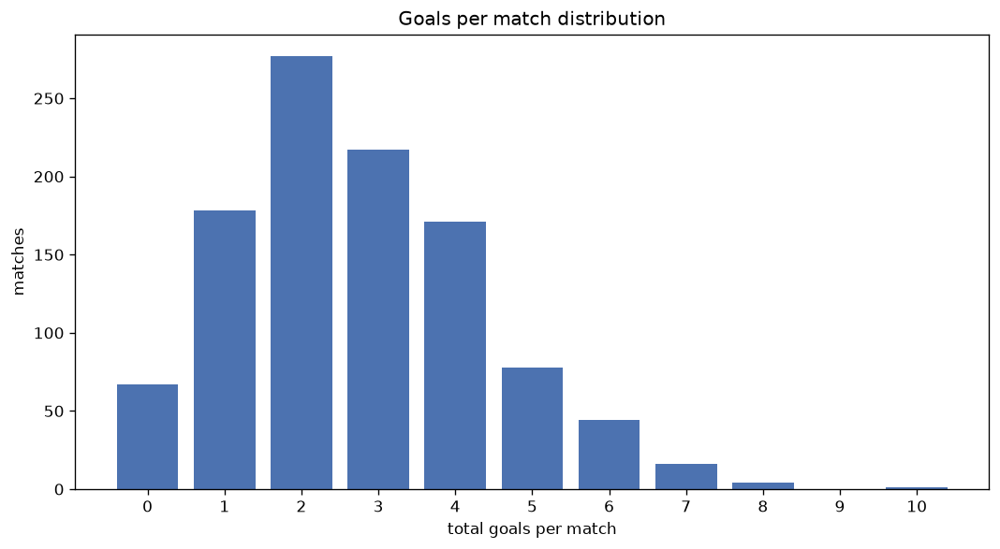
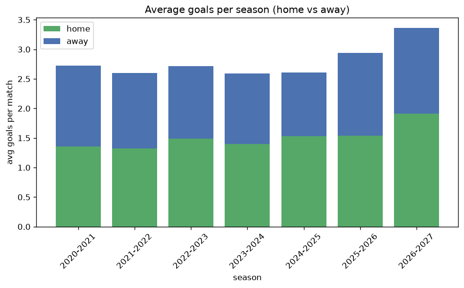

# Goal Analysis
- Report: `goals_analysis`
- Generated: 2026-10-26T01:46:55+00:00
- Script: `backend/scripts/analyze_goals.py` v1.0.0
- League: League Two (Scotland)
- Scope: league `scot2`

## 1. Goals per match distribution
| goals | matches | pct |
|---|---|---|
| 0 | 67 | 6.4% |
| 1 | 178 | 16.9% |
| 2 | 277 | 26.3% |
| 3 | 217 | 20.6% |
| 4 | 171 | 16.2% |
| 5 | 78 | 7.4% |
| 6 | 44 | 4.2% |
| 7 | 16 | 1.5% |
| 8 | 4 | 0.4% |
| 9 | 0 | 0.0% |
| 10 | 1 | 0.1% |

## 2. Goals per match per season
| season | matches | total goals | avg home | avg away | avg total |
|---|---|---|---|---|---|
| 2020-2021 | 90 | 245 | 1.356 | 1.367 | 2.722 |
| 2021-2022 | 180 | 468 | 1.322 | 1.278 | 2.6 |
| 2022-2023 | 180 | 489 | 1.489 | 1.228 | 2.717 |
| 2023-2024 | 180 | 467 | 1.4 | 1.194 | 2.594 |
| 2024-2025 | 180 | 469 | 1.533 | 1.072 | 2.606 |
| 2025-2026 | 188 | 552 | 1.537 | 1.399 | 2.936 |
| 2026-2027 | 55 | 185 | 1.909 | 1.455 | 3.364 |

## 3. Home vs away goal share
- Home goals: **1550** (53.9%)
- Away goals: **1325** (46.1%)
- Home/away ratio: **1.17**

| season | home goals | away goals | total | home pct | away pct |
|---|---|---|---|---|---|
| 2020-2021 | 122 | 123 | 245 | 49.8% | 50.2% |
| 2021-2022 | 238 | 230 | 468 | 50.9% | 49.1% |
| 2022-2023 | 268 | 221 | 489 | 54.8% | 45.2% |
| 2023-2024 | 252 | 215 | 467 | 54.0% | 46.0% |
| 2024-2025 | 276 | 193 | 469 | 58.8% | 41.2% |
| 2025-2026 | 289 | 263 | 552 | 52.4% | 47.6% |
| 2026-2027 | 105 | 80 | 185 | 56.8% | 43.2% |

## 4. BTTS (Both Teams To Score)
- Overall: **553** of `1053` (52.5%)

| season | matches | BTTS | pct |
|---|---|---|---|
| 2020-2021 | 90 | 40 | 44.4% |
| 2021-2022 | 180 | 89 | 49.4% |
| 2022-2023 | 180 | 99 | 55.0% |
| 2023-2024 | 180 | 95 | 52.8% |
| 2024-2025 | 180 | 82 | 45.6% |
| 2025-2026 | 188 | 116 | 61.7% |
| 2026-2027 | 55 | 32 | 58.2% |

## 5. Clean sheets
- Home clean sheets: **322** (30.6%)
- Away clean sheets: **245** (23.3%)
- Total clean sheets recorded: **567**
- Matches with at least one clean sheet: **500** (47.5%)
- Both teams kept clean sheets (0-0): **67**

| season | matches | home CS | away CS | total CS | matches w/ CS |
|---|---|---|---|---|---|
| 2020-2021 | 90 | 32 | 24 | 56 | 50 (55.6%) |
| 2021-2022 | 180 | 54 | 49 | 103 | 91 (50.6%) |
| 2022-2023 | 180 | 51 | 38 | 89 | 81 (45.0%) |
| 2023-2024 | 180 | 57 | 45 | 102 | 85 (47.2%) |
| 2024-2025 | 180 | 64 | 47 | 111 | 98 (54.4%) |
| 2025-2026 | 188 | 49 | 32 | 81 | 72 (38.3%) |
| 2026-2027 | 55 | 15 | 10 | 25 | 23 (41.8%) |

## 6. Scoring intensity
- First-half goals: **1331** (46.3%)
- Second-half goals: **1544** (53.7%)
- Avg first-half goals per match: **1.264**
- Avg second-half goals per match: **1.466**
- Second-half-only scoring (HT 0-0, FT goals >= 1): **235** (22.3%)

| season | matches | 1st half | 2nd half | 1st half pct | 2nd half pct |
|---|---|---|---|---|---|
| 2020-2021 | 90 | 109 | 136 | 44.5% | 55.5% |
| 2021-2022 | 180 | 223 | 245 | 47.6% | 52.4% |
| 2022-2023 | 180 | 229 | 260 | 46.8% | 53.2% |
| 2023-2024 | 180 | 219 | 248 | 46.9% | 53.1% |
| 2024-2025 | 180 | 201 | 268 | 42.9% | 57.1% |
| 2025-2026 | 188 | 271 | 281 | 49.1% | 50.9% |
| 2026-2027 | 55 | 79 | 106 | 42.7% | 57.3% |

## 7. First-goal timing
- Matches with first-goal time recorded: `986` of `1053` (93.6%)
- Goalless matches: `67`
- Min `1` | Max `97` | Mean `30.71` | Median (p50) `25.0`

| bucket | count | % of matches | % of scoring matches |
|---|---|---|---|
| 1-15 | 325 | 30.9% | 33.0% |
| 16-30 | 250 | 23.7% | 25.4% |
| 31-45 | 157 | 14.9% | 15.9% |
| 46-60 | 117 | 11.1% | 11.9% |
| 61-75 | 86 | 8.2% | 8.7% |
| 76-90 | 39 | 3.7% | 4.0% |
| 91-120 | 12 | 1.1% | 1.2% |

---
*All statistics are computed from PostgreSQL tables (read-only). Run with `python backend/scripts/analyze_goals.py` to regenerate.*

## Charts

