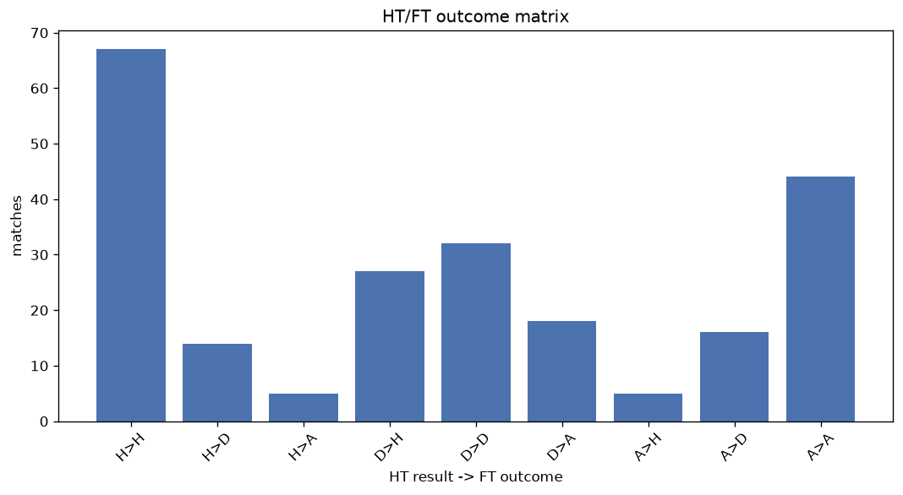
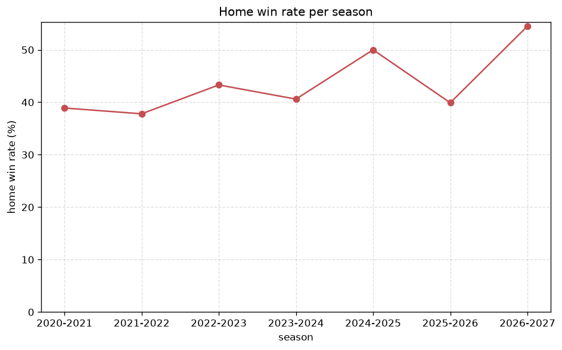

# Match Analysis
- Report: `matches_analysis`
- Generated: 2026-10-29T02:13:42+00:00
- Script: `backend/scripts/analyze_matches.py` v1.0.0
- League: League Two (Scotland)
- Scope: league `scot2`

## 1. Overall summary
| metric | value |
|---|---|
| Matches | 1053 |
| Home wins | 449 (42.6%) |
| Draws | 266 (25.3%) |
| Away wins | 338 (32.1%) |
| Total goals | 2875 |
| Average goals per match | 2.730 |
| Goalless matches | 67 (6.4%) |

## 2. Per-season breakdown
| season | matches | home wins | draws | away wins | total goals | avg goals | goalless |
|---|---|---|---|---|---|---|---|
| 2020-2021 | 90 | 35 (38.9%) | 18 (20.0%) | 37 (41.1%) | 245 | 2.722 | 6 (6.7%) |
| 2021-2022 | 180 | 68 (37.8%) | 45 (25.0%) | 67 (37.2%) | 468 | 2.6 | 12 (6.7%) |
| 2022-2023 | 180 | 78 (43.3%) | 43 (23.9%) | 59 (32.8%) | 489 | 2.717 | 8 (4.4%) |
| 2023-2024 | 180 | 73 (40.6%) | 58 (32.2%) | 49 (27.2%) | 467 | 2.594 | 17 (9.4%) |
| 2024-2025 | 180 | 90 (50.0%) | 37 (20.6%) | 53 (29.4%) | 469 | 2.606 | 13 (7.2%) |
| 2025-2026 | 188 | 75 (39.9%) | 55 (29.3%) | 58 (30.9%) | 552 | 2.936 | 9 (4.8%) |
| 2026-2027 | 55 | 30 (54.5%) | 10 (18.2%) | 15 (27.3%) | 185 | 3.364 | 2 (3.6%) |

## 3. HT/FT outcome matrix
| HT result \ FT result | Home | Draw | Away | total |
|---|---|---|---|---|
| HT home lead | 278 (78.5%) | 58 (16.4%) | 18 (5.1%) | 354 |
| HT draw | 143 (35.3%) | 154 (38.0%) | 108 (26.7%) | 405 |
| HT away lead | 28 (9.5%) | 54 (18.4%) | 212 (72.1%) | 294 |

## 4. Comeback matches
- Home comebacks (trailing at HT, won at FT): **28** (2.7%)
- Away comebacks (trailing at HT, won at FT): **18** (1.7%)

### Home comebacks
| season | home | away | HT | FT |
|---|---|---|---|---|
| 2020-2021 | Albion Rovers | Elgin City | 0-1 | 3-1 |
| 2021-2022 | Albion Rovers | Stranraer | 1-2 | 3-2 |
| 2022-2023 | Dumbarton | Elgin City | 0-1 | 2-1 |
| 2022-2023 | Annan | Forfar Athletic | 0-1 | 2-1 |
| 2022-2023 | Annan | Albion Rovers | 0-1 | 5-1 |
| 2022-2023 | Stirling | Bonnyrigg Rose | 0-1 | 2-1 |
| 2022-2023 | Forfar Athletic | Albion Rovers | 0-1 | 2-1 |
| 2023-2024 | Dumbarton | Forfar Athletic | 0-1 | 3-1 |
| 2023-2024 | Bonnyrigg Rose | Clyde | 1-2 | 3-2 |
| 2023-2024 | Stenhousemuir | Spartans | 0-1 | 3-2 |
| 2023-2024 | Elgin City | Stranraer | 0-1 | 2-1 |
| 2023-2024 | Peterhead | Dumbarton | 0-1 | 3-1 |
| 2023-2024 | Forfar Athletic | Elgin City | 0-1 | 2-1 |
| 2023-2024 | Clyde | Elgin City | 0-1 | 2-1 |
| 2023-2024 | Forfar Athletic | Clyde | 0-1 | 2-1 |
| 2023-2024 | East Fife | Stranraer | 0-1 | 2-1 |
| 2023-2024 | Forfar Athletic | East Fife | 0-1 | 2-1 |
| 2024-2025 | Bonnyrigg Rose | Clyde | 0-1 | 2-1 |
| 2024-2025 | East Fife | Spartans | 0-2 | 4-2 |
| 2024-2025 | Stirling | Stranraer | 0-1 | 3-1 |
| 2025-2026 | Annan | Elgin City | 0-1 | 3-2 |
| 2025-2026 | Elgin City | Forfar Athletic | 0-1 | 2-1 |
| 2025-2026 | Annan | Forfar Athletic | 0-1 | 3-1 |
| 2026-2027 | Clyde | Edinburgh City | 0-1 | 3-2 |
| 2026-2027 | Stranraer | Dumbarton | 0-1 | 3-1 |
| 2026-2027 | Dumbarton | Forfar Athletic | 0-1 | 2-1 |
| 2026-2027 | Elgin City | Clyde | 0-1 | 6-2 |
| 2026-2027 | Stirling | Kelty Hearts | 0-1 | 2-1 |

### Away comebacks
| season | home | away | HT | FT |
|---|---|---|---|---|
| 2020-2021 | Brechin | Elgin City | 1-0 | 1-2 |
| 2021-2022 | Cowdenbeath | Annan | 1-0 | 1-3 |
| 2021-2022 | Stenhousemuir | Stirling | 1-0 | 1-2 |
| 2022-2023 | Annan | Stirling | 1-0 | 1-2 |
| 2022-2023 | East Fife | Stenhousemuir | 1-0 | 1-2 |
| 2022-2023 | Bonnyrigg Rose | East Fife | 1-0 | 1-4 |
| 2022-2023 | Stenhousemuir | East Fife | 1-0 | 1-2 |
| 2022-2023 | Dumbarton | Stenhousemuir | 1-0 | 1-2 |
| 2023-2024 | Stranraer | Spartans | 1-0 | 1-2 |
| 2023-2024 | Bonnyrigg Rose | Clyde | 1-0 | 1-2 |
| 2024-2025 | Stirling | Peterhead | 2-1 | 2-3 |
| 2024-2025 | Edinburgh City | East Fife | 1-0 | 2-4 |
| 2024-2025 | Stranraer | Forfar Athletic | 1-0 | 1-2 |
| 2025-2026 | Forfar Athletic | Dumbarton | 2-1 | 2-3 |
| 2025-2026 | Edinburgh City | Elgin City | 1-0 | 1-3 |
| 2025-2026 | Edinburgh City | Stirling | 1-0 | 1-4 |
| 2025-2026 | Clyde | East Kilbride | 1-0 | 1-3 |
| 2026-2027 | Annan | Spartans | 1-0 | 2-4 |

## 5. HT lead conversion
| HT state | matches | converted to win | held as draw | collapsed to loss |
|---|---|---|---|---|
| Home lead | 354 | 278 (78.5%) | 58 (16.4%) | 18 (5.1%) |
| Away lead | 294 | 212 (72.1%) | 54 (18.4%) | 28 (9.5%) |

### Matches level at half-time
| FT result | count | pct |
|---|---|---|
| Home win | 143 | 35.3% |
| Draw | 154 | 38.0% |
| Away win | 108 | 26.7% |

## 6. First-goal timing
- Matches with a first-goal time recorded: `986` of `1053` (93.6%)

Outcome distribution by first-goal timing bucket:
| bucket | matches | % of matches | home | draw | away |
|---|---|---|---|---|---|
| 1-15 | 325 | 30.9% | 155 (47.7%) | 59 (18.2%) | 111 (34.2%) |
| 16-30 | 250 | 23.7% | 109 (43.6%) | 62 (24.8%) | 79 (31.6%) |
| 31-45 | 157 | 14.9% | 68 (43.3%) | 33 (21.0%) | 56 (35.7%) |
| 46-60 | 117 | 11.1% | 62 (53.0%) | 19 (16.2%) | 36 (30.8%) |
| 61-75 | 86 | 8.2% | 39 (45.3%) | 20 (23.3%) | 27 (31.4%) |
| 76-90 | 39 | 3.7% | 10 (25.6%) | 6 (15.4%) | 23 (59.0%) |
| 91-120 | 12 | 1.1% | 6 (50.0%) | 0 (0.0%) | 6 (50.0%) |

## 7. Goalless matches
- Overall: **67** of `1053` (6.4%)

| season | matches | goalless | pct |
|---|---|---|---|
| 2020-2021 | 90 | 6 | 6.7% |
| 2021-2022 | 180 | 12 | 6.7% |
| 2022-2023 | 180 | 8 | 4.4% |
| 2023-2024 | 180 | 17 | 9.4% |
| 2024-2025 | 180 | 13 | 7.2% |
| 2025-2026 | 188 | 9 | 4.8% |
| 2026-2027 | 55 | 2 | 3.6% |

---
*All statistics are computed from PostgreSQL tables (read-only). Run with `python backend/scripts/analyze_matches.py` to regenerate.*

## Charts

