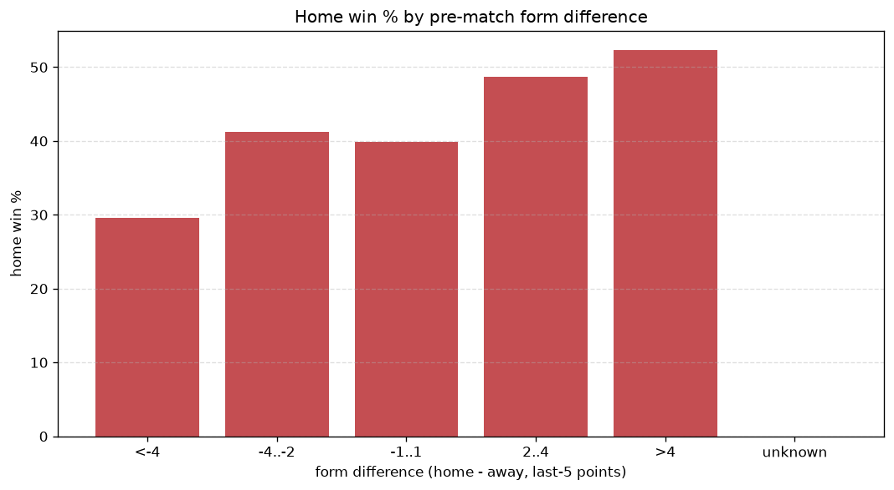
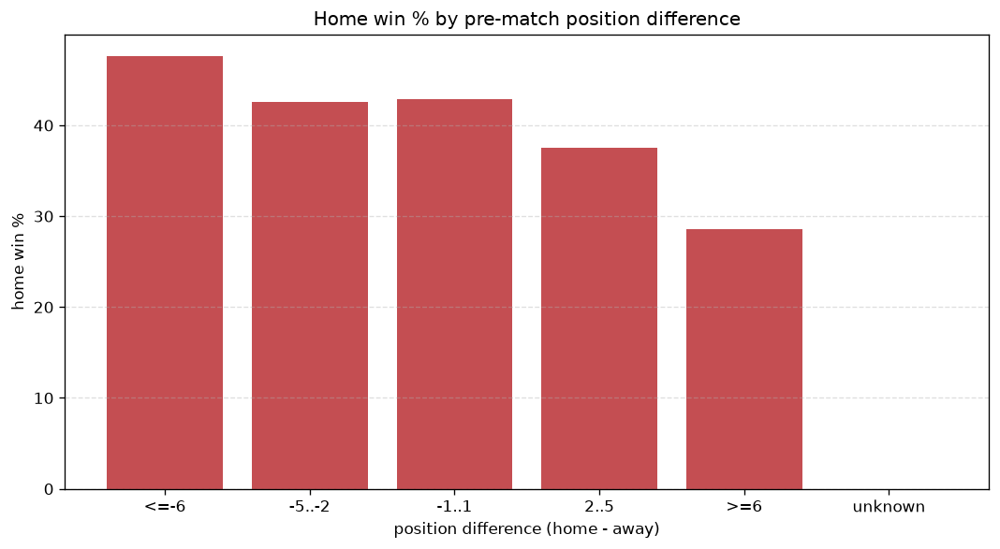

# Relationships Analysis
- Report: `relationships`
- Generated: 2026-10-29T02:13:51+00:00
- Script: `backend/scripts/analyze_relationships.py` v1.0.0
- League: League Two (Scotland)
- Scope: league `scot2`

- Matches analysed: **998** (23 leakage-safe pre-match features).

## 1. Correlation matrix
_Pearson correlation of each pre-match feature with observed goals; sorted by |corr(total goals)|._

| feature | corr(home) | corr(away) | corr(total) |
|---|---|---|---|
| home_team_goals_scored_last_5 | 0.135 | -0.034 | 0.078 |
| home_position_before_match | -0.123 | 0.027 | -0.074 |
| away_points_before_match | -0.024 | -0.075 | -0.073 |
| home_team_wins_last_5 | 0.123 | -0.029 | 0.073 |
| home_team_home_goals_avg | 0.133 | -0.040 | 0.072 |
| home_team_points_last_5 | 0.117 | -0.028 | 0.069 |
| home_team_home_win_rate | 0.126 | -0.042 | 0.065 |
| points_difference | 0.131 | -0.053 | 0.061 |
| away_team_away_conceded_avg | 0.111 | -0.037 | 0.058 |
| position_difference | -0.155 | 0.083 | -0.058 |
| away_team_goals_conceded_last_5 | 0.090 | -0.033 | 0.044 |
| away_team_away_goals_avg | -0.028 | 0.087 | 0.043 |
| rest_days_difference | -0.038 | -0.015 | -0.040 |
| home_points_before_match | 0.070 | -0.114 | -0.031 |
| away_team_away_win_rate | -0.054 | 0.090 | 0.025 |
| away_team_goals_scored_last_5 | -0.021 | 0.048 | 0.019 |
| away_rest_days | 0.039 | -0.018 | 0.016 |
| away_team_wins_last_5 | -0.062 | 0.049 | -0.011 |
| away_team_points_last_5 | -0.054 | 0.045 | -0.008 |
| away_position_before_match | 0.096 | -0.090 | 0.007 |
| home_team_home_conceded_avg | -0.039 | 0.048 | 0.006 |
| home_rest_days | 0.020 | -0.026 | -0.004 |
| home_team_goals_conceded_last_5 | 0.010 | -0.006 | 0.003 |

## 2. Form vs outcome
_Home win/draw/away % per bucket of `home_team_points_last_5 - away_team_points_last_5`._

| bucket | matches | home | draw | away | home % | draw % | away % |
|---|---|---|---|---|---|---|---|
| <-4 | 152 | 45 | 47 | 60 | 29.6% | 30.9% | 39.5% |
| -4..-2 | 204 | 84 | 53 | 67 | 41.2% | 26.0% | 32.8% |
| -1..1 | 313 | 125 | 80 | 108 | 39.9% | 25.6% | 34.5% |
| 2..4 | 199 | 97 | 48 | 54 | 48.7% | 24.1% | 27.1% |
| >4 | 130 | 68 | 28 | 34 | 52.3% | 21.5% | 26.2% |
| unknown | 0 | 0 | 0 | 0 | - | - | - |

## 3. Position vs outcome
_Home win/draw/away % per bucket of `position_difference` (home position - away position; negative favours the home team)._

| bucket | matches | home | draw | away | home % | draw % | away % |
|---|---|---|---|---|---|---|---|
| <=-6 | 105 | 57 | 23 | 25 | 54.3% | 21.9% | 23.8% |
| -5..-2 | 287 | 141 | 64 | 82 | 49.1% | 22.3% | 28.6% |
| -1..1 | 210 | 88 | 59 | 63 | 41.9% | 28.1% | 30.0% |
| 2..5 | 295 | 104 | 79 | 112 | 35.3% | 26.8% | 38.0% |
| >=6 | 101 | 29 | 31 | 41 | 28.7% | 30.7% | 40.6% |
| unknown | 0 | 0 | 0 | 0 | - | - | - |

## 4. Rest advantage
_Home win/draw/away % per bucket of `rest_days_difference` (home rest - away rest). Matches with unknown rest are bucketed separately._

| bucket | matches | home | draw | away | home % | draw % | away % |
|---|---|---|---|---|---|---|---|
| <-1 | 109 | 51 | 27 | 31 | 46.8% | 24.8% | 28.4% |
| -1..0 | 13 | 5 | 5 | 3 | 38.5% | 38.5% | 23.1% |
| 0 | 728 | 310 | 192 | 226 | 42.6% | 26.4% | 31.0% |
| 1..2 | 18 | 4 | 4 | 10 | 22.2% | 22.2% | 55.6% |
| >2 | 98 | 39 | 20 | 39 | 39.8% | 20.4% | 39.8% |
| unknown | 32 | 10 | 8 | 14 | 31.2% | 25.0% | 43.8% |
- *32 match(es) had unknown rest difference (missing rest data on at least one side).*

## 5. Home team quality
_Home win rate by `home_team_home_win_rate` tier (split at 0.5)._

- `< 0.5` tier: **38.9%** home win (252/647)
- `>= 0.5` tier: **47.6%** home win (167/351)
- Home-win gap (>= split minus < split): **+8.7 pp**

| tier | label | matches | home | draw | away | home % |
|---|---|---|---|---|---|---|
| low | < 0.5 | 647 | 252 | 172 | 223 | 38.9% |
| high | >= 0.5 | 351 | 167 | 84 | 100 | 47.6% |

## 6. Feature averages by result
_Mean feature value per outcome; `range` is home-minus-away spread of the group means._

| feature | home mean | draw mean | away mean | range |
|---|---|---|---|---|
| home_points_before_match | 24.666 | 23.004 | 20.412 | 4.254 |
| points_difference | 1.687 | -1.164 | -1.861 | 3.548 |
| away_points_before_match | 22.979 | 24.168 | 22.272 | 1.896 |
| position_difference | -0.809 | 0.465 | 0.746 | 1.555 |
| away_position_before_match | 5.831 | 5.203 | 4.960 | 0.871 |
| home_team_goals_scored_last_5 | 6.561 | 5.754 | 5.765 | 0.807 |
| home_position_before_match | 5.021 | 5.668 | 5.706 | 0.684 |
| home_team_points_last_5 | 6.513 | 5.969 | 5.876 | 0.637 |
| away_team_goals_conceded_last_5 | 6.401 | 6.055 | 5.771 | 0.630 |
| away_rest_days | 8.362 | 8.060 | 7.780 | 0.582 |
| away_team_points_last_5 | 5.976 | 6.543 | 6.542 | 0.567 |
| rest_days_difference | -0.108 | -0.202 | 0.207 | 0.409 |
| home_rest_days | 8.254 | 7.863 | 7.971 | 0.391 |
| away_team_goals_scored_last_5 | 5.959 | 6.324 | 6.319 | 0.365 |
| home_team_wins_last_5 | 1.788 | 1.605 | 1.563 | 0.224 |
| away_team_wins_last_5 | 1.592 | 1.797 | 1.808 | 0.216 |
| home_team_goals_conceded_last_5 | 6.222 | 6.168 | 6.034 | 0.188 |
| home_team_home_goals_avg | 1.403 | 1.309 | 1.225 | 0.178 |
| away_team_away_conceded_avg | 1.422 | 1.268 | 1.248 | 0.175 |
| away_team_away_goals_avg | 1.180 | 1.272 | 1.310 | 0.130 |
| home_team_home_conceded_avg | 1.201 | 1.268 | 1.275 | 0.073 |
| away_team_away_win_rate | 0.285 | 0.348 | 0.356 | 0.071 |
| home_team_home_win_rate | 0.399 | 0.374 | 0.341 | 0.059 |

---
*All features are leakage-safe pre-match values built by `ml.features.build_features.build_rows` from strictly prior matches. Run with `python backend/scripts/analyze_relationships.py` to regenerate.*

## Charts

