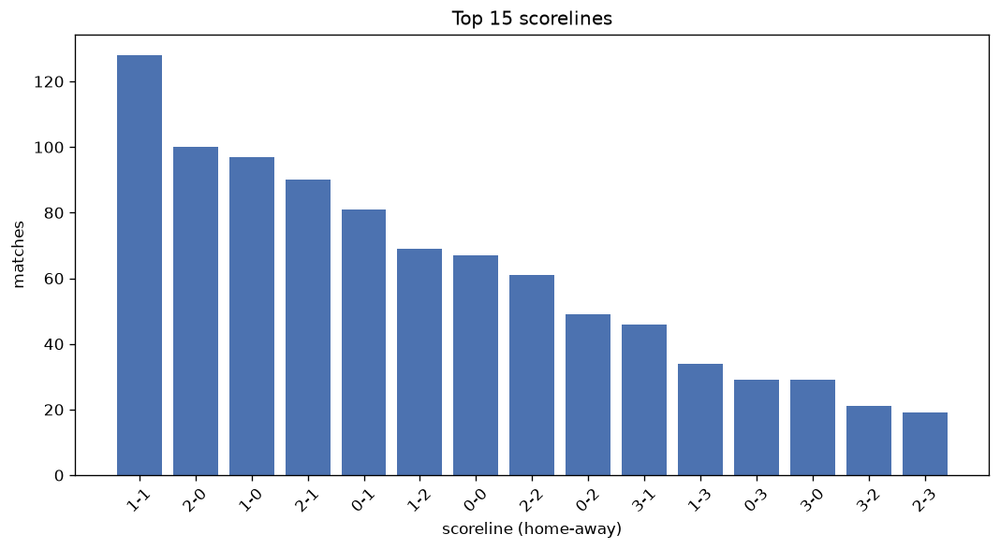
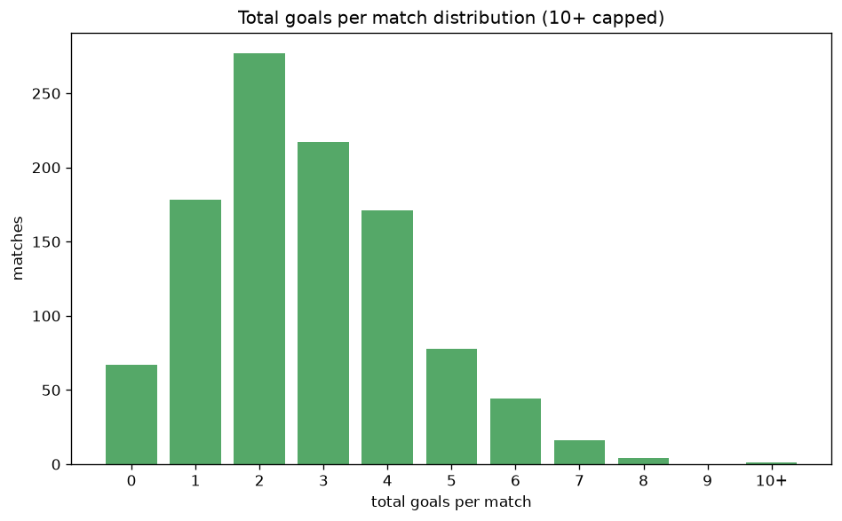

# Scoreline Analysis
- Report: `scoreline_analysis`
- Generated: 2026-10-29T02:13:49+00:00
- Script: `backend/scripts/analyze_scorelines.py` v1.0.0
- League: League Two (Scotland)
- Scope: league `scot2`

## 1. Scoreline frequency
- Matches analysed: **1053** across **7** seasons.
- Distinct scorelines seen: **39**.

| scoreline | count | pct |
|---|---|---|
| 1-1 | 128 | 12.2% |
| 2-0 | 100 | 9.5% |
| 1-0 | 97 | 9.2% |
| 2-1 | 90 | 8.5% |
| 0-1 | 81 | 7.7% |
| 1-2 | 69 | 6.6% |
| 0-0 | 67 | 6.4% |
| 2-2 | 61 | 5.8% |
| 0-2 | 49 | 4.7% |
| 3-1 | 46 | 4.4% |
| 1-3 | 34 | 3.2% |
| 0-3 | 29 | 2.8% |
| 3-0 | 29 | 2.8% |
| 3-2 | 21 | 2.0% |
| 2-3 | 19 | 1.8% |
| 4-0 | 16 | 1.5% |
| 1-4 | 14 | 1.3% |
| 0-4 | 14 | 1.3% |
| 2-4 | 11 | 1.0% |
| 4-1 | 11 | 1.0% |

## 2. Scoreline frequency per season

### 2020-2021
| scoreline | count | pct |
|---|---|---|
| 1-0 | 10 | 11.1% |
| 0-1 | 9 | 10.0% |
| 2-0 | 9 | 10.0% |
| 1-1 | 8 | 8.9% |
| 1-2 | 7 | 7.8% |

### 2021-2022
| scoreline | count | pct |
|---|---|---|
| 1-1 | 23 | 12.8% |
| 2-0 | 18 | 10.0% |
| 1-0 | 18 | 10.0% |
| 0-1 | 16 | 8.9% |
| 1-2 | 12 | 6.7% |

### 2022-2023
| scoreline | count | pct |
|---|---|---|
| 1-1 | 20 | 11.1% |
| 2-1 | 18 | 10.0% |
| 0-1 | 18 | 10.0% |
| 1-0 | 17 | 9.4% |
| 2-0 | 16 | 8.9% |

### 2023-2024
| scoreline | count | pct |
|---|---|---|
| 1-1 | 25 | 13.9% |
| 2-1 | 20 | 11.1% |
| 0-0 | 17 | 9.4% |
| 1-0 | 16 | 8.9% |
| 2-0 | 16 | 8.9% |

### 2024-2025
| scoreline | count | pct |
|---|---|---|
| 2-0 | 23 | 12.8% |
| 1-0 | 18 | 10.0% |
| 2-1 | 17 | 9.4% |
| 0-1 | 16 | 8.9% |
| 1-1 | 15 | 8.3% |

### 2025-2026
| scoreline | count | pct |
|---|---|---|
| 1-1 | 33 | 17.6% |
| 2-1 | 17 | 9.0% |
| 2-0 | 14 | 7.4% |
| 1-0 | 13 | 6.9% |
| 1-2 | 13 | 6.9% |

### 2026-2027
| scoreline | count | pct |
|---|---|---|
| 2-1 | 6 | 10.9% |
| 1-0 | 5 | 9.1% |
| 2-0 | 4 | 7.3% |
| 1-1 | 4 | 7.3% |
| 3-1 | 3 | 5.5% |

## 3. Total-goal histogram
_10+ groups all matches with 10 or more total goals._

| total goals | matches | pct |
|---|---|---|
| 0 | 67 | 6.4% |
| 1 | 178 | 16.9% |
| 2 | 277 | 26.3% |
| 3 | 217 | 20.6% |
| 4 | 171 | 16.2% |
| 5 | 78 | 7.4% |
| 6 | 44 | 4.2% |
| 7 | 16 | 1.5% |
| 8 | 4 | 0.4% |
| 9 | 0 | 0.0% |
| 10+ | 1 | 0.1% |

## 4. Extreme scorelines
- Matches with 7+ total goals: **21**

| season | date | scoreline | total goals |
|---|---|---|---|
| 2026-2027 | 2026-09-12 | 7-3 | 10 |
| 2022-2023 | 2023-04-15 | 8-0 | 8 |
| 2023-2024 | 2023-12-23 | 4-4 | 8 |
| 2023-2024 | 2024-03-16 | 2-6 | 8 |
| 2026-2027 | 2026-10-03 | 6-2 | 8 |
| 2020-2021 | 2020-11-28 | 5-2 | 7 |
| 2020-2021 | 2020-12-05 | 5-2 | 7 |
| 2020-2021 | 2021-04-17 | 2-5 | 7 |
| 2021-2022 | 2021-12-11 | 6-1 | 7 |
| 2021-2022 | 2021-12-26 | 3-4 | 7 |
| 2023-2024 | 2023-10-07 | 3-4 | 7 |
| 2023-2024 | 2024-02-24 | 1-6 | 7 |
| 2024-2025 | 2025-02-01 | 4-3 | 7 |
| 2024-2025 | 2025-02-08 | 3-4 | 7 |
| 2024-2025 | 2025-03-22 | 5-2 | 7 |
| 2024-2025 | 2025-05-03 | 6-1 | 7 |
| 2025-2026 | 2025-08-23 | 3-4 | 7 |
| 2025-2026 | 2025-12-06 | 4-3 | 7 |
| 2025-2026 | 2026-02-17 | 1-6 | 7 |
| 2025-2026 | 2026-05-15 | 4-3 | 7 |
| 2026-2027 | 2026-10-10 | 1-6 | 7 |

## 5. Margin-of-victory distribution (decided matches)
- Decided matches: **787** (draws: **266**)
- Average winning margin: **1.84**

| margin | matches | pct |
|---|---|---|
| 1 | 384 | 48.8% |
| 2 | 246 | 31.3% |
| 3+ | 157 | 19.9% |

## 6. Margin by outcome

### Home wins
- Matches: **449** | avg margin: **1.86** | max margin: **8**
| margin | matches | pct |
|---|---|---|
| 1 | 211 | 47.0% |
| 2 | 152 | 33.9% |
| 3+ | 86 | 19.2% |
- *Full match-by-match list available in `scoreline_analysis.json`.*

### Away wins
- Matches: **338** | avg margin: **1.81** | max margin: **6**
| margin | matches | pct |
|---|---|---|
| 1 | 173 | 51.2% |
| 2 | 94 | 27.8% |
| 3+ | 71 | 21.0% |
- *Full match-by-match list available in `scoreline_analysis.json`.*

## 7. Most common exact score by outcome type
| outcome | matches | most common score | count | pct |
|---|---|---|---|---|
| home | 449 | 2-0 | 100 | 22.3% |
| draw | 266 | 1-1 | 128 | 48.1% |
| away | 338 | 0-1 | 81 | 24.0% |

---
*All statistics are computed from PostgreSQL tables (read-only). Run with `python backend/scripts/analyze_scorelines.py` to regenerate.*

## Charts

