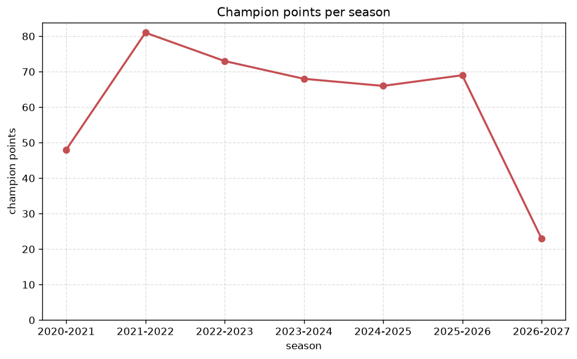
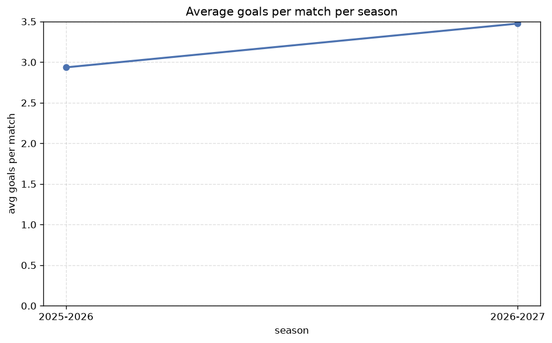

# Season Trends Analysis
- Report: `season_trends`
- Generated: 2026-10-30T04:10:57+00:00
- Script: `backend/scripts/analyze_seasons.py` v1.0.0
- League: League Two (Scotland)
- Scope: league `scot2`

## 1. Champions per season
| season | champion | pts | runner-up | margin |
|---|---|---|---|---|
| 2020-2021 | Queen's Park | 48 | Edinburgh City | 13 pts |
| 2021-2022 | Kelty Hearts | 81 | Forfar Athletic | 21 pts |
| 2022-2023 | Stirling | 73 | Dumbarton | 11 pts |
| 2023-2024 | Stenhousemuir | 68 | Peterhead | 8 pts |
| 2024-2025 | Peterhead | 66 | East Fife | 1 pts |
| 2025-2026 | East Kilbride | 69 | Spartans | 4 pts |
| 2026-2027 | Stranraer | 23 | Clyde | 0 pts |

## 2. Title-race tightness
- Tight races (margin <= 3 pts): **2** of 7 seasons
- Tightest race: **2026-2027** - Stranraer beat Clyde by **0** pts

| season | margin | tight |
|---|---|---|
| 2020-2021 | 13 pts |  |
| 2021-2022 | 21 pts |  |
| 2022-2023 | 11 pts |  |
| 2023-2024 | 8 pts |  |
| 2024-2025 | 1 pts | yes |
| 2025-2026 | 4 pts |  |
| 2026-2027 | 0 pts | yes |

## 3. Points thresholds
_Position-specific points per season. Key: 1 = champion, 2 = runner-up, 4 = CL line, 6 = Europa, 7 = last safe, 10 = bottom._

| season | pos 1 | pos 2 | pos 4 | pos 6 | pos 7 | pos 10 |
|---|---|---|---|---|---|---|
| 2020-2021 | 48 | 35 | 31 | 22 | 18 | 6 |
| 2021-2022 | 81 | 60 | 52 | 47 | 42 | 29 |
| 2022-2023 | 73 | 62 | 50 | 47 | 45 | 39 |
| 2023-2024 | 68 | 60 | 57 | 42 | 40 | 36 |
| 2024-2025 | 66 | 65 | 55 | 48 | 43 | 36 |
| 2025-2026 | 69 | 65 | 50 | 44 | 43 | 38 |
| 2026-2027 | 23 | 23 | 16 | 15 | 13 | 9 |

## 4. Relegation battle
| season | safe pos | safe pts | drop pos | drop pts | gap |
|---|---|---|---|---|---|
| 2020-2021 | 7 | 18 | 8 | 17 | 1 pts |
| 2021-2022 | 7 | 42 | 8 | 39 | 3 pts |
| 2022-2023 | 7 | 45 | 8 | 42 | 3 pts |
| 2023-2024 | 7 | 40 | 8 | 39 | 1 pts |
| 2024-2025 | 7 | 43 | 8 | 42 | 1 pts |
| 2025-2026 | 7 | 43 | 8 | 41 | 2 pts |
| 2026-2027 | 7 | 13 | 8 | 12 | 1 pts |

## 5. League-level trends
| season | matches | total goals | avg goals | home win | draw | away win | goalless | avg pts/team |
|---|---|---|---|---|---|---|---|---|
| 2020-2021 | 90 | 245 | 2.722 | 38.9% | 20.0% | 41.1% | 6.7% | 25.2 |
| 2021-2022 | 180 | 468 | 2.6 | 37.8% | 25.0% | 37.2% | 6.7% | 49.5 |
| 2022-2023 | 180 | 489 | 2.717 | 43.3% | 23.9% | 32.8% | 4.4% | 49.7 |
| 2023-2024 | 180 | 467 | 2.594 | 40.6% | 32.2% | 27.2% | 9.4% | 48.2 |
| 2024-2025 | 180 | 469 | 2.606 | 50.0% | 20.6% | 29.4% | 7.2% | 50.3 |
| 2025-2026 | 188 | 552 | 2.936 | 39.9% | 29.3% | 30.9% | 4.8% | 42.42 |
| 2026-2027 | 55 | 185 | 3.364 | 54.5% | 18.2% | 27.3% | 3.6% | 15.5 |

## 6. View divergence
- Largest divergence: **2025-2026** (goals view, avg abs position diff = 4.167)

_Avg absolute position difference between classic view and alternative view per season._

| season | classic vs luck | classic vs goals |
|---|---|---|
| 2020-2021 | 0.400 | 3.000 |
| 2021-2022 | 1.400 | 2.000 |
| 2022-2023 | 1.200 | 3.200 |
| 2023-2024 | 1.000 | 3.200 |
| 2024-2025 | 1.200 | 2.800 |
| 2025-2026 | 3.500 | 4.167 |
| 2026-2027 | 1.000 | 1.800 |

---
*All statistics are computed from PostgreSQL tables (read-only). Run with `python backend/scripts/analyze_seasons.py` to regenerate.*

## Charts

