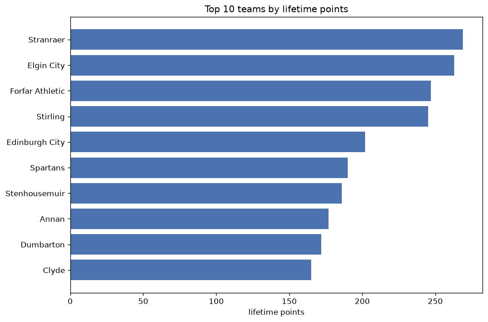
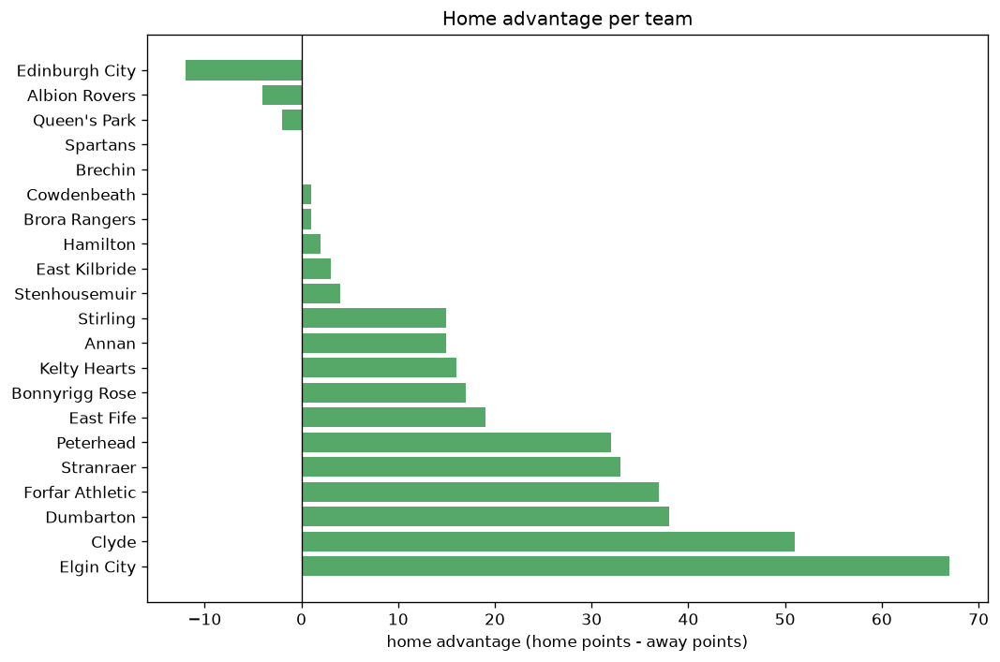

# Team Analysis
- Report: `teams_analysis`
- Generated: 2026-10-29T02:13:45+00:00
- Script: `backend/scripts/analyze_teams.py` v1.0.0
- League: League Two (Scotland)
- Scope: league `scot2`

- Teams: **21** | Seasons: **7** | Matches: **1053**

## 1. Team standings (lifetime)
| team | seasons | played | W | D | L | pts | GF | GA | GD | avg pts/season | best pos | worst pos | titles |
|---|---|---|---|---|---|---|---|---|---|---|---|---|---|
| Stranraer | 7 | 209 | 73 | 50 | 86 | 269 | 266 | 279 | -13 | 38.43 | 1 | 10 | 1 |
| Elgin City | 7 | 209 | 71 | 50 | 88 | 263 | 267 | 307 | -40 | 37.57 | 3 | 9 | 0 |
| Forfar Athletic | 6 | 193 | 62 | 61 | 70 | 247 | 225 | 237 | -12 | 41.17 | 2 | 10 | 0 |
| Stirling | 6 | 173 | 67 | 44 | 62 | 245 | 245 | 242 | 3 | 40.83 | 1 | 10 | 1 |
| Edinburgh City | 5 | 139 | 57 | 31 | 51 | 202 | 202 | 209 | -7 | 40.4 | 2 | 7 | 0 |
| Spartans | 4 | 121 | 52 | 34 | 35 | 190 | 184 | 152 | 32 | 47.5 | 2 | 5 | 0 |
| Stenhousemuir | 4 | 126 | 49 | 39 | 38 | 186 | 171 | 163 | 8 | 46.5 | 1 | 6 | 1 |
| Annan | 5 | 137 | 49 | 30 | 58 | 177 | 203 | 205 | -2 | 35.4 | 3 | 10 | 0 |
| Dumbarton | 4 | 119 | 48 | 28 | 43 | 172 | 164 | 162 | 2 | 43.0 | 2 | 9 | 0 |
| Clyde | 4 | 123 | 42 | 39 | 42 | 165 | 187 | 177 | 10 | 41.25 | 2 | 9 | 0 |
| East Fife | 3 | 108 | 45 | 24 | 39 | 159 | 165 | 134 | 31 | 53.0 | 2 | 5 | 0 |
| Peterhead | 2 | 72 | 35 | 21 | 16 | 126 | 110 | 79 | 31 | 63.0 | 1 | 2 | 1 |
| Bonnyrigg Rose | 3 | 108 | 32 | 27 | 49 | 123 | 123 | 157 | -34 | 41.0 | 8 | 8 | 0 |
| Kelty Hearts | 2 | 47 | 29 | 9 | 9 | 96 | 84 | 49 | 35 | 48.0 | 1 | 6 | 1 |
| Albion Rovers | 3 | 90 | 26 | 18 | 46 | 96 | 106 | 141 | -35 | 32.0 | 7 | 10 | 0 |
| East Kilbride | 1 | 36 | 21 | 6 | 9 | 69 | 77 | 46 | 31 | 69.0 | 1 | 1 | 1 |
| Queen's Park | 1 | 18 | 15 | 3 | 0 | 48 | 37 | 8 | 29 | 48.0 | 1 | 1 | 1 |
| Cowdenbeath | 2 | 54 | 10 | 13 | 31 | 43 | 38 | 78 | -40 | 21.5 | 9 | 10 | 0 |
| Hamilton | 1 | 4 | 3 | 1 | 0 | 10 | 10 | 6 | 4 | 10.0 | 11 | 11 | 0 |
| Brechin | 1 | 18 | 1 | 3 | 14 | 6 | 10 | 41 | -31 | 6.0 | 10 | 10 | 0 |
| Brora Rangers | 1 | 2 | 0 | 1 | 1 | 1 | 1 | 3 | -2 | 1.0 | 12 | 12 | 0 |

## 2. Home vs away split
| team | home P | H-W | H-D | H-L | H-pts | away P | A-W | A-D | A-L | A-pts | adv |
|---|---|---|---|---|---|---|---|---|---|---|---|
| Elgin City | 105 | 47 | 24 | 34 | 165 | 104 | 24 | 26 | 54 | 98 | 67 |
| Clyde | 62 | 30 | 18 | 14 | 108 | 61 | 12 | 21 | 28 | 57 | 51 |
| Dumbarton | 60 | 30 | 15 | 15 | 105 | 59 | 18 | 13 | 28 | 67 | 38 |
| Forfar Athletic | 96 | 37 | 31 | 28 | 142 | 97 | 25 | 30 | 42 | 105 | 37 |
| Stranraer | 104 | 41 | 28 | 35 | 151 | 105 | 32 | 22 | 51 | 118 | 33 |
| Peterhead | 36 | 24 | 7 | 5 | 79 | 36 | 11 | 14 | 11 | 47 | 32 |
| East Fife | 54 | 26 | 11 | 17 | 89 | 54 | 19 | 13 | 22 | 70 | 19 |
| Bonnyrigg Rose | 54 | 19 | 13 | 22 | 70 | 54 | 13 | 14 | 27 | 53 | 17 |
| Kelty Hearts | 23 | 17 | 5 | 1 | 56 | 24 | 12 | 4 | 8 | 40 | 16 |
| Stirling | 86 | 37 | 19 | 30 | 130 | 87 | 30 | 25 | 32 | 115 | 15 |
| Annan | 69 | 26 | 18 | 25 | 96 | 68 | 23 | 12 | 33 | 81 | 15 |
| Stenhousemuir | 63 | 25 | 20 | 18 | 95 | 63 | 24 | 19 | 20 | 91 | 4 |
| East Kilbride | 18 | 11 | 3 | 4 | 36 | 18 | 10 | 3 | 5 | 33 | 3 |
| Hamilton | 2 | 2 | 0 | 0 | 6 | 2 | 1 | 1 | 0 | 4 | 2 |
| Cowdenbeath | 27 | 5 | 7 | 15 | 22 | 27 | 5 | 6 | 16 | 21 | 1 |
| Brora Rangers | 1 | 0 | 1 | 0 | 1 | 1 | 0 | 0 | 1 | 0 | 1 |
| Spartans | 61 | 26 | 17 | 18 | 95 | 60 | 26 | 17 | 17 | 95 | 0 |
| Brechin | 9 | 0 | 3 | 6 | 3 | 9 | 1 | 0 | 8 | 3 | 0 |
| Queen's Park | 9 | 7 | 2 | 0 | 23 | 9 | 8 | 1 | 0 | 25 | -2 |
| Albion Rovers | 45 | 12 | 10 | 23 | 46 | 45 | 14 | 8 | 23 | 50 | -4 |
| Edinburgh City | 69 | 27 | 14 | 28 | 95 | 70 | 30 | 17 | 23 | 107 | -12 |

## 3. Top performers
### Best points per game (PPG)
| rank | team | PPG |
|---|---|---|
| 1 | Queen's Park | 2.67 |
| 2 | Hamilton | 2.50 |
| 3 | Kelty Hearts | 2.04 |
| 4 | East Kilbride | 1.92 |
| 5 | Peterhead | 1.75 |

### Most goals scored
| rank | team | goals |
|---|---|---|
| 1 | Elgin City | 267 |
| 2 | Stranraer | 266 |
| 3 | Stirling | 245 |
| 4 | Forfar Athletic | 225 |
| 5 | Annan | 203 |

### Best goal difference
| rank | team | GD |
|---|---|---|
| 1 | Kelty Hearts | 35 |
| 2 | Spartans | 32 |
| 3 | East Fife | 31 |
| 4 | Peterhead | 31 |
| 5 | East Kilbride | 31 |

### Best defence (goals against per match, standings)
| rank | team | GA/match |
|---|---|---|
| 1 | Queen's Park | 0.444 |
| 2 | Kelty Hearts | 1.043 |
| 3 | Peterhead | 1.097 |
| 4 | Forfar Athletic | 1.228 |
| 5 | East Fife | 1.241 |

## 4. Team consistency
- Teams present in all **7** seasons: **2**

Elgin City, Stranraer

## 5. Head-to-head dominance
- Distinct fixtures: **136** (showing the 15 most frequent)

| fixture | meetings | home wins | draws | away wins | home pct | draw pct | away pct |
|---|---|---|---|---|---|---|---|
| Stranraer vs Elgin City | 23 | 9 | 4 | 10 | 39.1% | 17.4% | 43.5% |
| Forfar Athletic vs Elgin City | 22 | 10 | 8 | 4 | 45.5% | 36.4% | 18.2% |
| Forfar Athletic vs Stranraer | 21 | 8 | 5 | 8 | 38.1% | 23.8% | 38.1% |
| Stirling vs Stranraer | 19 | 8 | 8 | 3 | 42.1% | 42.1% | 15.8% |
| Stirling vs Elgin City | 19 | 6 | 4 | 9 | 31.6% | 21.1% | 47.4% |
| Forfar Athletic vs Stirling | 17 | 8 | 4 | 5 | 47.1% | 23.5% | 29.4% |
| Edinburgh City vs Elgin City | 16 | 6 | 4 | 6 | 37.5% | 25.0% | 37.5% |
| Annan vs Stranraer | 16 | 4 | 8 | 4 | 25.0% | 50.0% | 25.0% |
| Annan vs Elgin City | 15 | 9 | 1 | 5 | 60.0% | 6.7% | 33.3% |
| Edinburgh City vs Stirling | 15 | 6 | 1 | 8 | 40.0% | 6.7% | 53.3% |
| Clyde vs Spartans | 15 | 5 | 7 | 3 | 33.3% | 46.7% | 20.0% |
| Annan vs Stirling | 15 | 4 | 5 | 6 | 26.7% | 33.3% | 40.0% |
| Edinburgh City vs Stranraer | 15 | 3 | 3 | 9 | 20.0% | 20.0% | 60.0% |
| Stenhousemuir vs Stranraer | 14 | 9 | 2 | 3 | 64.3% | 14.3% | 21.4% |
| Stenhousemuir vs Elgin City | 14 | 6 | 6 | 2 | 42.9% | 42.9% | 14.3% |

## 6. Position per season (classic view)
_Cells show final position; '-' when the team was absent from that season._

| team | 2020-2021 | 2021-2022 | 2022-2023 | 2023-2024 | 2024-2025 | 2025-2026 | 2026-2027 |
|---|---|---|---|---|---|---|---|
| Stranraer | 4 | 6 | 7 | 10 | 9 | 5 | 1 |
| Elgin City | 5 | 9 | 9 | 7 | 4 | 6 | 3 |
| Forfar Athletic | - | 2 | 5 | 6 | 10 | 4 | 9 |
| Stirling | 3 | 7 | 1 | - | 6 | 10 | 8 |
| Edinburgh City | 2 | 4 | - | - | 3 | 7 | 4 |
| Spartans | - | - | - | 3 | 5 | 2 | 5 |
| Stenhousemuir | 6 | 5 | 6 | 1 | - | - | - |
| Annan | 8 | 3 | 3 | - | - | 8 | 10 |
| Dumbarton | - | - | 2 | 4 | - | 9 | 7 |
| Clyde | - | - | - | 9 | 7 | 3 | 2 |
| East Fife | - | - | 4 | 5 | 2 | - | - |
| Peterhead | - | - | - | 2 | 1 | - | - |
| Bonnyrigg Rose | - | - | 8 | 8 | 8 | - | - |
| Kelty Hearts | - | 1 | - | - | - | - | 6 |
| Albion Rovers | 7 | 8 | 10 | - | - | - | - |
| East Kilbride | - | - | - | - | - | 1 | - |
| Queen's Park | 1 | - | - | - | - | - | - |
| Cowdenbeath | 9 | 10 | - | - | - | - | - |
| Hamilton | - | - | - | - | - | 11 | - |
| Brechin | 10 | - | - | - | - | - | - |
| Brora Rangers | - | - | - | - | - | 12 | - |

---
*All statistics are computed from PostgreSQL tables (read-only). Run with `python backend/scripts/analyze_teams.py` to regenerate.*

## Charts

