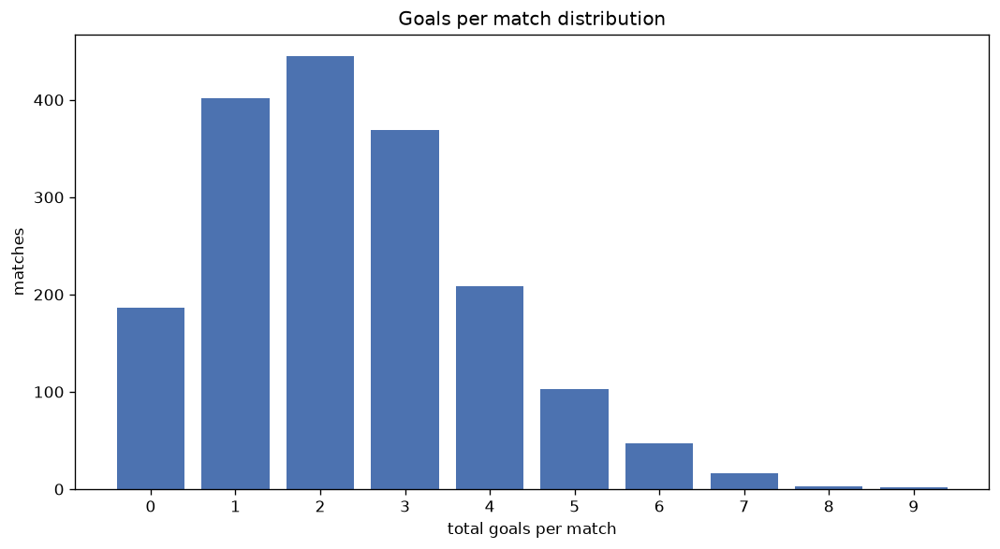
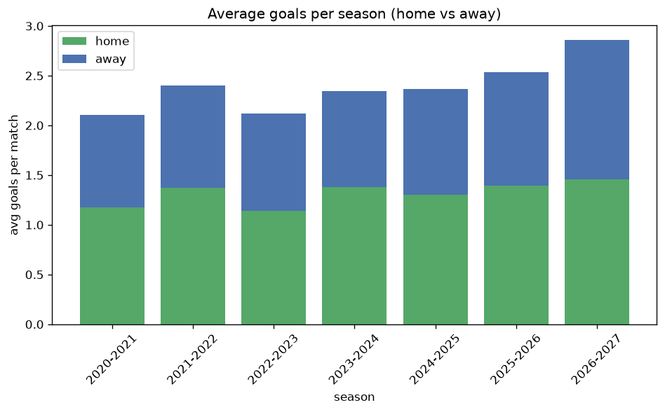

# Goal Analysis
- Report: `goals_analysis`
- Generated: 2026-10-27T02:29:15+00:00
- Script: `backend/scripts/analyze_goals.py` v1.0.0
- League: Segunda RFEF - Group 1 (Spain)
- Scope: league `segunda1`

## 1. Goals per match distribution
| goals | matches | pct |
|---|---|---|
| 0 | 186 | 10.4% |
| 1 | 402 | 22.6% |
| 2 | 445 | 25.0% |
| 3 | 369 | 20.7% |
| 4 | 209 | 11.7% |
| 5 | 103 | 5.8% |
| 6 | 47 | 2.6% |
| 7 | 16 | 0.9% |
| 8 | 3 | 0.2% |
| 9 | 2 | 0.1% |

## 2. Goals per match per season
| season | matches | total goals | avg home | avg away | avg total |
|---|---|---|---|---|---|
| 2020-2021 | 180 | 379 | 1.178 | 0.928 | 2.106 |
| 2021-2022 | 306 | 735 | 1.373 | 1.029 | 2.402 |
| 2022-2023 | 306 | 648 | 1.137 | 0.98 | 2.118 |
| 2023-2024 | 306 | 718 | 1.379 | 0.967 | 2.346 |
| 2024-2025 | 306 | 724 | 1.304 | 1.062 | 2.366 |
| 2025-2026 | 306 | 776 | 1.392 | 1.144 | 2.536 |
| 2026-2027 | 72 | 206 | 1.458 | 1.403 | 2.861 |

## 3. Home vs away goal share
- Home goals: **2332** (55.7%)
- Away goals: **1854** (44.3%)
- Home/away ratio: **1.258**

| season | home goals | away goals | total | home pct | away pct |
|---|---|---|---|---|---|
| 2020-2021 | 212 | 167 | 379 | 55.9% | 44.1% |
| 2021-2022 | 420 | 315 | 735 | 57.1% | 42.9% |
| 2022-2023 | 348 | 300 | 648 | 53.7% | 46.3% |
| 2023-2024 | 422 | 296 | 718 | 58.8% | 41.2% |
| 2024-2025 | 399 | 325 | 724 | 55.1% | 44.9% |
| 2025-2026 | 426 | 350 | 776 | 54.9% | 45.1% |
| 2026-2027 | 105 | 101 | 206 | 51.0% | 49.0% |

## 4. BTTS (Both Teams To Score)
- Overall: **834** of `1782` (46.8%)

| season | matches | BTTS | pct |
|---|---|---|---|
| 2020-2021 | 180 | 74 | 41.1% |
| 2021-2022 | 306 | 151 | 49.3% |
| 2022-2023 | 306 | 125 | 40.8% |
| 2023-2024 | 306 | 150 | 49.0% |
| 2024-2025 | 306 | 138 | 45.1% |
| 2025-2026 | 306 | 156 | 51.0% |
| 2026-2027 | 72 | 40 | 55.6% |

## 5. Clean sheets
- Home clean sheets: **642** (36.0%)
- Away clean sheets: **492** (27.6%)
- Total clean sheets recorded: **1134**
- Matches with at least one clean sheet: **948** (53.2%)
- Both teams kept clean sheets (0-0): **186**

| season | matches | home CS | away CS | total CS | matches w/ CS |
|---|---|---|---|---|---|
| 2020-2021 | 180 | 71 | 53 | 124 | 106 (58.9%) |
| 2021-2022 | 306 | 110 | 76 | 186 | 155 (50.7%) |
| 2022-2023 | 306 | 122 | 94 | 216 | 181 (59.2%) |
| 2023-2024 | 306 | 111 | 80 | 191 | 156 (51.0%) |
| 2024-2025 | 306 | 111 | 91 | 202 | 168 (54.9%) |
| 2025-2026 | 306 | 100 | 78 | 178 | 150 (49.0%) |
| 2026-2027 | 72 | 17 | 20 | 37 | 32 (44.4%) |

## 6. Scoring intensity
- First-half goals: **1837** (43.9%)
- Second-half goals: **2346** (56.1%)
- Avg first-half goals per match: **1.031**
- Avg second-half goals per match: **1.317**
- Second-half-only scoring (HT 0-0, FT goals >= 1): **440** (24.7%)
- *1 match(es) excluded (no HT score recorded).*

| season | matches | 1st half | 2nd half | 1st half pct | 2nd half pct |
|---|---|---|---|---|---|
| 2020-2021 | 180 | 176 | 203 | 46.4% | 53.6% |
| 2021-2022 | 306 | 314 | 421 | 42.7% | 57.3% |
| 2022-2023 | 306 | 271 | 377 | 41.8% | 58.2% |
| 2023-2024 | 306 | 323 | 395 | 45.0% | 55.0% |
| 2024-2025 | 306 | 322 | 402 | 44.5% | 55.5% |
| 2025-2026 | 306 | 340 | 433 | 44.0% | 56.0% |
| 2026-2027 | 72 | 91 | 115 | 44.2% | 55.8% |

## 7. First-goal timing
- Matches with first-goal time recorded: `1595` of `1782` (89.5%)
- Goalless matches: `187`
- Min `1` | Max `96` | Mean `33.01` | Median (p50) `28`

| bucket | count | % of matches | % of scoring matches |
|---|---|---|---|
| 1-15 | 486 | 27.3% | 30.5% |
| 16-30 | 363 | 20.4% | 22.8% |
| 31-45 | 297 | 16.7% | 18.6% |
| 46-60 | 200 | 11.2% | 12.5% |
| 61-75 | 133 | 7.5% | 8.3% |
| 76-90 | 94 | 5.3% | 5.9% |
| 91-120 | 22 | 1.2% | 1.4% |

---
*All statistics are computed from PostgreSQL tables (read-only). Run with `python backend/scripts/analyze_goals.py` to regenerate.*

## Charts

