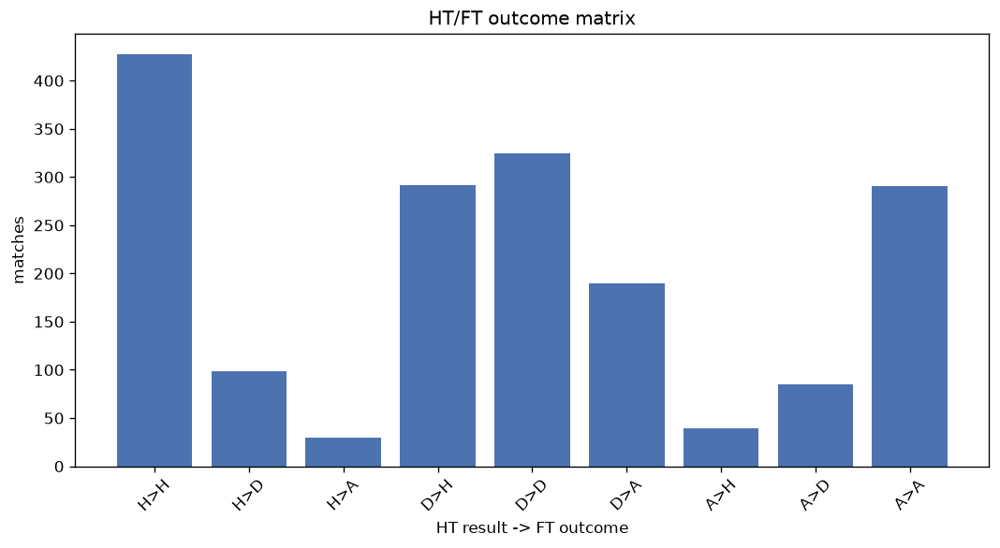
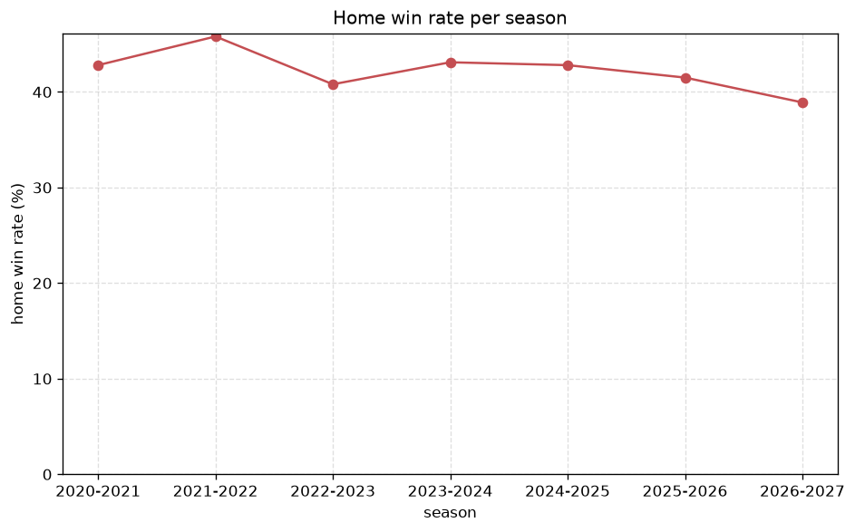

# Match Analysis
- Report: `matches_analysis`
- Generated: 2026-10-29T02:14:01+00:00
- Script: `backend/scripts/analyze_matches.py` v1.0.0
- League: Segunda RFEF - Group 1 (Spain)
- Scope: league `segunda1`

## 1. Overall summary
| metric | value |
|---|---|
| Matches | 1782 |
| Home wins | 760 (42.6%) |
| Draws | 511 (28.7%) |
| Away wins | 511 (28.7%) |
| Total goals | 4186 |
| Average goals per match | 2.349 |
| Goalless matches | 186 (10.4%) |

## 2. Per-season breakdown
| season | matches | home wins | draws | away wins | total goals | avg goals | goalless |
|---|---|---|---|---|---|---|---|
| 2020-2021 | 180 | 77 (42.8%) | 54 (30.0%) | 49 (27.2%) | 379 | 2.106 | 18 (10.0%) |
| 2021-2022 | 306 | 140 (45.8%) | 87 (28.4%) | 79 (25.8%) | 735 | 2.402 | 31 (10.1%) |
| 2022-2023 | 306 | 125 (40.8%) | 84 (27.5%) | 97 (31.7%) | 648 | 2.118 | 35 (11.4%) |
| 2023-2024 | 306 | 132 (43.1%) | 97 (31.7%) | 77 (25.2%) | 718 | 2.346 | 35 (11.4%) |
| 2024-2025 | 306 | 131 (42.8%) | 87 (28.4%) | 88 (28.8%) | 724 | 2.366 | 34 (11.1%) |
| 2025-2026 | 306 | 127 (41.5%) | 84 (27.5%) | 95 (31.0%) | 776 | 2.536 | 28 (9.2%) |
| 2026-2027 | 72 | 28 (38.9%) | 18 (25.0%) | 26 (36.1%) | 206 | 2.861 | 5 (6.9%) |

## 3. HT/FT outcome matrix
| HT result \ FT result | Home | Draw | Away | total |
|---|---|---|---|---|
| HT home lead | 428 (76.8%) | 99 (17.8%) | 30 (5.4%) | 557 |
| HT draw | 292 (36.1%) | 327 (40.4%) | 190 (23.5%) | 809 |
| HT away lead | 39 (9.4%) | 85 (20.5%) | 291 (70.1%) | 415 |
- *1 match(es) excluded (no HT score recorded).*

## 4. Comeback matches
- Home comebacks (trailing at HT, won at FT): **39** (2.2%)
- Away comebacks (trailing at HT, won at FT): **30** (1.7%)

### Home comebacks
| season | home | away | HT | FT |
|---|---|---|---|---|
| 2020-2021 | Langreo | Valladolid Promesas | 0-1 | 2-1 |
| 2020-2021 | Oviedo B | Marino de Luanco | 0-1 | 2-1 |
| 2020-2021 | Covadonga | Marino de Luanco | 0-1 | 2-1 |
| 2020-2021 | Burgos CF | Cultural Leonesa | 0-1 | 2-1 |
| 2020-2021 | Oviedo B | Lealtad | 0-1 | 2-1 |
| 2020-2021 | Salamanca | Unionistas | 0-1 | 2-1 |
| 2021-2022 | Pontevedra | Coruxo FC | 0-1 | 2-1 |
| 2021-2022 | Union Adarve | Pontevedra | 0-1 | 2-1 |
| 2021-2022 | Llanera | Navalcarnero | 0-1 | 3-2 |
| 2021-2022 | Navalcarnero | Gimnastica Segoviana | 0-1 | 4-2 |
| 2021-2022 | CD Mostoles | Compostela | 0-1 | 2-1 |
| 2021-2022 | Llanera | Union Club Ceares | 1-2 | 4-2 |
| 2021-2022 | CD Mostoles | Marino de Luanco | 0-1 | 2-1 |
| 2021-2022 | Pontevedra | Union Adarve | 0-1 | 3-2 |
| 2021-2022 | Pontevedra | Real Aviles | 1-2 | 3-2 |
| 2021-2022 | Salamanca | Compostela | 0-1 | 2-1 |
| 2022-2023 | Oviedo B | Compostela | 0-1 | 2-1 |
| 2022-2023 | Torrelavega | Oviedo B | 0-1 | 2-1 |
| 2022-2023 | Zamora | Rayo Cantabria | 0-1 | 3-1 |
| 2022-2023 | Rayo Cantabria | Compostela | 0-1 | 2-1 |
| 2023-2024 | Dep. Fabril | Arandina | 1-2 | 3-2 |
| 2023-2024 | Guijuelo | Rayo Cantabria | 0-1 | 2-1 |
| 2023-2024 | Covadonga | Pontevedra | 0-1 | 3-1 |
| 2023-2024 | Rayo Cantabria | Torrelavega | 0-1 | 2-1 |
| 2023-2024 | Zamora | Compostela | 0-1 | 2-1 |
| 2023-2024 | Torrelavega | Racing Club Villalbes | 0-1 | 2-1 |
| 2023-2024 | Cayon | Dep. Fabril | 0-1 | 3-2 |
| 2023-2024 | Ourense CF | Coruxo FC | 0-1 | 5-1 |
| 2023-2024 | Rayo Cantabria | Compostela | 0-1 | 3-1 |
| 2024-2025 | Real Avila | Coruxo FC | 1-2 | 3-2 |
| 2024-2025 | Llanera | Laredo | 0-1 | 2-1 |
| 2024-2025 | Bergantinos | Valladolid Promesas | 0-2 | 3-2 |
| 2024-2025 | Real Aviles | Escobedo | 0-1 | 4-3 |
| 2024-2025 | Rayo Cantabria | Real Aviles | 0-1 | 4-1 |
| 2025-2026 | Oviedo B | Valladolid Promesas | 0-1 | 2-1 |
| 2025-2026 | Salamanca | Sarriana | 0-1 | 2-1 |
| 2025-2026 | UD Ourense | Dep. Fabril | 0-1 | 2-1 |
| 2025-2026 | Numancia | Valladolid Promesas | 0-1 | 3-1 |
| 2025-2026 | Langreo | Burgos CF B | 0-1 | 2-1 |

### Away comebacks
| season | home | away | HT | FT |
|---|---|---|---|---|
| 2021-2022 | Palencia CA | Bergantinos | 3-1 | 3-5 |
| 2021-2022 | Gimnastica Segoviana | Leganes B | 1-0 | 1-3 |
| 2021-2022 | Bergantinos | Gimnastica Segoviana | 1-0 | 1-2 |
| 2021-2022 | Gimnastica Segoviana | Llanera | 1-0 | 1-2 |
| 2021-2022 | Langreo | Leganes B | 1-0 | 1-3 |
| 2021-2022 | Union Adarve | Llanera | 2-0 | 3-4 |
| 2022-2023 | Torrelavega | Arenteiro | 1-0 | 1-2 |
| 2022-2023 | Marino de Luanco | Bergantinos | 1-0 | 2-3 |
| 2022-2023 | Coruxo FC | Burgos CF B | 1-0 | 1-2 |
| 2022-2023 | Bergantinos | Compostela | 1-0 | 1-2 |
| 2022-2023 | Ourense CF | Oviedo B | 1-0 | 1-2 |
| 2022-2023 | Marino de Luanco | Rayo Cantabria | 1-0 | 1-3 |
| 2022-2023 | Palencia CA | Langreo | 1-0 | 1-2 |
| 2023-2024 | Rayo Cantabria | Langreo | 1-0 | 2-3 |
| 2023-2024 | Zamora | Dep. Fabril | 1-0 | 1-2 |
| 2023-2024 | Valladolid Promesas | Dep. Fabril | 3-1 | 3-4 |
| 2023-2024 | Coruxo FC | Dep. Fabril | 1-0 | 1-2 |
| 2024-2025 | Valladolid Promesas | Dep. Fabril | 1-0 | 1-2 |
| 2024-2025 | Coruxo FC | Salamanca | 2-1 | 2-3 |
| 2024-2025 | Compostela | Rayo Cantabria | 1-0 | 1-2 |
| 2024-2025 | Salamanca | Valladolid Promesas | 1-0 | 1-2 |
| 2025-2026 | UD Samano | Sarriana | 1-0 | 1-2 |
| 2025-2026 | Bergantinos | Oviedo B | 1-0 | 1-2 |
| 2025-2026 | Sarriana | Gimnastica Segoviana | 1-0 | 1-2 |
| 2025-2026 | Real Avila | Salamanca | 1-0 | 1-2 |
| 2025-2026 | Burgos CF B | Real Avila | 1-0 | 1-2 |
| 2025-2026 | Valladolid Promesas | Bergantinos | 2-1 | 3-4 |
| 2026-2027 | Gernika | Sestao | 1-0 | 1-2 |
| 2026-2027 | Amorebieta | Portugalete | 1-0 | 1-2 |
| 2026-2027 | Gernika | Amorebieta | 1-0 | 1-2 |

## 5. HT lead conversion
| HT state | matches | converted to win | held as draw | collapsed to loss |
|---|---|---|---|---|
| Home lead | 557 | 428 (76.8%) | 99 (17.8%) | 30 (5.4%) |
| Away lead | 415 | 291 (70.1%) | 85 (20.5%) | 39 (9.4%) |

### Matches level at half-time
| FT result | count | pct |
|---|---|---|
| Home win | 292 | 36.1% |
| Draw | 327 | 40.4% |
| Away win | 190 | 23.5% |
- *1 match(es) excluded (no HT score recorded).*

## 6. First-goal timing
- Matches with a first-goal time recorded: `1595` of `1782` (89.5%)

Outcome distribution by first-goal timing bucket:
| bucket | matches | % of matches | home | draw | away |
|---|---|---|---|---|---|
| 1-15 | 487 | 27.3% | 221 (45.4%) | 95 (19.5%) | 171 (35.1%) |
| 16-30 | 363 | 20.4% | 172 (47.4%) | 90 (24.8%) | 101 (27.8%) |
| 31-45 | 296 | 16.6% | 141 (47.6%) | 62 (20.9%) | 93 (31.4%) |
| 46-60 | 200 | 11.2% | 94 (47.0%) | 45 (22.5%) | 61 (30.5%) |
| 61-75 | 133 | 7.5% | 63 (47.4%) | 25 (18.8%) | 45 (33.8%) |
| 76-90 | 94 | 5.3% | 53 (56.4%) | 7 (7.4%) | 34 (36.2%) |
| 91-120 | 22 | 1.2% | 15 (68.2%) | 1 (4.5%) | 6 (27.3%) |

## 7. Goalless matches
- Overall: **186** of `1782` (10.4%)

| season | matches | goalless | pct |
|---|---|---|---|
| 2020-2021 | 180 | 18 | 10.0% |
| 2021-2022 | 306 | 31 | 10.1% |
| 2022-2023 | 306 | 35 | 11.4% |
| 2023-2024 | 306 | 35 | 11.4% |
| 2024-2025 | 306 | 34 | 11.1% |
| 2025-2026 | 306 | 28 | 9.2% |
| 2026-2027 | 72 | 5 | 6.9% |

---
*All statistics are computed from PostgreSQL tables (read-only). Run with `python backend/scripts/analyze_matches.py` to regenerate.*

## Charts

