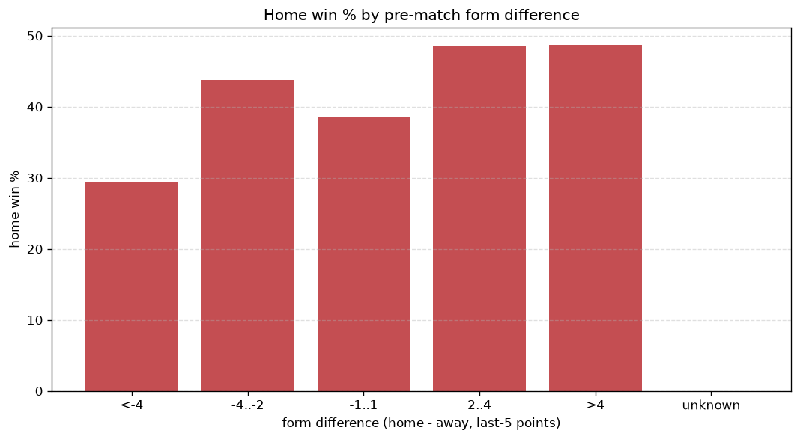
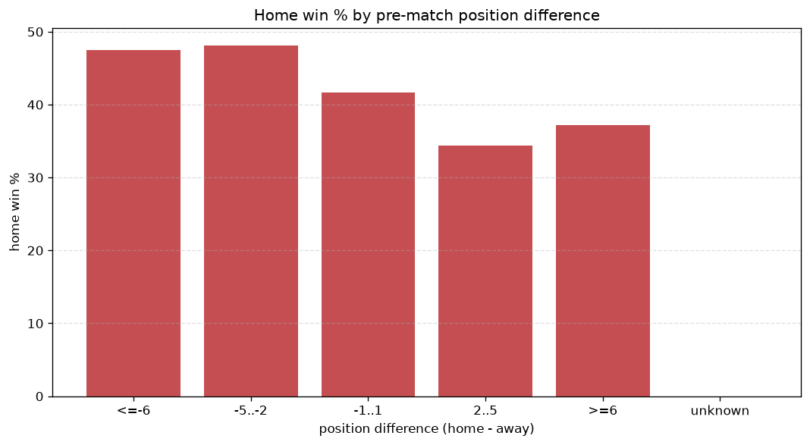

# Relationships Analysis
- Report: `relationships`
- Generated: 2026-10-30T04:11:28+00:00
- Script: `backend/scripts/analyze_relationships.py` v1.0.0
- League: Segunda RFEF - Group 1 (Spain)
- Scope: league `segunda1`

- Matches analysed: **1710** (23 leakage-safe pre-match features).

## 1. Correlation matrix
_Pearson correlation of each pre-match feature with observed goals; sorted by |corr(total goals)|._

| feature | corr(home) | corr(away) | corr(total) |
|---|---|---|---|
| home_points_before_match | 0.119 | -0.000 | 0.089 |
| away_team_away_conceded_avg | 0.137 | -0.028 | 0.084 |
| away_team_goals_conceded_last_5 | 0.109 | -0.008 | 0.075 |
| points_difference | 0.187 | -0.104 | 0.070 |
| away_position_before_match | 0.136 | -0.053 | 0.066 |
| away_team_away_win_rate | -0.100 | 0.018 | -0.062 |
| home_team_home_conceded_avg | -0.022 | 0.103 | 0.052 |
| position_difference | -0.159 | 0.105 | -0.049 |
| home_team_goals_conceded_last_5 | -0.028 | 0.095 | 0.042 |
| away_points_before_match | -0.006 | 0.070 | 0.042 |
| home_team_home_win_rate | 0.023 | -0.084 | -0.038 |
| rest_days_difference | -0.041 | -0.005 | -0.034 |
| home_rest_days | -0.014 | -0.035 | -0.033 |
| home_team_goals_scored_last_5 | 0.058 | -0.023 | 0.029 |
| away_team_points_last_5 | -0.070 | 0.047 | -0.021 |
| away_team_goals_scored_last_5 | -0.026 | 0.061 | 0.021 |
| home_team_points_last_5 | 0.051 | -0.031 | 0.018 |
| home_team_home_goals_avg | 0.045 | -0.032 | 0.013 |
| home_team_wins_last_5 | 0.039 | -0.026 | 0.012 |
| away_team_away_goals_avg | -0.037 | 0.055 | 0.009 |
| away_team_wins_last_5 | -0.058 | 0.052 | -0.008 |
| away_rest_days | 0.022 | -0.033 | -0.005 |
| home_position_before_match | -0.088 | 0.095 | -0.003 |

## 2. Form vs outcome
_Home win/draw/away % per bucket of `home_team_points_last_5 - away_team_points_last_5`._

| bucket | matches | home | draw | away | home % | draw % | away % |
|---|---|---|---|---|---|---|---|
| <-4 | 262 | 94 | 77 | 91 | 35.9% | 29.4% | 34.7% |
| -4..-2 | 386 | 148 | 121 | 117 | 38.3% | 31.3% | 30.3% |
| -1..1 | 491 | 211 | 139 | 141 | 43.0% | 28.3% | 28.7% |
| 2..4 | 376 | 184 | 101 | 91 | 48.9% | 26.9% | 24.2% |
| >4 | 195 | 95 | 55 | 45 | 48.7% | 28.2% | 23.1% |
| unknown | 0 | 0 | 0 | 0 | - | - | - |

## 3. Position vs outcome
_Home win/draw/away % per bucket of `position_difference` (home position - away position; negative favours the home team)._

| bucket | matches | home | draw | away | home % | draw % | away % |
|---|---|---|---|---|---|---|---|
| <=-6 | 405 | 230 | 98 | 77 | 56.8% | 24.2% | 19.0% |
| -5..-2 | 304 | 139 | 77 | 88 | 45.7% | 25.3% | 28.9% |
| -1..1 | 248 | 106 | 73 | 69 | 42.7% | 29.4% | 27.8% |
| 2..5 | 325 | 110 | 111 | 104 | 33.8% | 34.2% | 32.0% |
| >=6 | 428 | 147 | 134 | 147 | 34.3% | 31.3% | 34.3% |
| unknown | 0 | 0 | 0 | 0 | - | - | - |

## 4. Rest advantage
_Home win/draw/away % per bucket of `rest_days_difference` (home rest - away rest). Matches with unknown rest are bucketed separately._

| bucket | matches | home | draw | away | home % | draw % | away % |
|---|---|---|---|---|---|---|---|
| <-1 | 47 | 23 | 10 | 14 | 48.9% | 21.3% | 29.8% |
| -1..0 | 324 | 140 | 92 | 92 | 43.2% | 28.4% | 28.4% |
| 0 | 913 | 389 | 266 | 258 | 42.6% | 29.1% | 28.3% |
| 1..2 | 324 | 133 | 96 | 95 | 41.0% | 29.6% | 29.3% |
| >2 | 46 | 18 | 16 | 12 | 39.1% | 34.8% | 26.1% |
| unknown | 56 | 29 | 13 | 14 | 51.8% | 23.2% | 25.0% |
- *56 match(es) had unknown rest difference (missing rest data on at least one side).*

## 5. Home team quality
_Home win rate by `home_team_home_win_rate` tier (split at 0.5)._

- `< 0.5` tier: **40.2%** home win (431/1073)
- `>= 0.5` tier: **47.3%** home win (301/637)
- Home-win gap (>= split minus < split): **+7.1 pp**

| tier | label | matches | home | draw | away | home % |
|---|---|---|---|---|---|---|
| low | < 0.5 | 1073 | 431 | 308 | 334 | 40.2% |
| high | >= 0.5 | 637 | 301 | 185 | 151 | 47.3% |

## 6. Feature averages by result
_Mean feature value per outcome; `range` is home-minus-away spread of the group means._

| feature | home mean | draw mean | away mean | range |
|---|---|---|---|---|
| points_difference | 1.925 | -1.538 | -2.272 | 4.197 |
| position_difference | -1.249 | 1.110 | 1.746 | 2.995 |
| home_points_before_match | 22.437 | 20.308 | 19.728 | 2.709 |
| home_position_before_match | 9.255 | 10.150 | 10.901 | 1.646 |
| away_points_before_match | 20.512 | 21.846 | 22.000 | 1.488 |
| away_position_before_match | 10.504 | 9.041 | 9.155 | 1.464 |
| home_team_goals_conceded_last_5 | 4.990 | 5.187 | 5.612 | 0.622 |
| away_team_points_last_5 | 5.907 | 6.460 | 6.482 | 0.575 |
| home_team_points_last_5 | 6.173 | 6.043 | 5.645 | 0.528 |
| away_team_goals_conceded_last_5 | 5.324 | 4.874 | 4.876 | 0.450 |
| home_team_goals_scored_last_5 | 5.157 | 5.132 | 4.862 | 0.295 |
| rest_days_difference | -0.091 | 0.198 | 0.049 | 0.289 |
| away_team_goals_scored_last_5 | 5.074 | 5.320 | 5.330 | 0.256 |
| home_rest_days | 7.631 | 7.829 | 7.577 | 0.252 |
| away_rest_days | 7.723 | 7.631 | 7.525 | 0.197 |
| away_team_wins_last_5 | 1.520 | 1.704 | 1.715 | 0.195 |
| home_team_wins_last_5 | 1.607 | 1.588 | 1.441 | 0.165 |
| away_team_away_conceded_avg | 1.247 | 1.130 | 1.100 | 0.147 |
| home_team_home_conceded_avg | 0.881 | 0.953 | 1.002 | 0.121 |
| home_team_home_goals_avg | 1.206 | 1.163 | 1.137 | 0.068 |
| home_team_home_win_rate | 0.417 | 0.394 | 0.360 | 0.057 |
| away_team_away_goals_avg | 0.918 | 0.943 | 0.964 | 0.046 |
| away_team_away_win_rate | 0.252 | 0.271 | 0.283 | 0.032 |

---
*All features are leakage-safe pre-match values built by `ml.features.build_features.build_rows` from strictly prior matches. Run with `python backend/scripts/analyze_relationships.py` to regenerate.*

## Charts

