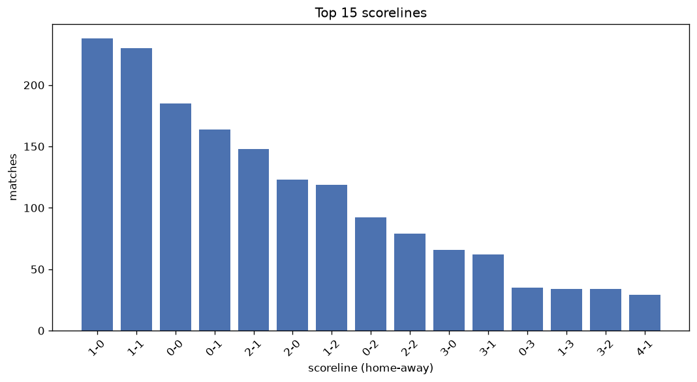
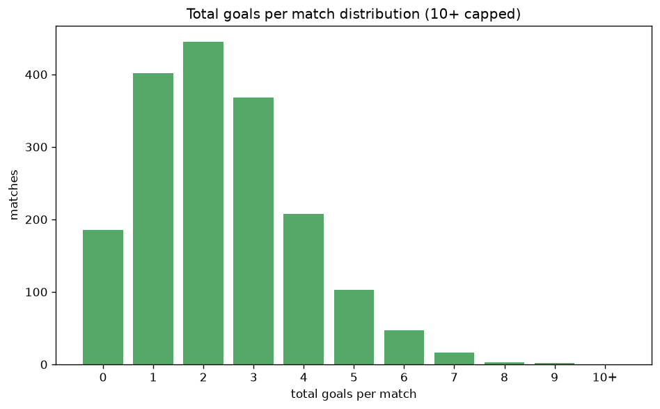

# Scoreline Analysis
- Report: `scoreline_analysis`
- Generated: 2026-10-26T01:47:19+00:00
- Script: `backend/scripts/analyze_scorelines.py` v1.0.0
- League: Segunda RFEF - Group 1 (Spain)
- Scope: league `segunda1`

## 1. Scoreline frequency
- Matches analysed: **1779** across **7** seasons.
- Distinct scorelines seen: **37**.

| scoreline | count | pct |
|---|---|---|
| 1-0 | 238 | 13.4% |
| 1-1 | 230 | 12.9% |
| 0-0 | 185 | 10.4% |
| 0-1 | 164 | 9.2% |
| 2-1 | 148 | 8.3% |
| 2-0 | 123 | 6.9% |
| 1-2 | 119 | 6.7% |
| 0-2 | 92 | 5.2% |
| 2-2 | 79 | 4.4% |
| 3-0 | 66 | 3.7% |
| 3-1 | 62 | 3.5% |
| 0-3 | 35 | 2.0% |
| 1-3 | 34 | 1.9% |
| 3-2 | 34 | 1.9% |
| 4-1 | 29 | 1.6% |
| 4-0 | 23 | 1.3% |
| 2-3 | 22 | 1.2% |
| 3-3 | 13 | 0.7% |
| 4-2 | 13 | 0.7% |
| 1-4 | 11 | 0.6% |

## 2. Scoreline frequency per season

### 2020-2021
| scoreline | count | pct |
|---|---|---|
| 1-0 | 27 | 15.0% |
| 1-1 | 26 | 14.4% |
| 0-1 | 19 | 10.6% |
| 0-0 | 18 | 10.0% |
| 2-0 | 18 | 10.0% |

### 2021-2022
| scoreline | count | pct |
|---|---|---|
| 1-1 | 41 | 13.4% |
| 1-0 | 38 | 12.4% |
| 2-1 | 32 | 10.5% |
| 0-0 | 31 | 10.1% |
| 0-1 | 26 | 8.5% |

### 2022-2023
| scoreline | count | pct |
|---|---|---|
| 1-0 | 56 | 18.3% |
| 1-1 | 36 | 11.8% |
| 0-0 | 35 | 11.4% |
| 0-1 | 29 | 9.5% |
| 1-2 | 24 | 7.8% |

### 2023-2024
| scoreline | count | pct |
|---|---|---|
| 1-1 | 47 | 15.4% |
| 0-0 | 35 | 11.4% |
| 1-0 | 33 | 10.8% |
| 2-0 | 28 | 9.2% |
| 0-1 | 26 | 8.5% |

### 2024-2025
| scoreline | count | pct |
|---|---|---|
| 1-0 | 38 | 12.4% |
| 1-1 | 36 | 11.8% |
| 0-0 | 34 | 11.1% |
| 0-1 | 31 | 10.1% |
| 2-1 | 28 | 9.2% |

### 2025-2026
| scoreline | count | pct |
|---|---|---|
| 1-0 | 42 | 13.7% |
| 1-1 | 38 | 12.4% |
| 1-2 | 29 | 9.5% |
| 0-0 | 28 | 9.2% |
| 0-1 | 26 | 8.5% |

### 2026-2027
| scoreline | count | pct |
|---|---|---|
| 2-1 | 7 | 10.1% |
| 0-1 | 7 | 10.1% |
| 1-2 | 7 | 10.1% |
| 1-1 | 6 | 8.7% |
| 0-2 | 5 | 7.2% |

## 3. Total-goal histogram
_10+ groups all matches with 10 or more total goals._

| total goals | matches | pct |
|---|---|---|
| 0 | 185 | 10.4% |
| 1 | 402 | 22.6% |
| 2 | 445 | 25.0% |
| 3 | 368 | 20.7% |
| 4 | 208 | 11.7% |
| 5 | 103 | 5.8% |
| 6 | 47 | 2.6% |
| 7 | 16 | 0.9% |
| 8 | 3 | 0.2% |
| 9 | 2 | 0.1% |
| 10+ | 0 | 0.0% |

## 4. Extreme scorelines
- Matches with 7+ total goals: **21**

| season | date | scoreline | total goals |
|---|---|---|---|
| 2022-2023 | 2023-02-04 | 5-4 | 9 |
| 2025-2026 | 2026-02-07 | 7-2 | 9 |
| 2021-2022 | 2022-03-13 | 3-5 | 8 |
| 2022-2023 | 2023-04-09 | 4-4 | 8 |
| 2025-2026 | 2026-03-21 | 4-4 | 8 |
| 2021-2022 | 2022-04-16 | 0-7 | 7 |
| 2021-2022 | 2022-05-15 | 3-4 | 7 |
| 2022-2023 | 2023-02-12 | 4-3 | 7 |
| 2023-2024 | 2023-10-22 | 3-4 | 7 |
| 2023-2024 | 2024-03-23 | 3-4 | 7 |
| 2023-2024 | 2024-04-28 | 5-2 | 7 |
| 2024-2025 | 2025-01-12 | 4-3 | 7 |
| 2024-2025 | 2025-04-12 | 4-3 | 7 |
| 2025-2026 | 2025-10-05 | 5-2 | 7 |
| 2025-2026 | 2026-02-08 | 7-0 | 7 |
| 2025-2026 | 2026-02-15 | 3-4 | 7 |
| 2025-2026 | 2026-03-01 | 5-2 | 7 |
| 2025-2026 | 2026-04-04 | 3-4 | 7 |
| 2025-2026 | 2026-04-05 | 3-4 | 7 |
| 2025-2026 | 2026-05-03 | 3-4 | 7 |
| 2026-2027 | 2026-09-27 | 2-5 | 7 |

## 5. Margin-of-victory distribution (decided matches)
- Decided matches: **1270** (draws: **509**)
- Average winning margin: **1.64**

| margin | matches | pct |
|---|---|---|
| 1 | 736 | 58.0% |
| 2 | 330 | 26.0% |
| 3+ | 204 | 16.1% |

## 6. Margin by outcome

### Home wins
- Matches: **759** | avg margin: **1.69** | max margin: **7**
| margin | matches | pct |
|---|---|---|
| 1 | 424 | 55.9% |
| 2 | 198 | 26.1% |
| 3+ | 137 | 18.1% |
- *Full match-by-match list available in `scoreline_analysis.json`.*

### Away wins
- Matches: **511** | avg margin: **1.57** | max margin: **7**
| margin | matches | pct |
|---|---|---|
| 1 | 312 | 61.1% |
| 2 | 132 | 25.8% |
| 3+ | 67 | 13.1% |
- *Full match-by-match list available in `scoreline_analysis.json`.*

## 7. Most common exact score by outcome type
| outcome | matches | most common score | count | pct |
|---|---|---|---|---|
| home | 759 | 1-0 | 238 | 31.4% |
| draw | 509 | 1-1 | 230 | 45.2% |
| away | 511 | 0-1 | 164 | 32.1% |

---
*All statistics are computed from PostgreSQL tables (read-only). Run with `python backend/scripts/analyze_scorelines.py` to regenerate.*

## Charts

