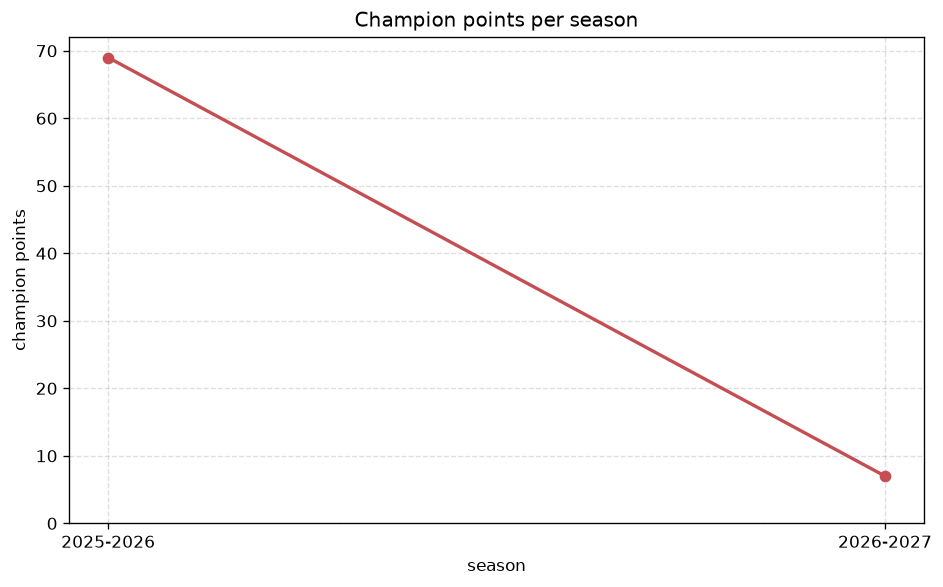
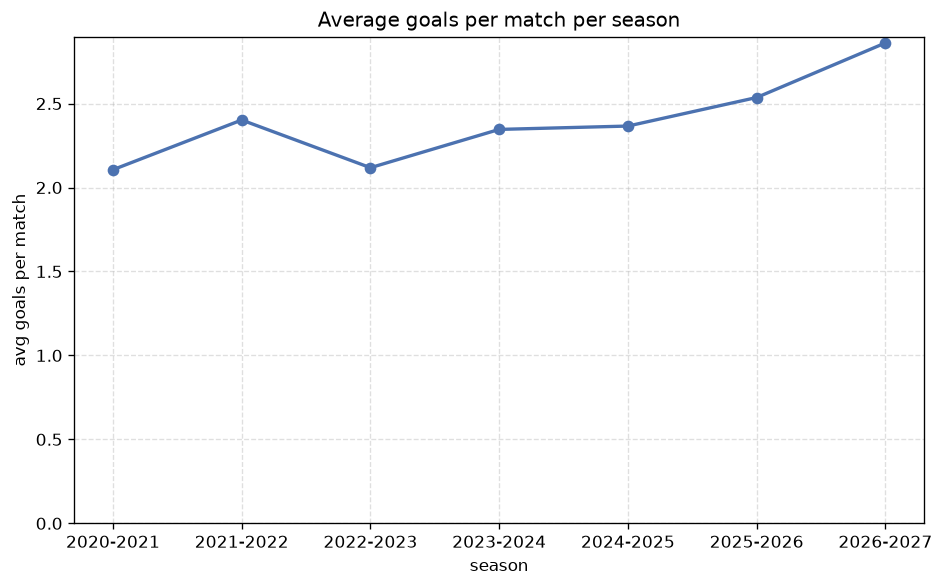

# Season Trends Analysis
- Report: `season_trends`
- Generated: 2026-10-27T02:29:18+00:00
- Script: `backend/scripts/analyze_seasons.py` v1.0.0
- League: Segunda RFEF - Group 1 (Spain)
- Scope: league `segunda1`

## 1. Champions per season
| season | champion | pts | runner-up | margin |
|---|---|---|---|---|
| 2020-2021 | Burgos CF | 39 | Cultural Leonesa | 8 pts |
| 2021-2022 | Pontevedra | 65 | Union Adarve | 4 pts |
| 2022-2023 | Arenteiro | 73 | Real Aviles | 14 pts |
| 2023-2024 | Ourense CF | 73 | Pontevedra | 5 pts |
| 2024-2025 | Pontevedra | 72 | Numancia | 5 pts |
| 2025-2026 | Dep. Fabril | 69 | Oviedo B | 11 pts |
| 2026-2027 | Sestao | 19 | Alaves B | 2 pts |

## 2. Title-race tightness
- Tight races (margin <= 3 pts): **1** of 7 seasons
- Tightest race: **2026-2027** - Sestao beat Alaves B by **2** pts

| season | margin | tight |
|---|---|---|
| 2020-2021 | 8 pts |  |
| 2021-2022 | 4 pts |  |
| 2022-2023 | 14 pts |  |
| 2023-2024 | 5 pts |  |
| 2024-2025 | 5 pts |  |
| 2025-2026 | 11 pts |  |
| 2026-2027 | 2 pts | yes |

## 3. Points thresholds
_Position-specific points per season. Key: 1 = champion, 2 = runner-up, 4 = CL line, 6 = Europa, 15 = last safe, 18 = bottom._

| season | pos 1 | pos 2 | pos 4 | pos 6 | pos 15 | pos 18 |
|---|---|---|---|---|---|---|
| 2020-2021 | 39 | 31 | 30 | 30 | 20 | 16 |
| 2021-2022 | 65 | 61 | 52 | 49 | 41 | 18 |
| 2022-2023 | 73 | 59 | 54 | 54 | 35 | 22 |
| 2023-2024 | 73 | 68 | 51 | 50 | 34 | 29 |
| 2024-2025 | 72 | 67 | 54 | 50 | 38 | 24 |
| 2025-2026 | 69 | 58 | 55 | 51 | 40 | 15 |
| 2026-2027 | 19 | 17 | 17 | 13 | 7 | 5 |

## 4. Relegation battle
| season | safe pos | safe pts | drop pos | drop pts | gap |
|---|---|---|---|---|---|
| 2020-2021 | 15 | 20 | 16 | 20 | 0 pts |
| 2021-2022 | 15 | 41 | 16 | 40 | 1 pts |
| 2022-2023 | 15 | 35 | 16 | 27 | 8 pts |
| 2023-2024 | 15 | 34 | 16 | 30 | 4 pts |
| 2024-2025 | 15 | 38 | 16 | 31 | 7 pts |
| 2025-2026 | 15 | 40 | 16 | 36 | 4 pts |
| 2026-2027 | 15 | 7 | 16 | 7 | 0 pts |

## 5. League-level trends
| season | matches | total goals | avg goals | home win | draw | away win | goalless | avg pts/team |
|---|---|---|---|---|---|---|---|---|
| 2020-2021 | 180 | 379 | 2.106 | 42.8% | 30.0% | 27.2% | 10.0% | 24.3 |
| 2021-2022 | 306 | 735 | 2.402 | 45.8% | 28.4% | 25.8% | 10.1% | 46.17 |
| 2022-2023 | 306 | 648 | 2.118 | 40.8% | 27.5% | 31.7% | 11.4% | 46.33 |
| 2023-2024 | 306 | 718 | 2.346 | 43.1% | 31.7% | 25.2% | 11.4% | 45.61 |
| 2024-2025 | 306 | 724 | 2.366 | 42.8% | 28.4% | 28.8% | 11.1% | 46.17 |
| 2025-2026 | 306 | 776 | 2.536 | 41.5% | 27.5% | 31.0% | 9.2% | 46.33 |
| 2026-2027 | 72 | 206 | 2.861 | 38.9% | 25.0% | 36.1% | 6.9% | 11.0 |

## 6. View divergence
- Largest divergence: **2025-2026** (goals view, avg abs position diff = 7.667)

_Avg absolute position difference between classic view and alternative view per season._

| season | classic vs luck | classic vs goals |
|---|---|---|
| 2020-2021 | 3.500 | 6.800 |
| 2021-2022 | 2.667 | 5.667 |
| 2022-2023 | 2.333 | 6.444 |
| 2023-2024 | 2.444 | 6.111 |
| 2024-2025 | 2.444 | 6.889 |
| 2025-2026 | 4.222 | 7.667 |
| 2026-2027 | 0.667 | 6.889 |

---
*All statistics are computed from PostgreSQL tables (read-only). Run with `python backend/scripts/analyze_seasons.py` to regenerate.*

## Charts

