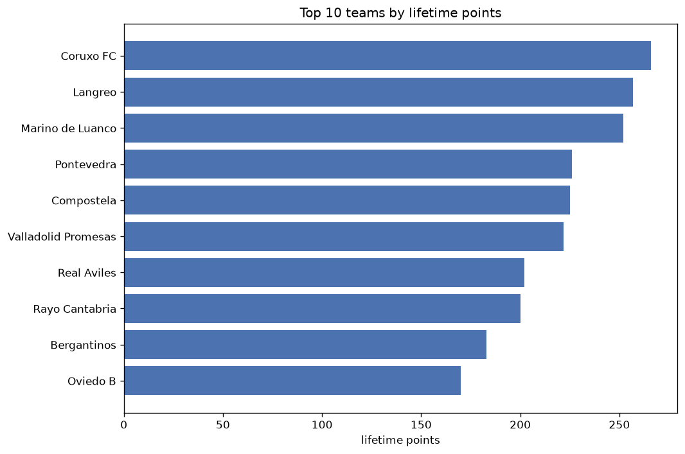
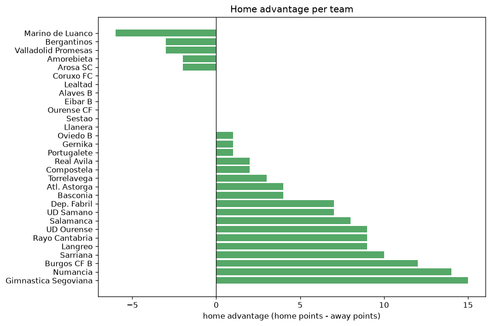

# Team Analysis
- Report: `teams_analysis`
- Generated: 2026-10-29T02:14:04+00:00
- Script: `backend/scripts/analyze_teams.py` v1.0.0
- League: Segunda RFEF - Group 1 (Spain)
- Scope: league `segunda1`

- Teams: **55** | Seasons: **7** | Matches: **1782**

## 1. Team standings (lifetime)
| team | seasons | played | W | D | L | pts | GF | GA | GD | avg pts/season | best pos | worst pos | titles |
|---|---|---|---|---|---|---|---|---|---|---|---|---|---|
| Coruxo FC | 7 | 196 | 72 | 50 | 74 | 266 | 224 | 212 | 12 | 38.0 | 4 | 16 | 0 |
| Langreo | 6 | 188 | 65 | 62 | 61 | 257 | 198 | 215 | -17 | 42.83 | 6 | 14 | 0 |
| Marino de Luanco | 7 | 196 | 65 | 58 | 73 | 253 | 195 | 193 | 2 | 36.14 | 9 | 15 | 0 |
| Pontevedra | 4 | 120 | 64 | 34 | 22 | 226 | 205 | 115 | 90 | 56.5 | 1 | 13 | 2 |
| Compostela | 6 | 162 | 57 | 54 | 51 | 225 | 192 | 171 | 21 | 37.5 | 4 | 14 | 0 |
| Valladolid Promesas | 5 | 154 | 60 | 42 | 52 | 222 | 221 | 211 | 10 | 44.4 | 3 | 12 | 0 |
| Real Aviles | 4 | 136 | 51 | 49 | 36 | 202 | 174 | 143 | 31 | 50.5 | 2 | 12 | 0 |
| Rayo Cantabria | 5 | 144 | 52 | 44 | 48 | 200 | 219 | 194 | 25 | 40.0 | 4 | 17 | 0 |
| Bergantinos | 5 | 144 | 48 | 39 | 57 | 183 | 182 | 185 | -3 | 36.6 | 3 | 18 | 0 |
| Oviedo B | 5 | 128 | 47 | 30 | 51 | 171 | 148 | 161 | -13 | 34.2 | 2 | 17 | 0 |
| Dep. Fabril | 3 | 102 | 47 | 26 | 29 | 167 | 155 | 98 | 57 | 55.67 | 1 | 9 | 1 |
| Salamanca | 4 | 120 | 42 | 31 | 47 | 157 | 129 | 136 | -7 | 39.25 | 7 | 17 | 0 |
| Numancia | 3 | 86 | 40 | 28 | 18 | 148 | 124 | 69 | 55 | 49.33 | 2 | 9 | 0 |
| Zamora | 3 | 86 | 40 | 27 | 19 | 147 | 98 | 71 | 27 | 49.0 | 3 | 6 | 0 |
| Guijuelo | 4 | 120 | 36 | 39 | 45 | 147 | 110 | 135 | -25 | 36.75 | 5 | 20 | 0 |
| Ourense CF | 3 | 76 | 36 | 21 | 19 | 129 | 98 | 63 | 35 | 43.0 | 1 | 13 | 1 |
| Torrelavega | 4 | 110 | 32 | 32 | 46 | 128 | 118 | 147 | -29 | 32.0 | 8 | 18 | 0 |
| Arenteiro | 2 | 68 | 31 | 25 | 12 | 118 | 79 | 54 | 25 | 59.0 | 1 | 10 | 1 |
| Real Avila | 2 | 68 | 29 | 15 | 24 | 102 | 83 | 81 | 2 | 51.0 | 5 | 8 | 0 |
| Palencia CA | 2 | 68 | 24 | 21 | 23 | 93 | 76 | 73 | 3 | 46.5 | 5 | 14 | 0 |
| Gimnastica Segoviana | 2 | 68 | 25 | 18 | 25 | 93 | 74 | 78 | -4 | 46.5 | 6 | 13 | 0 |
| Llanera | 3 | 76 | 22 | 19 | 35 | 85 | 83 | 120 | -37 | 28.33 | 15 | 16 | 0 |
| Burgos CF B | 2 | 68 | 15 | 18 | 35 | 63 | 67 | 109 | -42 | 31.5 | 16 | 16 | 0 |
| Union Adarve | 1 | 34 | 17 | 10 | 7 | 61 | 54 | 39 | 15 | 61.0 | 2 | 2 | 0 |
| Laredo | 2 | 68 | 13 | 20 | 35 | 59 | 45 | 91 | -46 | 29.5 | 15 | 18 | 0 |
| Navalcarnero | 1 | 34 | 17 | 6 | 11 | 57 | 41 | 32 | 9 | 57.0 | 3 | 3 | 0 |
| UD Ourense | 1 | 34 | 15 | 10 | 9 | 55 | 40 | 34 | 6 | 55.0 | 4 | 4 | 0 |
| Atl. Astorga | 2 | 42 | 14 | 10 | 18 | 52 | 52 | 55 | -3 | 26.0 | 13 | 13 | 0 |
| Leganes B | 1 | 34 | 13 | 9 | 12 | 48 | 44 | 34 | 10 | 48.0 | 7 | 7 | 0 |
| Lealtad | 2 | 52 | 11 | 15 | 26 | 48 | 42 | 68 | -26 | 24.0 | 15 | 17 | 0 |
| Arosa SC | 2 | 42 | 11 | 13 | 18 | 46 | 44 | 65 | -21 | 23.0 | 14 | 17 | 0 |
| Escobedo | 1 | 34 | 10 | 13 | 11 | 43 | 31 | 39 | -8 | 43.0 | 13 | 13 | 0 |
| Covadonga | 2 | 52 | 11 | 10 | 31 | 43 | 56 | 97 | -41 | 21.5 | 18 | 19 | 0 |
| CD Mostoles | 1 | 34 | 11 | 8 | 15 | 41 | 37 | 44 | -7 | 41.0 | 15 | 15 | 0 |
| Sarriana | 1 | 34 | 11 | 7 | 16 | 40 | 42 | 42 | 0 | 40.0 | 15 | 15 | 0 |
| Burgos CF | 1 | 18 | 12 | 3 | 3 | 39 | 24 | 12 | 12 | 39.0 | 1 | 1 | 1 |
| Racing Club Villalbes | 1 | 34 | 8 | 13 | 13 | 37 | 23 | 32 | -9 | 37.0 | 14 | 14 | 0 |
| Arandina | 1 | 34 | 8 | 10 | 16 | 34 | 37 | 48 | -11 | 34.0 | 15 | 15 | 0 |
| Cultural Leonesa | 1 | 18 | 8 | 7 | 3 | 31 | 27 | 15 | 12 | 31.0 | 2 | 2 | 0 |
| Unionistas | 1 | 18 | 8 | 6 | 4 | 30 | 17 | 10 | 7 | 30.0 | 4 | 4 | 0 |
| Celta Vigo B | 1 | 18 | 9 | 3 | 6 | 30 | 22 | 20 | 2 | 30.0 | 5 | 5 | 0 |
| Cayon | 1 | 34 | 6 | 12 | 16 | 30 | 37 | 52 | -15 | 30.0 | 16 | 16 | 0 |
| Dep. La Coruna | 1 | 18 | 8 | 5 | 5 | 29 | 14 | 10 | 4 | 29.0 | 7 | 7 | 0 |
| Racing Club Ferrol | 1 | 18 | 7 | 6 | 5 | 27 | 22 | 17 | 5 | 27.0 | 8 | 8 | 0 |
| Lugo B | 1 | 34 | 5 | 11 | 18 | 26 | 30 | 47 | -17 | 26.0 | 17 | 17 | 0 |
| Sestao | 1 | 8 | 6 | 1 | 1 | 19 | 9 | 3 | 6 | 19.0 | 1 | 1 | 1 |
| Union Club Ceares | 1 | 34 | 5 | 3 | 26 | 18 | 23 | 78 | -55 | 18.0 | 18 | 18 | 0 |
| Alaves B | 1 | 8 | 5 | 2 | 1 | 17 | 21 | 11 | 10 | 17.0 | 2 | 2 | 0 |
| Eibar B | 1 | 8 | 5 | 2 | 1 | 17 | 14 | 6 | 8 | 17.0 | 4 | 4 | 0 |
| Gijon B | 1 | 18 | 3 | 7 | 8 | 16 | 16 | 24 | -8 | 16.0 | 18 | 18 | 0 |
| UD Samano | 1 | 34 | 3 | 6 | 25 | 15 | 23 | 87 | -64 | 15.0 | 18 | 18 | 0 |
| Amorebieta | 1 | 8 | 4 | 1 | 3 | 13 | 10 | 8 | 2 | 13.0 | 6 | 6 | 0 |
| Portugalete | 1 | 8 | 3 | 3 | 2 | 12 | 9 | 9 | 0 | 12.0 | 8 | 8 | 0 |
| Gernika | 1 | 8 | 2 | 4 | 2 | 10 | 15 | 9 | 6 | 10.0 | 10 | 10 | 0 |
| Basconia | 1 | 8 | 2 | 4 | 2 | 10 | 13 | 14 | -1 | 10.0 | 11 | 11 | 0 |

## 2. Home vs away split
| team | home P | H-W | H-D | H-L | H-pts | away P | A-W | A-D | A-L | A-pts | adv |
|---|---|---|---|---|---|---|---|---|---|---|---|
| Compostela | 81 | 38 | 26 | 17 | 140 | 81 | 19 | 28 | 34 | 85 | 55 |
| Coruxo FC | 97 | 42 | 31 | 24 | 157 | 99 | 30 | 19 | 50 | 109 | 48 |
| Guijuelo | 60 | 26 | 17 | 17 | 95 | 60 | 10 | 22 | 28 | 52 | 43 |
| Real Aviles | 68 | 34 | 20 | 14 | 122 | 68 | 17 | 29 | 22 | 80 | 42 |
| Marino de Luanco | 98 | 39 | 30 | 29 | 147 | 98 | 26 | 28 | 44 | 106 | 41 |
| Pontevedra | 60 | 41 | 10 | 9 | 133 | 60 | 23 | 24 | 13 | 93 | 40 |
| Numancia | 43 | 28 | 9 | 6 | 93 | 43 | 12 | 19 | 12 | 55 | 38 |
| Oviedo B | 63 | 29 | 13 | 21 | 100 | 65 | 18 | 17 | 30 | 71 | 29 |
| Gimnastica Segoviana | 34 | 17 | 9 | 8 | 60 | 34 | 8 | 9 | 17 | 33 | 27 |
| Covadonga | 26 | 9 | 7 | 10 | 34 | 26 | 2 | 3 | 21 | 9 | 25 |
| Ourense CF | 39 | 23 | 7 | 9 | 76 | 37 | 13 | 14 | 10 | 53 | 23 |
| Llanera | 38 | 14 | 12 | 12 | 54 | 38 | 8 | 7 | 23 | 31 | 23 |
| Langreo | 94 | 34 | 37 | 23 | 139 | 94 | 31 | 25 | 38 | 118 | 21 |
| Torrelavega | 55 | 19 | 17 | 19 | 74 | 55 | 13 | 15 | 27 | 54 | 20 |
| Salamanca | 60 | 23 | 19 | 18 | 88 | 60 | 19 | 12 | 29 | 69 | 19 |
| Rayo Cantabria | 72 | 29 | 21 | 22 | 108 | 72 | 23 | 23 | 26 | 92 | 16 |
| Arosa SC | 21 | 8 | 7 | 6 | 31 | 21 | 3 | 6 | 12 | 15 | 16 |
| Cayon | 17 | 6 | 5 | 6 | 23 | 17 | 0 | 7 | 10 | 7 | 16 |
| Union Club Ceares | 17 | 5 | 2 | 10 | 17 | 17 | 0 | 1 | 16 | 1 | 16 |
| Palencia CA | 34 | 14 | 12 | 8 | 54 | 34 | 10 | 9 | 15 | 39 | 15 |
| Union Adarve | 17 | 12 | 2 | 3 | 38 | 17 | 5 | 8 | 4 | 23 | 15 |
| Arenteiro | 34 | 19 | 9 | 6 | 66 | 34 | 12 | 16 | 6 | 52 | 14 |
| Dep. Fabril | 51 | 26 | 12 | 13 | 90 | 51 | 21 | 14 | 16 | 77 | 13 |
| Zamora | 43 | 23 | 11 | 9 | 80 | 43 | 17 | 16 | 10 | 67 | 13 |
| Burgos CF B | 34 | 9 | 10 | 15 | 37 | 34 | 6 | 8 | 20 | 26 | 11 |
| CD Mostoles | 17 | 7 | 5 | 5 | 26 | 17 | 4 | 3 | 10 | 15 | 11 |
| Real Avila | 34 | 16 | 8 | 10 | 56 | 34 | 13 | 7 | 14 | 46 | 10 |
| Sarriana | 17 | 7 | 4 | 6 | 25 | 17 | 4 | 3 | 10 | 15 | 10 |
| Navalcarnero | 17 | 10 | 3 | 4 | 33 | 17 | 7 | 3 | 7 | 24 | 9 |
| UD Ourense | 17 | 9 | 5 | 3 | 32 | 17 | 6 | 5 | 6 | 23 | 9 |
| Dep. La Coruna | 9 | 6 | 1 | 2 | 19 | 9 | 2 | 4 | 3 | 10 | 9 |
| Atl. Astorga | 22 | 8 | 6 | 8 | 30 | 20 | 6 | 4 | 10 | 22 | 8 |
| Bergantinos | 72 | 25 | 20 | 27 | 95 | 72 | 23 | 19 | 30 | 88 | 7 |
| Racing Club Villalbes | 17 | 4 | 10 | 3 | 22 | 17 | 4 | 3 | 10 | 15 | 7 |
| UD Samano | 17 | 3 | 2 | 12 | 11 | 17 | 0 | 4 | 13 | 4 | 7 |
| Valladolid Promesas | 77 | 31 | 21 | 25 | 114 | 77 | 29 | 21 | 27 | 108 | 6 |
| Lealtad | 26 | 6 | 9 | 11 | 27 | 26 | 5 | 6 | 15 | 21 | 6 |
| Arandina | 17 | 4 | 8 | 5 | 20 | 17 | 4 | 2 | 11 | 14 | 6 |
| Laredo | 34 | 7 | 11 | 16 | 32 | 34 | 6 | 9 | 19 | 27 | 5 |
| Burgos CF | 9 | 7 | 1 | 1 | 22 | 9 | 5 | 2 | 2 | 17 | 5 |
| Lugo B | 17 | 3 | 6 | 8 | 15 | 17 | 2 | 5 | 10 | 11 | 4 |
| Cultural Leonesa | 9 | 4 | 5 | 0 | 17 | 9 | 4 | 2 | 3 | 14 | 3 |
| Eibar B | 4 | 3 | 1 | 0 | 10 | 4 | 2 | 1 | 1 | 7 | 3 |
| Leganes B | 17 | 7 | 4 | 6 | 25 | 17 | 6 | 5 | 6 | 23 | 2 |
| Unionistas | 9 | 5 | 1 | 3 | 16 | 9 | 3 | 5 | 1 | 14 | 2 |
| Gijon B | 9 | 2 | 3 | 4 | 9 | 9 | 1 | 4 | 4 | 7 | 2 |
| Basconia | 4 | 1 | 3 | 0 | 6 | 4 | 1 | 1 | 2 | 4 | 2 |
| Racing Club Ferrol | 9 | 4 | 2 | 3 | 14 | 9 | 3 | 4 | 2 | 13 | 1 |
| Sestao | 4 | 3 | 1 | 0 | 10 | 4 | 3 | 0 | 1 | 9 | 1 |
| Portugalete | 4 | 1 | 2 | 1 | 5 | 4 | 2 | 1 | 1 | 7 | -2 |
| Gernika | 4 | 1 | 1 | 2 | 4 | 4 | 1 | 3 | 0 | 6 | -2 |
| Escobedo | 17 | 4 | 8 | 5 | 20 | 17 | 6 | 5 | 6 | 23 | -3 |
| Amorebieta | 4 | 1 | 1 | 2 | 4 | 4 | 3 | 0 | 1 | 9 | -5 |
| Alaves B | 4 | 1 | 2 | 1 | 5 | 4 | 4 | 0 | 0 | 12 | -7 |
| Celta Vigo B | 9 | 3 | 2 | 4 | 11 | 9 | 6 | 1 | 2 | 19 | -8 |

## 3. Top performers
### Best points per game (PPG)
| rank | team | PPG |
|---|---|---|
| 1 | Sestao | 2.38 |
| 2 | Burgos CF | 2.17 |
| 3 | Alaves B | 2.12 |
| 4 | Eibar B | 2.12 |
| 5 | Pontevedra | 1.88 |

### Most goals scored
| rank | team | goals |
|---|---|---|
| 1 | Coruxo FC | 224 |
| 2 | Valladolid Promesas | 221 |
| 3 | Rayo Cantabria | 219 |
| 4 | Pontevedra | 205 |
| 5 | Langreo | 198 |

### Best goal difference
| rank | team | GD |
|---|---|---|
| 1 | Pontevedra | 90 |
| 2 | Dep. Fabril | 57 |
| 3 | Numancia | 55 |
| 4 | Ourense CF | 35 |
| 5 | Real Aviles | 31 |

### Best defence (goals against per match, standings)
| rank | team | GA/match |
|---|---|---|
| 1 | Sestao | 0.375 |
| 2 | Unionistas | 0.556 |
| 3 | Dep. La Coruna | 0.556 |
| 4 | Burgos CF | 0.667 |
| 5 | Eibar B | 0.750 |

## 4. Team consistency
- Teams present in all **7** seasons: **2**

Coruxo FC, Marino de Luanco

## 5. Head-to-head dominance
- Distinct fixtures: **620** (showing the 15 most frequent)

| fixture | meetings | home wins | draws | away wins | home pct | draw pct | away pct |
|---|---|---|---|---|---|---|---|
| Langreo vs Marino de Luanco | 12 | 6 | 3 | 3 | 50.0% | 25.0% | 25.0% |
| Compostela vs Coruxo FC | 11 | 5 | 5 | 1 | 45.5% | 45.5% | 9.1% |
| Marino de Luanco vs Coruxo FC | 10 | 4 | 3 | 3 | 40.0% | 30.0% | 30.0% |
| Valladolid Promesas vs Langreo | 10 | 4 | 5 | 1 | 40.0% | 50.0% | 10.0% |
| Valladolid Promesas vs Marino de Luanco | 10 | 4 | 3 | 3 | 40.0% | 30.0% | 30.0% |
| Langreo vs Coruxo FC | 10 | 3 | 5 | 2 | 30.0% | 50.0% | 20.0% |
| Marino de Luanco vs Oviedo B | 9 | 5 | 4 | 0 | 55.6% | 44.4% | 0.0% |
| Coruxo FC vs Bergantinos | 9 | 4 | 2 | 3 | 44.4% | 22.2% | 33.3% |
| Coruxo FC vs Rayo Cantabria | 9 | 4 | 3 | 2 | 44.4% | 33.3% | 22.2% |
| Compostela vs Marino de Luanco | 9 | 2 | 4 | 3 | 22.2% | 44.4% | 33.3% |
| Coruxo FC vs Salamanca | 8 | 5 | 1 | 2 | 62.5% | 12.5% | 25.0% |
| Pontevedra vs Coruxo FC | 8 | 5 | 1 | 2 | 62.5% | 12.5% | 25.0% |
| Real Aviles vs Compostela | 8 | 5 | 3 | 0 | 62.5% | 37.5% | 0.0% |
| Compostela vs Guijuelo | 8 | 4 | 2 | 2 | 50.0% | 25.0% | 25.0% |
| Compostela vs Langreo | 8 | 4 | 0 | 4 | 50.0% | 0.0% | 50.0% |

## 6. Position per season (classic view)
_Cells show final position; '-' when the team was absent from that season._

| team | 2020-2021 | 2021-2022 | 2022-2023 | 2023-2024 | 2024-2025 | 2025-2026 | 2026-2027 |
|---|---|---|---|---|---|---|---|
| Coruxo FC | 16 | 4 | 11 | 10 | 10 | 5 | 12 |
| Langreo | 11 | 11 | 12 | 6 | 6 | 14 | - |
| Marino de Luanco | 12 | 12 | 9 | 11 | 11 | 11 | 15 |
| Pontevedra | 13 | 1 | - | 2 | 1 | - | - |
| Compostela | 10 | 8 | 4 | 7 | 14 | - | 5 |
| Valladolid Promesas | 3 | - | 3 | 8 | 12 | 12 | - |
| Real Aviles | - | 9 | 2 | 12 | 3 | - | - |
| Rayo Cantabria | - | - | 10 | 4 | 7 | 9 | 17 |
| Bergantinos | - | 6 | 18 | - | 8 | 10 | 3 |
| Oviedo B | 14 | - | 7 | 17 | - | 2 | 9 |
| Dep. Fabril | - | - | - | 9 | 4 | 1 | - |
| Salamanca | 17 | 14 | - | - | 9 | 7 | - |
| Numancia | 9 | - | - | - | 2 | 3 | - |
| Zamora | 6 | - | 6 | 3 | - | - | - |
| Guijuelo | 20 | - | 5 | 5 | 17 | - | - |
| Ourense CF | - | - | 13 | 1 | - | - | 7 |
| Torrelavega | - | - | 8 | 13 | 16 | - | 18 |
| Arenteiro | - | 10 | 1 | - | - | - | - |
| Real Avila | - | - | - | - | 5 | 8 | - |
| Palencia CA | - | 5 | 14 | - | - | - | - |
| Gimnastica Segoviana | - | 13 | - | - | - | 6 | - |
| Llanera | - | 16 | - | - | 15 | - | 16 |
| Burgos CF B | - | - | 16 | - | - | 16 | - |
| Union Adarve | - | 2 | - | - | - | - | - |
| Laredo | - | - | 15 | - | 18 | - | - |
| Navalcarnero | - | 3 | - | - | - | - | - |
| UD Ourense | - | - | - | - | - | 4 | - |
| Atl. Astorga | - | - | - | - | - | 13 | 13 |
| Leganes B | - | 7 | - | - | - | - | - |
| Lealtad | 15 | - | - | - | - | 17 | - |
| Arosa SC | - | 17 | - | - | - | - | 14 |
| Escobedo | - | - | - | - | 13 | - | - |
| Covadonga | 19 | - | - | 18 | - | - | - |
| CD Mostoles | - | 15 | - | - | - | - | - |
| Sarriana | - | - | - | - | - | 15 | - |
| Burgos CF | 1 | - | - | - | - | - | - |
| Racing Club Villalbes | - | - | - | 14 | - | - | - |
| Arandina | - | - | - | 15 | - | - | - |
| Cultural Leonesa | 2 | - | - | - | - | - | - |
| Unionistas | 4 | - | - | - | - | - | - |
| Celta Vigo B | 5 | - | - | - | - | - | - |
| Cayon | - | - | - | 16 | - | - | - |
| Dep. La Coruna | 7 | - | - | - | - | - | - |
| Racing Club Ferrol | 8 | - | - | - | - | - | - |
| Lugo B | - | - | 17 | - | - | - | - |
| Sestao | - | - | - | - | - | - | 1 |
| Union Club Ceares | - | 18 | - | - | - | - | - |
| Alaves B | - | - | - | - | - | - | 2 |
| Eibar B | - | - | - | - | - | - | 4 |
| Gijon B | 18 | - | - | - | - | - | - |
| UD Samano | - | - | - | - | - | 18 | - |
| Amorebieta | - | - | - | - | - | - | 6 |
| Portugalete | - | - | - | - | - | - | 8 |
| Gernika | - | - | - | - | - | - | 10 |
| Basconia | - | - | - | - | - | - | 11 |

---
*All statistics are computed from PostgreSQL tables (read-only). Run with `python backend/scripts/analyze_teams.py` to regenerate.*

## Charts

