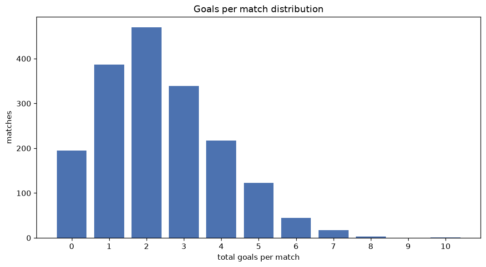
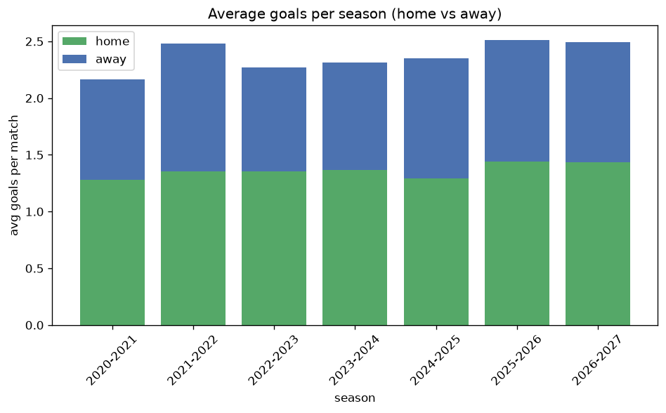

# Goal Analysis
- Report: `goals_analysis`
- Generated: 2026-10-26T01:47:32+00:00
- Script: `backend/scripts/analyze_goals.py` v1.0.0
- League: Segunda RFEF - Group 2 (Spain)
- Scope: league `segunda2`

## 1. Goals per match distribution
| goals | matches | pct |
|---|---|---|
| 0 | 195 | 10.9% |
| 1 | 387 | 21.5% |
| 2 | 470 | 26.2% |
| 3 | 339 | 18.9% |
| 4 | 217 | 12.1% |
| 5 | 123 | 6.8% |
| 6 | 45 | 2.5% |
| 7 | 17 | 0.9% |
| 8 | 3 | 0.2% |
| 9 | 0 | 0.0% |
| 10 | 1 | 0.1% |

## 2. Goals per match per season
| season | matches | total goals | avg home | avg away | avg total |
|---|---|---|---|---|---|
| 2020-2021 | 200 | 433 | 1.28 | 0.885 | 2.165 |
| 2021-2022 | 306 | 760 | 1.356 | 1.127 | 2.484 |
| 2022-2023 | 306 | 694 | 1.353 | 0.915 | 2.268 |
| 2023-2024 | 306 | 708 | 1.369 | 0.944 | 2.314 |
| 2024-2025 | 306 | 719 | 1.294 | 1.056 | 2.35 |
| 2025-2026 | 306 | 769 | 1.438 | 1.075 | 2.513 |
| 2026-2027 | 67 | 167 | 1.433 | 1.06 | 2.493 |

## 3. Home vs away goal share
- Home goals: **2436** (57.3%)
- Away goals: **1814** (42.7%)
- Home/away ratio: **1.343**

| season | home goals | away goals | total | home pct | away pct |
|---|---|---|---|---|---|
| 2020-2021 | 256 | 177 | 433 | 59.1% | 40.9% |
| 2021-2022 | 415 | 345 | 760 | 54.6% | 45.4% |
| 2022-2023 | 414 | 280 | 694 | 59.7% | 40.3% |
| 2023-2024 | 419 | 289 | 708 | 59.2% | 40.8% |
| 2024-2025 | 396 | 323 | 719 | 55.1% | 44.9% |
| 2025-2026 | 440 | 329 | 769 | 57.2% | 42.8% |
| 2026-2027 | 96 | 71 | 167 | 57.5% | 42.5% |

## 4. BTTS (Both Teams To Score)
- Overall: **807** of `1797` (44.9%)

| season | matches | BTTS | pct |
|---|---|---|---|
| 2020-2021 | 200 | 84 | 42.0% |
| 2021-2022 | 306 | 143 | 46.7% |
| 2022-2023 | 306 | 135 | 44.1% |
| 2023-2024 | 306 | 114 | 37.3% |
| 2024-2025 | 306 | 139 | 45.4% |
| 2025-2026 | 306 | 158 | 51.6% |
| 2026-2027 | 67 | 34 | 50.7% |

## 5. Clean sheets
- Home clean sheets: **676** (37.6%)
- Away clean sheets: **509** (28.3%)
- Total clean sheets recorded: **1185**
- Matches with at least one clean sheet: **990** (55.1%)
- Both teams kept clean sheets (0-0): **195**

| season | matches | home CS | away CS | total CS | matches w/ CS |
|---|---|---|---|---|---|
| 2020-2021 | 200 | 80 | 59 | 139 | 116 (58.0%) |
| 2021-2022 | 306 | 107 | 91 | 198 | 163 (53.3%) |
| 2022-2023 | 306 | 124 | 81 | 205 | 171 (55.9%) |
| 2023-2024 | 306 | 129 | 102 | 231 | 192 (62.7%) |
| 2024-2025 | 306 | 110 | 85 | 195 | 167 (54.6%) |
| 2025-2026 | 306 | 102 | 74 | 176 | 148 (48.4%) |
| 2026-2027 | 67 | 24 | 17 | 41 | 33 (49.3%) |

## 6. Scoring intensity
- First-half goals: **1805** (42.5%)
- Second-half goals: **2445** (57.5%)
- Avg first-half goals per match: **1.004**
- Avg second-half goals per match: **1.361**
- Second-half-only scoring (HT 0-0, FT goals >= 1): **470** (26.2%)

| season | matches | 1st half | 2nd half | 1st half pct | 2nd half pct |
|---|---|---|---|---|---|
| 2020-2021 | 200 | 185 | 248 | 42.7% | 57.3% |
| 2021-2022 | 306 | 324 | 436 | 42.6% | 57.4% |
| 2022-2023 | 306 | 288 | 406 | 41.5% | 58.5% |
| 2023-2024 | 306 | 307 | 401 | 43.4% | 56.6% |
| 2024-2025 | 306 | 302 | 417 | 42.0% | 58.0% |
| 2025-2026 | 306 | 330 | 439 | 42.9% | 57.1% |
| 2026-2027 | 67 | 69 | 98 | 41.3% | 58.7% |

## 7. First-goal timing
- Matches with first-goal time recorded: `1602` of `1797` (89.1%)
- Goalless matches: `195`
- Min `1` | Max `96` | Mean `33.91` | Median (p50) `28.0`

| bucket | count | % of matches | % of scoring matches |
|---|---|---|---|
| 1-15 | 460 | 25.6% | 28.7% |
| 16-30 | 381 | 21.2% | 23.8% |
| 31-45 | 283 | 15.7% | 17.7% |
| 46-60 | 210 | 11.7% | 13.1% |
| 61-75 | 148 | 8.2% | 9.2% |
| 76-90 | 105 | 5.8% | 6.6% |
| 91-120 | 15 | 0.8% | 0.9% |

---
*All statistics are computed from PostgreSQL tables (read-only). Run with `python backend/scripts/analyze_goals.py` to regenerate.*

## Charts

