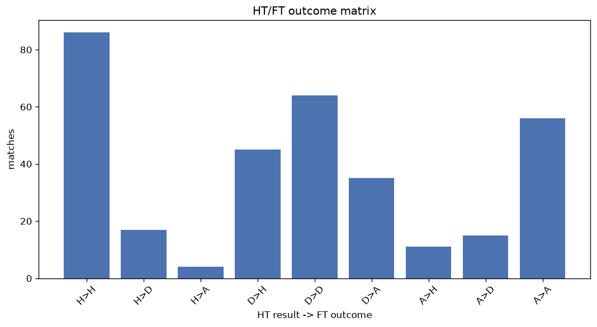
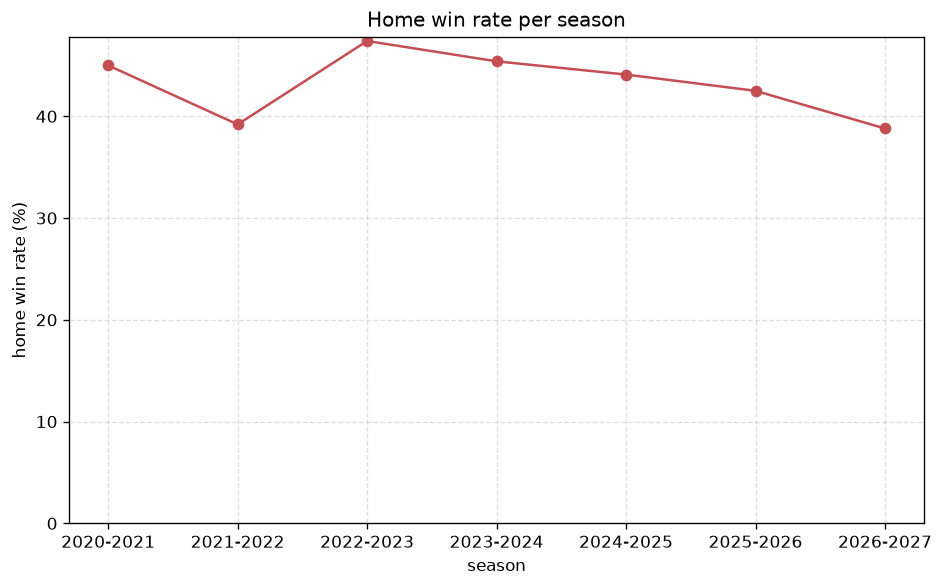

# Match Analysis
- Report: `matches_analysis`
- Generated: 2026-10-29T02:14:19+00:00
- Script: `backend/scripts/analyze_matches.py` v1.0.0
- League: Segunda RFEF - Group 2 (Spain)
- Scope: league `segunda2`

## 1. Overall summary
| metric | value |
|---|---|
| Matches | 1801 |
| Home wins | 788 (43.8%) |
| Draws | 503 (27.9%) |
| Away wins | 510 (28.3%) |
| Total goals | 4256 |
| Average goals per match | 2.363 |
| Goalless matches | 196 (10.9%) |

## 2. Per-season breakdown
| season | matches | home wins | draws | away wins | total goals | avg goals | goalless |
|---|---|---|---|---|---|---|---|
| 2020-2021 | 200 | 90 (45.0%) | 56 (28.0%) | 54 (27.0%) | 433 | 2.165 | 23 (11.5%) |
| 2021-2022 | 306 | 120 (39.2%) | 98 (32.0%) | 88 (28.8%) | 760 | 2.484 | 35 (11.4%) |
| 2022-2023 | 306 | 145 (47.4%) | 81 (26.5%) | 80 (26.1%) | 694 | 2.268 | 34 (11.1%) |
| 2023-2024 | 306 | 139 (45.4%) | 80 (26.1%) | 87 (28.4%) | 708 | 2.314 | 39 (12.7%) |
| 2024-2025 | 306 | 135 (44.1%) | 76 (24.8%) | 95 (31.0%) | 719 | 2.35 | 28 (9.2%) |
| 2025-2026 | 306 | 130 (42.5%) | 89 (29.1%) | 87 (28.4%) | 769 | 2.513 | 28 (9.2%) |
| 2026-2027 | 71 | 29 (40.8%) | 23 (32.4%) | 19 (26.8%) | 173 | 2.437 | 9 (12.7%) |

## 3. HT/FT outcome matrix
| HT result \ FT result | Home | Draw | Away | total |
|---|---|---|---|---|
| HT home lead | 461 (82.5%) | 75 (13.4%) | 23 (4.1%) | 559 |
| HT draw | 290 (35.1%) | 336 (40.6%) | 201 (24.3%) | 827 |
| HT away lead | 37 (8.9%) | 92 (22.2%) | 286 (68.9%) | 415 |

## 4. Comeback matches
- Home comebacks (trailing at HT, won at FT): **37** (2.1%)
- Away comebacks (trailing at HT, won at FT): **23** (1.3%)

### Home comebacks
| season | home | away | HT | FT |
|---|---|---|---|---|
| 2020-2021 | Amorebieta | Real Sociedad B | 0-1 | 2-1 |
| 2020-2021 | Osasuna B | Izarra | 0-1 | 3-2 |
| 2020-2021 | Tarazona | Izarra | 0-1 | 2-1 |
| 2021-2022 | Burgos CF B | Pena | 0-1 | 2-1 |
| 2021-2022 | Mutilvera | Cayon | 0-1 | 2-1 |
| 2021-2022 | UD Logrones B | AD San Juan | 0-1 | 3-1 |
| 2021-2022 | Cayon | Pena | 0-1 | 2-1 |
| 2021-2022 | UD Logrones B | CD Ardoi | 0-1 | 3-2 |
| 2021-2022 | Cayon | Tropezon | 1-3 | 4-3 |
| 2022-2023 | Utebo FC | Alfaro | 0-1 | 2-1 |
| 2022-2023 | Utebo FC | Mutilvera | 1-2 | 3-2 |
| 2022-2023 | Gernika | Mutilvera | 0-1 | 2-1 |
| 2022-2023 | Real Sociedad C | Alfaro | 0-1 | 3-1 |
| 2022-2023 | Cirbonero | Arnedo | 0-1 | 3-2 |
| 2022-2023 | Beasain | Gernika | 0-1 | 3-2 |
| 2022-2023 | Real Sociedad C | Tarazona | 0-1 | 2-1 |
| 2023-2024 | Zaragoza B | Arenas Getxo | 0-1 | 2-1 |
| 2023-2024 | Izarra | Calahorra | 0-1 | 2-1 |
| 2023-2024 | Calahorra | Zaragoza B | 0-3 | 4-3 |
| 2024-2025 | SD Logrones | Arenas Getxo | 0-1 | 2-1 |
| 2024-2025 | Zaragoza B | Eibar B | 0-1 | 2-1 |
| 2024-2025 | Subiza | Barbastro | 0-1 | 2-1 |
| 2024-2025 | Alaves B | Real Sociedad C | 0-1 | 2-1 |
| 2024-2025 | Utebo FC | Teruel | 0-1 | 3-2 |
| 2025-2026 | Tudelano | Beasain | 0-1 | 3-1 |
| 2025-2026 | UD Logrones | Naxara | 0-1 | 2-1 |
| 2025-2026 | UD Logrones | Beasain | 0-1 | 2-1 |
| 2025-2026 | Tudelano | Naxara | 0-1 | 2-1 |
| 2025-2026 | Ejea | Amorebieta | 0-1 | 2-1 |
| 2025-2026 | SD Logrones | Ebro | 0-1 | 2-1 |
| 2025-2026 | Naxara | UD Logrones | 0-1 | 2-1 |
| 2025-2026 | Zaragoza B | Mutilvera | 0-2 | 3-2 |
| 2025-2026 | Beasain | Mutilvera | 1-2 | 3-2 |
| 2025-2026 | Ejea | R. Union | 1-2 | 3-2 |
| 2026-2027 | Girona B | Tudelano | 0-1 | 3-1 |
| 2026-2027 | Girona B | Osasuna B | 1-2 | 3-2 |
| 2026-2027 | Manresa | Ebro | 1-2 | 3-2 |

### Away comebacks
| season | home | away | HT | FT |
|---|---|---|---|---|
| 2020-2021 | Haro Deportivo | Ebro | 1-0 | 1-2 |
| 2020-2021 | Amorebieta | Ath Bilbao B | 1-0 | 2-3 |
| 2020-2021 | Ath Bilbao B | Real Sociedad B | 1-0 | 1-2 |
| 2021-2022 | UD Logrones B | Rayo Cantabria | 1-0 | 1-2 |
| 2021-2022 | Pena | Burgos CF B | 1-0 | 1-3 |
| 2021-2022 | Osasuna B | AD San Juan | 3-2 | 3-4 |
| 2021-2022 | Racing Rioja | Burgos CF B | 1-0 | 2-5 |
| 2022-2023 | Izarra | Arenas Getxo | 1-0 | 1-2 |
| 2022-2023 | Real Sociedad C | Izarra | 1-0 | 2-4 |
| 2022-2023 | Beasain | Tarazona | 1-0 | 1-2 |
| 2022-2023 | Cirbonero | Tarazona | 1-0 | 1-3 |
| 2022-2023 | Cirbonero | Alfaro | 2-0 | 2-3 |
| 2023-2024 | Naxara | Ath Bilbao B | 1-0 | 1-2 |
| 2023-2024 | Mutilvera | UD Logrones | 1-0 | 1-2 |
| 2023-2024 | Tudelano | Ath Bilbao B | 1-0 | 1-2 |
| 2024-2025 | Subiza | SD Logrones | 1-0 | 2-3 |
| 2024-2025 | Eibar B | Gernika | 1-0 | 1-2 |
| 2024-2025 | Alfaro | Anguiano | 1-0 | 1-2 |
| 2025-2026 | Tudelano | Basconia | 1-0 | 1-2 |
| 2025-2026 | Amorebieta | Ebro | 1-0 | 1-2 |
| 2025-2026 | Amorebieta | Gernika | 1-0 | 1-2 |
| 2025-2026 | Mutilvera | Utebo FC | 1-0 | 1-2 |
| 2026-2027 | Tudelano | Barcelona B | 1-0 | 1-2 |

## 5. HT lead conversion
| HT state | matches | converted to win | held as draw | collapsed to loss |
|---|---|---|---|---|
| Home lead | 559 | 461 (82.5%) | 75 (13.4%) | 23 (4.1%) |
| Away lead | 415 | 286 (68.9%) | 92 (22.2%) | 37 (8.9%) |

### Matches level at half-time
| FT result | count | pct |
|---|---|---|
| Home win | 290 | 35.1% |
| Draw | 336 | 40.6% |
| Away win | 201 | 24.3% |

## 6. First-goal timing
- Matches with a first-goal time recorded: `1605` of `1801` (89.1%)

Outcome distribution by first-goal timing bucket:
| bucket | matches | % of matches | home | draw | away |
|---|---|---|---|---|---|
| 1-15 | 461 | 25.6% | 229 (49.7%) | 82 (17.8%) | 150 (32.5%) |
| 16-30 | 381 | 21.2% | 183 (48.0%) | 82 (21.5%) | 116 (30.4%) |
| 31-45 | 283 | 15.7% | 141 (49.8%) | 60 (21.2%) | 82 (29.0%) |
| 46-60 | 211 | 11.7% | 96 (45.5%) | 49 (23.2%) | 66 (31.3%) |
| 61-75 | 148 | 8.2% | 79 (53.4%) | 22 (14.9%) | 47 (31.8%) |
| 76-90 | 106 | 5.9% | 55 (51.9%) | 11 (10.4%) | 40 (37.7%) |
| 91-120 | 15 | 0.8% | 5 (33.3%) | 1 (6.7%) | 9 (60.0%) |

## 7. Goalless matches
- Overall: **196** of `1801` (10.9%)

| season | matches | goalless | pct |
|---|---|---|---|
| 2020-2021 | 200 | 23 | 11.5% |
| 2021-2022 | 306 | 35 | 11.4% |
| 2022-2023 | 306 | 34 | 11.1% |
| 2023-2024 | 306 | 39 | 12.7% |
| 2024-2025 | 306 | 28 | 9.2% |
| 2025-2026 | 306 | 28 | 9.2% |
| 2026-2027 | 71 | 9 | 12.7% |

---
*All statistics are computed from PostgreSQL tables (read-only). Run with `python backend/scripts/analyze_matches.py` to regenerate.*

## Charts

