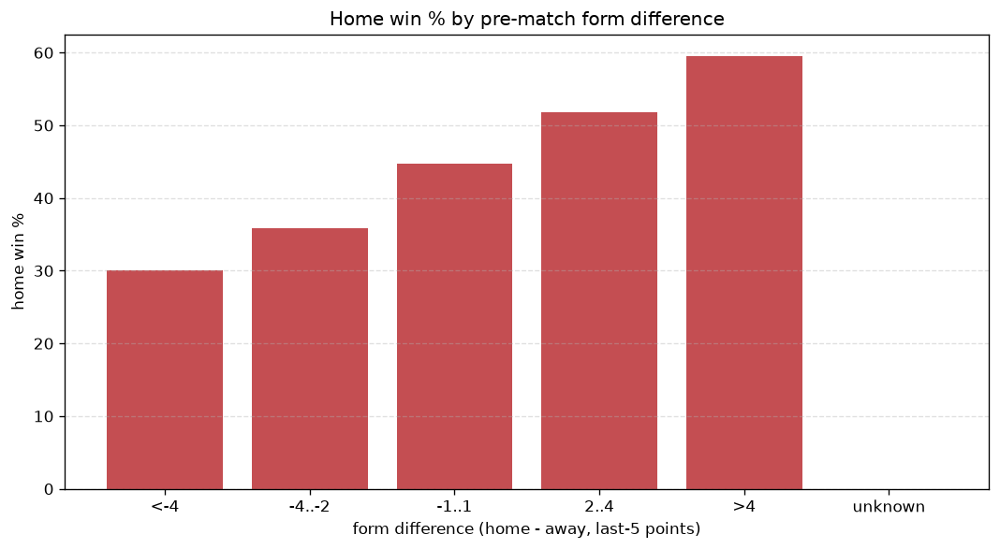
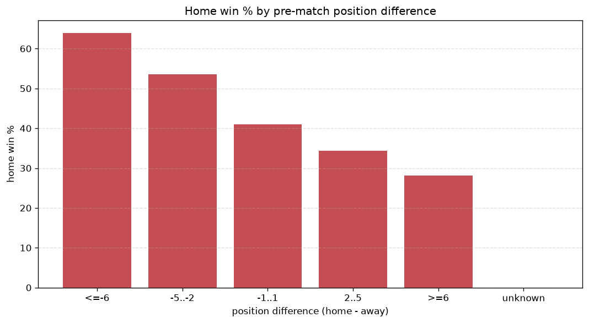

# Relationships Analysis
- Report: `relationships`
- Generated: 2026-10-26T01:47:41+00:00
- Script: `backend/scripts/analyze_relationships.py` v1.0.0
- League: Segunda RFEF - Group 2 (Spain)
- Scope: league `segunda2`

- Matches analysed: **1730** (23 leakage-safe pre-match features).

## 1. Correlation matrix
_Pearson correlation of each pre-match feature with observed goals; sorted by |corr(total goals)|._

| feature | corr(home) | corr(away) | corr(total) |
|---|---|---|---|
| points_difference | 0.291 | -0.202 | 0.097 |
| away_team_goals_conceded_last_5 | 0.175 | -0.078 | 0.087 |
| position_difference | -0.266 | 0.196 | -0.081 |
| away_position_before_match | 0.212 | -0.131 | 0.081 |
| away_team_away_conceded_avg | 0.180 | -0.108 | 0.071 |
| home_points_before_match | 0.139 | -0.060 | 0.070 |
| home_team_home_goals_avg | 0.136 | -0.065 | 0.065 |
| home_team_goals_scored_last_5 | 0.121 | -0.064 | 0.054 |
| rest_days_difference | 0.036 | 0.028 | 0.047 |
| home_team_wins_last_5 | 0.120 | -0.075 | 0.045 |
| home_team_points_last_5 | 0.128 | -0.088 | 0.043 |
| home_team_home_win_rate | 0.108 | -0.067 | 0.042 |
| home_team_goals_conceded_last_5 | -0.069 | 0.143 | 0.039 |
| home_rest_days | 0.038 | 0.003 | 0.032 |
| home_position_before_match | -0.157 | 0.140 | -0.032 |
| away_team_away_goals_avg | -0.044 | 0.091 | 0.025 |
| away_team_goals_scored_last_5 | -0.066 | 0.117 | 0.025 |
| away_team_wins_last_5 | -0.117 | 0.106 | -0.023 |
| away_team_points_last_5 | -0.124 | 0.117 | -0.021 |
| home_team_home_conceded_avg | -0.058 | 0.088 | 0.013 |
| away_team_away_win_rate | -0.096 | 0.098 | -0.012 |
| away_rest_days | 0.004 | -0.019 | -0.009 |
| away_points_before_match | -0.071 | 0.086 | 0.000 |

## 2. Form vs outcome
_Home win/draw/away % per bucket of `home_team_points_last_5 - away_team_points_last_5`._

| bucket | matches | home | draw | away | home % | draw % | away % |
|---|---|---|---|---|---|---|---|
| <-4 | 269 | 81 | 73 | 115 | 30.1% | 27.1% | 42.8% |
| -4..-2 | 357 | 128 | 114 | 115 | 35.9% | 31.9% | 32.2% |
| -1..1 | 546 | 244 | 155 | 147 | 44.7% | 28.4% | 26.9% |
| 2..4 | 336 | 174 | 82 | 80 | 51.8% | 24.4% | 23.8% |
| >4 | 222 | 132 | 56 | 34 | 59.5% | 25.2% | 15.3% |
| unknown | 0 | 0 | 0 | 0 | - | - | - |

## 3. Position vs outcome
_Home win/draw/away % per bucket of `position_difference` (home position - away position; negative favours the home team)._

| bucket | matches | home | draw | away | home % | draw % | away % |
|---|---|---|---|---|---|---|---|
| <=-6 | 363 | 232 | 74 | 57 | 63.9% | 20.4% | 15.7% |
| -5..-2 | 343 | 184 | 87 | 72 | 53.6% | 25.4% | 21.0% |
| -1..1 | 266 | 109 | 88 | 69 | 41.0% | 33.1% | 25.9% |
| 2..5 | 331 | 114 | 101 | 116 | 34.4% | 30.5% | 35.0% |
| >=6 | 427 | 120 | 130 | 177 | 28.1% | 30.4% | 41.5% |
| unknown | 0 | 0 | 0 | 0 | - | - | - |

## 4. Rest advantage
_Home win/draw/away % per bucket of `rest_days_difference` (home rest - away rest). Matches with unknown rest are bucketed separately._

| bucket | matches | home | draw | away | home % | draw % | away % |
|---|---|---|---|---|---|---|---|
| <-1 | 55 | 25 | 17 | 13 | 45.5% | 30.9% | 23.6% |
| -1..0 | 356 | 158 | 97 | 101 | 44.4% | 27.2% | 28.4% |
| 0 | 874 | 382 | 249 | 243 | 43.7% | 28.5% | 27.8% |
| 1..2 | 335 | 143 | 88 | 104 | 42.7% | 26.3% | 31.0% |
| >2 | 50 | 25 | 11 | 14 | 50.0% | 22.0% | 28.0% |
| unknown | 60 | 26 | 18 | 16 | 43.3% | 30.0% | 26.7% |
- *60 match(es) had unknown rest difference (missing rest data on at least one side).*

## 5. Home team quality
_Home win rate by `home_team_home_win_rate` tier (split at 0.5)._

- `< 0.5` tier: **40.5%** home win (443/1093)
- `>= 0.5` tier: **49.6%** home win (316/637)
- Home-win gap (>= split minus < split): **+9.1 pp**

| tier | label | matches | home | draw | away | home % |
|---|---|---|---|---|---|---|
| low | < 0.5 | 1093 | 443 | 304 | 346 | 40.5% |
| high | >= 0.5 | 637 | 316 | 176 | 145 | 49.6% |

## 6. Feature averages by result
_Mean feature value per outcome; `range` is home-minus-away spread of the group means._

| feature | home mean | draw mean | away mean | range |
|---|---|---|---|---|
| points_difference | 3.220 | -1.592 | -4.356 | 7.576 |
| position_difference | -1.947 | 1.254 | 2.798 | 4.746 |
| home_points_before_match | 23.153 | 20.521 | 18.460 | 4.693 |
| away_points_before_match | 19.933 | 22.113 | 22.817 | 2.884 |
| away_position_before_match | 11.161 | 8.758 | 8.527 | 2.633 |
| home_position_before_match | 9.213 | 10.012 | 11.326 | 2.112 |
| away_team_goals_conceded_last_5 | 5.789 | 4.731 | 4.617 | 1.172 |
| home_team_points_last_5 | 6.436 | 6.098 | 5.316 | 1.120 |
| away_team_points_last_5 | 5.665 | 6.588 | 6.766 | 1.100 |
| home_team_goals_conceded_last_5 | 4.996 | 5.265 | 5.933 | 0.937 |
| home_team_goals_scored_last_5 | 5.422 | 5.210 | 4.699 | 0.723 |
| away_team_goals_scored_last_5 | 5.012 | 5.452 | 5.731 | 0.719 |
| home_team_wins_last_5 | 1.701 | 1.594 | 1.363 | 0.338 |
| away_team_wins_last_5 | 1.470 | 1.765 | 1.802 | 0.332 |
| away_team_away_conceded_avg | 1.374 | 1.117 | 1.049 | 0.325 |
| away_rest_days | 7.819 | 7.523 | 7.609 | 0.296 |
| home_rest_days | 7.686 | 7.411 | 7.506 | 0.274 |
| home_team_home_goals_avg | 1.295 | 1.205 | 1.087 | 0.208 |
| home_team_home_conceded_avg | 0.885 | 0.936 | 0.993 | 0.108 |
| away_team_away_goals_avg | 0.889 | 0.966 | 0.958 | 0.077 |
| home_team_home_win_rate | 0.422 | 0.386 | 0.353 | 0.070 |
| away_team_away_win_rate | 0.242 | 0.300 | 0.300 | 0.057 |
| rest_days_difference | -0.134 | -0.113 | -0.103 | 0.031 |

---
*All features are leakage-safe pre-match values built by `ml.features.build_features.build_rows` from strictly prior matches. Run with `python backend/scripts/analyze_relationships.py` to regenerate.*

## Charts

