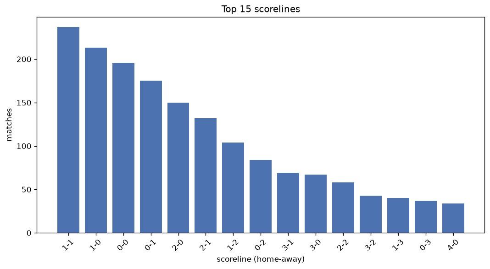
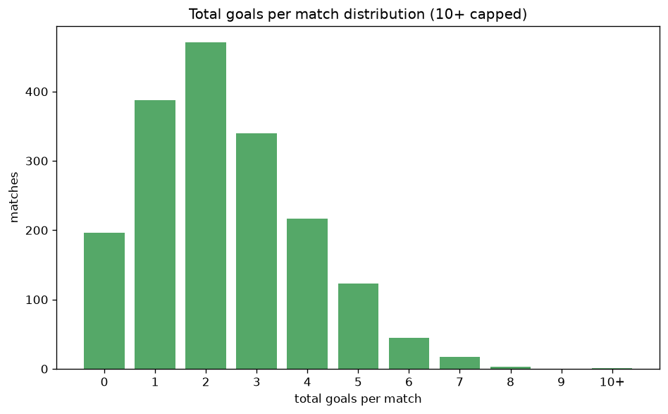

# Scoreline Analysis
- Report: `scoreline_analysis`
- Generated: 2026-10-27T02:29:40+00:00
- Script: `backend/scripts/analyze_scorelines.py` v1.0.0
- League: Segunda RFEF - Group 2 (Spain)
- Scope: league `segunda2`

## 1. Scoreline frequency
- Matches analysed: **1801** across **7** seasons.
- Distinct scorelines seen: **37**.

| scoreline | count | pct |
|---|---|---|
| 1-1 | 237 | 13.2% |
| 1-0 | 213 | 11.8% |
| 0-0 | 196 | 10.9% |
| 0-1 | 175 | 9.7% |
| 2-0 | 150 | 8.3% |
| 2-1 | 132 | 7.3% |
| 1-2 | 104 | 5.8% |
| 0-2 | 84 | 4.7% |
| 3-1 | 69 | 3.8% |
| 3-0 | 67 | 3.7% |
| 2-2 | 58 | 3.2% |
| 3-2 | 43 | 2.4% |
| 1-3 | 40 | 2.2% |
| 0-3 | 37 | 2.1% |
| 4-0 | 34 | 1.9% |
| 4-1 | 26 | 1.4% |
| 2-3 | 23 | 1.3% |
| 0-4 | 16 | 0.9% |
| 1-4 | 15 | 0.8% |
| 5-0 | 15 | 0.8% |

## 2. Scoreline frequency per season

### 2020-2021
| scoreline | count | pct |
|---|---|---|
| 1-1 | 28 | 14.0% |
| 0-1 | 25 | 12.5% |
| 1-0 | 24 | 12.0% |
| 0-0 | 23 | 11.5% |
| 2-0 | 20 | 10.0% |

### 2021-2022
| scoreline | count | pct |
|---|---|---|
| 1-1 | 46 | 15.0% |
| 0-0 | 35 | 11.4% |
| 1-0 | 32 | 10.5% |
| 0-1 | 27 | 8.8% |
| 2-0 | 23 | 7.5% |

### 2022-2023
| scoreline | count | pct |
|---|---|---|
| 1-0 | 44 | 14.4% |
| 1-1 | 41 | 13.4% |
| 0-0 | 34 | 11.1% |
| 2-0 | 29 | 9.5% |
| 2-1 | 24 | 7.8% |

### 2023-2024
| scoreline | count | pct |
|---|---|---|
| 0-0 | 39 | 12.7% |
| 1-0 | 38 | 12.4% |
| 0-1 | 31 | 10.1% |
| 1-1 | 28 | 9.2% |
| 0-2 | 21 | 6.9% |

### 2024-2025
| scoreline | count | pct |
|---|---|---|
| 1-0 | 38 | 12.4% |
| 0-1 | 37 | 12.1% |
| 1-1 | 36 | 11.8% |
| 2-1 | 30 | 9.8% |
| 2-0 | 28 | 9.2% |

### 2025-2026
| scoreline | count | pct |
|---|---|---|
| 1-1 | 47 | 15.4% |
| 1-0 | 30 | 9.8% |
| 0-0 | 28 | 9.2% |
| 0-1 | 27 | 8.8% |
| 2-0 | 24 | 7.8% |

### 2026-2027
| scoreline | count | pct |
|---|---|---|
| 1-1 | 11 | 15.5% |
| 0-0 | 9 | 12.7% |
| 0-1 | 7 | 9.9% |
| 1-0 | 7 | 9.9% |
| 1-2 | 6 | 8.5% |

## 3. Total-goal histogram
_10+ groups all matches with 10 or more total goals._

| total goals | matches | pct |
|---|---|---|
| 0 | 196 | 10.9% |
| 1 | 388 | 21.5% |
| 2 | 471 | 26.2% |
| 3 | 340 | 18.9% |
| 4 | 217 | 12.0% |
| 5 | 123 | 6.8% |
| 6 | 45 | 2.5% |
| 7 | 17 | 0.9% |
| 8 | 3 | 0.2% |
| 9 | 0 | 0.0% |
| 10+ | 1 | 0.1% |

## 4. Extreme scorelines
- Matches with 7+ total goals: **21**

| season | date | scoreline | total goals |
|---|---|---|---|
| 2025-2026 | 2026-03-29 | 6-4 | 10 |
| 2022-2023 | 2023-04-23 | 7-1 | 8 |
| 2023-2024 | 2023-12-10 | 7-1 | 8 |
| 2023-2024 | 2024-03-10 | 6-2 | 8 |
| 2021-2022 | 2021-10-24 | 4-3 | 7 |
| 2021-2022 | 2021-10-30 | 3-4 | 7 |
| 2021-2022 | 2022-02-13 | 3-4 | 7 |
| 2021-2022 | 2022-03-13 | 5-2 | 7 |
| 2021-2022 | 2022-03-19 | 4-3 | 7 |
| 2021-2022 | 2022-04-24 | 6-1 | 7 |
| 2021-2022 | 2022-04-30 | 1-6 | 7 |
| 2021-2022 | 2022-05-01 | 4-3 | 7 |
| 2021-2022 | 2022-05-08 | 6-1 | 7 |
| 2021-2022 | 2022-05-15 | 2-5 | 7 |
| 2022-2023 | 2023-02-26 | 6-1 | 7 |
| 2023-2024 | 2024-05-05 | 4-3 | 7 |
| 2024-2025 | 2024-09-15 | 5-2 | 7 |
| 2024-2025 | 2024-10-05 | 5-2 | 7 |
| 2024-2025 | 2025-01-11 | 1-6 | 7 |
| 2025-2026 | 2025-09-14 | 4-3 | 7 |
| 2026-2027 | 2026-09-06 | 4-3 | 7 |

## 5. Margin-of-victory distribution (decided matches)
- Decided matches: **1298** (draws: **503**)
- Average winning margin: **1.74**

| margin | matches | pct |
|---|---|---|
| 1 | 698 | 53.8% |
| 2 | 361 | 27.8% |
| 3+ | 239 | 18.4% |

## 6. Margin by outcome

### Home wins
- Matches: **788** | avg margin: **1.84** | max margin: **6**
| margin | matches | pct |
|---|---|---|
| 1 | 394 | 50.0% |
| 2 | 230 | 29.2% |
| 3+ | 164 | 20.8% |
- *Full match-by-match list available in `scoreline_analysis.json`.*

### Away wins
- Matches: **510** | avg margin: **1.6** | max margin: **6**
| margin | matches | pct |
|---|---|---|
| 1 | 304 | 59.6% |
| 2 | 131 | 25.7% |
| 3+ | 75 | 14.7% |
- *Full match-by-match list available in `scoreline_analysis.json`.*

## 7. Most common exact score by outcome type
| outcome | matches | most common score | count | pct |
|---|---|---|---|---|
| home | 788 | 1-0 | 213 | 27.0% |
| draw | 503 | 1-1 | 237 | 47.1% |
| away | 510 | 0-1 | 175 | 34.3% |

---
*All statistics are computed from PostgreSQL tables (read-only). Run with `python backend/scripts/analyze_scorelines.py` to regenerate.*

## Charts

