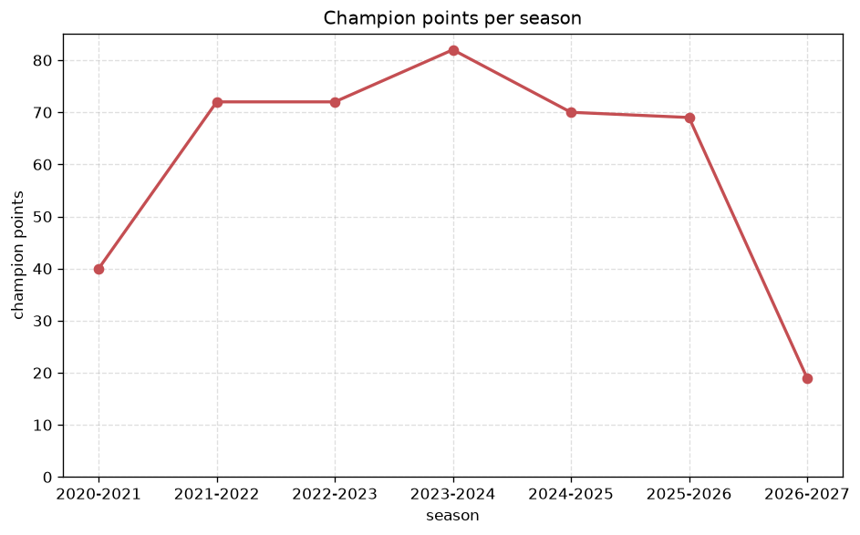
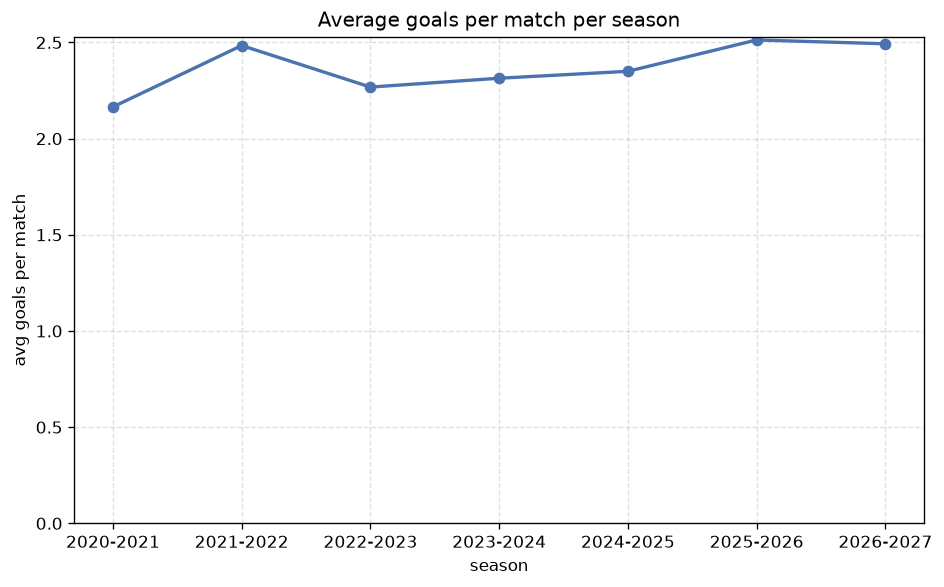

# Season Trends Analysis
- Report: `season_trends`
- Generated: 2026-10-26T01:47:37+00:00
- Script: `backend/scripts/analyze_seasons.py` v1.0.0
- League: Segunda RFEF - Group 2 (Spain)
- Scope: league `segunda2`

## 1. Champions per season
| season | champion | pts | runner-up | margin |
|---|---|---|---|---|
| 2020-2021 | Real Sociedad B | 40 | Ath Bilbao B | 1 pts |
| 2021-2022 | Osasuna B | 72 | Sestao | 2 pts |
| 2022-2023 | Sestao | 72 | Alaves B | 13 pts |
| 2023-2024 | Ath Bilbao B | 82 | Barakaldo | 6 pts |
| 2024-2025 | Arenas Getxo | 70 | SD Logrones | 4 pts |
| 2025-2026 | R. Union | 69 | Alaves B | 7 pts |
| 2026-2027 | Barcelona B | 19 | Manresa | 5 pts |

## 2. Title-race tightness
- Tight races (margin <= 3 pts): **2** of 7 seasons
- Tightest race: **2020-2021** - Real Sociedad B beat Ath Bilbao B by **1** pts

| season | margin | tight |
|---|---|---|
| 2020-2021 | 1 pts | yes |
| 2021-2022 | 2 pts | yes |
| 2022-2023 | 13 pts |  |
| 2023-2024 | 6 pts |  |
| 2024-2025 | 4 pts |  |
| 2025-2026 | 7 pts |  |
| 2026-2027 | 5 pts |  |

## 3. Points thresholds
_Position-specific points per season. Key: 1 = champion, 2 = runner-up, 4 = CL line, 6 = Europa, 15 = last safe, 18 = bottom._

| season | pos 1 | pos 2 | pos 4 | pos 6 | pos 15 | pos 18 |
|---|---|---|---|---|---|---|
| 2020-2021 | 40 | 39 | 35 | 34 | 22 | 17 |
| 2021-2022 | 72 | 70 | 56 | 51 | 27 | 18 |
| 2022-2023 | 72 | 59 | 53 | 52 | 34 | 24 |
| 2023-2024 | 82 | 76 | 61 | 52 | 33 | 21 |
| 2024-2025 | 70 | 66 | 61 | 55 | 38 | 21 |
| 2025-2026 | 69 | 62 | 58 | 50 | 35 | 25 |
| 2026-2027 | 19 | 14 | 14 | 13 | 5 | 3 |

## 4. Relegation battle
| season | safe pos | safe pts | drop pos | drop pts | gap |
|---|---|---|---|---|---|
| 2020-2021 | 15 | 22 | 16 | 20 | 2 pts |
| 2021-2022 | 15 | 27 | 16 | 26 | 1 pts |
| 2022-2023 | 15 | 34 | 16 | 32 | 2 pts |
| 2023-2024 | 15 | 33 | 16 | 24 | 9 pts |
| 2024-2025 | 15 | 38 | 16 | 29 | 9 pts |
| 2025-2026 | 15 | 35 | 16 | 30 | 5 pts |
| 2026-2027 | 15 | 5 | 16 | 5 | 0 pts |

## 5. League-level trends
| season | matches | total goals | avg goals | home win | draw | away win | goalless | avg pts/team |
|---|---|---|---|---|---|---|---|---|
| 2020-2021 | 200 | 433 | 2.165 | 45.0% | 28.0% | 27.0% | 11.5% | 25.9 |
| 2021-2022 | 306 | 760 | 2.484 | 39.2% | 32.0% | 28.8% | 11.4% | 45.56 |
| 2022-2023 | 306 | 694 | 2.268 | 47.4% | 26.5% | 26.1% | 11.1% | 46.5 |
| 2023-2024 | 306 | 708 | 2.314 | 45.4% | 26.1% | 28.4% | 12.7% | 46.56 |
| 2024-2025 | 306 | 719 | 2.35 | 44.1% | 24.8% | 31.0% | 9.2% | 46.78 |
| 2025-2026 | 306 | 769 | 2.513 | 42.5% | 29.1% | 28.4% | 9.2% | 46.06 |
| 2026-2027 | 67 | 167 | 2.493 | 38.8% | 32.8% | 28.4% | 11.9% | 9.94 |

## 6. View divergence
- Largest divergence: **2022-2023** (goals view, avg abs position diff = 7.667)

_Avg absolute position difference between classic view and alternative view per season._

| season | classic vs luck | classic vs goals |
|---|---|---|
| 2020-2021 | 1.429 | 6.000 |
| 2021-2022 | 2.111 | 7.000 |
| 2022-2023 | 1.889 | 7.667 |
| 2023-2024 | 2.333 | 4.778 |
| 2024-2025 | 2.111 | 7.222 |
| 2025-2026 | 2.778 | 5.556 |
| 2026-2027 | 1.667 | 6.333 |

---
*All statistics are computed from PostgreSQL tables (read-only). Run with `python backend/scripts/analyze_seasons.py` to regenerate.*

## Charts

