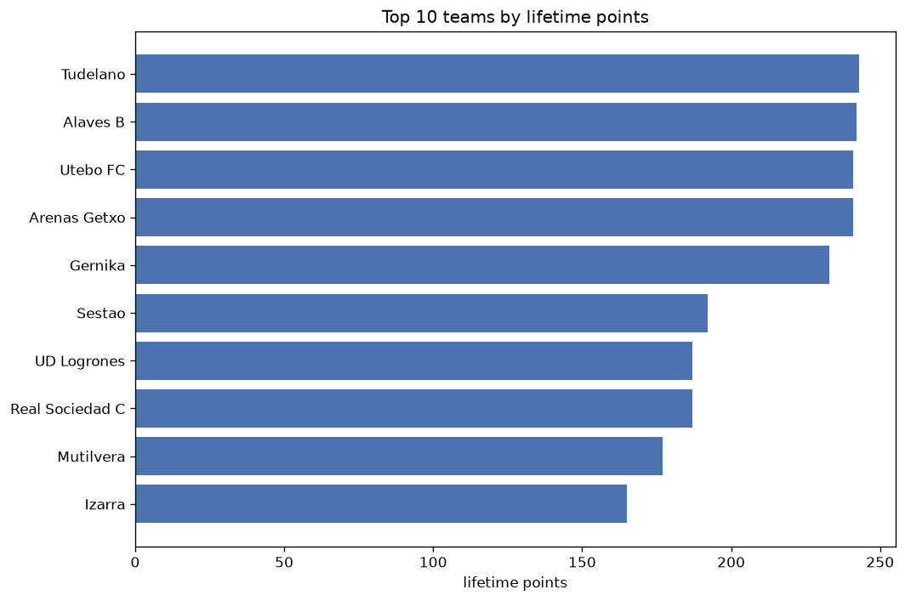
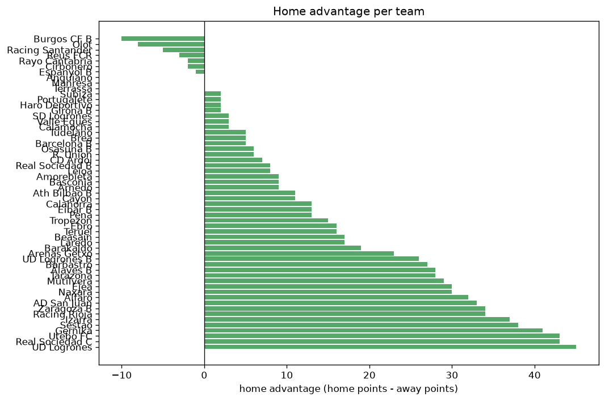

# Team Analysis
- Report: `teams_analysis`
- Generated: 2026-10-26T01:47:34+00:00
- Script: `backend/scripts/analyze_teams.py` v1.0.0
- League: Segunda RFEF - Group 2 (Spain)
- Scope: league `segunda2`

- Teams: **57** | Seasons: **7** | Matches: **1797**

## 1. Team standings (lifetime)
| team | seasons | played | W | D | L | pts | GF | GA | GD | avg pts/season | best pos | worst pos | titles |
|---|---|---|---|---|---|---|---|---|---|---|---|---|---|
| Tudelano | 6 | 162 | 64 | 51 | 47 | 243 | 223 | 173 | 50 | 40.5 | 5 | 10 | 0 |
| Alaves B | 5 | 156 | 66 | 44 | 46 | 242 | 195 | 148 | 47 | 48.4 | 2 | 16 | 0 |
| Utebo FC | 5 | 144 | 66 | 43 | 35 | 241 | 197 | 147 | 50 | 48.2 | 4 | 14 | 0 |
| Arenas Getxo | 5 | 156 | 62 | 55 | 39 | 241 | 181 | 143 | 38 | 48.2 | 1 | 12 | 1 |
| Gernika | 5 | 170 | 61 | 50 | 59 | 233 | 201 | 209 | -8 | 46.6 | 4 | 11 | 0 |
| Sestao | 3 | 102 | 52 | 36 | 14 | 192 | 148 | 72 | 76 | 64.0 | 1 | 6 | 1 |
| UD Logrones | 3 | 102 | 52 | 31 | 19 | 187 | 185 | 71 | 114 | 62.33 | 3 | 6 | 0 |
| Real Sociedad C | 4 | 136 | 51 | 34 | 51 | 187 | 167 | 166 | 1 | 46.75 | 3 | 16 | 0 |
| Mutilvera | 5 | 154 | 48 | 33 | 73 | 177 | 161 | 215 | -54 | 35.4 | 11 | 16 | 0 |
| Izarra | 5 | 154 | 42 | 39 | 73 | 165 | 149 | 204 | -55 | 33.0 | 9 | 19 | 0 |
| SD Logrones | 4 | 93 | 34 | 33 | 26 | 135 | 101 | 96 | 5 | 33.75 | 2 | 17 | 0 |
| AD San Juan | 3 | 102 | 35 | 30 | 37 | 135 | 109 | 113 | -4 | 45.0 | 6 | 14 | 0 |
| Zaragoza B | 3 | 102 | 35 | 23 | 44 | 128 | 126 | 147 | -21 | 42.67 | 5 | 17 | 0 |
| Ath Bilbao B | 2 | 54 | 36 | 13 | 5 | 121 | 102 | 36 | 66 | 60.5 | 1 | 2 | 1 |
| Calahorra | 3 | 86 | 31 | 26 | 29 | 119 | 81 | 83 | -2 | 39.67 | 6 | 14 | 0 |
| Eibar B | 2 | 68 | 32 | 15 | 21 | 111 | 86 | 65 | 21 | 55.5 | 3 | 9 | 0 |
| Osasuna B | 3 | 59 | 30 | 20 | 9 | 110 | 103 | 55 | 48 | 36.67 | 1 | 11 | 1 |
| Ejea | 3 | 86 | 25 | 29 | 32 | 104 | 93 | 108 | -15 | 34.67 | 7 | 17 | 0 |
| R. Union | 2 | 54 | 30 | 12 | 12 | 102 | 90 | 53 | 37 | 51.0 | 1 | 7 | 1 |
| Alfaro | 3 | 102 | 26 | 24 | 52 | 102 | 99 | 161 | -62 | 34.0 | 12 | 18 | 0 |
| Naxara | 4 | 108 | 24 | 24 | 60 | 96 | 92 | 170 | -78 | 24.0 | 12 | 16 | 0 |
| Barbastro | 3 | 76 | 23 | 26 | 27 | 95 | 71 | 76 | -5 | 31.67 | 8 | 13 | 0 |
| Barakaldo | 2 | 54 | 27 | 12 | 15 | 93 | 80 | 58 | 22 | 46.5 | 2 | 18 | 0 |
| Ebro | 3 | 60 | 22 | 24 | 14 | 90 | 68 | 61 | 7 | 30.0 | 6 | 9 | 0 |
| Amorebieta | 2 | 54 | 24 | 15 | 15 | 87 | 64 | 51 | 13 | 43.5 | 3 | 7 | 0 |
| UD Logrones B | 3 | 76 | 21 | 23 | 32 | 86 | 80 | 105 | -25 | 28.67 | 10 | 16 | 0 |
| Racing Rioja | 2 | 68 | 21 | 19 | 28 | 82 | 70 | 96 | -26 | 41.0 | 7 | 17 | 0 |
| Tarazona | 2 | 52 | 23 | 11 | 18 | 80 | 76 | 59 | 17 | 40.0 | 3 | 12 | 0 |
| Beasain | 2 | 68 | 18 | 23 | 27 | 77 | 78 | 86 | -8 | 38.5 | 13 | 14 | 0 |
| Laredo | 2 | 54 | 20 | 9 | 25 | 69 | 58 | 63 | -5 | 34.5 | 11 | 13 | 0 |
| Brea | 2 | 68 | 17 | 14 | 37 | 65 | 42 | 89 | -47 | 32.5 | 12 | 18 | 0 |
| Teruel | 1 | 34 | 17 | 9 | 8 | 60 | 41 | 28 | 13 | 60.0 | 5 | 5 | 0 |
| Rayo Cantabria | 1 | 34 | 15 | 11 | 8 | 56 | 42 | 29 | 13 | 56.0 | 5 | 5 | 0 |
| Burgos CF B | 1 | 34 | 12 | 12 | 10 | 48 | 42 | 33 | 9 | 48.0 | 9 | 9 | 0 |
| Basconia | 1 | 34 | 11 | 14 | 9 | 47 | 55 | 43 | 12 | 47.0 | 10 | 10 | 0 |
| Real Sociedad B | 1 | 20 | 12 | 4 | 4 | 40 | 35 | 16 | 19 | 40.0 | 1 | 1 | 1 |
| Cirbonero | 1 | 34 | 10 | 10 | 14 | 40 | 35 | 40 | -5 | 40.0 | 14 | 14 | 0 |
| Anguiano | 1 | 34 | 11 | 5 | 18 | 38 | 32 | 49 | -17 | 38.0 | 15 | 15 | 0 |
| Racing Santander | 1 | 20 | 10 | 5 | 5 | 35 | 30 | 17 | 13 | 35.0 | 4 | 4 | 0 |
| Cayon | 1 | 34 | 7 | 12 | 15 | 33 | 26 | 60 | -34 | 33.0 | 14 | 14 | 0 |
| Subiza | 1 | 34 | 8 | 4 | 22 | 28 | 36 | 60 | -24 | 28.0 | 17 | 17 | 0 |
| Tropezon | 1 | 34 | 6 | 9 | 19 | 27 | 40 | 68 | -28 | 27.0 | 15 | 15 | 0 |
| Pena | 2 | 42 | 5 | 12 | 25 | 27 | 40 | 87 | -47 | 13.5 | 11 | 18 | 0 |
| Arnedo | 2 | 42 | 6 | 9 | 27 | 27 | 34 | 84 | -50 | 13.5 | 18 | 18 | 0 |
| CD Ardoi | 1 | 34 | 5 | 10 | 19 | 25 | 29 | 61 | -32 | 25.0 | 17 | 17 | 0 |
| Portugalete | 1 | 20 | 6 | 4 | 10 | 22 | 16 | 19 | -3 | 22.0 | 15 | 15 | 0 |
| Valle Egues | 1 | 34 | 5 | 6 | 23 | 21 | 25 | 58 | -33 | 21.0 | 17 | 17 | 0 |
| Barcelona B | 1 | 7 | 6 | 1 | 0 | 19 | 15 | 2 | 13 | 19.0 | 1 | 1 | 1 |
| Manresa | 1 | 8 | 4 | 2 | 2 | 14 | 14 | 7 | 7 | 14.0 | 2 | 2 | 0 |
| Terrassa | 1 | 7 | 4 | 2 | 1 | 14 | 7 | 2 | 5 | 14.0 | 4 | 4 | 0 |
| Espanyol B | 1 | 6 | 4 | 1 | 1 | 13 | 16 | 5 | 11 | 13.0 | 5 | 5 | 0 |
| Olot | 1 | 7 | 3 | 3 | 1 | 12 | 12 | 8 | 4 | 12.0 | 7 | 7 | 0 |
| Haro Deportivo | 1 | 18 | 2 | 6 | 10 | 12 | 14 | 24 | -10 | 12.0 | 20 | 20 | 0 |
| Reus FCR | 1 | 8 | 3 | 2 | 3 | 11 | 8 | 10 | -2 | 11.0 | 8 | 8 | 0 |
| Girona B | 1 | 7 | 3 | 1 | 3 | 10 | 13 | 12 | 1 | 10.0 | 9 | 9 | 0 |
| Leioa | 1 | 20 | 1 | 7 | 12 | 10 | 12 | 32 | -20 | 10.0 | 21 | 21 | 0 |
| Calamocha | 1 | 8 | 1 | 2 | 5 | 5 | 5 | 17 | -12 | 5.0 | 16 | 16 | 0 |

## 2. Home vs away split
| team | home P | H-W | H-D | H-L | H-pts | away P | A-W | A-D | A-L | A-pts | adv |
|---|---|---|---|---|---|---|---|---|---|---|---|
| UD Logrones | 51 | 34 | 14 | 3 | 116 | 51 | 18 | 17 | 16 | 71 | 45 |
| Utebo FC | 72 | 40 | 22 | 10 | 142 | 72 | 26 | 21 | 25 | 99 | 43 |
| Real Sociedad C | 68 | 33 | 16 | 19 | 115 | 68 | 18 | 18 | 32 | 72 | 43 |
| Gernika | 85 | 38 | 23 | 24 | 137 | 85 | 23 | 27 | 35 | 96 | 41 |
| Sestao | 51 | 35 | 10 | 6 | 115 | 51 | 17 | 26 | 8 | 77 | 38 |
| Izarra | 77 | 27 | 20 | 30 | 101 | 77 | 15 | 19 | 43 | 64 | 37 |
| Zaragoza B | 51 | 24 | 9 | 18 | 81 | 51 | 11 | 14 | 26 | 47 | 34 |
| Racing Rioja | 34 | 16 | 10 | 8 | 58 | 34 | 5 | 9 | 20 | 24 | 34 |
| AD San Juan | 51 | 23 | 15 | 13 | 84 | 51 | 12 | 15 | 24 | 51 | 33 |
| Alfaro | 51 | 18 | 13 | 20 | 67 | 51 | 8 | 11 | 32 | 35 | 32 |
| Ejea | 43 | 16 | 19 | 8 | 67 | 43 | 9 | 10 | 24 | 37 | 30 |
| Naxara | 54 | 16 | 15 | 23 | 63 | 54 | 8 | 9 | 37 | 33 | 30 |
| Mutilvera | 77 | 27 | 22 | 28 | 103 | 77 | 21 | 11 | 45 | 74 | 29 |
| Alaves B | 78 | 39 | 18 | 21 | 135 | 78 | 27 | 26 | 25 | 107 | 28 |
| Tarazona | 26 | 17 | 3 | 6 | 54 | 26 | 6 | 8 | 12 | 26 | 28 |
| Barbastro | 38 | 16 | 13 | 9 | 61 | 38 | 7 | 13 | 18 | 34 | 27 |
| UD Logrones B | 37 | 15 | 11 | 11 | 56 | 39 | 6 | 12 | 21 | 30 | 26 |
| Arenas Getxo | 78 | 35 | 27 | 16 | 132 | 78 | 27 | 28 | 23 | 109 | 23 |
| Barakaldo | 27 | 17 | 5 | 5 | 56 | 27 | 10 | 7 | 10 | 37 | 19 |
| Beasain | 34 | 12 | 11 | 11 | 47 | 34 | 6 | 12 | 16 | 30 | 17 |
| Laredo | 27 | 12 | 7 | 8 | 43 | 27 | 8 | 2 | 17 | 26 | 17 |
| Ebro | 30 | 13 | 14 | 3 | 53 | 30 | 9 | 10 | 11 | 37 | 16 |
| Teruel | 17 | 11 | 5 | 1 | 38 | 17 | 6 | 4 | 7 | 22 | 16 |
| Tropezon | 17 | 5 | 6 | 6 | 21 | 17 | 1 | 3 | 13 | 6 | 15 |
| Calahorra | 43 | 18 | 12 | 13 | 66 | 43 | 13 | 14 | 16 | 53 | 13 |
| Eibar B | 34 | 19 | 5 | 10 | 62 | 34 | 13 | 10 | 11 | 49 | 13 |
| Pena | 21 | 5 | 5 | 11 | 20 | 21 | 0 | 7 | 14 | 7 | 13 |
| Ath Bilbao B | 27 | 21 | 3 | 3 | 66 | 27 | 15 | 10 | 2 | 55 | 11 |
| Cayon | 17 | 5 | 7 | 5 | 22 | 17 | 2 | 5 | 10 | 11 | 11 |
| Amorebieta | 27 | 14 | 6 | 7 | 48 | 27 | 10 | 9 | 8 | 39 | 9 |
| Basconia | 17 | 7 | 7 | 3 | 28 | 17 | 4 | 7 | 6 | 19 | 9 |
| Arnedo | 22 | 4 | 6 | 12 | 18 | 20 | 2 | 3 | 15 | 9 | 9 |
| Real Sociedad B | 10 | 8 | 0 | 2 | 24 | 10 | 4 | 4 | 2 | 16 | 8 |
| Leioa | 10 | 1 | 6 | 3 | 9 | 10 | 0 | 1 | 9 | 1 | 8 |
| CD Ardoi | 17 | 3 | 7 | 7 | 16 | 17 | 2 | 3 | 12 | 9 | 7 |
| Osasuna B | 30 | 15 | 13 | 2 | 58 | 29 | 15 | 7 | 7 | 52 | 6 |
| R. Union | 27 | 16 | 6 | 5 | 54 | 27 | 14 | 6 | 7 | 48 | 6 |
| Tudelano | 82 | 33 | 25 | 24 | 124 | 80 | 31 | 26 | 23 | 119 | 5 |
| Brea | 34 | 9 | 8 | 17 | 35 | 34 | 8 | 6 | 20 | 30 | 5 |
| Barcelona B | 4 | 4 | 0 | 0 | 12 | 3 | 2 | 1 | 0 | 7 | 5 |
| SD Logrones | 47 | 17 | 18 | 12 | 69 | 46 | 17 | 15 | 14 | 66 | 3 |
| Valle Egues | 17 | 2 | 6 | 9 | 12 | 17 | 3 | 0 | 14 | 9 | 3 |
| Calamocha | 4 | 1 | 1 | 2 | 4 | 4 | 0 | 1 | 3 | 1 | 3 |
| Subiza | 17 | 4 | 3 | 10 | 15 | 17 | 4 | 1 | 12 | 13 | 2 |
| Portugalete | 10 | 3 | 3 | 4 | 12 | 10 | 3 | 1 | 6 | 10 | 2 |
| Haro Deportivo | 9 | 2 | 1 | 6 | 7 | 9 | 0 | 5 | 4 | 5 | 2 |
| Girona B | 3 | 2 | 0 | 1 | 6 | 4 | 1 | 1 | 2 | 4 | 2 |
| Anguiano | 17 | 5 | 4 | 8 | 19 | 17 | 6 | 1 | 10 | 19 | 0 |
| Manresa | 4 | 2 | 1 | 1 | 7 | 4 | 2 | 1 | 1 | 7 | 0 |
| Terrassa | 3 | 2 | 1 | 0 | 7 | 4 | 2 | 1 | 1 | 7 | 0 |
| Espanyol B | 2 | 2 | 0 | 0 | 6 | 4 | 2 | 1 | 1 | 7 | -1 |
| Rayo Cantabria | 17 | 7 | 6 | 4 | 27 | 17 | 8 | 5 | 4 | 29 | -2 |
| Cirbonero | 17 | 5 | 4 | 8 | 19 | 17 | 5 | 6 | 6 | 21 | -2 |
| Reus FCR | 4 | 1 | 1 | 2 | 4 | 4 | 2 | 1 | 1 | 7 | -3 |
| Racing Santander | 10 | 4 | 3 | 3 | 15 | 10 | 6 | 2 | 2 | 20 | -5 |
| Olot | 3 | 0 | 2 | 1 | 2 | 4 | 3 | 1 | 0 | 10 | -8 |
| Burgos CF B | 17 | 5 | 4 | 8 | 19 | 17 | 7 | 8 | 2 | 29 | -10 |

## 3. Top performers
### Best points per game (PPG)
| rank | team | PPG |
|---|---|---|
| 1 | Barcelona B | 2.71 |
| 2 | Ath Bilbao B | 2.24 |
| 3 | Espanyol B | 2.17 |
| 4 | Real Sociedad B | 2.00 |
| 5 | Terrassa | 2.00 |

### Most goals scored
| rank | team | goals |
|---|---|---|
| 1 | Tudelano | 223 |
| 2 | Gernika | 201 |
| 3 | Utebo FC | 197 |
| 4 | Alaves B | 195 |
| 5 | UD Logrones | 185 |

### Best goal difference
| rank | team | GD |
|---|---|---|
| 1 | UD Logrones | 114 |
| 2 | Sestao | 76 |
| 3 | Ath Bilbao B | 66 |
| 4 | Tudelano | 50 |
| 5 | Utebo FC | 50 |

### Best defence (goals against per match, standings)
| rank | team | GA/match |
|---|---|---|
| 1 | Barcelona B | 0.286 |
| 2 | Terrassa | 0.286 |
| 3 | Ath Bilbao B | 0.667 |
| 4 | UD Logrones | 0.696 |
| 5 | Sestao | 0.706 |

## 4. Team consistency
- Teams present in all **7** seasons: **0**

## 5. Head-to-head dominance
- Distinct fixtures: **665** (showing the 15 most frequent)

| fixture | meetings | home wins | draws | away wins | home pct | draw pct | away pct |
|---|---|---|---|---|---|---|---|
| Gernika vs Real Sociedad C | 8 | 5 | 1 | 2 | 62.5% | 12.5% | 25.0% |
| Mutilvera vs Izarra | 8 | 5 | 2 | 1 | 62.5% | 25.0% | 12.5% |
| Gernika vs Mutilvera | 8 | 4 | 2 | 2 | 50.0% | 25.0% | 25.0% |
| Gernika vs Utebo FC | 8 | 4 | 2 | 2 | 50.0% | 25.0% | 25.0% |
| Izarra vs Real Sociedad C | 8 | 4 | 2 | 2 | 50.0% | 25.0% | 25.0% |
| Tudelano vs Alaves B | 8 | 4 | 1 | 3 | 50.0% | 12.5% | 37.5% |
| Tudelano vs Gernika | 8 | 4 | 2 | 2 | 50.0% | 25.0% | 25.0% |
| Arenas Getxo vs Izarra | 8 | 3 | 2 | 3 | 37.5% | 25.0% | 37.5% |
| Tudelano vs Izarra | 8 | 3 | 4 | 1 | 37.5% | 50.0% | 12.5% |
| Alaves B vs Gernika | 8 | 2 | 3 | 3 | 25.0% | 37.5% | 37.5% |
| Alaves B vs Utebo FC | 8 | 2 | 3 | 3 | 25.0% | 37.5% | 37.5% |
| Arenas Getxo vs Alaves B | 8 | 2 | 3 | 3 | 25.0% | 37.5% | 37.5% |
| Gernika vs Izarra | 8 | 2 | 4 | 2 | 25.0% | 50.0% | 25.0% |
| Tudelano vs Utebo FC | 8 | 2 | 6 | 0 | 25.0% | 75.0% | 0.0% |
| Arenas Getxo vs Gernika | 8 | 1 | 3 | 4 | 12.5% | 37.5% | 50.0% |

## 6. Position per season (classic view)
_Cells show final position; '-' when the team was absent from that season._

| team | 2020-2021 | 2021-2022 | 2022-2023 | 2023-2024 | 2024-2025 | 2025-2026 | 2026-2027 |
|---|---|---|---|---|---|---|---|
| Tudelano | 5 | - | 6 | 7 | 10 | 5 | 10 |
| Alaves B | 16 | - | 2 | 6 | 8 | 2 | - |
| Utebo FC | - | - | 5 | 4 | 4 | 4 | 14 |
| Arenas Getxo | 10 | 4 | 10 | 12 | 1 | - | - |
| Gernika | - | 8 | 4 | 11 | 11 | 11 | - |
| Sestao | - | 2 | 1 | - | - | 6 | - |
| UD Logrones | - | - | - | 3 | 6 | 3 | - |
| Real Sociedad C | - | 3 | 7 | 9 | 16 | - | - |
| Mutilvera | 14 | 13 | 11 | 15 | - | 16 | - |
| Izarra | 19 | 12 | 9 | 13 | 18 | - | - |
| SD Logrones | 8 | - | - | - | 2 | 13 | 17 |
| AD San Juan | - | 6 | 8 | 14 | - | - | - |
| Zaragoza B | - | - | - | 5 | 9 | 17 | - |
| Ath Bilbao B | 2 | - | - | 1 | - | - | - |
| Calahorra | 6 | - | - | 10 | 14 | - | - |
| Eibar B | - | - | - | - | 3 | 9 | - |
| Osasuna B | 11 | 1 | - | - | - | - | 3 |
| Ejea | 17 | - | - | - | 7 | 15 | - |
| R. Union | 7 | - | - | - | - | 1 | - |
| Alfaro | - | - | 15 | - | 12 | 18 | - |
| Naxara | - | 16 | - | 16 | - | 12 | 15 |
| Barbastro | - | - | - | 8 | 13 | - | 13 |
| Barakaldo | 18 | - | - | 2 | - | - | - |
| Ebro | 9 | - | - | - | - | 8 | 6 |
| Amorebieta | 3 | - | - | - | - | 7 | - |
| UD Logrones B | - | 10 | 16 | - | - | - | 12 |
| Racing Rioja | - | 7 | 17 | - | - | - | - |
| Tarazona | 12 | - | 3 | - | - | - | - |
| Beasain | - | - | 13 | - | - | 14 | - |
| Laredo | 13 | 11 | - | - | - | - | - |
| Brea | - | - | 12 | 18 | - | - | - |
| Teruel | - | - | - | - | 5 | - | - |
| Rayo Cantabria | - | 5 | - | - | - | - | - |
| Burgos CF B | - | 9 | - | - | - | - | - |
| Basconia | - | - | - | - | - | 10 | - |
| Real Sociedad B | 1 | - | - | - | - | - | - |
| Cirbonero | - | - | 14 | - | - | - | - |
| Anguiano | - | - | - | - | 15 | - | - |
| Racing Santander | 4 | - | - | - | - | - | - |
| Cayon | - | 14 | - | - | - | - | - |
| Subiza | - | - | - | - | 17 | - | - |
| Tropezon | - | 15 | - | - | - | - | - |
| Pena | - | 18 | - | - | - | - | 11 |
| Arnedo | - | - | 18 | - | - | - | 18 |
| CD Ardoi | - | 17 | - | - | - | - | - |
| Portugalete | 15 | - | - | - | - | - | - |
| Valle Egues | - | - | - | 17 | - | - | - |
| Barcelona B | - | - | - | - | - | - | 1 |
| Manresa | - | - | - | - | - | - | 2 |
| Terrassa | - | - | - | - | - | - | 4 |
| Espanyol B | - | - | - | - | - | - | 5 |
| Olot | - | - | - | - | - | - | 7 |
| Haro Deportivo | 20 | - | - | - | - | - | - |
| Reus FCR | - | - | - | - | - | - | 8 |
| Girona B | - | - | - | - | - | - | 9 |
| Leioa | 21 | - | - | - | - | - | - |
| Calamocha | - | - | - | - | - | - | 16 |

---
*All statistics are computed from PostgreSQL tables (read-only). Run with `python backend/scripts/analyze_teams.py` to regenerate.*

## Charts

