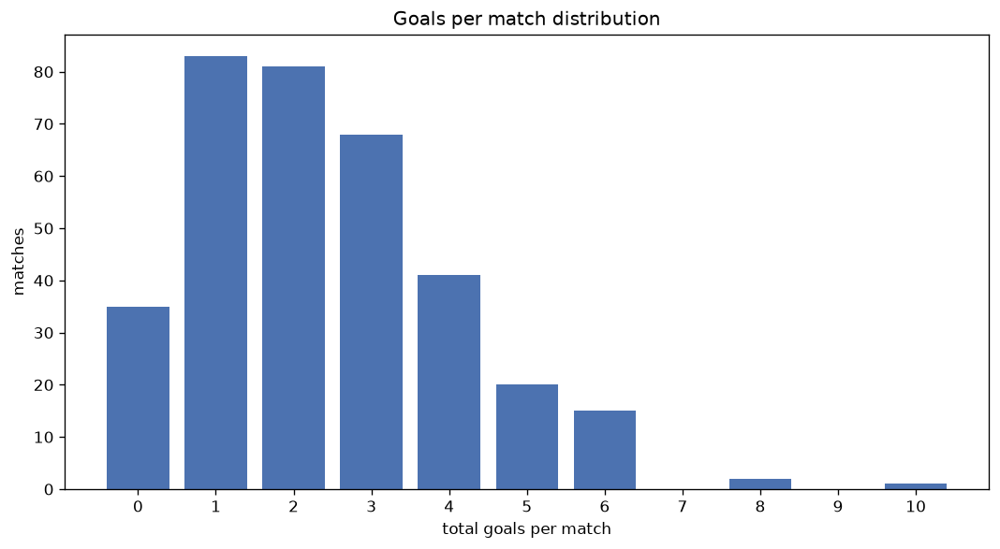
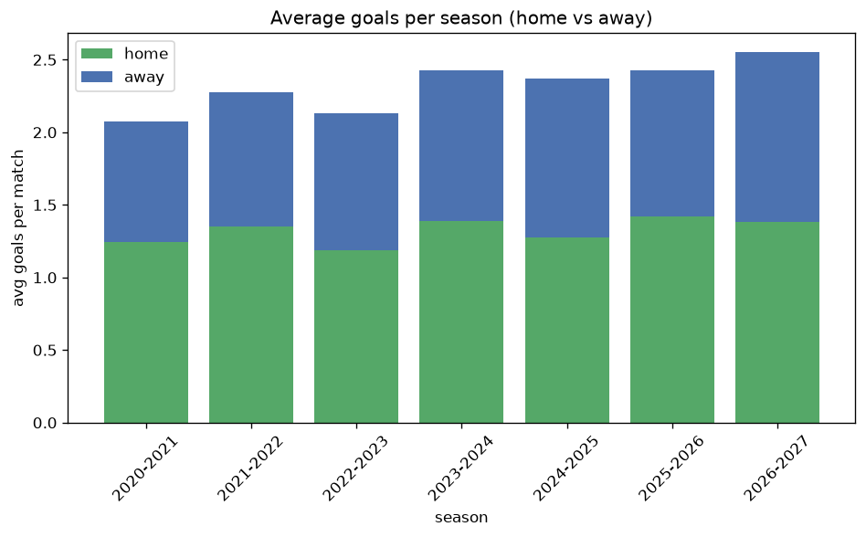

# Goal Analysis
- Report: `goals_analysis`
- Generated: 2026-10-30T04:12:08+00:00
- Script: `backend/scripts/analyze_goals.py` v1.0.0
- League: Segunda RFEF - Group 3 (Spain)
- Scope: league `segunda3`

## 1. Goals per match distribution
| goals | matches | pct |
|---|---|---|
| 0 | 190 | 10.5% |
| 1 | 429 | 23.8% |
| 2 | 438 | 24.3% |
| 3 | 367 | 20.4% |
| 4 | 216 | 12.0% |
| 5 | 100 | 5.6% |
| 6 | 47 | 2.6% |
| 7 | 9 | 0.5% |
| 8 | 3 | 0.2% |
| 9 | 0 | 0.0% |
| 10 | 2 | 0.1% |

## 2. Goals per match per season
| season | matches | total goals | avg home | avg away | avg total |
|---|---|---|---|---|---|
| 2020-2021 | 200 | 415 | 1.245 | 0.83 | 2.075 |
| 2021-2022 | 306 | 697 | 1.353 | 0.925 | 2.278 |
| 2022-2023 | 306 | 652 | 1.186 | 0.944 | 2.131 |
| 2023-2024 | 306 | 742 | 1.386 | 1.039 | 2.425 |
| 2024-2025 | 306 | 724 | 1.275 | 1.092 | 2.366 |
| 2025-2026 | 306 | 742 | 1.418 | 1.007 | 2.425 |
| 2026-2027 | 71 | 187 | 1.465 | 1.169 | 2.634 |

## 3. Home vs away goal share
- Home goals: **2378** (57.2%)
- Away goals: **1781** (42.8%)
- Home/away ratio: **1.335**

| season | home goals | away goals | total | home pct | away pct |
|---|---|---|---|---|---|
| 2020-2021 | 249 | 166 | 415 | 60.0% | 40.0% |
| 2021-2022 | 414 | 283 | 697 | 59.4% | 40.6% |
| 2022-2023 | 363 | 289 | 652 | 55.7% | 44.3% |
| 2023-2024 | 424 | 318 | 742 | 57.1% | 42.9% |
| 2024-2025 | 390 | 334 | 724 | 53.9% | 46.1% |
| 2025-2026 | 434 | 308 | 742 | 58.5% | 41.5% |
| 2026-2027 | 104 | 83 | 187 | 55.6% | 44.4% |

## 4. BTTS (Both Teams To Score)
- Overall: **867** of `1801` (48.1%)

| season | matches | BTTS | pct |
|---|---|---|---|
| 2020-2021 | 200 | 80 | 40.0% |
| 2021-2022 | 306 | 148 | 48.4% |
| 2022-2023 | 306 | 142 | 46.4% |
| 2023-2024 | 306 | 157 | 51.3% |
| 2024-2025 | 306 | 142 | 46.4% |
| 2025-2026 | 306 | 159 | 52.0% |
| 2026-2027 | 71 | 39 | 54.9% |

## 5. Clean sheets
- Home clean sheets: **660** (36.6%)
- Away clean sheets: **464** (25.8%)
- Total clean sheets recorded: **1124**
- Matches with at least one clean sheet: **934** (51.9%)
- Both teams kept clean sheets (0-0): **190**

| season | matches | home CS | away CS | total CS | matches w/ CS |
|---|---|---|---|---|---|
| 2020-2021 | 200 | 86 | 59 | 145 | 120 (60.0%) |
| 2021-2022 | 306 | 120 | 68 | 188 | 158 (51.6%) |
| 2022-2023 | 306 | 118 | 88 | 206 | 164 (53.6%) |
| 2023-2024 | 306 | 101 | 79 | 180 | 149 (48.7%) |
| 2024-2025 | 306 | 97 | 94 | 191 | 164 (53.6%) |
| 2025-2026 | 306 | 114 | 66 | 180 | 147 (48.0%) |
| 2026-2027 | 71 | 24 | 10 | 34 | 32 (45.1%) |

## 6. Scoring intensity
- First-half goals: **1798** (43.2%)
- Second-half goals: **2361** (56.8%)
- Avg first-half goals per match: **0.998**
- Avg second-half goals per match: **1.311**
- Second-half-only scoring (HT 0-0, FT goals >= 1): **486** (27.0%)

| season | matches | 1st half | 2nd half | 1st half pct | 2nd half pct |
|---|---|---|---|---|---|
| 2020-2021 | 200 | 173 | 242 | 41.7% | 58.3% |
| 2021-2022 | 306 | 306 | 391 | 43.9% | 56.1% |
| 2022-2023 | 306 | 273 | 379 | 41.9% | 58.1% |
| 2023-2024 | 306 | 315 | 427 | 42.5% | 57.5% |
| 2024-2025 | 306 | 329 | 395 | 45.4% | 54.6% |
| 2025-2026 | 306 | 320 | 422 | 43.1% | 56.9% |
| 2026-2027 | 71 | 82 | 105 | 43.9% | 56.1% |

## 7. First-goal timing
- Matches with first-goal time recorded: `1611` of `1801` (89.5%)
- Goalless matches: `190`
- Min `1` | Max `99` | Mean `34.5` | Median (p50) `30`

| bucket | count | % of matches | % of scoring matches |
|---|---|---|---|
| 1-15 | 464 | 25.8% | 28.8% |
| 16-30 | 362 | 20.1% | 22.5% |
| 31-45 | 283 | 15.7% | 17.6% |
| 46-60 | 214 | 11.9% | 13.3% |
| 61-75 | 151 | 8.4% | 9.4% |
| 76-90 | 117 | 6.5% | 7.3% |
| 91-120 | 20 | 1.1% | 1.2% |

---
*All statistics are computed from PostgreSQL tables (read-only). Run with `python backend/scripts/analyze_goals.py` to regenerate.*

## Charts

