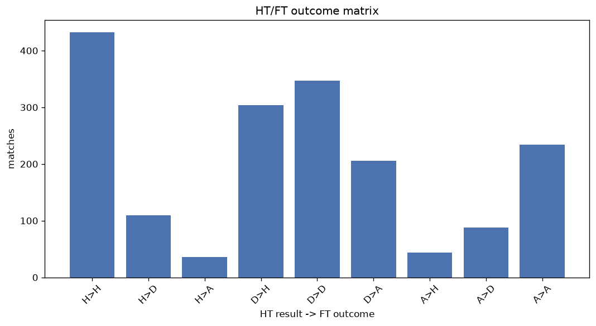
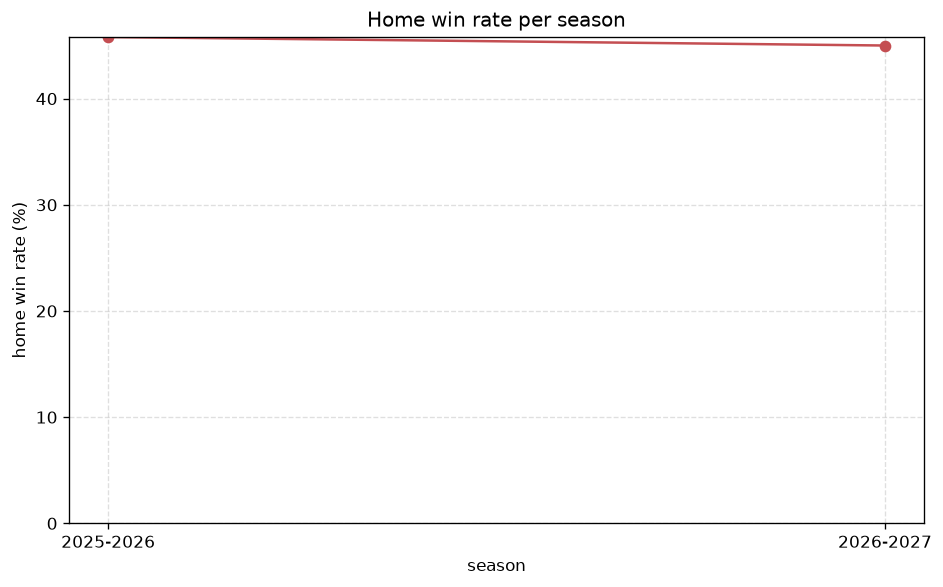

# Match Analysis
- Report: `matches_analysis`
- Generated: 2026-10-30T04:12:07+00:00
- Script: `backend/scripts/analyze_matches.py` v1.0.0
- League: Segunda RFEF - Group 3 (Spain)
- Scope: league `segunda3`

## 1. Overall summary
| metric | value |
|---|---|
| Matches | 1801 |
| Home wins | 780 (43.3%) |
| Draws | 545 (30.3%) |
| Away wins | 476 (26.4%) |
| Total goals | 4159 |
| Average goals per match | 2.309 |
| Goalless matches | 190 (10.5%) |

## 2. Per-season breakdown
| season | matches | home wins | draws | away wins | total goals | avg goals | goalless |
|---|---|---|---|---|---|---|---|
| 2020-2021 | 200 | 89 (44.5%) | 63 (31.5%) | 48 (24.0%) | 415 | 2.075 | 25 (12.5%) |
| 2021-2022 | 306 | 139 (45.4%) | 94 (30.7%) | 73 (23.9%) | 697 | 2.278 | 30 (9.8%) |
| 2022-2023 | 306 | 128 (41.8%) | 100 (32.7%) | 78 (25.5%) | 652 | 2.131 | 42 (13.7%) |
| 2023-2024 | 306 | 135 (44.1%) | 86 (28.1%) | 85 (27.8%) | 742 | 2.425 | 31 (10.1%) |
| 2024-2025 | 306 | 114 (37.3%) | 89 (29.1%) | 103 (33.7%) | 724 | 2.366 | 27 (8.8%) |
| 2025-2026 | 306 | 140 (45.8%) | 97 (31.7%) | 69 (22.5%) | 742 | 2.425 | 33 (10.8%) |
| 2026-2027 | 71 | 35 (49.3%) | 16 (22.5%) | 20 (28.2%) | 187 | 2.634 | 2 (2.8%) |

## 3. HT/FT outcome matrix
| HT result \ FT result | Home | Draw | Away | total |
|---|---|---|---|---|
| HT home lead | 432 (74.7%) | 110 (19.0%) | 36 (6.2%) | 578 |
| HT draw | 304 (35.5%) | 347 (40.5%) | 206 (24.0%) | 857 |
| HT away lead | 44 (12.0%) | 88 (24.0%) | 234 (63.9%) | 366 |

## 4. Comeback matches
- Home comebacks (trailing at HT, won at FT): **44** (2.4%)
- Away comebacks (trailing at HT, won at FT): **36** (2.0%)

### Home comebacks
| season | home | away | HT | FT |
|---|---|---|---|---|
| 2020-2021 | Hercules | Atzeneta | 0-1 | 2-1 |
| 2020-2021 | Orihuela | Valencia B | 0-1 | 2-1 |
| 2020-2021 | Gimnastic | Andorra | 0-1 | 4-2 |
| 2020-2021 | Som Maresme | Cornella | 0-1 | 2-1 |
| 2020-2021 | Barcelona B | Som Maresme | 1-2 | 4-2 |
| 2020-2021 | Cornella | Espanyol B | 1-3 | 4-3 |
| 2021-2022 | Cerdanyola | Brea | 0-1 | 2-1 |
| 2021-2022 | Prat | Ejea | 0-1 | 2-1 |
| 2021-2022 | Andratx | Pena Deportiva | 1-2 | 4-3 |
| 2021-2022 | Tarazona | Huesca B | 0-1 | 3-2 |
| 2021-2022 | Pena Deportiva | Lleida | 0-1 | 2-1 |
| 2021-2022 | Prat | Ebro | 0-1 | 2-1 |
| 2021-2022 | Terrassa | Prat | 1-2 | 4-3 |
| 2021-2022 | CE Europa | CF Badalona | 0-1 | 2-1 |
| 2022-2023 | Formentera | Hercules | 0-1 | 2-1 |
| 2022-2023 | Manresa | Alzira | 1-2 | 4-3 |
| 2022-2023 | Mallorca B | Lleida | 0-1 | 2-1 |
| 2022-2023 | Valencia B | Som Maresme | 0-1 | 3-2 |
| 2022-2023 | Mallorca B | Formentera | 0-1 | 2-1 |
| 2022-2023 | Terrassa | SD Ibiza | 0-1 | 2-1 |
| 2022-2023 | Teruel | Valencia B | 0-1 | 2-1 |
| 2022-2023 | Zaragoza B | Mallorca B | 0-1 | 2-1 |
| 2023-2024 | Saguntino | Espanyol B | 0-1 | 3-1 |
| 2023-2024 | Lleida | Valencia B | 0-2 | 3-2 |
| 2023-2024 | Andratx | Som Maresme | 0-1 | 2-1 |
| 2023-2024 | Espanyol B | Penya Indep. | 0-1 | 2-1 |
| 2023-2024 | Espanyol B | Hercules | 0-1 | 2-1 |
| 2023-2024 | Penya Indep. | Andratx | 0-1 | 2-1 |
| 2023-2024 | Cerdanyola | Sant Andreu | 0-1 | 2-1 |
| 2023-2024 | Espanyol B | Saguntino | 0-1 | 2-1 |
| 2023-2024 | Som Maresme | Torrent | 0-1 | 3-1 |
| 2023-2024 | Terrassa | CE Europa | 0-1 | 4-1 |
| 2024-2025 | Ilicitano | Som Maresme | 0-1 | 3-1 |
| 2024-2025 | CE Europa | Torrent | 0-1 | 2-1 |
| 2024-2025 | Valencia B | Alzira | 1-2 | 4-2 |
| 2024-2025 | CE Europa | SD Ibiza | 0-1 | 2-1 |
| 2024-2025 | Valencia B | Espanyol B | 0-1 | 2-1 |
| 2025-2026 | Barbastro | Torrent | 0-1 | 2-1 |
| 2025-2026 | Sant Andreu | SD Ibiza | 0-1 | 2-1 |
| 2025-2026 | Atletic Lleida | Andratx | 1-2 | 3-2 |
| 2025-2026 | Sant Andreu | Espanyol B | 0-1 | 2-1 |
| 2025-2026 | Girona B | Olot | 0-1 | 4-1 |
| 2025-2026 | Barcelona B | Atletic Lleida | 0-1 | 2-1 |
| 2026-2027 | Real Murcia B | Lorca Deportiva | 0-1 | 3-2 |

### Away comebacks
| season | home | away | HT | FT |
|---|---|---|---|---|
| 2020-2021 | La Nucia | Villarreal B | 1-0 | 1-2 |
| 2020-2021 | Lleida | Cornella | 1-0 | 2-3 |
| 2020-2021 | Valencia B | Alcoyano | 1-0 | 1-2 |
| 2020-2021 | L Hospitalet | Cornella | 2-0 | 2-3 |
| 2021-2022 | CE Europa | Tarazona | 1-0 | 1-2 |
| 2021-2022 | Huesca B | Ejea | 2-1 | 2-3 |
| 2021-2022 | SD Ibiza | Pena Deportiva | 1-0 | 1-3 |
| 2021-2022 | Teruel | Huesca B | 2-0 | 2-3 |
| 2021-2022 | Espanyol B | Brea | 1-0 | 1-2 |
| 2022-2023 | Zaragoza B | Espanyol B | 1-0 | 1-2 |
| 2022-2023 | Zaragoza B | Pena Deportiva | 1-0 | 1-4 |
| 2022-2023 | Saguntino | Hercules | 1-0 | 2-3 |
| 2022-2023 | Valencia B | Olot | 1-0 | 1-2 |
| 2022-2023 | Olot | SD Ibiza | 1-0 | 1-3 |
| 2022-2023 | Mallorca B | Alzira | 1-0 | 2-3 |
| 2023-2024 | Espanyol B | Alzira | 1-0 | 1-2 |
| 2023-2024 | Torrent | Sant Andreu | 1-0 | 1-2 |
| 2023-2024 | Pena Deportiva | Hercules | 1-0 | 1-5 |
| 2023-2024 | Torrent | Pena Deportiva | 1-0 | 2-3 |
| 2023-2024 | Manresa | Andratx | 1-0 | 1-2 |
| 2024-2025 | Espanyol B | Sant Andreu | 1-0 | 1-2 |
| 2024-2025 | Andratx | Alzira | 2-1 | 2-3 |
| 2024-2025 | SD Ibiza | Ilicitano | 1-0 | 1-2 |
| 2024-2025 | Sant Andreu | Espanyol B | 1-0 | 1-2 |
| 2024-2025 | Pena Deportiva | CE Europa | 1-0 | 1-2 |
| 2024-2025 | Alzira | Lleida | 1-0 | 1-4 |
| 2025-2026 | SD Ibiza | Valencia B | 1-0 | 1-2 |
| 2025-2026 | Barbastro | SD Ibiza | 1-0 | 1-2 |
| 2025-2026 | Torrent | Sant Andreu | 1-0 | 1-2 |
| 2025-2026 | SD Ibiza | Barbastro | 1-0 | 1-2 |
| 2025-2026 | Espanyol B | Sant Andreu | 1-0 | 1-2 |
| 2025-2026 | Terrassa | Poblense | 2-1 | 2-3 |
| 2026-2027 | Castellon B | CF Intercity | 1-0 | 1-2 |
| 2026-2027 | Castellon B | CF Intercity | 1-0 | 1-2 |
| 2026-2027 | Valencia B | Castellon B | 1-0 | 1-2 |
| 2026-2027 | La Nucia | Lorca Deportiva | 1-0 | 1-3 |

## 5. HT lead conversion
| HT state | matches | converted to win | held as draw | collapsed to loss |
|---|---|---|---|---|
| Home lead | 578 | 432 (74.7%) | 110 (19.0%) | 36 (6.2%) |
| Away lead | 366 | 234 (63.9%) | 88 (24.0%) | 44 (12.0%) |

### Matches level at half-time
| FT result | count | pct |
|---|---|---|
| Home win | 304 | 35.5% |
| Draw | 347 | 40.5% |
| Away win | 206 | 24.0% |

## 6. First-goal timing
- Matches with a first-goal time recorded: `1611` of `1801` (89.5%)

Outcome distribution by first-goal timing bucket:
| bucket | matches | % of matches | home | draw | away |
|---|---|---|---|---|---|
| 1-15 | 464 | 25.8% | 228 (49.1%) | 108 (23.3%) | 128 (27.6%) |
| 16-30 | 362 | 20.1% | 170 (47.0%) | 91 (25.1%) | 101 (27.9%) |
| 31-45 | 283 | 15.7% | 133 (47.0%) | 65 (23.0%) | 85 (30.0%) |
| 46-60 | 214 | 11.9% | 104 (48.6%) | 49 (22.9%) | 61 (28.5%) |
| 61-75 | 151 | 8.4% | 70 (46.4%) | 24 (15.9%) | 57 (37.7%) |
| 76-90 | 117 | 6.5% | 64 (54.7%) | 18 (15.4%) | 35 (29.9%) |
| 91-120 | 20 | 1.1% | 11 (55.0%) | 0 (0.0%) | 9 (45.0%) |

## 7. Goalless matches
- Overall: **190** of `1801` (10.5%)

| season | matches | goalless | pct |
|---|---|---|---|
| 2020-2021 | 200 | 25 | 12.5% |
| 2021-2022 | 306 | 30 | 9.8% |
| 2022-2023 | 306 | 42 | 13.7% |
| 2023-2024 | 306 | 31 | 10.1% |
| 2024-2025 | 306 | 27 | 8.8% |
| 2025-2026 | 306 | 33 | 10.8% |
| 2026-2027 | 71 | 2 | 2.8% |

---
*All statistics are computed from PostgreSQL tables (read-only). Run with `python backend/scripts/analyze_matches.py` to regenerate.*

## Charts

