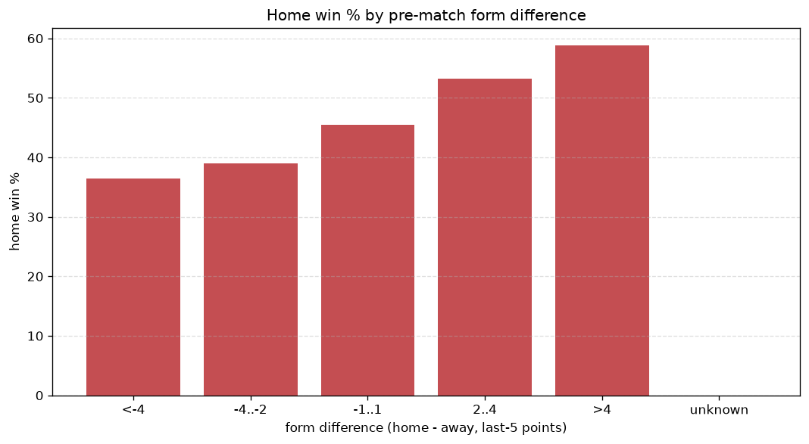
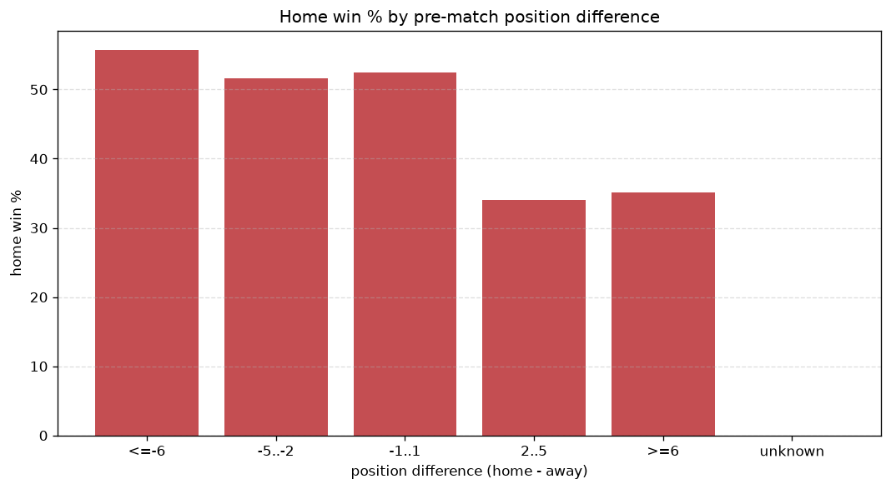

# Relationships Analysis
- Report: `relationships`
- Generated: 2026-10-29T02:14:48+00:00
- Script: `backend/scripts/analyze_relationships.py` v1.0.0
- League: Segunda RFEF - Group 3 (Spain)
- Scope: league `segunda3`

- Matches analysed: **1730** (23 leakage-safe pre-match features).

## 1. Correlation matrix
_Pearson correlation of each pre-match feature with observed goals; sorted by |corr(total goals)|._

| feature | corr(home) | corr(away) | corr(total) |
|---|---|---|---|
| away_team_away_conceded_avg | 0.081 | 0.039 | 0.085 |
| home_team_home_goals_avg | 0.139 | -0.037 | 0.079 |
| away_team_goals_conceded_last_5 | 0.087 | 0.013 | 0.072 |
| home_team_goals_scored_last_5 | 0.110 | -0.017 | 0.070 |
| home_team_goals_conceded_last_5 | 0.004 | 0.104 | 0.069 |
| home_points_before_match | 0.094 | -0.006 | 0.065 |
| home_team_home_win_rate | 0.121 | -0.055 | 0.054 |
| points_difference | 0.179 | -0.138 | 0.045 |
| away_points_before_match | -0.020 | 0.082 | 0.037 |
| away_position_before_match | 0.100 | -0.061 | 0.035 |
| away_team_away_goals_avg | -0.017 | 0.069 | 0.031 |
| home_team_wins_last_5 | 0.085 | -0.053 | 0.029 |
| home_team_points_last_5 | 0.088 | -0.059 | 0.028 |
| position_difference | -0.144 | 0.126 | -0.027 |
| home_team_home_conceded_avg | -0.014 | 0.050 | 0.021 |
| away_team_goals_scored_last_5 | -0.007 | 0.037 | 0.018 |
| rest_days_difference | -0.037 | 0.019 | -0.015 |
| home_rest_days | -0.019 | 0.006 | -0.011 |
| away_team_away_win_rate | -0.041 | 0.062 | 0.009 |
| away_team_wins_last_5 | -0.011 | 0.023 | 0.006 |
| home_position_before_match | -0.099 | 0.112 | -0.002 |
| away_rest_days | 0.010 | -0.009 | 0.002 |
| away_team_points_last_5 | -0.023 | 0.028 | 0.001 |

## 2. Form vs outcome
_Home win/draw/away % per bucket of `home_team_points_last_5 - away_team_points_last_5`._

| bucket | matches | home | draw | away | home % | draw % | away % |
|---|---|---|---|---|---|---|---|
| <-4 | 254 | 95 | 78 | 81 | 37.4% | 30.7% | 31.9% |
| -4..-2 | 371 | 138 | 121 | 112 | 37.2% | 32.6% | 30.2% |
| -1..1 | 558 | 247 | 178 | 133 | 44.3% | 31.9% | 23.8% |
| 2..4 | 356 | 168 | 93 | 95 | 47.2% | 26.1% | 26.7% |
| >4 | 191 | 97 | 59 | 35 | 50.8% | 30.9% | 18.3% |
| unknown | 0 | 0 | 0 | 0 | - | - | - |

## 3. Position vs outcome
_Home win/draw/away % per bucket of `position_difference` (home position - away position; negative favours the home team)._

| bucket | matches | home | draw | away | home % | draw % | away % |
|---|---|---|---|---|---|---|---|
| <=-6 | 380 | 207 | 110 | 63 | 54.5% | 28.9% | 16.6% |
| -5..-2 | 335 | 152 | 100 | 83 | 45.4% | 29.9% | 24.8% |
| -1..1 | 273 | 124 | 81 | 68 | 45.4% | 29.7% | 24.9% |
| 2..5 | 304 | 113 | 88 | 103 | 37.2% | 28.9% | 33.9% |
| >=6 | 438 | 149 | 150 | 139 | 34.0% | 34.2% | 31.7% |
| unknown | 0 | 0 | 0 | 0 | - | - | - |

## 4. Rest advantage
_Home win/draw/away % per bucket of `rest_days_difference` (home rest - away rest). Matches with unknown rest are bucketed separately._

| bucket | matches | home | draw | away | home % | draw % | away % |
|---|---|---|---|---|---|---|---|
| <-1 | 67 | 31 | 25 | 11 | 46.3% | 37.3% | 16.4% |
| -1..0 | 176 | 72 | 42 | 62 | 40.9% | 23.9% | 35.2% |
| 0 | 1189 | 521 | 361 | 307 | 43.8% | 30.4% | 25.8% |
| 1..2 | 183 | 78 | 59 | 46 | 42.6% | 32.2% | 25.1% |
| >2 | 57 | 14 | 21 | 22 | 24.6% | 36.8% | 38.6% |
| unknown | 58 | 29 | 21 | 8 | 50.0% | 36.2% | 13.8% |
- *58 match(es) had unknown rest difference (missing rest data on at least one side).*

## 5. Home team quality
_Home win rate by `home_team_home_win_rate` tier (split at 0.5)._

- `< 0.5` tier: **40.2%** home win (410/1019)
- `>= 0.5` tier: **47.1%** home win (335/711)
- Home-win gap (>= split minus < split): **+6.9 pp**

| tier | label | matches | home | draw | away | home % |
|---|---|---|---|---|---|---|
| low | < 0.5 | 1019 | 410 | 306 | 303 | 40.2% |
| high | >= 0.5 | 711 | 335 | 223 | 153 | 47.1% |

## 6. Feature averages by result
_Mean feature value per outcome; `range` is home-minus-away spread of the group means._

| feature | home mean | draw mean | away mean | range |
|---|---|---|---|---|
| points_difference | 1.556 | -0.758 | -2.638 | 4.194 |
| away_points_before_match | 20.064 | 20.563 | 23.351 | 3.286 |
| position_difference | -0.940 | 0.707 | 1.864 | 2.804 |
| home_points_before_match | 21.620 | 19.805 | 20.713 | 1.815 |
| home_position_before_match | 9.356 | 10.062 | 11.132 | 1.776 |
| away_position_before_match | 10.295 | 9.355 | 9.268 | 1.028 |
| home_team_points_last_5 | 6.227 | 5.802 | 5.568 | 0.659 |
| home_team_goals_conceded_last_5 | 5.019 | 5.119 | 5.612 | 0.593 |
| home_team_goals_scored_last_5 | 5.212 | 4.962 | 4.748 | 0.464 |
| home_rest_days | 7.456 | 7.495 | 7.895 | 0.439 |
| away_team_points_last_5 | 6.118 | 6.153 | 6.461 | 0.342 |
| rest_days_difference | -0.168 | -0.022 | 0.170 | 0.337 |
| away_team_goals_conceded_last_5 | 5.153 | 4.858 | 5.026 | 0.295 |
| home_team_wins_last_5 | 1.589 | 1.493 | 1.371 | 0.219 |
| away_rest_days | 7.628 | 7.518 | 7.725 | 0.208 |
| away_team_goals_scored_last_5 | 5.183 | 5.200 | 5.340 | 0.157 |
| home_team_home_goals_avg | 1.256 | 1.169 | 1.114 | 0.143 |
| away_team_wins_last_5 | 1.570 | 1.592 | 1.654 | 0.083 |
| away_team_away_goals_avg | 0.863 | 0.862 | 0.942 | 0.080 |
| home_team_home_win_rate | 0.436 | 0.400 | 0.363 | 0.073 |
| home_team_home_conceded_avg | 0.876 | 0.865 | 0.939 | 0.073 |
| away_team_away_conceded_avg | 1.211 | 1.148 | 1.208 | 0.063 |
| away_team_away_win_rate | 0.209 | 0.226 | 0.243 | 0.034 |

---
*All features are leakage-safe pre-match values built by `ml.features.build_features.build_rows` from strictly prior matches. Run with `python backend/scripts/analyze_relationships.py` to regenerate.*

## Charts

