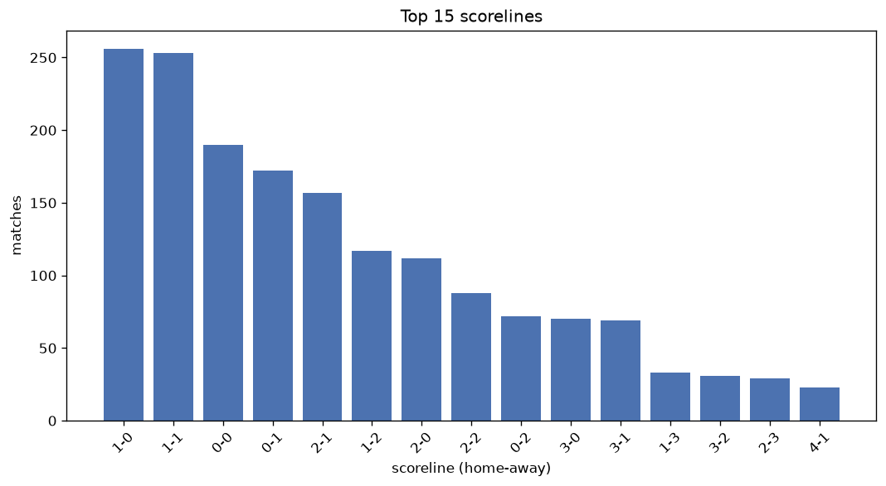
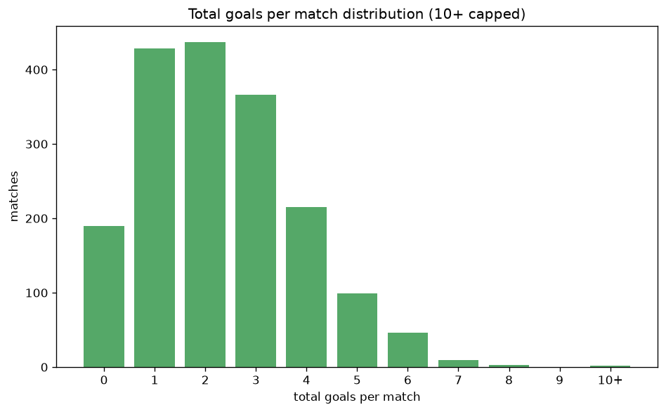

# Scoreline Analysis
- Report: `scoreline_analysis`
- Generated: 2026-10-26T01:47:58+00:00
- Script: `backend/scripts/analyze_scorelines.py` v1.0.0
- League: Segunda RFEF - Group 3 (Spain)
- Scope: league `segunda3`

## 1. Scoreline frequency
- Matches analysed: **1795** across **7** seasons.
- Distinct scorelines seen: **36**.

| scoreline | count | pct |
|---|---|---|
| 1-0 | 256 | 14.3% |
| 1-1 | 253 | 14.1% |
| 0-0 | 190 | 10.6% |
| 0-1 | 172 | 9.6% |
| 2-1 | 157 | 8.7% |
| 1-2 | 117 | 6.5% |
| 2-0 | 112 | 6.2% |
| 2-2 | 88 | 4.9% |
| 0-2 | 72 | 4.0% |
| 3-0 | 70 | 3.9% |
| 3-1 | 69 | 3.8% |
| 1-3 | 33 | 1.8% |
| 3-2 | 31 | 1.7% |
| 2-3 | 29 | 1.6% |
| 4-1 | 23 | 1.3% |
| 0-3 | 22 | 1.2% |
| 4-0 | 20 | 1.1% |
| 3-3 | 13 | 0.7% |
| 4-2 | 12 | 0.7% |
| 1-4 | 10 | 0.6% |

## 2. Scoreline frequency per season

### 2020-2021
| scoreline | count | pct |
|---|---|---|
| 1-0 | 31 | 15.5% |
| 1-1 | 28 | 14.0% |
| 0-0 | 25 | 12.5% |
| 0-1 | 22 | 11.0% |
| 2-1 | 18 | 9.0% |

### 2021-2022
| scoreline | count | pct |
|---|---|---|
| 1-1 | 46 | 15.0% |
| 1-0 | 45 | 14.7% |
| 0-0 | 30 | 9.8% |
| 2-1 | 29 | 9.5% |
| 2-0 | 25 | 8.2% |

### 2022-2023
| scoreline | count | pct |
|---|---|---|
| 1-0 | 47 | 15.4% |
| 1-1 | 43 | 14.1% |
| 0-0 | 42 | 13.7% |
| 0-1 | 29 | 9.5% |
| 2-1 | 29 | 9.5% |

### 2023-2024
| scoreline | count | pct |
|---|---|---|
| 1-0 | 41 | 13.4% |
| 1-1 | 38 | 12.4% |
| 0-0 | 31 | 10.1% |
| 2-1 | 30 | 9.8% |
| 0-1 | 28 | 9.2% |

### 2024-2025
| scoreline | count | pct |
|---|---|---|
| 1-1 | 46 | 15.0% |
| 0-1 | 44 | 14.4% |
| 1-0 | 32 | 10.5% |
| 0-0 | 27 | 8.8% |
| 2-1 | 20 | 6.5% |

### 2025-2026
| scoreline | count | pct |
|---|---|---|
| 1-0 | 49 | 16.0% |
| 1-1 | 43 | 14.1% |
| 0-0 | 33 | 10.8% |
| 2-1 | 26 | 8.5% |
| 0-1 | 21 | 6.9% |

### 2026-2027
| scoreline | count | pct |
|---|---|---|
| 1-0 | 11 | 16.9% |
| 1-1 | 9 | 13.8% |
| 1-2 | 7 | 10.8% |
| 2-0 | 6 | 9.2% |
| 2-1 | 5 | 7.7% |

## 3. Total-goal histogram
_10+ groups all matches with 10 or more total goals._

| total goals | matches | pct |
|---|---|---|
| 0 | 190 | 10.6% |
| 1 | 428 | 23.8% |
| 2 | 437 | 24.3% |
| 3 | 366 | 20.4% |
| 4 | 215 | 12.0% |
| 5 | 99 | 5.5% |
| 6 | 46 | 2.6% |
| 7 | 9 | 0.5% |
| 8 | 3 | 0.2% |
| 9 | 0 | 0.0% |
| 10+ | 2 | 0.1% |

## 4. Extreme scorelines
- Matches with 7+ total goals: **14**

| season | date | scoreline | total goals |
|---|---|---|---|
| 2024-2025 | 2024-12-11 | 4-6 | 10 |
| 2025-2026 | 2025-12-14 | 7-3 | 10 |
| 2024-2025 | 2024-09-15 | 3-5 | 8 |
| 2025-2026 | 2025-12-21 | 4-4 | 8 |
| 2025-2026 | 2026-04-05 | 5-3 | 8 |
| 2020-2021 | 2021-03-07 | 4-3 | 7 |
| 2021-2022 | 2021-10-24 | 4-3 | 7 |
| 2021-2022 | 2022-02-13 | 4-3 | 7 |
| 2021-2022 | 2022-05-08 | 4-3 | 7 |
| 2022-2023 | 2022-10-30 | 4-3 | 7 |
| 2022-2023 | 2023-01-08 | 3-4 | 7 |
| 2023-2024 | 2023-09-10 | 3-4 | 7 |
| 2024-2025 | 2025-03-09 | 4-3 | 7 |
| 2024-2025 | 2025-04-27 | 5-2 | 7 |

## 5. Margin-of-victory distribution (decided matches)
- Decided matches: **1250** (draws: **545**)
- Average winning margin: **1.58**

| margin | matches | pct |
|---|---|---|
| 1 | 770 | 61.6% |
| 2 | 305 | 24.4% |
| 3+ | 175 | 14.0% |

## 6. Margin by outcome

### Home wins
- Matches: **775** | avg margin: **1.65** | max margin: **6**
| margin | matches | pct |
|---|---|---|
| 1 | 450 | 58.1% |
| 2 | 194 | 25.0% |
| 3+ | 131 | 16.9% |
- *Full match-by-match list available in `scoreline_analysis.json`.*

### Away wins
- Matches: **475** | avg margin: **1.45** | max margin: **6**
| margin | matches | pct |
|---|---|---|
| 1 | 320 | 67.4% |
| 2 | 111 | 23.4% |
| 3+ | 44 | 9.3% |
- *Full match-by-match list available in `scoreline_analysis.json`.*

## 7. Most common exact score by outcome type
| outcome | matches | most common score | count | pct |
|---|---|---|---|---|
| home | 775 | 1-0 | 256 | 33.0% |
| draw | 545 | 1-1 | 253 | 46.4% |
| away | 475 | 0-1 | 172 | 36.2% |

---
*All statistics are computed from PostgreSQL tables (read-only). Run with `python backend/scripts/analyze_scorelines.py` to regenerate.*

## Charts

