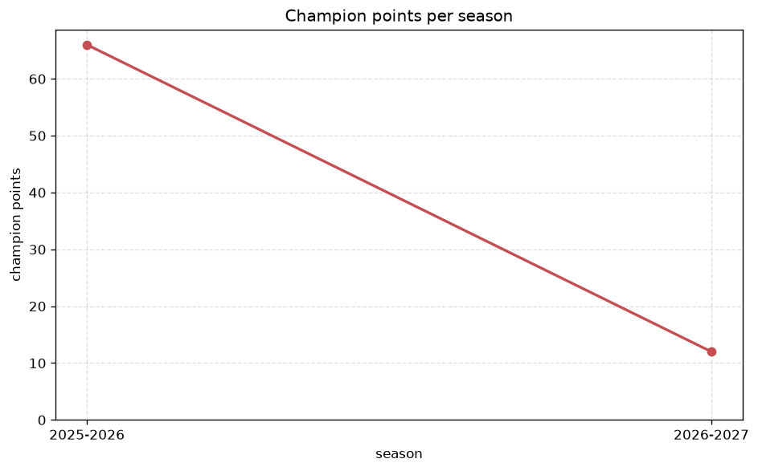
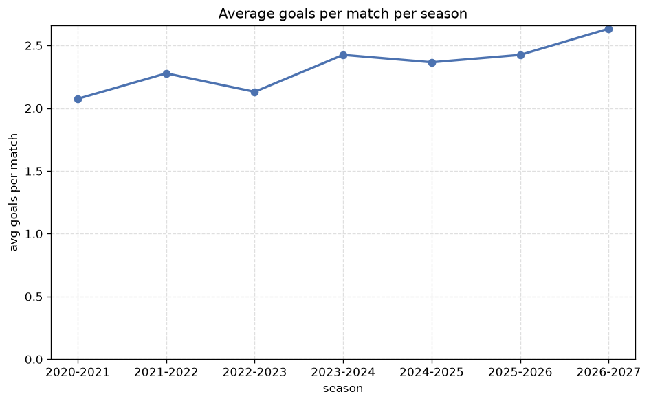

# Season Trends Analysis
- Report: `season_trends`
- Generated: 2026-10-27T02:29:57+00:00
- Script: `backend/scripts/analyze_seasons.py` v1.0.0
- League: Segunda RFEF - Group 3 (Spain)
- Scope: league `segunda3`

## 1. Champions per season
| season | champion | pts | runner-up | margin |
|---|---|---|---|---|
| 2020-2021 | UD Ibiza | 40 | Gimnastic | 5 pts |
| 2021-2022 | Numancia | 62 | Espanyol B | 5 pts |
| 2022-2023 | Teruel | 66 | Pena Deportiva | 5 pts |
| 2023-2024 | Hercules | 65 | CE Europa | 2 pts |
| 2024-2025 | CE Europa | 69 | Baleares | 7 pts |
| 2025-2026 | Baleares | 66 | Sant Andreu | 0 pts |
| 2026-2027 | Castellonense | 18 | Cieza | 3 pts |

## 2. Title-race tightness
- Tight races (margin <= 3 pts): **3** of 7 seasons
- Tightest race: **2025-2026** - Baleares beat Sant Andreu by **0** pts

| season | margin | tight |
|---|---|---|
| 2020-2021 | 5 pts |  |
| 2021-2022 | 5 pts |  |
| 2022-2023 | 5 pts |  |
| 2023-2024 | 2 pts | yes |
| 2024-2025 | 7 pts |  |
| 2025-2026 | 0 pts | yes |
| 2026-2027 | 3 pts | yes |

## 3. Points thresholds
_Position-specific points per season. Key: 1 = champion, 2 = runner-up, 4 = CL line, 6 = Europa, 15 = last safe, 18 = bottom._

| season | pos 1 | pos 2 | pos 4 | pos 6 | pos 15 | pos 18 |
|---|---|---|---|---|---|---|
| 2020-2021 | 40 | 35 | 31 | 29 | 22 | 21 |
| 2021-2022 | 62 | 57 | 52 | 50 | 41 | 23 |
| 2022-2023 | 66 | 61 | 54 | 49 | 32 | 24 |
| 2023-2024 | 65 | 63 | 58 | 50 | 37 | 21 |
| 2024-2025 | 69 | 62 | 56 | 53 | 35 | 17 |
| 2025-2026 | 66 | 66 | 55 | 52 | 33 | 27 |
| 2026-2027 | 18 | 15 | 15 | 14 | 7 | 4 |

## 4. Relegation battle
| season | safe pos | safe pts | drop pos | drop pts | gap |
|---|---|---|---|---|---|
| 2020-2021 | 15 | 22 | 16 | 21 | 1 pts |
| 2021-2022 | 15 | 41 | 16 | 38 | 3 pts |
| 2022-2023 | 15 | 32 | 16 | 29 | 3 pts |
| 2023-2024 | 15 | 37 | 16 | 34 | 3 pts |
| 2024-2025 | 15 | 35 | 16 | 30 | 5 pts |
| 2025-2026 | 15 | 33 | 16 | 30 | 3 pts |
| 2026-2027 | 15 | 7 | 16 | 7 | 0 pts |

## 5. League-level trends
| season | matches | total goals | avg goals | home win | draw | away win | goalless | avg pts/team |
|---|---|---|---|---|---|---|---|---|
| 2020-2021 | 200 | 415 | 2.075 | 44.5% | 31.5% | 24.0% | 12.5% | 25.57 |
| 2021-2022 | 306 | 697 | 2.278 | 45.4% | 30.7% | 23.9% | 9.8% | 45.78 |
| 2022-2023 | 306 | 652 | 2.131 | 41.8% | 32.7% | 25.5% | 13.7% | 45.44 |
| 2023-2024 | 306 | 742 | 2.425 | 44.1% | 28.1% | 27.8% | 10.1% | 46.22 |
| 2024-2025 | 306 | 724 | 2.366 | 37.3% | 29.1% | 33.7% | 8.8% | 46.06 |
| 2025-2026 | 306 | 742 | 2.425 | 45.8% | 31.7% | 22.5% | 10.8% | 45.61 |
| 2026-2027 | 71 | 187 | 2.634 | 49.3% | 22.5% | 28.2% | 2.8% | 10.94 |

## 6. View divergence
- Largest divergence: **2020-2021** (goals view, avg abs position diff = 7.429)

_Avg absolute position difference between classic view and alternative view per season._

| season | classic vs luck | classic vs goals |
|---|---|---|
| 2020-2021 | 2.857 | 7.429 |
| 2021-2022 | 2.667 | 5.889 |
| 2022-2023 | 2.889 | 5.333 |
| 2023-2024 | 2.333 | 5.444 |
| 2024-2025 | 2.111 | 5.778 |
| 2025-2026 | 2.111 | 6.556 |
| 2026-2027 | 2.333 | 5.000 |

---
*All statistics are computed from PostgreSQL tables (read-only). Run with `python backend/scripts/analyze_seasons.py` to regenerate.*

## Charts

