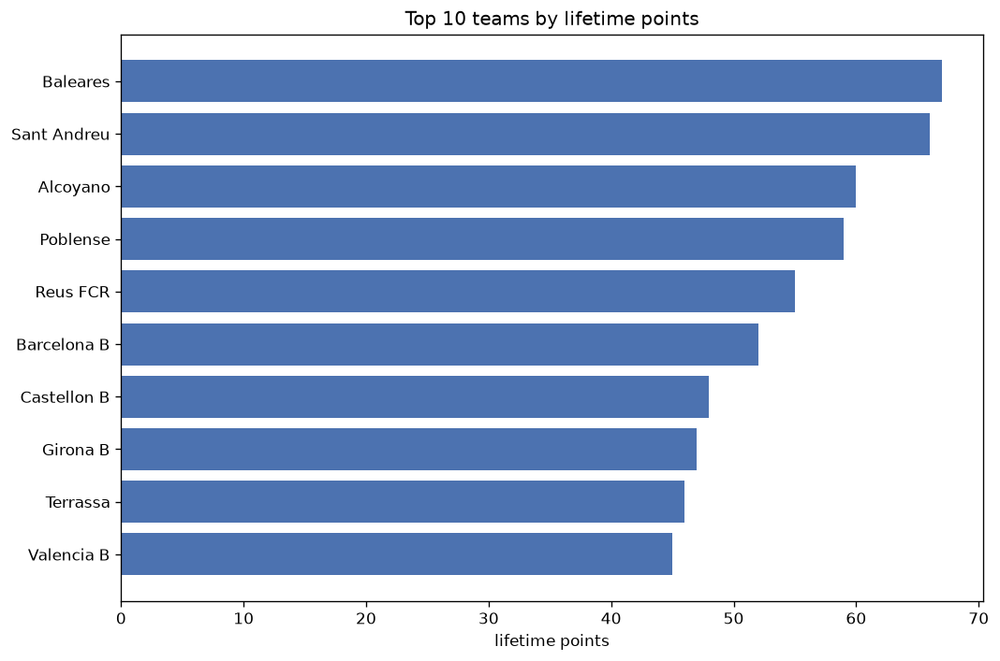
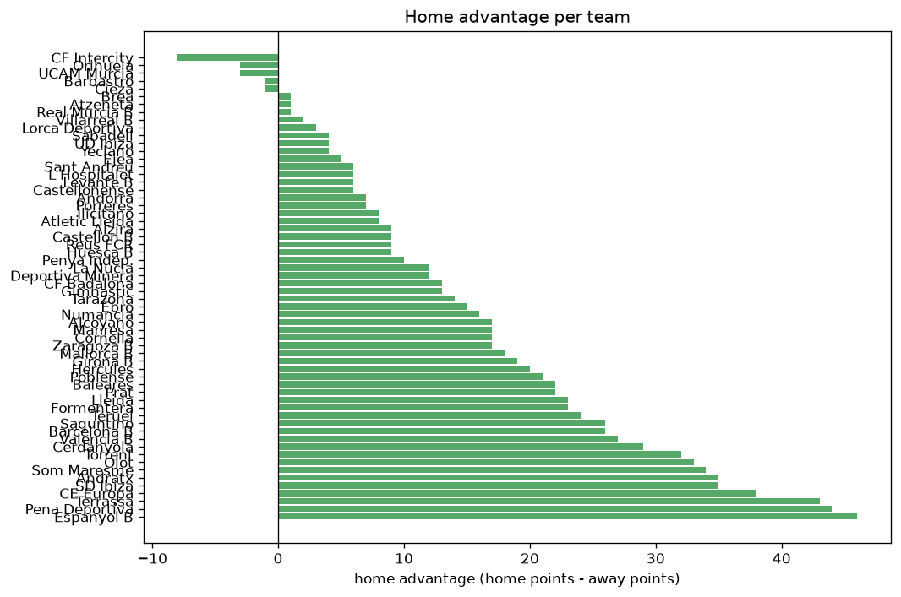

# Team Analysis
- Report: `teams_analysis`
- Generated: 2026-10-30T04:12:10+00:00
- Script: `backend/scripts/analyze_teams.py` v1.0.0
- League: Segunda RFEF - Group 3 (Spain)
- Scope: league `segunda3`

- Teams: **60** | Seasons: **7** | Matches: **1801**

## 1. Team standings (lifetime)
| team | seasons | played | W | D | L | pts | GF | GA | GD | avg pts/season | best pos | worst pos | titles |
|---|---|---|---|---|---|---|---|---|---|---|---|---|---|
| Espanyol B | 6 | 190 | 72 | 58 | 60 | 274 | 229 | 223 | 6 | 45.67 | 2 | 13 | 0 |
| Terrassa | 5 | 170 | 62 | 57 | 51 | 243 | 212 | 195 | 17 | 48.6 | 6 | 8 | 0 |
| Lleida | 5 | 156 | 62 | 43 | 51 | 229 | 176 | 148 | 28 | 45.8 | 4 | 13 | 0 |
| Pena Deportiva | 6 | 162 | 57 | 51 | 54 | 222 | 194 | 184 | 10 | 37.0 | 2 | 18 | 0 |
| Valencia B | 6 | 161 | 55 | 54 | 52 | 219 | 219 | 190 | 29 | 36.5 | 3 | 20 | 0 |
| Sant Andreu | 3 | 102 | 53 | 25 | 24 | 184 | 168 | 106 | 62 | 61.33 | 2 | 4 | 0 |
| CE Europa | 3 | 102 | 48 | 26 | 28 | 170 | 156 | 116 | 40 | 56.67 | 1 | 16 | 1 |
| Andratx | 4 | 136 | 43 | 38 | 55 | 167 | 150 | 181 | -31 | 41.75 | 9 | 15 | 0 |
| SD Ibiza | 4 | 136 | 41 | 42 | 53 | 165 | 151 | 168 | -17 | 41.25 | 6 | 16 | 0 |
| Som Maresme | 4 | 122 | 38 | 38 | 46 | 152 | 120 | 148 | -28 | 38.0 | 3 | 18 | 0 |
| Formentera | 3 | 102 | 38 | 25 | 39 | 139 | 115 | 109 | 6 | 46.33 | 7 | 12 | 0 |
| Olot | 4 | 122 | 33 | 40 | 49 | 139 | 111 | 133 | -22 | 34.75 | 11 | 19 | 0 |
| Baleares | 3 | 76 | 38 | 24 | 14 | 138 | 114 | 74 | 40 | 46.0 | 1 | 10 | 1 |
| Hercules | 3 | 86 | 38 | 24 | 24 | 138 | 101 | 81 | 20 | 46.0 | 1 | 11 | 1 |
| Torrent | 3 | 102 | 35 | 29 | 38 | 134 | 119 | 125 | -6 | 44.67 | 5 | 17 | 0 |
| Alzira | 3 | 102 | 30 | 31 | 41 | 121 | 109 | 143 | -34 | 40.33 | 8 | 16 | 0 |
| Teruel | 2 | 68 | 30 | 28 | 10 | 118 | 73 | 60 | 13 | 59.0 | 1 | 5 | 1 |
| Prat | 3 | 88 | 25 | 29 | 34 | 104 | 80 | 99 | -19 | 34.67 | 13 | 18 | 0 |
| Alcoyano | 3 | 60 | 25 | 22 | 13 | 97 | 54 | 45 | 9 | 32.33 | 5 | 9 | 0 |
| Saguntino | 2 | 68 | 22 | 22 | 24 | 88 | 68 | 75 | -7 | 44.0 | 10 | 14 | 0 |
| Barcelona B | 2 | 54 | 24 | 14 | 16 | 86 | 90 | 57 | 33 | 43.0 | 3 | 6 | 0 |
| Manresa | 2 | 68 | 20 | 21 | 27 | 81 | 63 | 73 | -10 | 40.5 | 4 | 17 | 0 |
| Cerdanyola | 2 | 68 | 20 | 19 | 29 | 79 | 80 | 93 | -13 | 39.5 | 12 | 15 | 0 |
| Ebro | 2 | 68 | 15 | 26 | 27 | 71 | 60 | 68 | -8 | 35.5 | 9 | 18 | 0 |
| Poblense | 2 | 42 | 19 | 12 | 11 | 69 | 49 | 38 | 11 | 34.5 | 3 | 12 | 0 |
| CF Badalona | 2 | 54 | 15 | 24 | 15 | 69 | 45 | 50 | -5 | 34.5 | 9 | 15 | 0 |
| Cornella | 2 | 54 | 17 | 16 | 21 | 67 | 66 | 72 | -6 | 33.5 | 6 | 14 | 0 |
| Numancia | 1 | 34 | 17 | 11 | 6 | 62 | 45 | 26 | 19 | 62.0 | 1 | 1 | 1 |
| Castellon B | 2 | 42 | 16 | 9 | 17 | 57 | 75 | 82 | -7 | 28.5 | 4 | 13 | 0 |
| Sabadell | 1 | 34 | 15 | 11 | 8 | 56 | 52 | 32 | 20 | 56.0 | 4 | 4 | 0 |
| La Nucia | 3 | 59 | 14 | 14 | 31 | 56 | 49 | 90 | -41 | 18.67 | 7 | 18 | 0 |
| Mallorca B | 3 | 76 | 13 | 17 | 46 | 56 | 54 | 112 | -58 | 18.67 | 14 | 17 | 0 |
| Reus FCR | 1 | 34 | 16 | 7 | 11 | 55 | 50 | 38 | 12 | 55.0 | 4 | 4 | 0 |
| Ilicitano | 2 | 41 | 14 | 12 | 15 | 54 | 50 | 51 | -1 | 27.0 | 10 | 15 | 0 |
| Girona B | 1 | 34 | 12 | 11 | 11 | 47 | 45 | 37 | 8 | 47.0 | 7 | 7 | 0 |
| Brea | 1 | 34 | 11 | 12 | 11 | 45 | 32 | 34 | -2 | 45.0 | 10 | 10 | 0 |
| Barbastro | 1 | 34 | 10 | 13 | 11 | 43 | 32 | 31 | 1 | 43.0 | 11 | 11 | 0 |
| Zaragoza B | 1 | 34 | 11 | 10 | 13 | 43 | 36 | 42 | -6 | 43.0 | 13 | 13 | 0 |
| Tarazona | 1 | 34 | 11 | 9 | 14 | 42 | 36 | 37 | -1 | 42.0 | 11 | 11 | 0 |
| UD Ibiza | 1 | 18 | 12 | 4 | 2 | 40 | 26 | 5 | 21 | 40.0 | 1 | 1 | 1 |
| Huesca B | 1 | 34 | 8 | 13 | 13 | 37 | 37 | 44 | -7 | 37.0 | 17 | 17 | 0 |
| Gimnastic | 1 | 20 | 9 | 8 | 3 | 35 | 32 | 15 | 17 | 35.0 | 2 | 2 | 0 |
| Penya Indep. | 1 | 34 | 9 | 7 | 18 | 34 | 32 | 52 | -20 | 34.0 | 16 | 16 | 0 |
| Andorra | 1 | 20 | 8 | 7 | 5 | 31 | 23 | 19 | 4 | 31.0 | 4 | 4 | 0 |
| Atletic Lleida | 1 | 34 | 6 | 12 | 16 | 30 | 37 | 51 | -14 | 30.0 | 16 | 16 | 0 |
| Orihuela | 2 | 27 | 7 | 8 | 12 | 29 | 24 | 42 | -18 | 14.5 | 6 | 21 | 0 |
| Villarreal B | 1 | 18 | 7 | 7 | 4 | 28 | 21 | 15 | 6 | 28.0 | 8 | 8 | 0 |
| Porreres | 1 | 34 | 6 | 9 | 19 | 27 | 22 | 44 | -22 | 27.0 | 18 | 18 | 0 |
| Ejea | 1 | 34 | 4 | 11 | 19 | 23 | 28 | 57 | -29 | 23.0 | 18 | 18 | 0 |
| Levante B | 1 | 18 | 6 | 4 | 8 | 22 | 15 | 19 | -4 | 22.0 | 14 | 14 | 0 |
| L Hospitalet | 1 | 20 | 6 | 4 | 10 | 22 | 21 | 35 | -14 | 22.0 | 15 | 15 | 0 |
| Atzeneta | 1 | 18 | 5 | 6 | 7 | 21 | 20 | 18 | 2 | 21.0 | 16 | 16 | 0 |
| Castellonense | 1 | 8 | 6 | 0 | 2 | 18 | 14 | 7 | 7 | 18.0 | 1 | 1 | 1 |
| Cieza | 1 | 8 | 4 | 3 | 1 | 15 | 15 | 7 | 8 | 15.0 | 2 | 2 | 0 |
| UCAM Murcia | 1 | 9 | 5 | 0 | 4 | 15 | 18 | 12 | 6 | 15.0 | 3 | 3 | 0 |
| Deportiva Minera | 1 | 7 | 4 | 2 | 1 | 14 | 10 | 6 | 4 | 14.0 | 5 | 5 | 0 |
| CF Intercity | 1 | 8 | 3 | 3 | 2 | 12 | 10 | 11 | -1 | 12.0 | 8 | 8 | 0 |
| Yeclano | 1 | 8 | 2 | 4 | 2 | 10 | 7 | 8 | -1 | 10.0 | 11 | 11 | 0 |
| Lorca Deportiva | 1 | 8 | 2 | 3 | 3 | 9 | 10 | 10 | 0 | 9.0 | 13 | 13 | 0 |
| Real Murcia B | 1 | 8 | 2 | 1 | 5 | 7 | 9 | 16 | -7 | 7.0 | 16 | 16 | 0 |

## 2. Home vs away split
| team | home P | H-W | H-D | H-L | H-pts | away P | A-W | A-D | A-L | A-pts | adv |
|---|---|---|---|---|---|---|---|---|---|---|---|
| Espanyol B | 95 | 45 | 25 | 25 | 160 | 95 | 27 | 33 | 35 | 114 | 46 |
| Pena Deportiva | 81 | 35 | 28 | 18 | 133 | 81 | 22 | 23 | 36 | 89 | 44 |
| Terrassa | 85 | 39 | 26 | 20 | 143 | 85 | 23 | 31 | 31 | 100 | 43 |
| CE Europa | 51 | 32 | 8 | 11 | 104 | 51 | 16 | 18 | 17 | 66 | 38 |
| Andratx | 68 | 27 | 20 | 21 | 101 | 68 | 16 | 18 | 34 | 66 | 35 |
| SD Ibiza | 68 | 28 | 16 | 24 | 100 | 68 | 13 | 26 | 29 | 65 | 35 |
| Som Maresme | 61 | 25 | 18 | 18 | 93 | 61 | 13 | 20 | 28 | 59 | 34 |
| Olot | 61 | 20 | 26 | 15 | 86 | 61 | 13 | 14 | 34 | 53 | 33 |
| Torrent | 51 | 22 | 17 | 12 | 83 | 51 | 13 | 12 | 26 | 51 | 32 |
| Cerdanyola | 34 | 14 | 12 | 8 | 54 | 34 | 6 | 7 | 21 | 25 | 29 |
| Valencia B | 80 | 33 | 24 | 23 | 123 | 81 | 22 | 30 | 29 | 96 | 27 |
| Saguntino | 34 | 16 | 9 | 9 | 57 | 34 | 6 | 13 | 15 | 31 | 26 |
| Barcelona B | 27 | 16 | 8 | 3 | 56 | 27 | 8 | 6 | 13 | 30 | 26 |
| Teruel | 34 | 20 | 11 | 3 | 71 | 34 | 10 | 17 | 7 | 47 | 24 |
| Lleida | 78 | 34 | 24 | 20 | 126 | 78 | 28 | 19 | 31 | 103 | 23 |
| Formentera | 51 | 22 | 15 | 14 | 81 | 51 | 16 | 10 | 25 | 58 | 23 |
| Baleares | 38 | 23 | 11 | 4 | 80 | 38 | 15 | 13 | 10 | 58 | 22 |
| Prat | 44 | 16 | 15 | 13 | 63 | 44 | 9 | 14 | 21 | 41 | 22 |
| Poblense | 21 | 13 | 6 | 2 | 45 | 21 | 6 | 6 | 9 | 24 | 21 |
| Hercules | 43 | 22 | 13 | 8 | 79 | 43 | 16 | 11 | 16 | 59 | 20 |
| Girona B | 17 | 9 | 6 | 2 | 33 | 17 | 3 | 5 | 9 | 14 | 19 |
| Mallorca B | 38 | 9 | 10 | 19 | 37 | 38 | 4 | 7 | 27 | 19 | 18 |
| Alcoyano | 30 | 16 | 9 | 5 | 57 | 30 | 9 | 13 | 8 | 40 | 17 |
| Manresa | 34 | 13 | 10 | 11 | 49 | 34 | 7 | 11 | 16 | 32 | 17 |
| Cornella | 27 | 11 | 9 | 7 | 42 | 27 | 6 | 7 | 14 | 25 | 17 |
| Zaragoza B | 17 | 8 | 6 | 3 | 30 | 17 | 3 | 4 | 10 | 13 | 17 |
| Numancia | 17 | 12 | 3 | 2 | 39 | 17 | 5 | 8 | 4 | 23 | 16 |
| Ebro | 34 | 9 | 16 | 9 | 43 | 34 | 6 | 10 | 18 | 28 | 15 |
| Tarazona | 17 | 9 | 1 | 7 | 28 | 17 | 2 | 8 | 7 | 14 | 14 |
| CF Badalona | 27 | 9 | 14 | 4 | 41 | 27 | 6 | 10 | 11 | 28 | 13 |
| Gimnastic | 10 | 7 | 3 | 0 | 24 | 10 | 2 | 5 | 3 | 11 | 13 |
| La Nucia | 30 | 9 | 7 | 14 | 34 | 29 | 5 | 7 | 17 | 22 | 12 |
| Deportiva Minera | 5 | 4 | 1 | 0 | 13 | 2 | 0 | 1 | 1 | 1 | 12 |
| Penya Indep. | 17 | 7 | 1 | 9 | 22 | 17 | 2 | 6 | 9 | 12 | 10 |
| Alzira | 51 | 16 | 17 | 18 | 65 | 51 | 14 | 14 | 23 | 56 | 9 |
| Castellon B | 22 | 9 | 6 | 7 | 33 | 20 | 7 | 3 | 10 | 24 | 9 |
| Reus FCR | 17 | 10 | 2 | 5 | 32 | 17 | 6 | 5 | 6 | 23 | 9 |
| Huesca B | 17 | 5 | 8 | 4 | 23 | 17 | 3 | 5 | 9 | 14 | 9 |
| Ilicitano | 20 | 9 | 4 | 7 | 31 | 21 | 5 | 8 | 8 | 23 | 8 |
| Atletic Lleida | 17 | 4 | 7 | 6 | 19 | 17 | 2 | 5 | 10 | 11 | 8 |
| Andorra | 10 | 5 | 4 | 1 | 19 | 10 | 3 | 3 | 4 | 12 | 7 |
| Porreres | 17 | 4 | 5 | 8 | 17 | 17 | 2 | 4 | 11 | 10 | 7 |
| Sant Andreu | 51 | 27 | 14 | 10 | 95 | 51 | 26 | 11 | 14 | 89 | 6 |
| L Hospitalet | 10 | 4 | 2 | 4 | 14 | 10 | 2 | 2 | 6 | 8 | 6 |
| Levante B | 9 | 4 | 2 | 3 | 14 | 9 | 2 | 2 | 5 | 8 | 6 |
| Castellonense | 4 | 4 | 0 | 0 | 12 | 4 | 2 | 0 | 2 | 6 | 6 |
| Ejea | 17 | 2 | 8 | 7 | 14 | 17 | 2 | 3 | 12 | 9 | 5 |
| Sabadell | 17 | 8 | 6 | 3 | 30 | 17 | 7 | 5 | 5 | 26 | 4 |
| UD Ibiza | 9 | 7 | 1 | 1 | 22 | 9 | 5 | 3 | 1 | 18 | 4 |
| Yeclano | 4 | 2 | 1 | 1 | 7 | 4 | 0 | 3 | 1 | 3 | 4 |
| Lorca Deportiva | 4 | 1 | 3 | 0 | 6 | 4 | 1 | 0 | 3 | 3 | 3 |
| Villarreal B | 9 | 4 | 3 | 2 | 15 | 9 | 3 | 4 | 2 | 13 | 2 |
| Brea | 17 | 6 | 5 | 6 | 23 | 17 | 5 | 7 | 5 | 22 | 1 |
| Atzeneta | 9 | 2 | 5 | 2 | 11 | 9 | 3 | 1 | 5 | 10 | 1 |
| Real Murcia B | 5 | 1 | 1 | 3 | 4 | 3 | 1 | 0 | 2 | 3 | 1 |
| Barbastro | 17 | 5 | 6 | 6 | 21 | 17 | 5 | 7 | 5 | 22 | -1 |
| Cieza | 3 | 2 | 1 | 0 | 7 | 5 | 2 | 2 | 1 | 8 | -1 |
| Orihuela | 13 | 3 | 4 | 6 | 13 | 14 | 4 | 4 | 6 | 16 | -3 |
| UCAM Murcia | 4 | 2 | 0 | 2 | 6 | 5 | 3 | 0 | 2 | 9 | -3 |
| CF Intercity | 3 | 0 | 2 | 1 | 2 | 5 | 3 | 1 | 1 | 10 | -8 |

## 3. Top performers
### Best points per game (PPG)
| rank | team | PPG |
|---|---|---|
| 1 | Castellonense | 2.25 |
| 2 | UD Ibiza | 2.22 |
| 3 | Deportiva Minera | 2.00 |
| 4 | Cieza | 1.88 |
| 5 | Numancia | 1.82 |

### Most goals scored
| rank | team | goals |
|---|---|---|
| 1 | Espanyol B | 229 |
| 2 | Valencia B | 219 |
| 3 | Terrassa | 212 |
| 4 | Pena Deportiva | 194 |
| 5 | Lleida | 176 |

### Best goal difference
| rank | team | GD |
|---|---|---|
| 1 | Sant Andreu | 62 |
| 2 | CE Europa | 40 |
| 3 | Baleares | 40 |
| 4 | Barcelona B | 33 |
| 5 | Valencia B | 29 |

### Best defence (goals against per match, standings)
| rank | team | GA/match |
|---|---|---|
| 1 | UD Ibiza | 0.278 |
| 2 | Gimnastic | 0.750 |
| 3 | Alcoyano | 0.750 |
| 4 | Numancia | 0.765 |
| 5 | Villarreal B | 0.833 |

## 4. Team consistency
- Teams present in all **7** seasons: **0**

## 5. Head-to-head dominance
- Distinct fixtures: **665** (showing the 15 most frequent)

| fixture | meetings | home wins | draws | away wins | home pct | draw pct | away pct |
|---|---|---|---|---|---|---|---|
| Espanyol B vs Lleida | 10 | 5 | 2 | 3 | 50.0% | 20.0% | 30.0% |
| Espanyol B vs Terrassa | 10 | 2 | 6 | 2 | 20.0% | 60.0% | 20.0% |
| Pena Deportiva vs Valencia B | 9 | 6 | 3 | 0 | 66.7% | 33.3% | 0.0% |
| Som Maresme vs Espanyol B | 8 | 5 | 3 | 0 | 62.5% | 37.5% | 0.0% |
| Espanyol B vs Andratx | 8 | 4 | 2 | 2 | 50.0% | 25.0% | 25.0% |
| Espanyol B vs Olot | 8 | 4 | 4 | 0 | 50.0% | 50.0% | 0.0% |
| Terrassa vs Pena Deportiva | 8 | 4 | 1 | 3 | 50.0% | 12.5% | 37.5% |
| Terrassa vs SD Ibiza | 8 | 4 | 2 | 2 | 50.0% | 25.0% | 25.0% |
| Espanyol B vs Pena Deportiva | 8 | 3 | 2 | 3 | 37.5% | 25.0% | 37.5% |
| Espanyol B vs Valencia B | 8 | 3 | 2 | 3 | 37.5% | 25.0% | 37.5% |
| Lleida vs Pena Deportiva | 8 | 3 | 4 | 1 | 37.5% | 50.0% | 12.5% |
| Terrassa vs Andratx | 8 | 3 | 1 | 4 | 37.5% | 12.5% | 50.0% |
| Terrassa vs Valencia B | 8 | 3 | 2 | 3 | 37.5% | 25.0% | 37.5% |
| Espanyol B vs SD Ibiza | 8 | 2 | 3 | 3 | 25.0% | 37.5% | 37.5% |
| Som Maresme vs Lleida | 8 | 2 | 3 | 3 | 25.0% | 37.5% | 37.5% |

## 6. Position per season (classic view)
_Cells show final position; '-' when the team was absent from that season._

| team | 2020-2021 | 2021-2022 | 2022-2023 | 2023-2024 | 2024-2025 | 2025-2026 | 2026-2027 |
|---|---|---|---|---|---|---|---|
| Espanyol B | 13 | 2 | 5 | 9 | 7 | 10 | - |
| Terrassa | - | 8 | 6 | 6 | 8 | 8 | - |
| Lleida | 10 | 4 | 8 | 5 | 13 | - | - |
| Pena Deportiva | 17 | 3 | 2 | 10 | 15 | - | 18 |
| Valencia B | 20 | - | 3 | 11 | 6 | 9 | 17 |
| Sant Andreu | - | - | - | 4 | 3 | 2 | - |
| CE Europa | - | 16 | - | 2 | 1 | - | - |
| Andratx | - | 14 | - | 13 | 9 | 15 | - |
| SD Ibiza | - | 6 | 16 | - | 12 | 14 | - |
| Som Maresme | 7 | - | 9 | 3 | 18 | - | - |
| Formentera | - | 7 | 11 | 12 | - | - | - |
| Olot | 19 | - | 15 | - | 11 | 12 | - |
| Baleares | - | - | - | - | 2 | 1 | 10 |
| Hercules | 11 | - | 7 | 1 | - | - | - |
| Torrent | - | - | - | 7 | 5 | 17 | - |
| Alzira | - | - | 12 | 8 | 16 | - | - |
| Teruel | - | 5 | 1 | - | - | - | - |
| Prat | 18 | 13 | 14 | - | - | - | - |
| Alcoyano | 5 | - | - | - | - | 5 | 9 |
| Saguntino | - | - | 10 | 14 | - | - | - |
| Barcelona B | 3 | - | - | - | - | 6 | - |
| Manresa | - | - | 4 | 17 | - | - | - |
| Cerdanyola | - | 12 | - | 15 | - | - | - |
| Ebro | - | 9 | 18 | - | - | - | - |
| Poblense | - | - | - | - | - | 3 | 12 |
| CF Badalona | 9 | 15 | - | - | - | - | - |
| Cornella | 6 | - | - | - | 14 | - | - |
| Numancia | - | 1 | - | - | - | - | - |
| Castellon B | - | - | - | - | - | 13 | 4 |
| Sabadell | - | - | - | - | 4 | - | - |
| La Nucia | 12 | - | - | 18 | - | - | 7 |
| Mallorca B | - | - | 17 | - | 17 | - | 14 |
| Reus FCR | - | - | - | - | - | 4 | - |
| Ilicitano | - | - | - | - | 10 | - | 15 |
| Girona B | - | - | - | - | - | 7 | - |
| Brea | - | 10 | - | - | - | - | - |
| Barbastro | - | - | - | - | - | 11 | - |
| Zaragoza B | - | - | 13 | - | - | - | - |
| Tarazona | - | 11 | - | - | - | - | - |
| UD Ibiza | 1 | - | - | - | - | - | - |
| Huesca B | - | 17 | - | - | - | - | - |
| Gimnastic | 2 | - | - | - | - | - | - |
| Penya Indep. | - | - | - | 16 | - | - | - |
| Andorra | 4 | - | - | - | - | - | - |
| Atletic Lleida | - | - | - | - | - | 16 | - |
| Orihuela | 21 | - | - | - | - | - | 6 |
| Villarreal B | 8 | - | - | - | - | - | - |
| Porreres | - | - | - | - | - | 18 | - |
| Ejea | - | 18 | - | - | - | - | - |
| Levante B | 14 | - | - | - | - | - | - |
| L Hospitalet | 15 | - | - | - | - | - | - |
| Atzeneta | 16 | - | - | - | - | - | - |
| Castellonense | - | - | - | - | - | - | 1 |
| Cieza | - | - | - | - | - | - | 2 |
| UCAM Murcia | - | - | - | - | - | - | 3 |
| Deportiva Minera | - | - | - | - | - | - | 5 |
| CF Intercity | - | - | - | - | - | - | 8 |
| Yeclano | - | - | - | - | - | - | 11 |
| Lorca Deportiva | - | - | - | - | - | - | 13 |
| Real Murcia B | - | - | - | - | - | - | 16 |

---
*All statistics are computed from PostgreSQL tables (read-only). Run with `python backend/scripts/analyze_teams.py` to regenerate.*

## Charts

