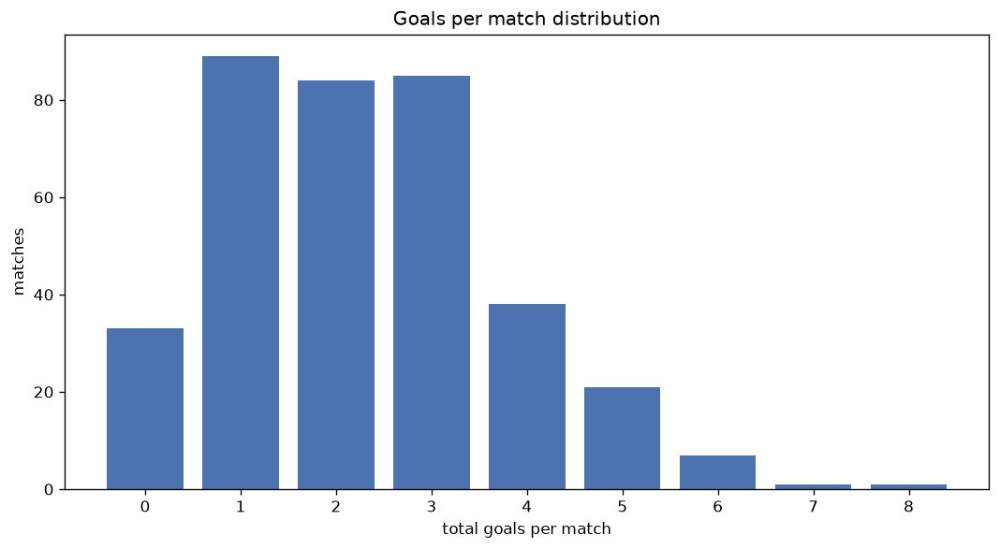
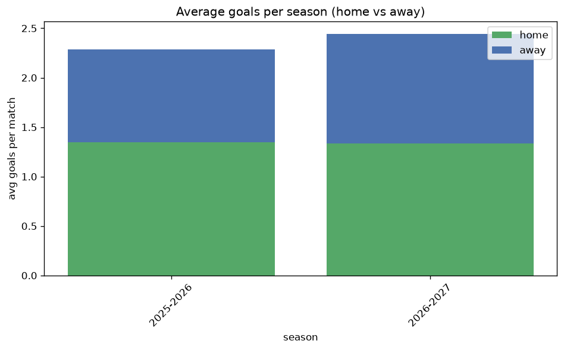

# Goal Analysis
- Report: `goals_analysis`
- Generated: 2026-10-30T04:12:22+00:00
- Script: `backend/scripts/analyze_goals.py` v1.0.0
- League: Segunda RFEF - Group 4 (Spain)
- Scope: league `segunda4`

## 1. Goals per match distribution
| goals | matches | pct |
|---|---|---|
| 0 | 202 | 11.2% |
| 1 | 439 | 24.4% |
| 2 | 474 | 26.3% |
| 3 | 345 | 19.2% |
| 4 | 193 | 10.7% |
| 5 | 94 | 5.2% |
| 6 | 39 | 2.2% |
| 7 | 8 | 0.4% |
| 8 | 4 | 0.2% |
| 9 | 1 | 0.1% |

## 2. Goals per match per season
| season | matches | total goals | avg home | avg away | avg total |
|---|---|---|---|---|---|
| 2020-2021 | 180 | 392 | 1.161 | 1.017 | 2.178 |
| 2021-2022 | 306 | 742 | 1.448 | 0.977 | 2.425 |
| 2022-2023 | 306 | 673 | 1.242 | 0.958 | 2.199 |
| 2023-2024 | 306 | 631 | 1.235 | 0.827 | 2.062 |
| 2024-2025 | 306 | 629 | 1.15 | 0.905 | 2.056 |
| 2025-2026 | 323 | 738 | 1.344 | 0.941 | 2.285 |
| 2026-2027 | 72 | 190 | 1.611 | 1.028 | 2.639 |

## 3. Home vs away goal share
- Home goals: **2312** (57.9%)
- Away goals: **1683** (42.1%)
- Home/away ratio: **1.374**

| season | home goals | away goals | total | home pct | away pct |
|---|---|---|---|---|---|
| 2020-2021 | 209 | 183 | 392 | 53.3% | 46.7% |
| 2021-2022 | 443 | 299 | 742 | 59.7% | 40.3% |
| 2022-2023 | 380 | 293 | 673 | 56.5% | 43.5% |
| 2023-2024 | 378 | 253 | 631 | 59.9% | 40.1% |
| 2024-2025 | 352 | 277 | 629 | 56.0% | 44.0% |
| 2025-2026 | 434 | 304 | 738 | 58.8% | 41.2% |
| 2026-2027 | 116 | 74 | 190 | 61.1% | 38.9% |

## 4. BTTS (Both Teams To Score)
- Overall: **802** of `1799` (44.6%)

| season | matches | BTTS | pct |
|---|---|---|---|
| 2020-2021 | 180 | 83 | 46.1% |
| 2021-2022 | 306 | 139 | 45.4% |
| 2022-2023 | 306 | 131 | 42.8% |
| 2023-2024 | 306 | 126 | 41.2% |
| 2024-2025 | 306 | 124 | 40.5% |
| 2025-2026 | 323 | 163 | 50.5% |
| 2026-2027 | 72 | 36 | 50.0% |

## 5. Clean sheets
- Home clean sheets: **703** (39.1%)
- Away clean sheets: **496** (27.6%)
- Total clean sheets recorded: **1199**
- Matches with at least one clean sheet: **997** (55.4%)
- Both teams kept clean sheets (0-0): **202**

| season | matches | home CS | away CS | total CS | matches w/ CS |
|---|---|---|---|---|---|
| 2020-2021 | 180 | 66 | 55 | 121 | 97 (53.9%) |
| 2021-2022 | 306 | 121 | 76 | 197 | 167 (54.6%) |
| 2022-2023 | 306 | 119 | 89 | 208 | 175 (57.2%) |
| 2023-2024 | 306 | 134 | 92 | 226 | 180 (58.8%) |
| 2024-2025 | 306 | 114 | 101 | 215 | 182 (59.5%) |
| 2025-2026 | 323 | 122 | 66 | 188 | 160 (49.5%) |
| 2026-2027 | 72 | 27 | 17 | 44 | 36 (50.0%) |

## 6. Scoring intensity
- First-half goals: **1736** (43.5%)
- Second-half goals: **2253** (56.5%)
- Avg first-half goals per match: **0.966**
- Avg second-half goals per match: **1.254**
- Second-half-only scoring (HT 0-0, FT goals >= 1): **490** (27.2%)
- *2 match(es) excluded (no HT score recorded).*

| season | matches | 1st half | 2nd half | 1st half pct | 2nd half pct |
|---|---|---|---|---|---|
| 2020-2021 | 180 | 171 | 221 | 43.6% | 56.4% |
| 2021-2022 | 306 | 333 | 403 | 45.2% | 54.8% |
| 2022-2023 | 306 | 299 | 374 | 44.4% | 55.6% |
| 2023-2024 | 306 | 267 | 364 | 42.3% | 57.7% |
| 2024-2025 | 306 | 269 | 360 | 42.8% | 57.2% |
| 2025-2026 | 323 | 308 | 430 | 41.7% | 58.3% |
| 2026-2027 | 72 | 89 | 101 | 46.8% | 53.2% |

## 7. First-goal timing
- Matches with first-goal time recorded: `1595` of `1799` (88.7%)
- Goalless matches: `204`
- Min `1` | Max `97` | Mean `35.12` | Median (p50) `30`

| bucket | count | % of matches | % of scoring matches |
|---|---|---|---|
| 1-15 | 433 | 24.1% | 27.1% |
| 16-30 | 386 | 21.5% | 24.2% |
| 31-45 | 275 | 15.3% | 17.2% |
| 46-60 | 214 | 11.9% | 13.4% |
| 61-75 | 139 | 7.7% | 8.7% |
| 76-90 | 121 | 6.7% | 7.6% |
| 91-120 | 27 | 1.5% | 1.7% |

---
*All statistics are computed from PostgreSQL tables (read-only). Run with `python backend/scripts/analyze_goals.py` to regenerate.*

## Charts

