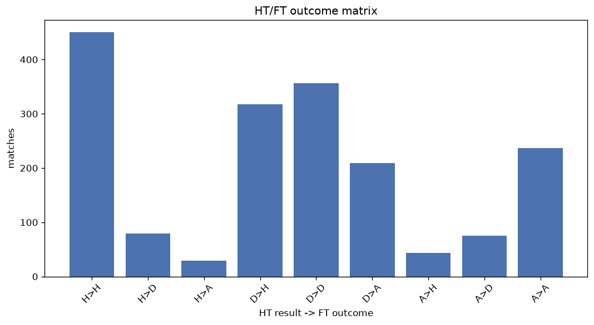
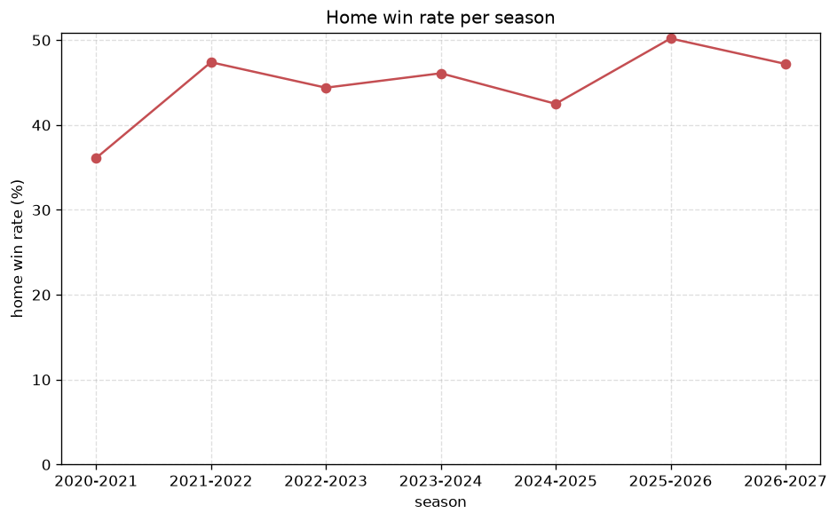

# Match Analysis
- Report: `matches_analysis`
- Generated: 2026-10-27T02:30:10+00:00
- Script: `backend/scripts/analyze_matches.py` v1.0.0
- League: Segunda RFEF - Group 4 (Spain)
- Scope: league `segunda4`

## 1. Overall summary
| metric | value |
|---|---|
| Matches | 1799 |
| Home wins | 813 (45.2%) |
| Draws | 510 (28.3%) |
| Away wins | 476 (26.5%) |
| Total goals | 3995 |
| Average goals per match | 2.221 |
| Goalless matches | 202 (11.2%) |

## 2. Per-season breakdown
| season | matches | home wins | draws | away wins | total goals | avg goals | goalless |
|---|---|---|---|---|---|---|---|
| 2020-2021 | 180 | 65 (36.1%) | 59 (32.8%) | 56 (31.1%) | 392 | 2.178 | 24 (13.3%) |
| 2021-2022 | 306 | 145 (47.4%) | 84 (27.5%) | 77 (25.2%) | 742 | 2.425 | 30 (9.8%) |
| 2022-2023 | 306 | 136 (44.4%) | 81 (26.5%) | 89 (29.1%) | 673 | 2.199 | 33 (10.8%) |
| 2023-2024 | 306 | 141 (46.1%) | 96 (31.4%) | 69 (22.5%) | 631 | 2.062 | 46 (15.0%) |
| 2024-2025 | 306 | 130 (42.5%) | 84 (27.5%) | 92 (30.1%) | 629 | 2.056 | 33 (10.8%) |
| 2025-2026 | 323 | 162 (50.2%) | 84 (26.0%) | 77 (23.8%) | 738 | 2.285 | 28 (8.7%) |
| 2026-2027 | 72 | 34 (47.2%) | 22 (30.6%) | 16 (22.2%) | 190 | 2.639 | 8 (11.1%) |

## 3. HT/FT outcome matrix
| HT result \ FT result | Home | Draw | Away | total |
|---|---|---|---|---|
| HT home lead | 450 (80.6%) | 79 (14.2%) | 29 (5.2%) | 558 |
| HT draw | 318 (36.0%) | 356 (40.3%) | 209 (23.7%) | 883 |
| HT away lead | 44 (12.4%) | 75 (21.1%) | 237 (66.6%) | 356 |
- *2 match(es) excluded (no HT score recorded).*

## 4. Comeback matches
- Home comebacks (trailing at HT, won at FT): **44** (2.4%)
- Away comebacks (trailing at HT, won at FT): **29** (1.6%)

### Home comebacks
| season | home | away | HT | FT |
|---|---|---|---|---|
| 2020-2021 | Tamaraceite | Marbella | 0-1 | 3-1 |
| 2020-2021 | UCAM Murcia | El Ejido | 0-1 | 2-1 |
| 2020-2021 | Murcia | UCAM Murcia | 0-1 | 2-1 |
| 2020-2021 | Tamaraceite | Recreativo Huelva | 0-1 | 2-1 |
| 2020-2021 | CD Marino | Recreativo Huelva | 0-1 | 2-1 |
| 2021-2022 | Cadiz CF B | Tamaraceite | 1-2 | 3-2 |
| 2021-2022 | Merida AD | Panaderia | 0-1 | 2-1 |
| 2021-2022 | Velez | Villanovense | 0-1 | 2-1 |
| 2021-2022 | Ceuta | Panaderia | 0-1 | 3-1 |
| 2022-2023 | Racing Cartagena MM | San Roque | 0-1 | 2-1 |
| 2022-2023 | Velez | CD Utrera | 0-1 | 2-1 |
| 2022-2023 | Mancha | Xerez D.F.C. | 0-1 | 2-1 |
| 2022-2023 | Xerez D.F.C. | Sanluqueno | 0-2 | 3-2 |
| 2022-2023 | Sanluqueno | Antequera | 1-2 | 4-2 |
| 2022-2023 | Cadiz CF B | CD Utrera | 0-1 | 2-1 |
| 2023-2024 | Velez | UCAM Murcia | 0-1 | 3-1 |
| 2023-2024 | Linense | Antoniano | 0-1 | 4-2 |
| 2023-2024 | San Roque | Yeclano | 0-1 | 2-1 |
| 2023-2024 | Yeclano | UCAM Murcia | 0-1 | 4-2 |
| 2023-2024 | Ciudad Real | UCAM Murcia | 0-1 | 2-1 |
| 2023-2024 | Linense | Velez | 0-1 | 3-1 |
| 2023-2024 | Racing Cartagena MM | UCAM Murcia | 0-1 | 2-1 |
| 2024-2025 | Torremolinos | Don Benito | 0-2 | 3-2 |
| 2024-2025 | Linares | Antoniano | 0-1 | 2-1 |
| 2024-2025 | Linares | San Fernando | 0-1 | 2-1 |
| 2024-2025 | Cadiz CF B | Orihuela | 0-1 | 2-1 |
| 2024-2025 | Granada CF B | Xerez D.F.C. | 1-2 | 4-3 |
| 2024-2025 | La Union | Don Benito | 0-1 | 3-1 |
| 2024-2025 | Almeria B | Don Benito | 0-1 | 2-1 |
| 2024-2025 | Torremolinos | Xerez D.F.C. | 0-1 | 2-1 |
| 2024-2025 | La Union | Xerez D.F.C. | 0-1 | 2-1 |
| 2024-2025 | UCAM Murcia | Deportiva Minera | 1-2 | 3-2 |
| 2025-2026 | CD Extremadura | Malaga B | 0-2 | 3-2 |
| 2025-2026 | CD Extremadura | Malagueno | 0-2 | 3-2 |
| 2025-2026 | La Union | CD Extremadura | 0-1 | 2-1 |
| 2025-2026 | Malaga B | Xerez D.F.C. | 0-1 | 2-1 |
| 2025-2026 | Puente Genil | Antoniano | 0-1 | 2-1 |
| 2025-2026 | Xerez CD | La Union | 0-1 | 2-1 |
| 2025-2026 | CD Extremadura | Recreativo Huelva | 0-1 | 2-1 |
| 2025-2026 | Malaga B | Antoniano | 0-1 | 3-2 |
| 2025-2026 | CD Extremadura | La Union | 0-1 | 4-2 |
| 2025-2026 | CD Estepona | Aguilas FC | 0-1 | 2-1 |
| 2026-2027 | Xerez CD | Tenerife B | 0-1 | 2-1 |
| 2026-2027 | Tamaraceite | Betis B | 0-2 | 3-2 |

### Away comebacks
| season | home | away | HT | FT |
|---|---|---|---|---|
| 2020-2021 | Murcia | Granada CF B | 1-0 | 1-2 |
| 2020-2021 | Lorca Deportiva | Betis B | 1-0 | 2-3 |
| 2020-2021 | Marbella | Linense | 1-0 | 1-2 |
| 2020-2021 | Cordoba | Betis B | 1-0 | 1-2 |
| 2021-2022 | Velez | Cacereno | 1-0 | 1-2 |
| 2021-2022 | Panaderia | Ceuta | 1-0 | 1-2 |
| 2021-2022 | Don Benito | Cadiz CF B | 1-0 | 2-3 |
| 2021-2022 | Las Palmas B | San Roque | 2-1 | 2-3 |
| 2021-2022 | Mensajero | Cadiz CF B | 1-0 | 1-2 |
| 2022-2023 | Sevilla FC B | San Roque | 1-0 | 1-2 |
| 2022-2023 | Sanluqueno | Xerez D.F.C. | 1-0 | 1-2 |
| 2022-2023 | Torremolinos | FC Cartagena SAD B | 1-0 | 1-2 |
| 2022-2023 | Sevilla FC B | Xerez D.F.C. | 1-0 | 1-2 |
| 2022-2023 | Velez | Yeclano | 1-0 | 1-2 |
| 2022-2023 | Racing Cartagena MM | FC Cartagena SAD B | 1-0 | 1-2 |
| 2022-2023 | El Ejido | Sanluqueno | 1-0 | 1-2 |
| 2023-2024 | Orihuela | Sevilla FC B | 1-0 | 1-4 |
| 2023-2024 | La Union | El Palo | 1-0 | 1-2 |
| 2023-2024 | San Roque | Sevilla FC B | 1-0 | 1-2 |
| 2023-2024 | Marbella | Yeclano | 1-0 | 1-2 |
| 2024-2025 | Xerez CD | Linense | 1-0 | 1-2 |
| 2024-2025 | Linares | CD Estepona | 1-0 | 1-2 |
| 2025-2026 | CD Estepona | Lorca Deportiva | 1-0 | 1-3 |
| 2025-2026 | Antoniano | Linares | 1-0 | 1-2 |
| 2025-2026 | Almeria B | Xerez CD | 1-0 | 1-2 |
| 2025-2026 | Linares | CD Estepona | 2-1 | 2-3 |
| 2025-2026 | Almeria B | Deportiva Minera | 2-1 | 3-4 |
| 2026-2027 | Antoniano | Don Benito | 1-0 | 1-2 |
| 2026-2027 | Tamaraceite | Recreativo Huelva | 1-0 | 1-3 |

## 5. HT lead conversion
| HT state | matches | converted to win | held as draw | collapsed to loss |
|---|---|---|---|---|
| Home lead | 558 | 450 (80.6%) | 79 (14.2%) | 29 (5.2%) |
| Away lead | 356 | 237 (66.6%) | 75 (21.1%) | 44 (12.4%) |

### Matches level at half-time
| FT result | count | pct |
|---|---|---|
| Home win | 318 | 36.0% |
| Draw | 356 | 40.3% |
| Away win | 209 | 23.7% |
- *2 match(es) excluded (no HT score recorded).*

## 6. First-goal timing
- Matches with a first-goal time recorded: `1595` of `1799` (88.7%)

Outcome distribution by first-goal timing bucket:
| bucket | matches | % of matches | home | draw | away |
|---|---|---|---|---|---|
| 1-15 | 433 | 24.1% | 226 (52.2%) | 79 (18.2%) | 128 (29.6%) |
| 16-30 | 386 | 21.5% | 199 (51.6%) | 76 (19.7%) | 111 (28.8%) |
| 31-45 | 275 | 15.3% | 144 (52.4%) | 63 (22.9%) | 68 (24.7%) |
| 46-60 | 214 | 11.9% | 100 (46.7%) | 46 (21.5%) | 68 (31.8%) |
| 61-75 | 139 | 7.7% | 75 (54.0%) | 32 (23.0%) | 32 (23.0%) |
| 76-90 | 121 | 6.7% | 54 (44.6%) | 12 (9.9%) | 55 (45.5%) |
| 91-120 | 27 | 1.5% | 14 (51.9%) | 0 (0.0%) | 13 (48.1%) |

## 7. Goalless matches
- Overall: **202** of `1799` (11.2%)

| season | matches | goalless | pct |
|---|---|---|---|
| 2020-2021 | 180 | 24 | 13.3% |
| 2021-2022 | 306 | 30 | 9.8% |
| 2022-2023 | 306 | 33 | 10.8% |
| 2023-2024 | 306 | 46 | 15.0% |
| 2024-2025 | 306 | 33 | 10.8% |
| 2025-2026 | 323 | 28 | 8.7% |
| 2026-2027 | 72 | 8 | 11.1% |

---
*All statistics are computed from PostgreSQL tables (read-only). Run with `python backend/scripts/analyze_matches.py` to regenerate.*

## Charts

