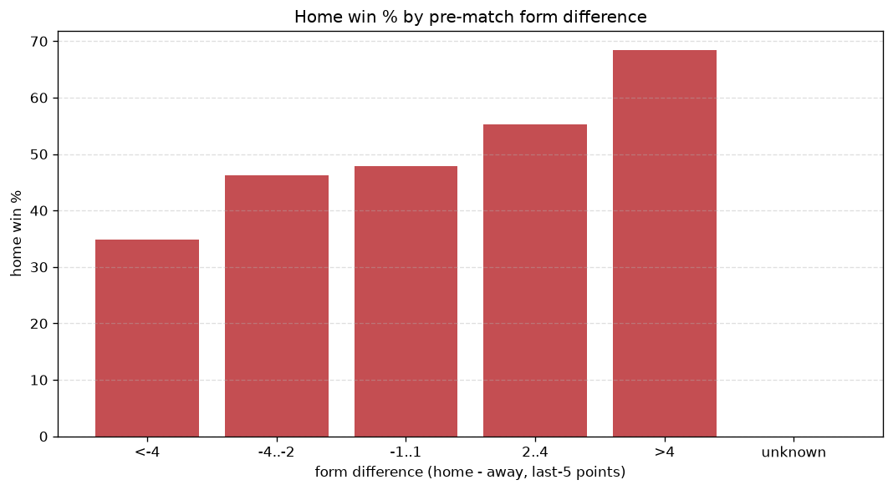
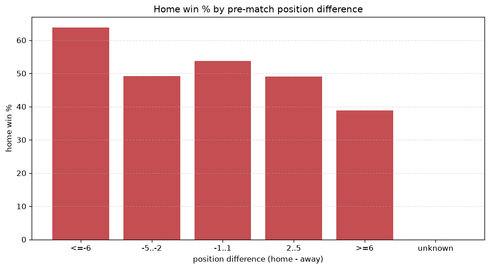

# Relationships Analysis
- Report: `relationships`
- Generated: 2026-10-30T04:12:27+00:00
- Script: `backend/scripts/analyze_relationships.py` v1.0.0
- League: Segunda RFEF - Group 4 (Spain)
- Scope: league `segunda4`

- Matches analysed: **1727** (23 leakage-safe pre-match features).

## 1. Correlation matrix
_Pearson correlation of each pre-match feature with observed goals; sorted by |corr(total goals)|._

| feature | corr(home) | corr(away) | corr(total) |
|---|---|---|---|
| away_position_before_match | 0.167 | -0.027 | 0.110 |
| position_difference | -0.207 | 0.102 | -0.092 |
| points_difference | 0.218 | -0.122 | 0.088 |
| away_team_away_win_rate | -0.100 | -0.015 | -0.086 |
| away_team_points_last_5 | -0.105 | 0.011 | -0.073 |
| away_team_away_conceded_avg | 0.117 | -0.034 | 0.067 |
| away_team_wins_last_5 | -0.093 | 0.012 | -0.063 |
| home_team_home_goals_avg | 0.119 | -0.047 | 0.060 |
| away_team_goals_conceded_last_5 | 0.143 | -0.076 | 0.060 |
| away_team_goals_scored_last_5 | -0.056 | -0.023 | -0.057 |
| home_team_goals_scored_last_5 | 0.114 | -0.051 | 0.054 |
| home_points_before_match | 0.117 | -0.060 | 0.050 |
| home_team_home_conceded_avg | -0.037 | 0.080 | 0.024 |
| rest_days_difference | -0.019 | -0.014 | -0.023 |
| away_team_away_goals_avg | -0.024 | -0.007 | -0.023 |
| home_team_wins_last_5 | 0.097 | -0.086 | 0.019 |
| home_team_points_last_5 | 0.108 | -0.101 | 0.018 |
| home_position_before_match | -0.120 | 0.116 | -0.017 |
| home_team_home_win_rate | 0.094 | -0.087 | 0.016 |
| home_rest_days | 0.011 | -0.029 | -0.010 |
| away_points_before_match | -0.029 | 0.021 | -0.008 |
| away_rest_days | 0.024 | -0.019 | 0.006 |
| home_team_goals_conceded_last_5 | -0.068 | 0.088 | 0.005 |

## 2. Form vs outcome
_Home win/draw/away % per bucket of `home_team_points_last_5 - away_team_points_last_5`._

| bucket | matches | home | draw | away | home % | draw % | away % |
|---|---|---|---|---|---|---|---|
| <-4 | 285 | 92 | 86 | 107 | 32.3% | 30.2% | 37.5% |
| -4..-2 | 355 | 142 | 109 | 104 | 40.0% | 30.7% | 29.3% |
| -1..1 | 502 | 231 | 137 | 134 | 46.0% | 27.3% | 26.7% |
| 2..4 | 381 | 183 | 114 | 84 | 48.0% | 29.9% | 22.0% |
| >4 | 204 | 131 | 42 | 31 | 64.2% | 20.6% | 15.2% |
| unknown | 0 | 0 | 0 | 0 | - | - | - |

## 3. Position vs outcome
_Home win/draw/away % per bucket of `position_difference` (home position - away position; negative favours the home team)._

| bucket | matches | home | draw | away | home % | draw % | away % |
|---|---|---|---|---|---|---|---|
| <=-6 | 391 | 230 | 92 | 69 | 58.8% | 23.5% | 17.6% |
| -5..-2 | 338 | 171 | 103 | 64 | 50.6% | 30.5% | 18.9% |
| -1..1 | 262 | 110 | 69 | 83 | 42.0% | 26.3% | 31.7% |
| 2..5 | 299 | 113 | 99 | 87 | 37.8% | 33.1% | 29.1% |
| >=6 | 437 | 155 | 125 | 157 | 35.5% | 28.6% | 35.9% |
| unknown | 0 | 0 | 0 | 0 | - | - | - |

## 4. Rest advantage
_Home win/draw/away % per bucket of `rest_days_difference` (home rest - away rest). Matches with unknown rest are bucketed separately._

| bucket | matches | home | draw | away | home % | draw % | away % |
|---|---|---|---|---|---|---|---|
| <-1 | 52 | 22 | 17 | 13 | 42.3% | 32.7% | 25.0% |
| -1..0 | 173 | 76 | 47 | 50 | 43.9% | 27.2% | 28.9% |
| 0 | 1206 | 542 | 349 | 315 | 44.9% | 28.9% | 26.1% |
| 1..2 | 180 | 92 | 44 | 44 | 51.1% | 24.4% | 24.4% |
| >2 | 59 | 26 | 14 | 19 | 44.1% | 23.7% | 32.2% |
| unknown | 57 | 21 | 17 | 19 | 36.8% | 29.8% | 33.3% |
- *57 match(es) had unknown rest difference (missing rest data on at least one side).*

## 5. Home team quality
_Home win rate by `home_team_home_win_rate` tier (split at 0.5)._

- `< 0.5` tier: **41.8%** home win (421/1008)
- `>= 0.5` tier: **49.8%** home win (358/719)
- Home-win gap (>= split minus < split): **+8.0 pp**

| tier | label | matches | home | draw | away | home % |
|---|---|---|---|---|---|---|
| low | < 0.5 | 1008 | 421 | 281 | 306 | 41.8% |
| high | >= 0.5 | 719 | 358 | 207 | 154 | 49.8% |

## 6. Feature averages by result
_Mean feature value per outcome; `range` is home-minus-away spread of the group means._

| feature | home mean | draw mean | away mean | range |
|---|---|---|---|---|
| points_difference | 2.142 | -1.176 | -3.333 | 5.475 |
| home_points_before_match | 23.077 | 20.273 | 19.213 | 3.864 |
| position_difference | -1.363 | 0.834 | 2.257 | 3.620 |
| home_position_before_match | 9.225 | 9.998 | 11.152 | 1.928 |
| away_position_before_match | 10.588 | 9.164 | 8.896 | 1.692 |
| away_points_before_match | 20.935 | 21.449 | 22.546 | 1.611 |
| home_team_points_last_5 | 6.380 | 5.980 | 5.315 | 1.065 |
| away_team_goals_conceded_last_5 | 5.252 | 4.553 | 4.276 | 0.976 |
| away_team_points_last_5 | 5.892 | 6.568 | 6.622 | 0.730 |
| home_team_goals_conceded_last_5 | 4.705 | 5.006 | 5.348 | 0.643 |
| home_team_goals_scored_last_5 | 4.979 | 4.824 | 4.400 | 0.579 |
| home_team_wins_last_5 | 1.679 | 1.580 | 1.357 | 0.323 |
| away_team_goals_scored_last_5 | 4.855 | 5.102 | 5.054 | 0.248 |
| away_team_wins_last_5 | 1.539 | 1.752 | 1.774 | 0.235 |
| away_team_away_conceded_avg | 1.221 | 1.125 | 1.049 | 0.172 |
| home_team_home_goals_avg | 1.206 | 1.149 | 1.049 | 0.158 |
| home_rest_days | 7.690 | 7.592 | 7.567 | 0.123 |
| away_rest_days | 7.619 | 7.622 | 7.501 | 0.120 |
| home_team_home_conceded_avg | 0.841 | 0.873 | 0.938 | 0.097 |
| rest_days_difference | 0.071 | -0.017 | 0.066 | 0.088 |
| home_team_home_win_rate | 0.432 | 0.406 | 0.355 | 0.078 |
| away_team_away_win_rate | 0.238 | 0.272 | 0.270 | 0.034 |
| away_team_away_goals_avg | 0.868 | 0.894 | 0.885 | 0.026 |

---
*All features are leakage-safe pre-match values built by `ml.features.build_features.build_rows` from strictly prior matches. Run with `python backend/scripts/analyze_relationships.py` to regenerate.*

## Charts

