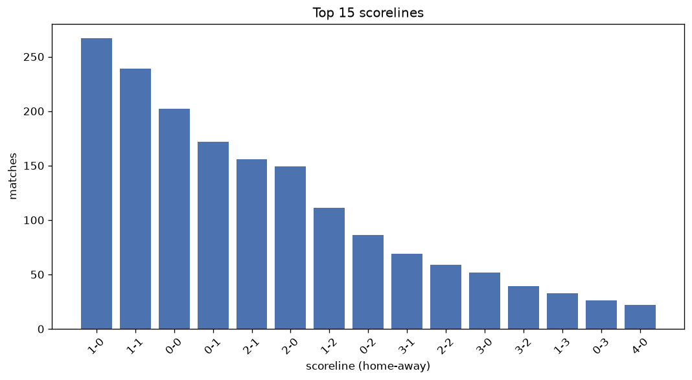
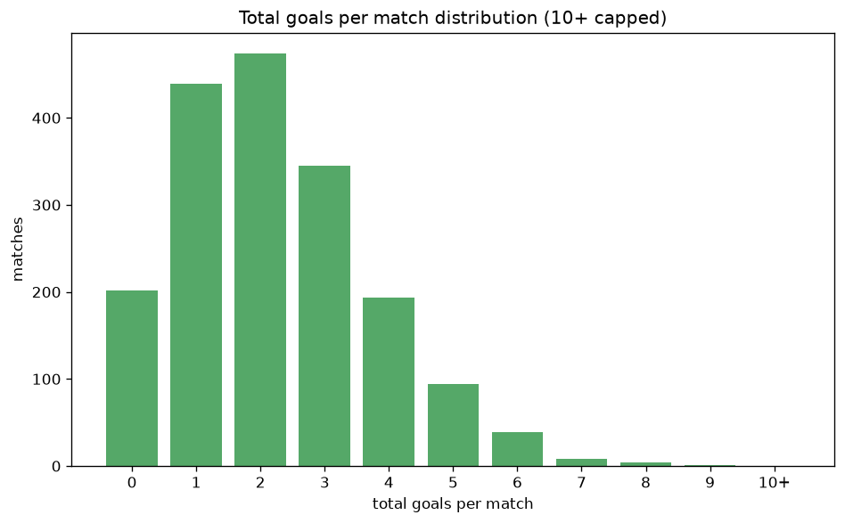

# Scoreline Analysis
- Report: `scoreline_analysis`
- Generated: 2026-10-27T02:30:18+00:00
- Script: `backend/scripts/analyze_scorelines.py` v1.0.0
- League: Segunda RFEF - Group 4 (Spain)
- Scope: league `segunda4`

## 1. Scoreline frequency
- Matches analysed: **1799** across **7** seasons.
- Distinct scorelines seen: **35**.

| scoreline | count | pct |
|---|---|---|
| 1-0 | 267 | 14.8% |
| 1-1 | 239 | 13.3% |
| 0-0 | 202 | 11.2% |
| 0-1 | 172 | 9.6% |
| 2-1 | 156 | 8.7% |
| 2-0 | 149 | 8.3% |
| 1-2 | 111 | 6.2% |
| 0-2 | 86 | 4.8% |
| 3-1 | 69 | 3.8% |
| 2-2 | 59 | 3.3% |
| 3-0 | 52 | 2.9% |
| 3-2 | 39 | 2.2% |
| 1-3 | 33 | 1.8% |
| 0-3 | 26 | 1.4% |
| 4-0 | 22 | 1.2% |
| 4-1 | 21 | 1.2% |
| 2-3 | 18 | 1.0% |
| 4-2 | 13 | 0.7% |
| 0-4 | 10 | 0.6% |
| 3-3 | 10 | 0.6% |

## 2. Scoreline frequency per season

### 2020-2021
| scoreline | count | pct |
|---|---|---|
| 1-1 | 25 | 13.9% |
| 0-0 | 24 | 13.3% |
| 1-0 | 19 | 10.6% |
| 0-1 | 18 | 10.0% |
| 2-0 | 16 | 8.9% |

### 2021-2022
| scoreline | count | pct |
|---|---|---|
| 1-0 | 41 | 13.4% |
| 2-0 | 34 | 11.1% |
| 1-1 | 34 | 11.1% |
| 0-0 | 30 | 9.8% |
| 0-1 | 28 | 9.2% |

### 2022-2023
| scoreline | count | pct |
|---|---|---|
| 1-0 | 45 | 14.7% |
| 1-1 | 41 | 13.4% |
| 0-0 | 33 | 10.8% |
| 0-1 | 32 | 10.5% |
| 2-0 | 26 | 8.5% |

### 2023-2024
| scoreline | count | pct |
|---|---|---|
| 0-0 | 46 | 15.0% |
| 1-1 | 46 | 15.0% |
| 1-0 | 46 | 15.0% |
| 2-0 | 27 | 8.8% |
| 2-1 | 25 | 8.2% |

### 2024-2025
| scoreline | count | pct |
|---|---|---|
| 1-0 | 47 | 15.4% |
| 0-1 | 44 | 14.4% |
| 1-1 | 39 | 12.7% |
| 0-0 | 33 | 10.8% |
| 2-1 | 30 | 9.8% |

### 2025-2026
| scoreline | count | pct |
|---|---|---|
| 1-0 | 59 | 18.3% |
| 1-1 | 47 | 14.6% |
| 2-1 | 38 | 11.8% |
| 0-0 | 28 | 8.7% |
| 1-2 | 24 | 7.4% |

### 2026-2027
| scoreline | count | pct |
|---|---|---|
| 1-0 | 10 | 13.9% |
| 0-0 | 8 | 11.1% |
| 1-1 | 7 | 9.7% |
| 0-1 | 6 | 8.3% |
| 2-1 | 5 | 6.9% |

## 3. Total-goal histogram
_10+ groups all matches with 10 or more total goals._

| total goals | matches | pct |
|---|---|---|
| 0 | 202 | 11.2% |
| 1 | 439 | 24.4% |
| 2 | 474 | 26.3% |
| 3 | 345 | 19.2% |
| 4 | 193 | 10.7% |
| 5 | 94 | 5.2% |
| 6 | 39 | 2.2% |
| 7 | 8 | 0.4% |
| 8 | 4 | 0.2% |
| 9 | 1 | 0.1% |
| 10+ | 0 | 0.0% |

## 4. Extreme scorelines
- Matches with 7+ total goals: **13**

| season | date | scoreline | total goals |
|---|---|---|---|
| 2023-2024 | 2024-05-05 | 9-0 | 9 |
| 2021-2022 | 2022-05-15 | 1-7 | 8 |
| 2022-2023 | 2022-11-27 | 5-3 | 8 |
| 2023-2024 | 2024-04-28 | 2-6 | 8 |
| 2026-2027 | 2026-09-27 | 6-2 | 8 |
| 2021-2022 | 2021-09-05 | 3-4 | 7 |
| 2021-2022 | 2021-10-24 | 5-2 | 7 |
| 2021-2022 | 2021-10-24 | 6-1 | 7 |
| 2022-2023 | 2022-11-27 | 4-3 | 7 |
| 2022-2023 | 2022-12-18 | 6-1 | 7 |
| 2023-2024 | 2023-11-11 | 5-2 | 7 |
| 2024-2025 | 2024-10-26 | 4-3 | 7 |
| 2025-2026 | 2026-04-26 | 3-4 | 7 |

## 5. Margin-of-victory distribution (decided matches)
- Decided matches: **1289** (draws: **510**)
- Average winning margin: **1.59**

| margin | matches | pct |
|---|---|---|
| 1 | 767 | 59.5% |
| 2 | 358 | 27.8% |
| 3+ | 164 | 12.7% |

## 6. Margin by outcome

### Home wins
- Matches: **813** | avg margin: **1.65** | max margin: **9**
| margin | matches | pct |
|---|---|---|
| 1 | 464 | 57.1% |
| 2 | 232 | 28.5% |
| 3+ | 117 | 14.4% |
- *Full match-by-match list available in `scoreline_analysis.json`.*

### Away wins
- Matches: **476** | avg margin: **1.49** | max margin: **6**
| margin | matches | pct |
|---|---|---|
| 1 | 303 | 63.7% |
| 2 | 126 | 26.5% |
| 3+ | 47 | 9.9% |
- *Full match-by-match list available in `scoreline_analysis.json`.*

## 7. Most common exact score by outcome type
| outcome | matches | most common score | count | pct |
|---|---|---|---|---|
| home | 813 | 1-0 | 267 | 32.8% |
| draw | 510 | 1-1 | 239 | 46.9% |
| away | 476 | 0-1 | 172 | 36.1% |

---
*All statistics are computed from PostgreSQL tables (read-only). Run with `python backend/scripts/analyze_scorelines.py` to regenerate.*

## Charts

