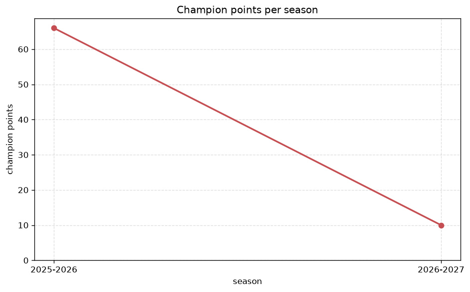
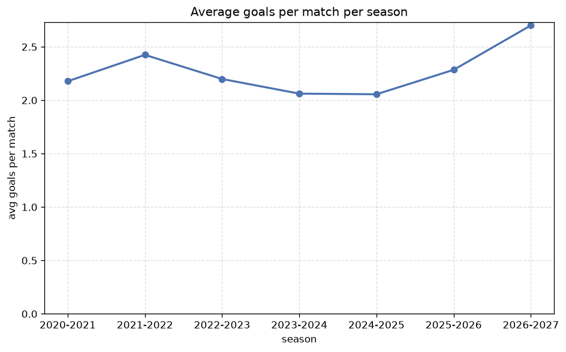

# Season Trends Analysis
- Report: `season_trends`
- Generated: 2026-10-30T04:12:25+00:00
- Script: `backend/scripts/analyze_seasons.py` v1.0.0
- League: Segunda RFEF - Group 4 (Spain)
- Scope: league `segunda4`

## 1. Champions per season
| season | champion | pts | runner-up | margin |
|---|---|---|---|---|
| 2020-2021 | UCAM Murcia | 33 | Linares | 0 pts |
| 2021-2022 | Cordoba | 82 | Merida AD | 20 pts |
| 2022-2023 | Antequera | 73 | Recreativo Huelva | 10 pts |
| 2023-2024 | Sevilla FC B | 66 | Yeclano | 6 pts |
| 2024-2025 | Torremolinos | 68 | La Union | 1 pts |
| 2025-2026 | Deportiva Minera | 66 | CD Extremadura | 0 pts |
| 2026-2027 | Recreativo Huelva | 17 | Betis B | 2 pts |

## 2. Title-race tightness
- Tight races (margin <= 3 pts): **4** of 7 seasons
- Tightest race: **2020-2021** - UCAM Murcia beat Linares by **0** pts

| season | margin | tight |
|---|---|---|
| 2020-2021 | 0 pts | yes |
| 2021-2022 | 20 pts |  |
| 2022-2023 | 10 pts |  |
| 2023-2024 | 6 pts |  |
| 2024-2025 | 1 pts | yes |
| 2025-2026 | 0 pts | yes |
| 2026-2027 | 2 pts | yes |

## 3. Points thresholds
_Position-specific points per season. Key: 1 = champion, 2 = runner-up, 4 = CL line, 6 = Europa, 15 = last safe, 18 = bottom._

| season | pos 1 | pos 2 | pos 4 | pos 6 | pos 15 | pos 18 |
|---|---|---|---|---|---|---|
| 2020-2021 | 33 | 33 | 31 | 30 | 20 | 11 |
| 2021-2022 | 82 | 62 | 54 | 52 | 31 | 25 |
| 2022-2023 | 73 | 63 | 58 | 52 | 39 | 19 |
| 2023-2024 | 66 | 60 | 54 | 49 | 36 | 23 |
| 2024-2025 | 68 | 67 | 59 | 52 | 36 | 26 |
| 2025-2026 | 66 | 66 | 62 | 60 | 37 | 21 |
| 2026-2027 | 17 | 15 | 15 | 13 | 6 | 3 |

## 4. Relegation battle
| season | safe pos | safe pts | drop pos | drop pts | gap |
|---|---|---|---|---|---|
| 2020-2021 | 15 | 20 | 16 | 19 | 1 pts |
| 2021-2022 | 15 | 31 | 16 | 29 | 2 pts |
| 2022-2023 | 15 | 39 | 16 | 34 | 5 pts |
| 2023-2024 | 15 | 36 | 16 | 36 | 0 pts |
| 2024-2025 | 15 | 36 | 16 | 35 | 1 pts |
| 2025-2026 | 15 | 37 | 16 | 37 | 0 pts |
| 2026-2027 | 15 | 6 | 16 | 6 | 0 pts |

## 5. League-level trends
| season | matches | total goals | avg goals | home win | draw | away win | goalless | avg pts/team |
|---|---|---|---|---|---|---|---|---|
| 2020-2021 | 180 | 392 | 2.178 | 36.1% | 32.8% | 31.1% | 13.3% | 24.05 |
| 2021-2022 | 306 | 742 | 2.425 | 47.4% | 27.5% | 25.2% | 9.8% | 46.33 |
| 2022-2023 | 306 | 673 | 2.199 | 44.4% | 26.5% | 29.1% | 10.8% | 46.5 |
| 2023-2024 | 306 | 631 | 2.062 | 46.1% | 31.4% | 22.5% | 15.0% | 45.67 |
| 2024-2025 | 306 | 629 | 2.056 | 42.5% | 27.5% | 30.1% | 10.8% | 46.33 |
| 2025-2026 | 323 | 738 | 2.285 | 50.2% | 26.0% | 23.8% | 8.7% | 46.58 |
| 2026-2027 | 72 | 190 | 2.639 | 47.2% | 30.6% | 22.2% | 11.1% | 10.78 |

## 6. View divergence
- Largest divergence: **2020-2021** (goals view, avg abs position diff = 8.900)

_Avg absolute position difference between classic view and alternative view per season._

| season | classic vs luck | classic vs goals |
|---|---|---|
| 2020-2021 | 2.100 | 8.900 |
| 2021-2022 | 1.778 | 7.000 |
| 2022-2023 | 1.778 | 6.556 |
| 2023-2024 | 4.444 | 5.889 |
| 2024-2025 | 2.444 | 6.889 |
| 2025-2026 | 2.211 | 6.632 |
| 2026-2027 | 2.444 | 5.778 |

---
*All statistics are computed from PostgreSQL tables (read-only). Run with `python backend/scripts/analyze_seasons.py` to regenerate.*

## Charts

