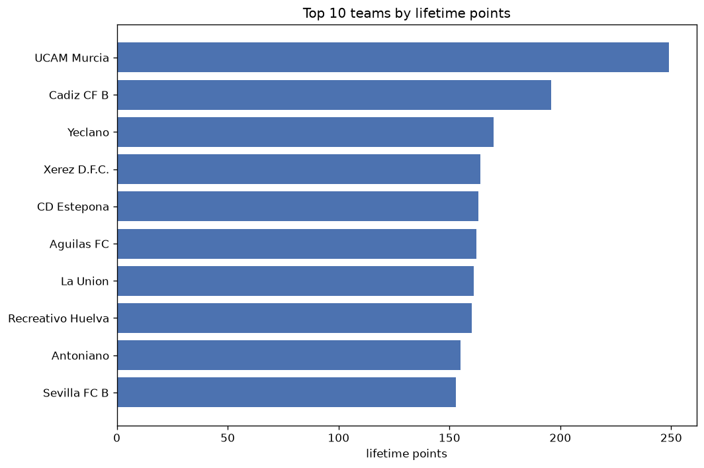
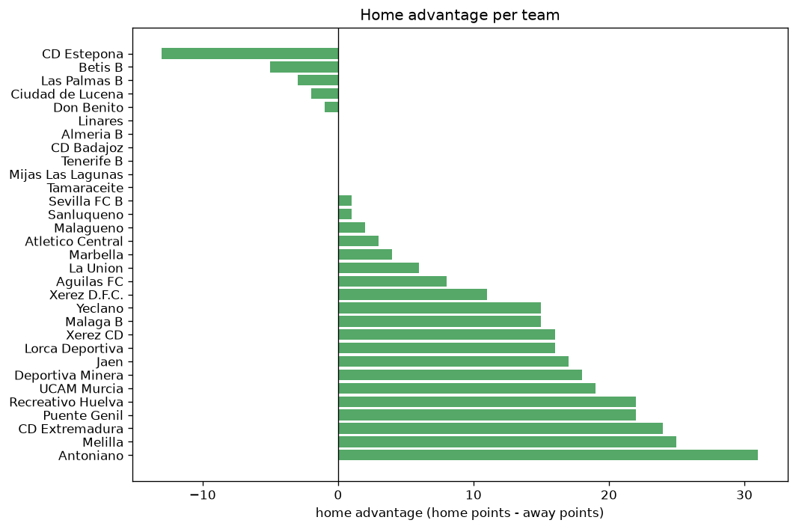

# Team Analysis
- Report: `teams_analysis`
- Generated: 2026-10-29T02:15:02+00:00
- Script: `backend/scripts/analyze_teams.py` v1.0.0
- League: Segunda RFEF - Group 4 (Spain)
- Scope: league `segunda4`

- Teams: **59** | Seasons: **7** | Matches: **1799**

## 1. Team standings (lifetime)
| team | seasons | played | W | D | L | pts | GF | GA | GD | avg pts/season | best pos | worst pos | titles |
|---|---|---|---|---|---|---|---|---|---|---|---|---|---|
| UCAM Murcia | 5 | 155 | 67 | 48 | 40 | 249 | 205 | 141 | 64 | 49.8 | 1 | 8 | 1 |
| Cadiz CF B | 5 | 154 | 50 | 46 | 58 | 196 | 164 | 194 | -30 | 39.2 | 8 | 15 | 0 |
| Yeclano | 4 | 121 | 45 | 35 | 41 | 170 | 125 | 118 | 7 | 42.5 | 2 | 18 | 0 |
| Xerez D.F.C. | 4 | 137 | 40 | 44 | 53 | 164 | 122 | 158 | -36 | 41.0 | 10 | 16 | 0 |
| CD Estepona | 4 | 111 | 43 | 34 | 34 | 163 | 132 | 108 | 24 | 40.75 | 5 | 12 | 0 |
| Aguilas FC | 3 | 103 | 42 | 36 | 25 | 162 | 106 | 72 | 34 | 54.0 | 3 | 8 | 0 |
| La Union | 3 | 103 | 49 | 14 | 40 | 161 | 121 | 99 | 22 | 53.67 | 2 | 10 | 0 |
| Recreativo Huelva | 4 | 95 | 44 | 28 | 23 | 160 | 128 | 83 | 45 | 40.0 | 1 | 15 | 1 |
| Antoniano | 4 | 111 | 42 | 29 | 40 | 155 | 119 | 130 | -11 | 38.75 | 4 | 18 | 0 |
| Sevilla FC B | 4 | 94 | 42 | 27 | 25 | 153 | 129 | 82 | 47 | 38.25 | 1 | 8 | 1 |
| Betis B | 4 | 94 | 35 | 37 | 22 | 142 | 113 | 83 | 30 | 35.5 | 2 | 12 | 0 |
| Linares | 4 | 95 | 37 | 30 | 28 | 141 | 110 | 105 | 5 | 35.25 | 2 | 9 | 0 |
| San Roque | 3 | 102 | 35 | 30 | 37 | 135 | 108 | 97 | 11 | 45.0 | 6 | 15 | 0 |
| Xerez CD | 3 | 77 | 35 | 18 | 24 | 123 | 72 | 56 | 16 | 41.0 | 4 | 13 | 0 |
| Velez | 3 | 102 | 33 | 23 | 46 | 122 | 111 | 155 | -44 | 40.67 | 11 | 17 | 0 |
| Antequera | 2 | 68 | 33 | 18 | 17 | 117 | 94 | 61 | 33 | 58.5 | 1 | 12 | 1 |
| Linense | 3 | 86 | 29 | 25 | 32 | 112 | 79 | 87 | -8 | 37.33 | 8 | 14 | 0 |
| Cordoba | 2 | 52 | 32 | 13 | 7 | 109 | 107 | 45 | 62 | 54.5 | 1 | 9 | 1 |
| Deportiva Minera | 2 | 69 | 31 | 15 | 23 | 108 | 89 | 77 | 12 | 54.0 | 1 | 11 | 1 |
| Granada CF B | 3 | 86 | 30 | 18 | 38 | 108 | 96 | 106 | -10 | 36.0 | 3 | 18 | 0 |
| Torremolinos | 2 | 68 | 27 | 21 | 20 | 102 | 83 | 66 | 17 | 51.0 | 1 | 16 | 1 |
| Sanluqueno | 3 | 60 | 27 | 18 | 15 | 99 | 79 | 62 | 17 | 33.0 | 4 | 11 | 0 |
| Orihuela | 2 | 68 | 26 | 19 | 23 | 97 | 67 | 64 | 3 | 48.5 | 4 | 10 | 0 |
| San Fernando | 3 | 86 | 24 | 23 | 39 | 95 | 79 | 105 | -26 | 31.67 | 4 | 16 | 0 |
| Villanovense | 2 | 68 | 23 | 19 | 26 | 88 | 72 | 67 | 5 | 44.0 | 7 | 13 | 0 |
| Racing Cartagena MM | 2 | 68 | 21 | 22 | 25 | 85 | 52 | 64 | -12 | 42.5 | 10 | 14 | 0 |
| Don Benito | 3 | 76 | 20 | 21 | 35 | 81 | 87 | 104 | -17 | 27.0 | 5 | 17 | 0 |
| Marbella | 3 | 60 | 21 | 17 | 22 | 80 | 67 | 61 | 6 | 26.67 | 3 | 17 | 0 |
| Almeria B | 2 | 69 | 20 | 16 | 33 | 76 | 65 | 89 | -24 | 38.0 | 7 | 17 | 0 |
| FC Cartagena SAD B | 2 | 68 | 16 | 20 | 32 | 68 | 63 | 93 | -30 | 34.0 | 9 | 18 | 0 |
| CD Extremadura | 1 | 35 | 18 | 12 | 5 | 66 | 57 | 40 | 17 | 66.0 | 2 | 2 | 0 |
| Merida AD | 1 | 34 | 18 | 8 | 8 | 62 | 49 | 26 | 23 | 62.0 | 2 | 2 | 0 |
| Jaen | 1 | 35 | 17 | 10 | 8 | 61 | 46 | 33 | 13 | 61.0 | 5 | 5 | 0 |
| Cacereno | 1 | 34 | 17 | 10 | 7 | 61 | 48 | 37 | 11 | 61.0 | 3 | 3 | 0 |
| El Ejido | 2 | 52 | 15 | 13 | 24 | 58 | 51 | 62 | -11 | 29.0 | 15 | 16 | 0 |
| Tamaraceite | 3 | 60 | 14 | 16 | 30 | 58 | 62 | 94 | -32 | 19.33 | 10 | 17 | 0 |
| Lorca Deportiva | 2 | 53 | 14 | 15 | 24 | 57 | 49 | 70 | -21 | 28.5 | 10 | 20 | 0 |
| Las Palmas B | 3 | 60 | 12 | 21 | 27 | 57 | 58 | 92 | -34 | 19.0 | 14 | 17 | 0 |
| Ceuta | 1 | 34 | 14 | 12 | 8 | 54 | 46 | 32 | 14 | 54.0 | 4 | 4 | 0 |
| CD Coria | 1 | 34 | 15 | 8 | 11 | 53 | 42 | 40 | 2 | 53.0 | 5 | 5 | 0 |
| Puente Genil | 2 | 43 | 13 | 13 | 17 | 52 | 36 | 43 | -7 | 26.0 | 10 | 14 | 0 |
| Montijo | 1 | 34 | 13 | 8 | 13 | 47 | 37 | 38 | -1 | 47.0 | 9 | 9 | 0 |
| Ciudad Real | 1 | 34 | 9 | 14 | 11 | 41 | 29 | 36 | -7 | 41.0 | 13 | 13 | 0 |
| Melilla | 1 | 35 | 8 | 13 | 14 | 37 | 38 | 41 | -3 | 37.0 | 15 | 15 | 0 |
| El Palo | 1 | 34 | 8 | 12 | 14 | 36 | 26 | 36 | -10 | 36.0 | 16 | 16 | 0 |
| Mensajero | 1 | 34 | 7 | 14 | 13 | 35 | 35 | 47 | -12 | 35.0 | 14 | 14 | 0 |
| Algeciras | 1 | 18 | 9 | 5 | 4 | 32 | 21 | 17 | 4 | 32.0 | 3 | 3 | 0 |
| Mancha | 1 | 34 | 8 | 7 | 19 | 31 | 26 | 48 | -22 | 31.0 | 17 | 17 | 0 |
| Murcia | 1 | 18 | 6 | 7 | 5 | 25 | 22 | 21 | 1 | 25.0 | 11 | 11 | 0 |
| Panaderia | 1 | 34 | 5 | 10 | 19 | 25 | 32 | 61 | -29 | 25.0 | 18 | 18 | 0 |
| Malaga B | 1 | 34 | 5 | 6 | 23 | 21 | 32 | 66 | -34 | 21.0 | 18 | 18 | 0 |
| CD Utrera | 1 | 34 | 5 | 4 | 25 | 19 | 27 | 67 | -40 | 19.0 | 18 | 18 | 0 |
| Ciudad de Lucena | 1 | 8 | 4 | 3 | 1 | 15 | 14 | 8 | 6 | 15.0 | 3 | 3 | 0 |
| CD Badajoz | 1 | 8 | 4 | 3 | 1 | 15 | 8 | 5 | 3 | 15.0 | 4 | 4 | 0 |
| Mijas Las Lagunas | 1 | 8 | 3 | 4 | 1 | 13 | 17 | 13 | 4 | 13.0 | 6 | 6 | 0 |
| Tenerife B | 1 | 8 | 3 | 1 | 4 | 10 | 11 | 13 | -2 | 10.0 | 12 | 12 | 0 |
| CD Marino | 1 | 18 | 2 | 4 | 12 | 10 | 11 | 33 | -22 | 10.0 | 19 | 19 | 0 |
| Atletico Central | 1 | 8 | 3 | 0 | 5 | 9 | 11 | 15 | -4 | 9.0 | 14 | 14 | 0 |
| Malagueno | 1 | 17 | 1 | 3 | 13 | 6 | 10 | 29 | -19 | 6.0 | 19 | 19 | 0 |

## 2. Home vs away split
| team | home P | H-W | H-D | H-L | H-pts | away P | A-W | A-D | A-L | A-pts | adv |
|---|---|---|---|---|---|---|---|---|---|---|---|
| UCAM Murcia | 77 | 44 | 26 | 7 | 158 | 78 | 23 | 22 | 33 | 91 | 67 |
| Antoniano | 56 | 31 | 15 | 10 | 108 | 55 | 11 | 14 | 30 | 47 | 61 |
| Recreativo Huelva | 48 | 32 | 8 | 8 | 104 | 47 | 12 | 20 | 15 | 56 | 48 |
| Xerez D.F.C. | 69 | 26 | 25 | 18 | 103 | 68 | 14 | 19 | 35 | 61 | 42 |
| Velez | 51 | 22 | 14 | 15 | 80 | 51 | 11 | 9 | 31 | 42 | 38 |
| Sevilla FC B | 47 | 27 | 14 | 6 | 95 | 47 | 15 | 13 | 19 | 58 | 37 |
| Cadiz CF B | 77 | 32 | 20 | 25 | 116 | 77 | 18 | 26 | 33 | 80 | 36 |
| Yeclano | 60 | 28 | 16 | 16 | 100 | 61 | 17 | 19 | 25 | 70 | 30 |
| Aguilas FC | 51 | 27 | 15 | 9 | 96 | 52 | 15 | 21 | 16 | 66 | 30 |
| San Roque | 51 | 22 | 16 | 13 | 82 | 51 | 13 | 14 | 24 | 53 | 29 |
| Racing Cartagena MM | 34 | 15 | 12 | 7 | 57 | 34 | 6 | 10 | 18 | 28 | 29 |
| Villanovense | 34 | 16 | 10 | 8 | 58 | 34 | 7 | 9 | 18 | 30 | 28 |
| Betis B | 46 | 23 | 15 | 8 | 84 | 48 | 12 | 22 | 14 | 58 | 26 |
| Tamaraceite | 30 | 12 | 6 | 12 | 42 | 30 | 2 | 10 | 18 | 16 | 26 |
| Linares | 48 | 23 | 14 | 11 | 83 | 47 | 14 | 16 | 17 | 58 | 25 |
| Xerez CD | 40 | 22 | 8 | 10 | 74 | 37 | 13 | 10 | 14 | 49 | 25 |
| Sanluqueno | 30 | 18 | 8 | 4 | 62 | 30 | 9 | 10 | 11 | 37 | 25 |
| San Fernando | 43 | 16 | 12 | 15 | 60 | 43 | 8 | 11 | 24 | 35 | 25 |
| Melilla | 18 | 8 | 7 | 3 | 31 | 17 | 0 | 6 | 11 | 6 | 25 |
| Deportiva Minera | 34 | 19 | 9 | 6 | 66 | 35 | 12 | 6 | 17 | 42 | 24 |
| CD Extremadura | 18 | 14 | 3 | 1 | 45 | 17 | 4 | 9 | 4 | 21 | 24 |
| Puente Genil | 22 | 9 | 11 | 2 | 38 | 21 | 4 | 2 | 15 | 14 | 24 |
| La Union | 51 | 28 | 8 | 15 | 92 | 52 | 21 | 6 | 25 | 69 | 23 |
| Marbella | 30 | 13 | 10 | 7 | 49 | 30 | 8 | 7 | 15 | 31 | 18 |
| Cordoba | 26 | 20 | 3 | 3 | 63 | 26 | 12 | 10 | 4 | 46 | 17 |
| Don Benito | 38 | 12 | 13 | 13 | 49 | 38 | 8 | 8 | 22 | 32 | 17 |
| Jaen | 18 | 12 | 3 | 3 | 39 | 17 | 5 | 7 | 5 | 22 | 17 |
| Montijo | 17 | 9 | 5 | 3 | 32 | 17 | 4 | 3 | 10 | 15 | 17 |
| FC Cartagena SAD B | 34 | 10 | 12 | 12 | 42 | 34 | 6 | 8 | 20 | 26 | 16 |
| Malaga B | 17 | 5 | 3 | 9 | 18 | 17 | 0 | 3 | 14 | 3 | 15 |
| CD Utrera | 17 | 5 | 2 | 10 | 17 | 17 | 0 | 2 | 15 | 2 | 15 |
| Lorca Deportiva | 27 | 9 | 8 | 10 | 35 | 26 | 5 | 7 | 14 | 22 | 13 |
| Mensajero | 17 | 6 | 6 | 5 | 24 | 17 | 1 | 8 | 8 | 11 | 13 |
| Antequera | 34 | 18 | 9 | 7 | 63 | 34 | 15 | 9 | 10 | 54 | 9 |
| Orihuela | 34 | 15 | 8 | 11 | 53 | 34 | 11 | 11 | 12 | 44 | 9 |
| Cacereno | 17 | 10 | 5 | 2 | 35 | 17 | 7 | 5 | 5 | 26 | 9 |
| Las Palmas B | 30 | 7 | 12 | 11 | 33 | 30 | 5 | 9 | 16 | 24 | 9 |
| CD Coria | 17 | 9 | 4 | 4 | 31 | 17 | 6 | 4 | 7 | 22 | 9 |
| Ciudad Real | 17 | 6 | 7 | 4 | 25 | 17 | 3 | 7 | 7 | 16 | 9 |
| Atletico Central | 4 | 3 | 0 | 1 | 9 | 4 | 0 | 0 | 4 | 0 | 9 |
| Granada CF B | 43 | 16 | 10 | 17 | 58 | 43 | 14 | 8 | 21 | 50 | 8 |
| Almeria B | 34 | 12 | 6 | 16 | 42 | 35 | 8 | 10 | 17 | 34 | 8 |
| Ceuta | 17 | 8 | 7 | 2 | 31 | 17 | 6 | 5 | 6 | 23 | 8 |
| Mancha | 17 | 5 | 4 | 8 | 19 | 17 | 3 | 3 | 11 | 12 | 7 |
| Linense | 43 | 14 | 16 | 13 | 58 | 43 | 15 | 9 | 19 | 54 | 4 |
| CD Marino | 9 | 1 | 4 | 4 | 7 | 9 | 1 | 0 | 8 | 3 | 4 |
| CD Badajoz | 4 | 3 | 0 | 1 | 9 | 4 | 1 | 3 | 0 | 6 | 3 |
| Mijas Las Lagunas | 4 | 2 | 2 | 0 | 8 | 4 | 1 | 2 | 1 | 5 | 3 |
| El Palo | 17 | 4 | 7 | 6 | 19 | 17 | 4 | 5 | 8 | 17 | 2 |
| Algeciras | 9 | 5 | 2 | 2 | 17 | 9 | 4 | 3 | 2 | 15 | 2 |
| Tenerife B | 3 | 2 | 0 | 1 | 6 | 5 | 1 | 1 | 3 | 4 | 2 |
| Malagueno | 8 | 1 | 1 | 6 | 4 | 9 | 0 | 2 | 7 | 2 | 2 |
| Panaderia | 17 | 2 | 7 | 8 | 13 | 17 | 3 | 3 | 11 | 12 | 1 |
| Torremolinos | 34 | 14 | 9 | 11 | 51 | 34 | 13 | 12 | 9 | 51 | 0 |
| Merida AD | 17 | 9 | 4 | 4 | 31 | 17 | 9 | 4 | 4 | 31 | 0 |
| Murcia | 9 | 3 | 3 | 3 | 12 | 9 | 3 | 4 | 2 | 13 | -1 |
| CD Estepona | 56 | 20 | 20 | 16 | 80 | 55 | 23 | 14 | 18 | 83 | -3 |
| Ciudad de Lucena | 3 | 2 | 0 | 1 | 6 | 5 | 2 | 3 | 0 | 9 | -3 |
| El Ejido | 26 | 7 | 6 | 13 | 27 | 26 | 8 | 7 | 11 | 31 | -4 |

## 3. Top performers
### Best points per game (PPG)
| rank | team | PPG |
|---|---|---|
| 1 | Cordoba | 2.10 |
| 2 | CD Extremadura | 1.89 |
| 3 | Ciudad de Lucena | 1.88 |
| 4 | CD Badajoz | 1.88 |
| 5 | Merida AD | 1.82 |

### Most goals scored
| rank | team | goals |
|---|---|---|
| 1 | UCAM Murcia | 205 |
| 2 | Cadiz CF B | 164 |
| 3 | CD Estepona | 132 |
| 4 | Sevilla FC B | 129 |
| 5 | Recreativo Huelva | 128 |

### Best goal difference
| rank | team | GD |
|---|---|---|
| 1 | UCAM Murcia | 64 |
| 2 | Cordoba | 62 |
| 3 | Sevilla FC B | 47 |
| 4 | Recreativo Huelva | 45 |
| 5 | Aguilas FC | 34 |

### Best defence (goals against per match, standings)
| rank | team | GA/match |
|---|---|---|
| 1 | CD Badajoz | 0.625 |
| 2 | Aguilas FC | 0.699 |
| 3 | Xerez CD | 0.727 |
| 4 | Merida AD | 0.765 |
| 5 | Cordoba | 0.865 |

## 4. Team consistency
- Teams present in all **7** seasons: **0**

## 5. Head-to-head dominance
- Distinct fixtures: **738** (showing the 15 most frequent)

| fixture | meetings | home wins | draws | away wins | home pct | draw pct | away pct |
|---|---|---|---|---|---|---|---|
| UCAM Murcia vs Yeclano | 8 | 3 | 4 | 1 | 37.5% | 50.0% | 12.5% |
| Aguilas FC vs CD Estepona | 6 | 5 | 1 | 0 | 83.3% | 16.7% | 0.0% |
| San Roque vs Velez | 6 | 5 | 0 | 1 | 83.3% | 0.0% | 16.7% |
| Sevilla FC B vs Yeclano | 6 | 5 | 1 | 0 | 83.3% | 16.7% | 0.0% |
| UCAM Murcia vs CD Estepona | 6 | 5 | 1 | 0 | 83.3% | 16.7% | 0.0% |
| Aguilas FC vs Antoniano | 6 | 4 | 1 | 1 | 66.7% | 16.7% | 16.7% |
| Linares vs UCAM Murcia | 6 | 4 | 2 | 0 | 66.7% | 33.3% | 0.0% |
| UCAM Murcia vs Antoniano | 6 | 4 | 2 | 0 | 66.7% | 33.3% | 0.0% |
| UCAM Murcia vs La Union | 6 | 4 | 0 | 2 | 66.7% | 0.0% | 33.3% |
| Aguilas FC vs La Union | 6 | 3 | 1 | 2 | 50.0% | 16.7% | 33.3% |
| UCAM Murcia vs Aguilas FC | 6 | 3 | 2 | 1 | 50.0% | 33.3% | 16.7% |
| UCAM Murcia vs Betis B | 6 | 3 | 3 | 0 | 50.0% | 50.0% | 0.0% |
| UCAM Murcia vs Cadiz CF B | 6 | 3 | 1 | 2 | 50.0% | 16.7% | 33.3% |
| UCAM Murcia vs Granada CF B | 6 | 3 | 1 | 2 | 50.0% | 16.7% | 33.3% |
| UCAM Murcia vs Xerez D.F.C. | 6 | 3 | 0 | 3 | 50.0% | 0.0% | 50.0% |

## 6. Position per season (classic view)
_Cells show final position; '-' when the team was absent from that season._

| team | 2020-2021 | 2021-2022 | 2022-2023 | 2023-2024 | 2024-2025 | 2025-2026 | 2026-2027 |
|---|---|---|---|---|---|---|---|
| UCAM Murcia | 1 | - | 5 | 8 | 3 | 7 | - |
| Cadiz CF B | 12 | 8 | 11 | 12 | 15 | - | - |
| Yeclano | 18 | - | 6 | 2 | - | 11 | - |
| Xerez D.F.C. | - | 10 | 14 | - | 12 | 16 | - |
| CD Estepona | - | - | - | 6 | 5 | 12 | 8 |
| Aguilas FC | - | - | - | 7 | 8 | 3 | - |
| La Union | - | - | - | 10 | 2 | 8 | - |
| Recreativo Huelva | 15 | - | 2 | - | - | 6 | 1 |
| Antoniano | - | - | - | 11 | 4 | 13 | 18 |
| Sevilla FC B | 6 | - | 8 | 1 | - | - | 7 |
| Betis B | 7 | - | 12 | 5 | - | - | 2 |
| Linares | 2 | - | - | - | 9 | 9 | 9 |
| San Roque | - | 6 | 7 | 15 | - | - | - |
| Xerez CD | - | - | - | - | 6 | 4 | 13 |
| Velez | - | 11 | 13 | 17 | - | - | - |
| Antequera | - | 12 | 1 | - | - | - | - |
| Linense | 8 | - | - | 9 | 14 | - | - |
| Cordoba | 9 | 1 | - | - | - | - | - |
| Deportiva Minera | - | - | - | - | 11 | 1 | - |
| Granada CF B | 13 | - | 3 | - | 18 | - | - |
| Torremolinos | - | - | 16 | - | 1 | - | - |
| Sanluqueno | 5 | - | 4 | - | - | - | 11 |
| Orihuela | - | - | - | 4 | 10 | - | - |
| San Fernando | 4 | 16 | - | - | 16 | - | - |
| Villanovense | - | 7 | - | - | 13 | - | - |
| Racing Cartagena MM | - | - | 10 | 14 | - | - | - |
| Don Benito | - | 13 | - | - | 17 | - | 5 |
| Marbella | 17 | - | - | 3 | - | - | 15 |
| Almeria B | - | - | - | - | 7 | 17 | - |
| FC Cartagena SAD B | - | - | 9 | 18 | - | - | - |
| CD Extremadura | - | - | - | - | - | 2 | - |
| Merida AD | - | 2 | - | - | - | - | - |
| Jaen | - | - | - | - | - | 5 | - |
| Cacereno | - | 3 | - | - | - | - | - |
| El Ejido | 16 | - | 15 | - | - | - | - |
| Tamaraceite | 10 | 17 | - | - | - | - | 16 |
| Lorca Deportiva | 20 | - | - | - | - | 10 | - |
| Las Palmas B | 14 | 15 | - | - | - | - | 17 |
| Ceuta | - | 4 | - | - | - | - | - |
| CD Coria | - | 5 | - | - | - | - | - |
| Puente Genil | - | - | - | - | - | 14 | 10 |
| Montijo | - | 9 | - | - | - | - | - |
| Ciudad Real | - | - | - | 13 | - | - | - |
| Melilla | - | - | - | - | - | 15 | - |
| El Palo | - | - | - | 16 | - | - | - |
| Mensajero | - | 14 | - | - | - | - | - |
| Algeciras | 3 | - | - | - | - | - | - |
| Mancha | - | - | 17 | - | - | - | - |
| Murcia | 11 | - | - | - | - | - | - |
| Panaderia | - | 18 | - | - | - | - | - |
| Malaga B | - | - | - | - | - | 18 | - |
| CD Utrera | - | - | 18 | - | - | - | - |
| Ciudad de Lucena | - | - | - | - | - | - | 3 |
| CD Badajoz | - | - | - | - | - | - | 4 |
| Mijas Las Lagunas | - | - | - | - | - | - | 6 |
| Tenerife B | - | - | - | - | - | - | 12 |
| CD Marino | 19 | - | - | - | - | - | - |
| Atletico Central | - | - | - | - | - | - | 14 |
| Malagueno | - | - | - | - | - | 19 | - |

---
*All statistics are computed from PostgreSQL tables (read-only). Run with `python backend/scripts/analyze_teams.py` to regenerate.*

## Charts

